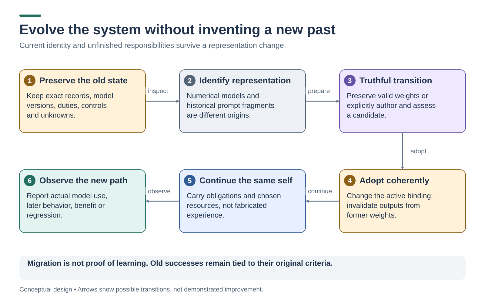

# Changelog

[Home](README.md) · [Decisions](DESIGN-DECISIONS.md) · [Source lineage](sources/SOURCE-MANIFEST.md)

*Read the arrows as possible, recorded transitions—not promises that a result will improve.*

The transition is a change of design target and explanation, not a new runtime experiment.

## 17 November 2026 — Owned numerical character and continual development

Reconciled the human requirements and conversation clarifications into one code-free design. Replaced operative character-fragment wording and the earlier assistant fine-tuning interpretation with each persona’s own numerical characteristic model, directly revised by persona-authored parameter changes.

Added a connected account of lifetime experience, causal interpretation, durable development questions, literal candidate edits, numerical identity, actual character use, appraisal applicability, comparative observations, coherent adoption and later benefits or regressions. Preserved useful no-change, explicit deferral and rollback rather than imposing age-based growth or edit quotas.

Separated identity, continual development, supporting context, collaboration and work into focused chapters. Retained all 45 previous active human IDs and the eight retired IDs, added UR-054 for the current understandable illustrated publication request, and preserved the 21 invariants, 45 implementation identifiers and 26/12/6 acceptance identifiers with changed meanings recorded explicitly.

Rewrote the active introductions, examples, contracts, status, source notes, glossary, contributor guide and optional worksheets around the same architecture. Included house, circuit, additional time/participants, skyscraper, printer and social-development examples, plus a concrete numerical illustration and ordinary-call sequence.

Replaced the obsolete active artwork collection with readable explainer SVGs and corresponding text. The visual guide indexes the current figures. The previous artwork and complete documents remain at the pinned predecessor rather than a competing active copy.

**Publication checks:** relative paths, heading anchors, required identifiers, diagram references and SVG rendering are checked as documentation properties. They establish neither runtime conformance nor useful maturation. Any outstanding publication limitation must be reported in the delivery rather than hidden here.

**No runtime change or new behavioral result:** this revision adds no application code, generated automated runtime test cases, provider-weight change, live-state migration or new persona trial. Source findings and repository-reported results remain bounded in the status and audit pages.

## Full earlier history

The complete earlier changelog is preserved at [revision 60fc268](https://github.com/ai-personas/ai-personas-design/blob/60fc268eea909ea2cfc4e91cf180c0020bde6ef1/CHANGELOG.md). Its entries, earlier failures, source inspections and limitations remain historical. The [manifest](sources/SOURCE-MANIFEST.md) also links the earlier consolidation stages and original supplied-source copies.
