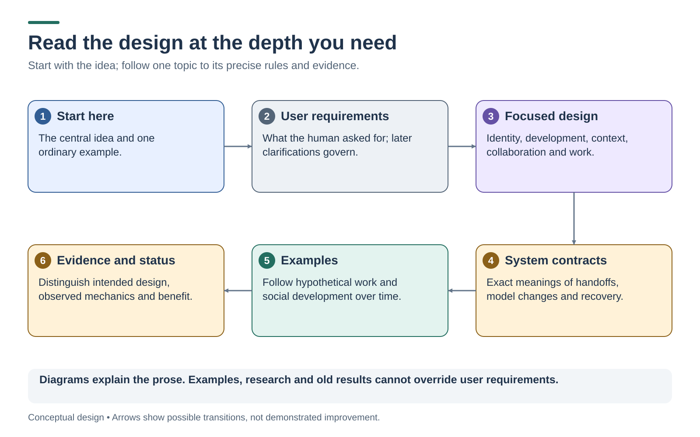

# Contributing to a coherent, readable design

[Home](README.md) · [Authority](design/README.md#authority-within-the-repository) · [Decisions](DESIGN-DECISIONS.md)

Contributions should help a reader understand the intended behavior without private conversations, implementation setup or earlier attachments. This repository is a design reference, not application code or an installation tutorial.

*Read the arrows as possible, recorded transitions—not promises that a result will improve.*

The reading path is not a persona workflow. Clear prose and an illustration must explain the same rule; neither should introduce an unnoticed new requirement.

## Preserve the actual product intent

Each general-purpose persona owns a numerical characteristic model. Its character influences substantive work and communication. Ordinary experience can motivate direct parameter revisions whose later effects must be observable. Do not replace this with role prompts, a fixed specialist team, a permanent manager or a mandatory training service.

Keep numerical character, appraisal, temporary affect, relationship interpretations, facts, skills and responsibilities distinct. A persona-authored resource is not automatically character. A model revision is not automatically improvement. Meaningful OCEAN/VAD descriptions guide origins without pretending to be validated psychological scores.

## Use one authoritative home

Follow the [design guide](design/README.md). Identity belongs in persona core; learning in continual development; resources in context and skills; cooperation in collaboration; fulfillment and effects in work and boundaries; exact handoffs in contracts. Traceability and evaluation refer to those homes instead of creating parallel rules.

When a rule changes, update its consequences across requirements, contracts, examples, acceptance, glossary and diagrams. Preserve old identifiers when their subject remains continuous. Record changed meaning and retain immutable historical criteria; do not reuse a retired identifier for an unrelated rule.

## Keep the repository code-free

Appropriate content includes plain-language rules, rationale, responsibilities, semantic record tables, lifecycle/failure explanations, hypothetical journeys, scoped research and accessible artwork. Keep application code, command tutorials, pseudocode, configuration samples, request/response payloads, executable validation scripts and branch-specific patch plans in the implementation project.

Do not add generated automated test cases or run runtime tests merely to fill an evidence category. Evaluation here specifies what actual evidence would support a claim. Static documentation and artwork checks concern publication quality, not persona conformance.

SVG files are editable artwork. Do not place diagram-source code blocks in the active prose. A mathematical explanation is acceptable when it is necessary, defined and accompanied by a plain-language interpretation.

## Explain for two audiences

Begin with the ordinary-language meaning and a concrete distinction. Then provide the exact contract, failures and evidence for readers implementing it. Define uncommon terms in the glossary. Avoid repeating long caveat blocks on every page; link the authoritative explanation while retaining locally necessary qualifications.

A diagram should answer a real question: who chooses, what changes, what stays separate, or what happens after failure. Use large legible text, clear arrow direction, labeled branches, generous spacing and a color-independent interpretation. Include descriptive alternative text and a nearby explanation. Inspect the actual rendered image; a syntactically valid SVG can still be unreadable.

## Review every consequential path

Check initialization, appraisal, ordinary work, retrieval, tool follow-up, communication, social activity, development, activation, rollback, repair, final response, waiting, stopping and restoration. Calling an operation a helper does not remove an ordinary persona decision’s responsibilities.

Every ordinary response explicitly covers current work, character maintenance, resource maintenance, next character state and next supporting context, plus continuation. No-change and suitable preservation remain legitimate. Silent omission, failure and host recovery do not count as authored decisions.

Model changes must preserve exact ownership, numerical lineage, whole-identity cache invalidation and fresh decision authority. Retained history must not become invented experience. Pending or uncertain effects cannot be replayed automatically.

## Preserve proportionality and autonomy

A small task does not need a team, an edit, a reviewer or a worksheet. A large task must not be narrowed to advice simply because an artifact is harder. Personas perform their own ordinary diagnosis, correction and integration; record external coaching as assistance.

No hidden semantic selector, task router, universal quality/maturity score or forced edit cadence is introduced. Honor UR-052 without discarding actual user controls, exact-state correctness or truthful accounting of external limitations.

## Cite and publish honestly

Tie factual claims to primary sources or exact project revisions with their scope and inspection limits. A paper about another system does not validate this architecture. A documentation rewrite does not rerun an experiment. Missing evidence is missing, not passed.

Verify relative links, heading anchors, image paths, identifier coverage, table readability and consistency of the complete reading path. Check the actual publication result before claiming it is live. Preserve prior source and result history through immutable Git links rather than a contradictory duplicate active tree.

Do not publish credentials, private live traces, session-only links, local database paths or unrelated personal information. Do not choose licensing or governance terms for the owner. Existing historical integrity claims apply only to their original bytes.
