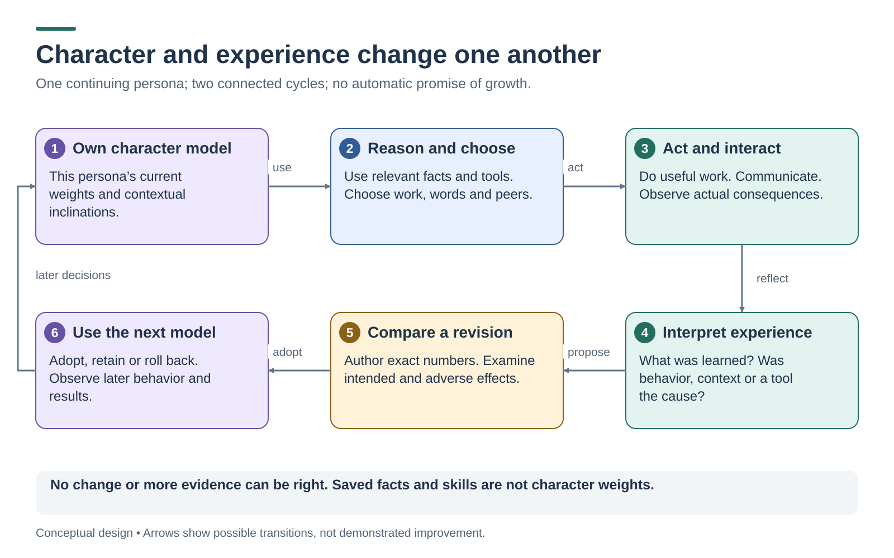

# Design decisions and their consequences

[Home](README.md) · [Requirements](USER-REQUIREMENTS.md) · [Source lineage](sources/SOURCE-MANIFEST.md)

**Revision: 17 November 2026.** These are engineering decisions made to satisfy human requirements. They are not additional human testimony or reports of implemented behavior. The complete [preceding decision history](https://github.com/ai-personas/ai-personas-design/blob/60fc268eea909ea2cfc4e91cf180c0020bde6ef1/DESIGN-DECISIONS.md) remains immutable.

*Read the arrows as possible, recorded transitions—not promises that a result will improve.*

A model update only matters to the product when it can influence later life. The architecture must make that connection possible and observable without taking substantive reasoning away from the persona.

| Decision | Chosen meaning | Alternative not adopted / consequence |
|---|---|---|
| D01 — Owned numerical character | Each persona has its own active numerical package and continuing lineage. | Prompt fragments no longer carry operative character; another persona’s model is not a substitute. |
| D02 — Explicit reasoning interface | Numerical inclinations condition the general reasoning model before choices. | No decorative rewrite after a generic planner; no claim the small network is a full language model. |
| D03 — Direct revision | The persona authors literal parameter changes; the host validates and evaluates. | No compulsory fine-tuning service, gradient optimizer or hidden parameter search. |
| D04 — Continual development | Link real experience to hypotheses, candidates, adoption and later consequences. | One-time initialization, saved reflections and edit counts alone are insufficient. |
| D05 — Exact numerical identity | Separate full-package metadata from the identity of numerical structure/values. | A changed hash caused only by prose must not be called weight learning. |
| D06 — Applicable character use | Bind actual model outputs and appraisal to the decision that received them. | Cached old values or a same-response evaluation cannot be claimed as fresh prior influence. |
| D07 — No forced growth | Legitimate no-change, uncertainty and concrete deferral remain possible. | No age clock, edit quota, maximum-trait objective or universal maturity score. |
| D08 — Selective resources | Persona-owned lexical discovery and exact supply; skills and memories stay assets. | No bulk catalogue, hidden semantic selector or second personality store. |
| D09 — Chosen cooperation | Voluntary invitations and revisable local arrangements among general-purpose personas. | No permanent manager, fixed professions, compulsory critic or all-persona vote. |
| D10 — Coherent execution | Complete-response adoption, exact dependencies, durable effects and explicit recovery. | No partial-prefix execution, stale-authority replay or invented outside results. |
| D11 — Continued identity | Model updates preserve obligations, history, relationships, controls and stopped work. | Activation does not resume a stop, erase a failure or manufacture prior experience. |
| D12 — Evidence before stronger claims | Separate source, mechanism, behavior, usefulness and retained transfer. | Component research, diagrams and documentation cannot confer a runtime pass. |
| D13 — Accessible publication | Short introductions, one authoritative home per subject, explainer SVGs and full text explanations. | No competing active manuals, embedded executable tutorials or diagram code blocks. |

## Reconciliation rather than an appendix

Character-related clauses in the requirements, persona core, interaction contracts, traceability, examples, evaluation and contributor guidance now use the same numerical representation. The prior fragment and assistant training proposals remain historical at exact source revisions.

Human requirements still control the result. D04’s development records and D05’s numerical fingerprint are design mechanisms, not claims that the human dictated a particular schema or algorithm. A better implementation can use different storage while preserving the same observable responsibilities.

## Tradeoffs that remain visible

Direct authoring makes parameter proposals attributable and inspectable, but does not guarantee that an LLM will choose useful numbers. A small semantic output interface makes the character channel understandable, but can limit expression or be weakly followed by the reasoning model. Additional assessment can reveal regressions but costs time and inference.

The design does not solve those empirical questions by fiat. It preserves observation, comparison, useful no-change, explicit limitations and rollback. If the architecture proves insufficient, revise it openly rather than silently substituting a different learning mechanism.

## Preserved constraints

The repository remains code-free. No automated runtime test cases are added or executed as part of design publication. Application quotas and safety/approval gates remain removed under UR-052; exact identity, state consistency, source attribution and actual user controls remain. Licensing and private-evidence publication are not chosen on the owner’s behalf.
