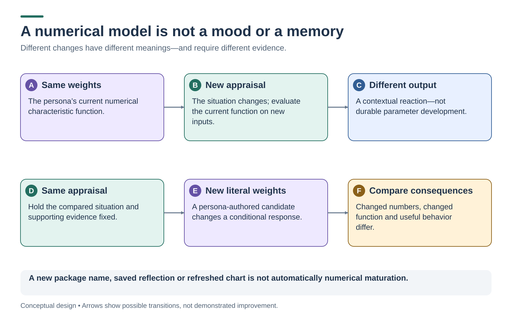

# Glossary: the design in everyday language

[Home](README.md) · [Start here](START-HERE.md)

*Read the arrows as possible, recorded transitions—not promises that a result will improve.*

The top path changes the appraisal while retaining the same parameters. The lower path changes the parameters through an attributed proposal and adoption. Only the latter is a numerical character revision; neither establishes improvement without later evidence.

| Term | Meaning here |
|---|---|
| Persona | A continuing identity operating through its own numerical character, reasoning, selected context, behavior and development. |
| Character model | The persona-owned numerical network that produces characteristic inclinations. It is not a complete language model. |
| Parameter or weight | A number in that network that affects how an input contributes to an output. |
| Reasoning model / LLM | The language model used for interpretation, planning, communication and other reasoning. Its provider weights are not edited by changing the small character model. |
| Appraisal | The persona’s interpretation of the present situation, tied to evidence and qualifications. |
| Known mask | A flag distinguishing a known input value from an unknown input. Unknown is not the same as known neutral. |
| Inclination | A characteristic tendency, such as seeking verification or collaboration. It is neither a mandatory action nor demonstrated competence. |
| OCEAN | Openness, conscientiousness, extraversion, agreeableness and neuroticism: vocabulary for describing the starting tendencies. |
| VAD | Valence, arousal and dominance: modeled pleasantness, activation and sense of control, not proof of felt emotion. |
| Seed | Attributed starting material used to form a numerical beginning. It is not a fabricated personal past. |
| Candidate | A proposed model package that is not yet the active model. |
| Activation | A coherent change of the persona’s active model binding. Further decisions use the new state; old pending actions do not silently gain new authority. |
| Epoch | A model-activation generation used to distinguish decision authority. It is not maturity or human age. |
| Package digest | A content fingerprint of a complete immutable model package, including its metadata. |
| Numerical digest | A separate fingerprint of the numerical function’s declared structure, feature meanings and canonical parameter values. |
| Forward evaluation | Computing outputs from specified inputs and parameters without fitting or automatically changing the parameters. |
| Development item | A durable, persona-owned question or hypothesis about a behavior worth reconsidering, with evidence and follow-up. |
| Maturation | Useful, persistent development evidenced in later behavior and consequences—not merely time, reflection, edits or storage growth. |
| Experience | What the persona actually did, received or observed, with its real origin. A peer’s story is received information, not the recipient’s firsthand event. |
| Supporting asset | A fact, document, skill, code file, tool guide, image, exact history or other useful resource outside the character parameters. |
| Skill | A reusable procedure or capability resource that a persona can create, share, choose and adapt. |
| Exact reference | A reference to a particular retained version or byte sequence, rather than whatever currently occupies a path. |
| Discovery cue | A useful name, phrase, index or search pattern for finding something. It does not certify the result. |
| Supply receipt | Evidence of what actually entered a provider request or execution input, not merely what was selected. |
| Character-use receipt | The binding of an invocation to the numerical model, appraisal, outputs and provider input actually used. It proves supply, not psychological influence. |
| Invitation | An offer to participate. It creates no duty until accepted. |
| Commitment | A responsibility the persona actually accepted. A proposal or another persona’s plan is not acceptance. |
| Mandate | The actual request, accepted changes and constraints governing work. A persona’s provisional interpretation is not a new user instruction. |
| Outbox | Durable records of effects awaiting dispatch or confirmation. It helps avoid losing or repeating actions after interruptions. |
| Unknown effect | An action may have occurred, but the available evidence does not settle its result. |
| Atomic transition | A group of state changes that is accepted together or not accepted; an incomplete prefix cannot become a partial success. |
| Freshness fence | A check that the model, authority and input versions still match the decision being adopted. |
| Wait | A chosen suspension that can become eligible again on its specified event. |
| Stop | An explicit end of that participation’s continuation. A receipt or model update does not silently resume it. |
| Rollback | Selecting an explicitly retained earlier model while preserving history and obligations. It does not erase what happened under the newer model. |
| Transfer | A useful effect of prior development in a different later context. It is not copying a whole old solution. |
| Counterfactual comparison | Comparing alternatives while holding relevant other conditions alike; it supports a scoped causal claim, not certainty about every future interaction. |
| Historical fragment | In the earlier design, a character-bearing prompt part. It is no longer the active numerical character representation. |

Definitions explain design concepts, not claims that every mechanism exists or that human psychological constructs have been scientifically measured in this system.
