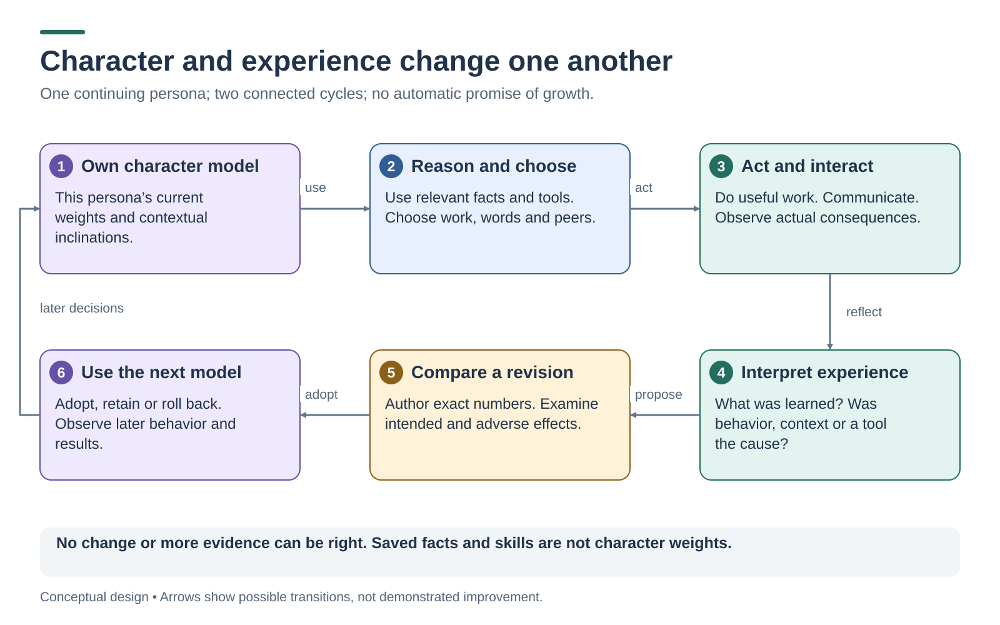

# AI Personas
## Distinct characters that do useful work and develop through experience

**Design revision: 17 November 2026. Design only; not a claim of a deployed, proven system.**

A persona should not be a fixed character description pasted onto otherwise generic answers. Each persona owns a small numerical **character model**: a set of parameters that influences how it reasons, works, communicates and collaborates. Its actual experiences can lead it to revise those parameters. Later work and relationships should reveal whether those revisions helped.

The important relationship goes both ways: **character influences experience; interpreted experience can change character; changed character influences what happens next.**

*Read the arrows as possible, recorded transitions—not promises that a result will improve.*

The upper cycle is ordinary activity: interpret the situation, choose resources and collaborators, act, and observe. The lower cycle is durable development: understand a consequential pattern, propose a justified numerical change, compare it with the current model, and follow an adopted change into later life. Neither cycle requires a permanent manager or participation by every available persona.

## Start with the right reading path

| You want to understand… | Read… |
|---|---|
| The idea without implementation terminology | [Start here](START-HERE.md) |
| What the user actually requires | [User requirements](USER-REQUIREMENTS.md) |
| The architecture and where each rule belongs | [Design guide](design/README.md) |
| How experience changes numerical character | [Continual development](design/CONTINUAL-DEVELOPMENT.md) |
| How the whole system behaves in concrete situations | [Worked examples](examples/WORKED-EXAMPLES.md) |
| What exists and what has not been demonstrated | [Evidence and status](implementation/STATUS.md) |
| The diagrams together, with explanations | [Visual guide](VISUAL-GUIDE.md) |

Unfamiliar words are defined in the [glossary](GLOSSARY.md). Every active chapter includes a relevant explainer diagram and a text explanation; color is never the only way to understand it.

## What is distinctive

**One characteristic model per continuing persona.** A shared reasoning service may provide language and general problem-solving ability, but it does not replace each persona’s owned numerical character. Another persona’s model is not silently substituted. The character network is not itself a full language model.

**Chosen cooperation.** In a population of ten, the addressed persona may work alone or invite two, three or more peers as useful. Invitees decide whether to participate. Coordination can emerge and change; there is no compulsory planner, critic, profession or team size.

**Development that reaches future behavior.** Saving a lesson, changing an appraisal, editing weights, changing a decision and improving an outcome are different achievements. The design connects them and keeps their evidence separate. Better communication can improve later task work; task experience can improve later social interaction.

**Useful end results.** Personas interpret sparse requests, obtain or create tools and skills, inspect their own results, correct problems, and deliver what the request actually needs. Ordinary progress must not depend on an outside agent continually diagnosing and repairing their work.

## What changed from the older design

The earlier repository made character-bearing prompt fragments the editable representation. An earlier assistant-produced PDF then proposed fine-tuning. The user’s later clarification instead requires **direct, persona-authored numerical parameter edits**. This revision integrates that choice throughout the active design. Prompt fragments are no longer the operative character store; a compulsory optimizer or fine-tuning service is not introduced.

Facts, history, code, tools, shared skills and explanations remain supporting resources. Their usefulness does not make them model parameters. See the [decision record](DESIGN-DECISIONS.md), [requirement reconciliation](examples/REQUIREMENTS-WALKTHROUGH.md), and [source lineage](sources/SOURCE-MANIFEST.md).

## What the evidence currently says

The inspected runtime feature revision contains parameter proposals, forward evaluation, comparative assessment, activation and rollback. Its published reports also describe main-task runs without organic post-initialization parameter updates. That supports a need to complete the development process; it does not prove that this revised design already works. Exact code references and report limitations are in the [runtime audit](sources/RUNTIME-AUDIT.md).

This publication changes documentation and artwork, not runtime code, provider weights, live persona state or historical results. There is no guarantee of improvement on every interaction, human equivalence or superiority on every task. The target is observable, useful, persistent development under the [acceptance criteria](evaluation/ACCEPTANCE.md).
