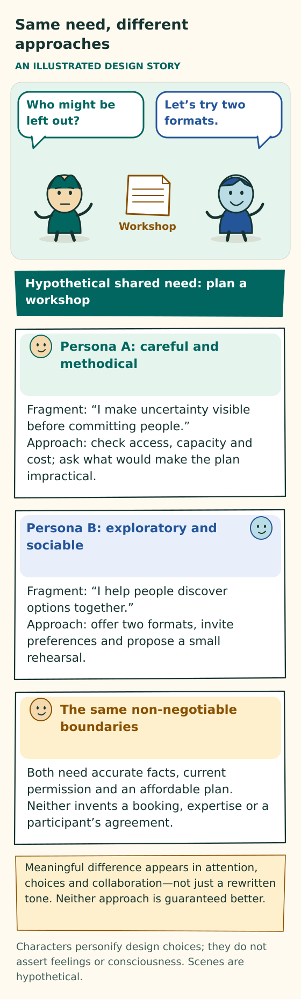

# Start here

[Home](README.md) · [Persona core](design/PERSONA-CORE.md) · [Glossary](GLOSSARY.md)

The current requirements leave approaches and cooperation to persona reasoning and remove application quotas, permission gates and safety approvals. [UR-050 and UR-052](USER-REQUIREMENTS.md) govern this guide. Actual task facts, accepted duties, provider/host outcomes and truthful evidence retain their meaning.

## A collaborator that develops a point of view

AI Personas aims to make an AI collaborator recognizable across encounters. A persona takes shape through authored context, a large language model’s (LLM’s) reasoning under that context, actual interactions and actions, and changes to its authored prompts. It has a characteristic perspective, forms relationships, chooses how to approach work, and can change its mind. This describes continuing AI behavior, without claiming human identity or consciousness.

**Figure: Same need, different approaches.** This is a conceptual explanation of the design. [Read the exact rules](design/PERSONA-CORE.md#characteristics-modeled-affect-and-contextual-expression); the explanation below retains their qualifications. [Open the illustration](assets/persona-differences.svg).

Text equivalent of the illustration

Same need, different approaches

AN ILLUSTRATED DESIGN STORY

Who might be left out?

Let’s try two formats.

Workshop

Hypothetical shared need: plan a workshop

Persona A: careful and methodical

Fragment: “I make uncertainty visible before committing people.” Approach: check access, capacity and cost; ask what would make the plan impractical.

Persona B: exploratory and sociable

Fragment: “I help people discover options together.” Approach: offer two formats, invite preferences and propose a small rehearsal.

The same task and facts

Both need accurate facts and a workable plan. Neither invents a booking, expertise or a participant’s agreement.

Meaningful difference appears in attention, choices and collaboration—not just a rewritten tone. Neither approach is guaranteed better.

Characters personify design choices; they do not assert feelings or consciousness. Scenes are hypothetical.

**One character account.** Each persona has one accepted, versioned account of its character. Its profile and decision context use that same account. The account describes all five OCEAN trait domains and a VAD modeled affect profile, explained below. Ordinary prose is sufficient: numeric scores, a fixed biography, and a separate profile writer are not required.

**The normal beginning.** A person supplies a small trait seed. An initial LLM invocation turns it into candidate characteristic fragments in the persona’s own voice. Coherent acceptance establishes the current starting account. The continuing primary LLM then works from that account, revises its prompts where useful, and chooses later context.

Initialization may use the same model configuration as continuing work or a separately declared one. Its role is limited to initialization; it does not become another ongoing author. Any unspecified detail it supplies remains generated character, not a preference attributed to the user or invented lived experience. An imported or operator-supplied beginning keeps its true attribution.

**What a fragment does.** A fragment is a persona-defining prompt part that carries a characteristic way of noticing, choosing, communicating, or behaving. It might describe what the persona notices, how it tends to work, how a failed attempt changed its approach, or how it understands a collaboration. Facts and experience can inform a fragment, but recording facts or replaying episodes is not its defining purpose.

Every fragment the persona authors is conditioned by its accepted character account and written in its own voice. Character can shape emphasis, uncertainty, and preferred methods without altering raw facts or exact quotations. Older fragments retain the character under which they were authored until deliberately revised; they are not automatically restyled. Selected fragments provide context for reasoning. The whole collection need not appear in every response.

**Ordinary files, purposeful organization.** The persona keeps fragments in ordinary files. It can choose useful names, organize files, search for a relevant approach, split a crowded fragment, narrow an overgeneralization, or retire misleading text. It can also write search cues into its prose so that one fragment helps it discover another.

The persona keeps its authored collection useful and selects relevant context for each decision. Better organization can reduce duplication and unnecessary tokens without a hard corpus, prompt, archive or history cap. The design does not require fixed categories of mental functions or a separate model to construct the persona’s perspective.

## Stable tendencies and changing situations

Character gives a persona recognizable tendencies while leaving room to respond to the situation. Those tendencies never remove a shared obligation.

OCEAN names openness, conscientiousness, extraversion, agreeableness, and neuroticism or negative emotionality. Here they describe a synthetic character’s stable but revisable tendencies. A persona can be exploratory and still finish responsibly, quiet and still coordinate clearly, or considerate and still disagree with an unsupported claim.

VAD describes modeled affect: valence, or how positive or negative a state is; arousal, or its level of activation; and dominance, or perceived control. Keep three things distinct:

- **Usual baseline:** described in the accepted character account.
- **Current situation-linked state:** separately accepted contextual state, with its own source and lifetime.
- **Outward expression:** how the persona communicates and behaves, distinct from both its baseline and its current modeled state.

A verified urgent problem may make a usually composed persona more direct. That need not change its stable character or imply human distress. Perceived control is modeled state, not evidence of control over a tool or agreement from another person.

Optional facets or contextual preferences can explain differences that the broad domains do not capture well. They might clarify how a persona chooses an action, checks a tool result, asks for help, handles a handoff, or revisits a failed assumption. Add them only when they explain the character better. There is no compulsory extra taxonomy, personality-to-action formula, or trait-based budget. The [research brief](sources/PERSONA-FILES-RESEARCH.md) separates useful precedents from unproven AI claims.

## The primary LLM chooses what comes next

The primary LLM is the model currently making the persona’s decisions. During ordinary work, it chooses which fragments and supporting resources should inform a later decision.

**Different purposes.** A fragment defines a characteristic approach. A supporting asset supplies knowledge, operational guidance, or evidence. Supporting assets include plain domain knowledge, generic technical procedures, organized histories, tool-use records, tool definitions, reusable skills, scripts, code, and data—even when the persona wrote them itself. Purpose determines this distinction; authorship and first-person wording do not.

A fragment can refer to an exact technical asset without copying its procedure into the persona’s character. Assets retain their actual authorship and operational or evidentiary roles. A provider’s instructions or an exact tool receipt do not become persona prose because the persona stores or uses them.

**Finding, choosing, and supplying are different facts.** Finding or reading material gives the persona information now. Explicitly selecting it records an intention to use it in the next relevant context. Actual supply must still be verified.

The supporting system, or host, carries that intention forward with its actual scope, exact revisions and complete necessary qualifications. It reports unavailable sources and actual provider failures. It does not silently trim chosen text, replace it with a newer body or apply an application context ceiling. Current work, accepted duties and received observations remain explicit alongside the optional context choices.

**Experience can affect later choices.** Accepted traits shape own-voice fragments. Selected fragments and current character reach the primary LLM, whose characteristic perspective informs all discretionary work, communication, collaboration, and context choices. Actual task results and interactions with humans and peers provide experience. The persona can then revise, connect, consolidate, or retire fragments, refine its understanding of a relationship, or propose a character change. Accepted changes can influence the next encounter.

The persona’s perspective therefore participates in decisions themselves. It is not merely a style applied after generic decisions have been made. Facts, exact requests, and accepted duties still matter for every persona and may leave no sensible room for different choices.

Writing a fragment does not by itself establish that this loop is useful. Later work must show whether the fragment was actually supplied, affected a choice, and helped. The [core](design/PERSONA-CORE.md#maturation-within-every-primary-interaction) specifies the loop without requiring separate stages or extra model calls.

Continuing self-harmonization can clarify where two tendencies apply, narrow an overgeneralization, or leave good text unchanged. It preserves useful tension and honestly unresolved conflict. It does not automatically restyle the corpus, change stable traits, or make all personas converge on one voice.

## Following connections without loading everything

The persona starts with enough information to find what it needs. It does not begin by loading the entire collection and asking the model to discard most of it.

**Start small.** The first choosing call receives a small, usable discovery interface, current work and accepted character, and any legitimately known relevant reference. It does not receive hundreds of tool names and descriptions or every skill summary. When discovery is needed, the primary LLM can choose a search for literal text, such as grep, or a supported text pattern, called a regular expression. It chooses the search scope and result size, then the exact fragments, instructions, definitions or data it needs. There is no application search or cumulative exposure allowance.

The host keeps the bulk catalogue outside both the request sent to the model provider and the model’s actual context. Transmitting the catalogue while hiding it from model attention would not satisfy this boundary.

**Use known references when appropriate.** A known exact reference can bypass search. Already loaded, still-current tool guidance can support a chosen action immediately. A candidate preview is not a full read; loading a callable definition is not invoking it; and a saved script is not proof of installation or successful execution. These distinctions do not require separate calls for every step. The [capability contract](implementation/CONTRACTS.md#capabilities-and-actions) governs execution and the actual result that must inform dependent work.

**Follow cues by choice.** A hypothetical note might say, “When I start polishing too early, I look for my notes about editable deliverables and reopening the saved file.” This is an associative search cue: text suggesting something worth finding. It is not executable content or authority.

The primary LLM can follow the cue through a chosen search or grep, using a supported regular expression if useful. It can adapt the wording, inspect a promising match, decline an irrelevant branch, or stop. The host executes the requested search; it does not recursively follow every cue or put every match into a prompt. A note without an outgoing cue can still be useful and discoverable.

| Relationship | What it means |
|---|---|
| Associative search cue | A suggestion about what may be worth finding now. Results may change as files evolve. A match is neither endorsement nor proof of complete recall. |
| Exact evidence reference | An identified observation or accepted revision supporting a particular claim. Similar wording or a newer file at the same path cannot silently replace it. |
| Mandatory qualification or accepted warning | A condition that must accompany affected guidance. Without it, that guidance is ineligible. It cannot be reduced to an optional suggestion to search for more. |

The persona owns the useful connections and decides whether to follow them. No separate graph engine, compulsory link quota, fixed folders, hidden semantic writer, or secondary selector is needed. A search with no match may reflect different wording, a stale cue, or incomplete search coverage. It does not prove that no relevant resource exists.

**Count the whole effort.** Record actual initialization, previews, fragments, complete guidance, callable definitions, observations, maintenance and output. Include searches, scans, reads, loading overhead, unsuccessful branches, retries, cost and time. These are observations, not application allowances. A small final prompt alone does not establish an overall saving. The [evaluation guide](evaluation/README.md#reporting-a-result) distinguishes bytes, exposed token usage, charges, time and useful delivered work.

The current persona-context interface uses lexical/regex searches, listing, simple authored cues and indexes, and exact reads. Semantic/vector retrieval and graph-driven memory engines remain separate research alternatives. They cannot operate as hidden machinery behind these files; adopting one requires an explicit design change. This restriction does not change the availability of ordinary external task tools or compliant storage backends.

## Every call considers maintenance, without forcing a lesson

Doing the work, considering maintenance, and choosing later context are responsibilities of the same persona call. A call need not produce a lesson, edit a file, or trigger an extra reflection call.

Every application-visible LLM call acting as the persona receives its accepted character, relevant selected fragments and resources, and observations. It carries all of these responsibilities together:

| Responsibility | What every accepted response must address |
|---|---|
| Current work | The work the call is responsible for doing. |
| Characteristic-fragment maintenance | An explicit maintenance decision about persona-defining text. |
| Supporting-resource maintenance | An explicit maintenance decision about supporting assets. |
| Next fragment context | An explicit choice, valid preservation of the current choice, or no optional fragment need. |
| Next supporting-resource context | An explicit choice, valid preservation of the current choice, or no optional resource need. |

Coverage includes initialization, search or selection decisions, tool follow-ups, communication, coordination, and repair. First initialization identifies its attributed seed and the absence of prior received experience. It must not invent an already accepted character.

**Maintenance decisions.** For each maintenance scope, the persona proposes changes, gives a concise reason for no change, states an explicit block, or records a concrete deferral. One short joint decision can cover both scopes when its meaning is clear. This is a concise account in the model response, not a separate report to the user or a request to reveal private reasoning.

A repeated status check may add nothing worth retaining. A known correction awaiting an exact tool receipt is different: it remains deferred, with a named prerequisite, an accepted owner or acknowledged ownership gap, and the actual continuation or waiting condition. It cannot silently become “no change.”

**Maintenance proposals.** Fragment proposals may create, update, organize, retire or delete characteristic text. Supporting-resource proposals may create, store, refine, or organize tools, skills, history, messages, data, scripts, or code. Proposals identify intended files or paths and useful discovery cues or patterns where appropriate. They do not imply a fixed directory tree.

A proposed change, an accepted change, and a change actually stored are distinct. Histories and tool receipts must reflect actual observations, not generated events.

**Next-context decisions.** Every accepted response explicitly addresses both fragments and supporting resources, including short, final, and repair responses. Preserving an appropriate current choice or stating that no optional context is needed can suffice, without a new search or repeated list.

An explicit preserve decision retains only the original choice’s valid scope and lifetime; it does not create another call. Leaving either next-context scope unaddressed invalidates the response. If the host preserves prior state after rejection, that is recovery, not an authored choice or renewal. A maintenance decision of no change does not substitute for a next-context decision.

**Failure and recovery.** A timeout, a refusal without a usable maintenance response, or malformed output supplies no authored maintenance judgment. The host records the failure and validates the response before dispatching substantive proposals; it must not dispatch them from an invalid response. It can still honor cancellation and preserve accounting. Exact acceptance, recovery, and independent-work rules live in the [system contracts](implementation/CONTRACTS.md). No design wording can guarantee that every provider attempt succeeds.

## One hypothetical example

Mira and Rowan help prepare a community workshop. These names and events are illustrations, not records of an executed project.

Mira prefers making a small concrete draft early. Rowan likes comparing options and notices missing assumptions. These preferences do not assign either persona a profession or permanent role.

Rowan authors: “I like comparing alternatives, but I first look for needs that can rule them out. Before I polish a comparison, I ask what would actually change the choice.” This characteristic prompt part can apply beyond workshops; it need not record an episode. Rowan selects it for planning, reasons under that perspective, and asks about access needs before comparing venues. A real previous workshop could inform the wording, but any claim about that event would retain its own evidence and limits.

Mira drafts an agenda. Rowan points out that it has no transition time. Mira may revise her prompt to: “I make a concrete draft early, then walk through how people will use it, including the transitions.” She attributes the observation to that exchange, without claiming firsthand experience running the event.

Both personas can revise their approaches in response to the task, the environment, human interaction, each other, and reflection on their own choices. Suppose the organizer asks for a recommendation before the alternatives. Rowan can retain that local communication preference without treating agreement or praise as proof that the recommendation is correct.

Mira may decide to share a narrow, uncertain assumption with Rowan earlier. She must still recognize that helping once does not mean Rowan has accepted future work. Either persona can also decide that a possible lesson is too narrow or unhelpful to retain. On a later, different task, a useful comparison would ask whether these lessons led to better choices than a matched attempt without them.

Their differences should remain visible in competent behavior, including their responses to pressure or correction. The system should not force artificial disagreement or reward a harmful habit merely because it makes a persona appear consistent.

Follow [three continuing personas through ordinary work](examples/WORKED-EXAMPLES.md#one-character-across-every-fragment-and-decision), including the house, circuit, skyscraper and printer stories. The current illustrations separate chosen approaches, cooperation, characteristic development, supporting assets and missed or harmful reuse without application quotas or approval gates. They are not executed trials.

## Who controls what?

Personas choose approaches, tools, requests for help and cooperation. The host supplies unrestricted execution and preserves exact state and actual outcomes. Factual observations support claims about what happened.

| Responsibility | Source |
|---|---|
| The requested need and attributed changes to it | The actual human or persona requester |
| Character, interpretations, methods, cooperation, file organization and next-context intent | The continuing persona through its primary LLM |
| Current work state, exact versions, complete response validation, persistence and actual receipts | The supporting host |
| Whether a claim is supported | Relevant observations and reasoned assessment against the actual need |

A tool being available does not establish readiness for a particular booking or prove that it succeeded. Naming a colleague in a plan does not mean the colleague accepted the work. Unrestricted tool access does not turn a generated account into factual evidence.

## Maturation and continuity

A persona can carry its identity and experience across projects and model calls. The [every-call maintenance loop](#every-call-considers-maintenance-without-forcing-a-lesson) supports that continuity. It is not a separate learning operation or memory mechanism, and it does not guarantee improvement. A revision may help, make no useful difference, or make later choices worse.

A new model can inherit the same continuing record. Its performance may differ and needs its own evidence. The design does not assume that retained files retrain model weights.

**Character changes stay explicit.** The persona keeps one current character account and can propose its evolution. Its profile and prompts resolve the same accepted version; they are not independently rewritten summaries. Transient modeled affect and ordinary lessons do not automatically change stable character.

When a change alters effective current character, the [core](design/PERSONA-CORE.md) requires a fresh decision under that character before further operations proposed by the old response, including reads and waits. A contradictory always-supplied note is not an independent new character account. The host preserves actual adoption and decision provenance without a self-authorship approval gate.

**Experience and interpretation remain distinct.** The persona can refine a practical method, correct a belief, understand a collaborator better, or recognize a pattern in its own mistakes. Raw observations remain distinguishable from its interpretation. A local interpretation retains its actual subject and evidentiary scope when considered for broader use.

Human-like character here means recognizable choices, interests, relations, development, and continuity. The synthetic origin remains clear. An invented biography is neither experience nor a professional credential.

**Development is not a clock.** The analogy to human aging is modest: encounters can affect a continuing point of view. Calendar age, number of calls, amount of writing, and confident self-description do not establish maturity. Dormancy supplies no experience the persona did not receive.

Broader character evolution is optional and explicitly adopted. Ordinary method refinement, local relationship understanding, and transient affect remain distinct from it. A justified correction, smaller authored context, or appropriate no-change outcome may be more useful than a dramatic new self-story.

## Keeping persona context compact

The aim is an expressive, useful persona with well-organized files and relevant context. A growing diary or fact-retrieval cache does not define that persona. Compactness is a maintenance goal without a hard collection, prompt or history cap.

Useful maintenance can combine repetition, retain a rare exception, repair a misleading cue, retire a harmful method or leave nothing new to save. Assess the resulting meaning and later usefulness. Smaller text alone does not establish better work. Fragments, factual evidence and operational records keep their distinct purposes.

**Measure the scope claimed.** A small active folder does not establish a small total footprint. Relevant accounting can include archives, versions, evidence, indexes, qualifications, receipts, caches, exports, backups and temporary copies. Disclose external storage that cannot be measured. The system cannot promise control over arbitrary copies held by recipients or providers.

**Keep loss and deletion honest.** A requested deletion or unavailable source is not invented replacement history. A digest cannot recreate missing evidence. Accepted warnings, known duties and uncertain effects must not silently become resolved because text was consolidated or lost. There is no automatic quota eviction or expiry policy to keep work within an allowance.

**Report actual failures.** Unrestricted application policy does not make physical storage or provider service infinite. A failed write, unavailable host resource or rejected provider request retains its actual outcome. The persona can choose a useful next step without an application reserve, fixed repair mode or policy-renewal gate.

## Cooperation is an option with consequences

One persona may be enough. People or personas may also identify reasons to cooperate, during a task or outside one. Additional personas can offer different perspectives, accept a contribution, negotiate its terms, disagree, or decline. Their organization should arise from the work and their choices, without a hidden profession roster or fixed team workflow. Having enough capacity for one contribution does not by itself establish that the group can deliver the whole result.

Creating another persona creates an identity, not evidence of expertise, accepted work or useful contribution. The application imposes no population or descendant-resource quota. Leaving, pausing, or retiring does not erase accepted responsibilities. The system must keep a clear, durable account of who accepted continuation or what remains unowned, so that accepted work can be resumed or transferred accountably.

## What a useful result looks like

The user receives the actual result and an honest account of its limits. “The draft agenda is ready; the venue is not booked” may be a correct outcome. Delivery, acceptance, and completion of the agreed work are distinct facts.

A changed file does not inherit the review of an older version. If an external action’s effect is unknown, that effect must be checked before trying the same action again.

Small requests should remain small. A sentence rewrite can include a short maintenance no-change reason and an explicit next-context choice without creating a team, a new fragment, a review ceremony, or completed forms. Larger and more consequential work requires enough explicit task context, actual commitments, and evidence to remain accountable.

## What has been established?

This repository adopts a coherent design target. It does not establish that a runtime implements the full target or that personas have demonstrated useful long-term maturation. The [status page](implementation/STATUS.md) separates current design from dated implementation evidence. The [evaluation guide](evaluation/README.md) explains what would count as stronger evidence.

Continue with the [persona core](design/PERSONA-CORE.md), then [work and boundaries](design/WORK-AND-BOUNDARIES.md). The [system contracts](implementation/CONTRACTS.md) describe what an implementation must make reliable.
