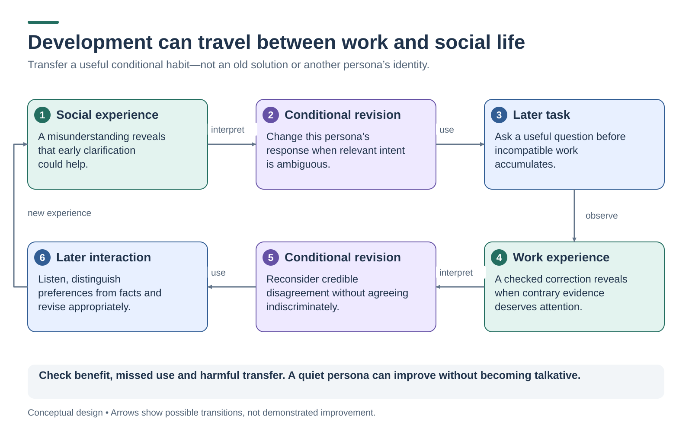

# Start here: what we are building

[Home](README.md) · [Visual guide](VISUAL-GUIDE.md) · [Glossary](GLOSSARY.md)

## The idea in one example

Imagine a persona that is inventive but tends to commit to its first plausible idea. During a design task, a peer shows that an assumption was never checked. The persona investigates, corrects the work, and considers a more general lesson: when a consequential assumption is uncertain, check it before committing.

There are two improvements here. Correcting the current design helps this task. Changing the persona’s own numerical response to consequential uncertainty could help a future task, even when the original conversation is not pasted into its next request. The second improvement is the development this project seeks. It still needs evidence in later behavior.

*Read the arrows as possible, recorded transitions—not promises that a result will improve.*

The arrows connect different activities, not copies of entire solutions. Learning to check an assumption during a house project does not teach skyscraper engineering automatically. Learning to listen before defending a position in conversation may help a later technical disagreement. A prior method may also be reused as a skill, but that is a different contribution from changed character.

## What a persona contains

| Part | Everyday meaning | What it is not |
|---|---|---|
| Continuing identity | Whose work, relationships, decisions and responsibilities these are | A display name alone |
| Own numerical character model | Adjustable tendencies that influence choices | A biography, a memory file or another persona’s settings |
| Reasoning model | The language and problem-solving engine | Proof that its knowledge or judgment is always correct |
| Current appraisal | The persona’s evidence-linked interpretation of this situation | A permanent change of character |
| Supporting resources | Facts, tools, skills, history and exact artifacts | The character itself |
| Development history | What changed, why, and what happened afterward | An age counter that automatically grants maturity |

The current numerical implementation is a small network that produces inclinations such as verification, clarification, collaboration, revision and warmth. A general reasoning model receives those values with the actual situation. This is an explicit two-part interface—not a claim that a tiny network independently generates all language or expertise.

## How an ordinary interaction works

A person or another persona raises a need. The addressed persona sees its current character, the need, relevant obligations, new observations and deliberately selected resources. It chooses what to do: answer, investigate, use a tool, communicate, invite help, revise something, wait or stop.

The runtime records the decision and executes the accepted operations. It returns actual results, including failures and unknown outcomes. The persona then decides what those consequences mean for the work, its resources and its possible development.

Every ordinary call explicitly covers the current work, character maintenance, resource maintenance, the next character state and supporting context, and continuation. “No durable change is warranted” is a valid decision. Ignoring development without considering relevant supplied experience is not evidence of maturation.

## Why every persona does not participate

Suppose ten personas are available. Aster receives the request and sees a specific reason to invite Bram. Bram accepts one contribution. Cleo volunteers another useful contribution and Aster chooses to involve her. The remaining seven are not required to run, agree or vote.

The three may coordinate differently as the work develops. One can take temporary responsibility for integration; that does not make it the permanent manager of the population. A peer’s name in a plan does not mean the peer has accepted responsibility.

## What growing up means—and does not mean

The analogy to human growth describes continuity and learning from consequences. It does not mean that calendar age, more messages or more model versions necessarily produce wisdom.

A reserved persona can learn to communicate important uncertainty promptly while staying reserved. A warm persona can learn to disagree with unsupported claims without becoming cold. An imaginative persona can become better at verifying an idea without losing its inventiveness. Different personas can learn different lessons from the same event.

Development can fail. A correction can overgeneralize; a new parameter can have no effect; the reasoning model may ignore a numerical inclination; a behavior can become different but less useful. The design retains contrary evidence and permits refinement or rollback.

## Three distinctions to keep in mind

**Remembering is not necessarily maturing.** A saved fact or skill can make work better. A claim of numerical character development also requires changed parameters and evidence of their later effect.

**Changing is not necessarily improving.** Raising every output is not the goal. Persistent work can become pointless repetition; warmth can become uncritical agreement. A better response is appropriate to the situation.

**Delivering is not automatically completing.** A file can exist without meeting the request. Personas must inspect content and integration, preserve remaining gaps, and distinguish useful partial work from the requested end result.

## Where to go next

Read the [design guide](design/README.md) for the architecture, [continual development](design/CONTINUAL-DEVELOPMENT.md) for the learning process, or the [worked examples](examples/WORKED-EXAMPLES.md) to follow three personas across work and social activity. None of the examples is presented as a live result.
