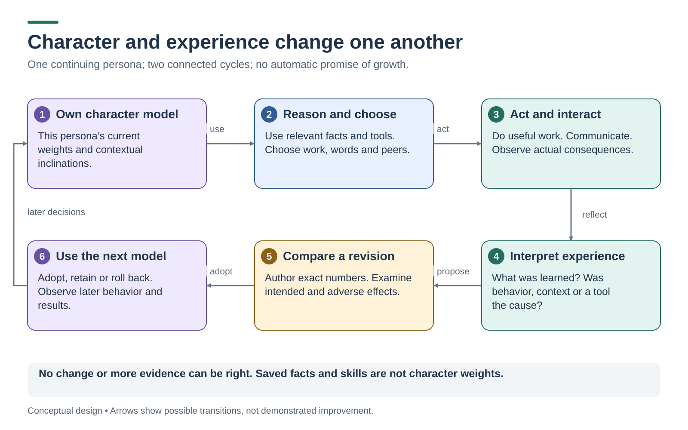
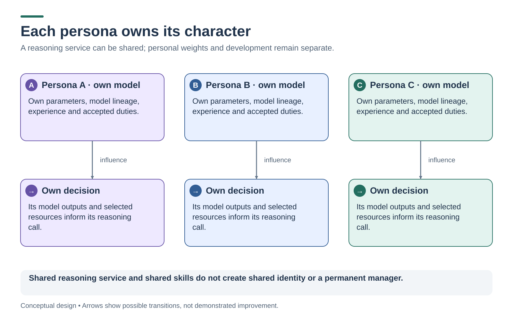
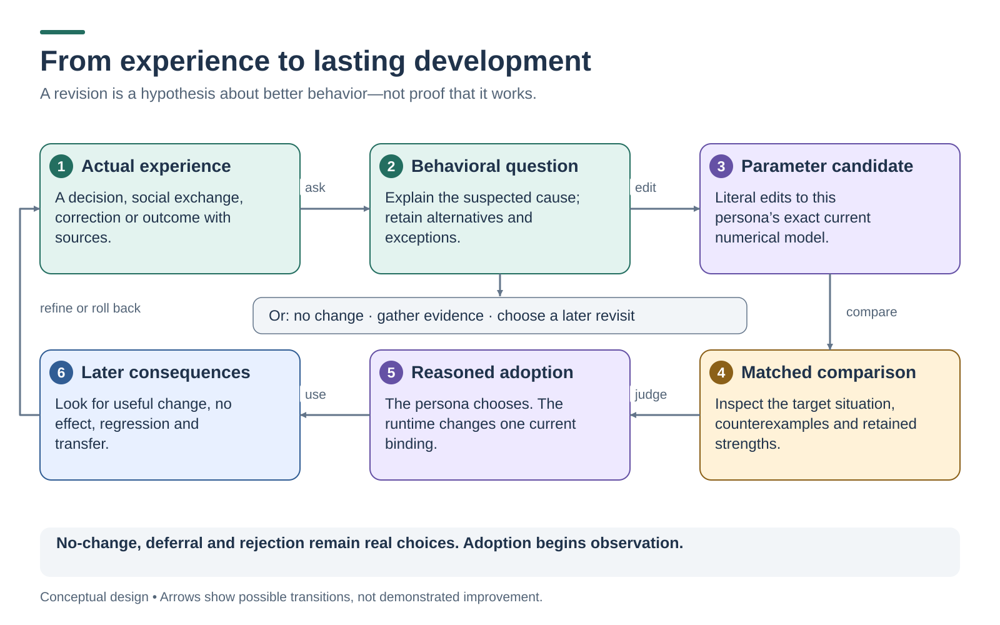
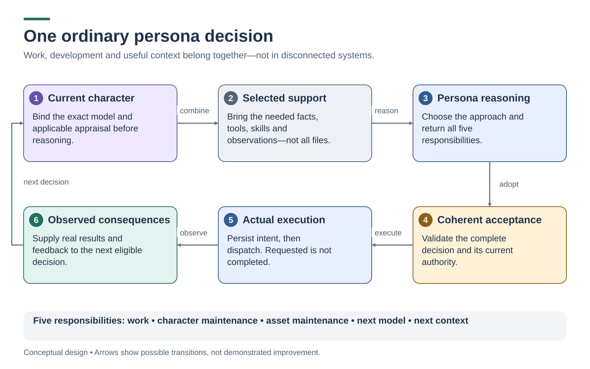
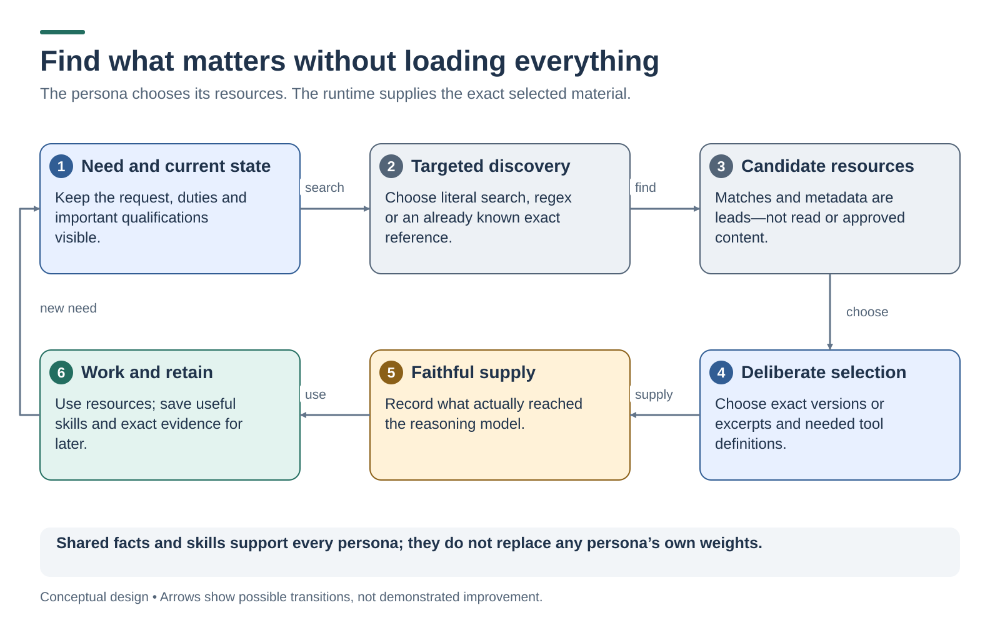
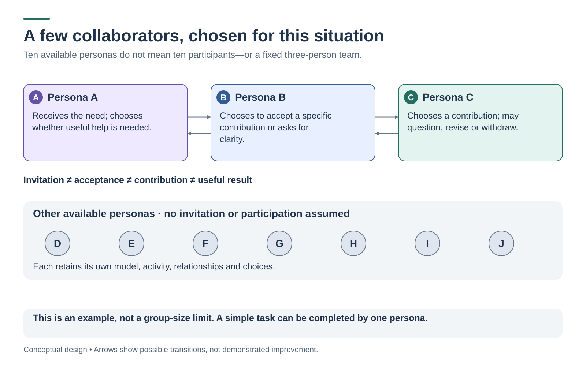
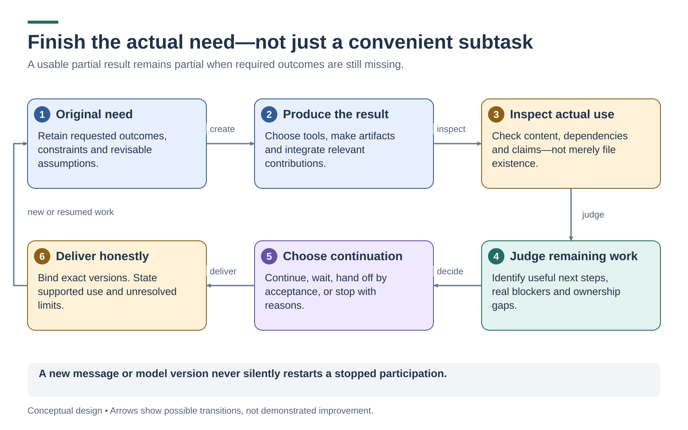
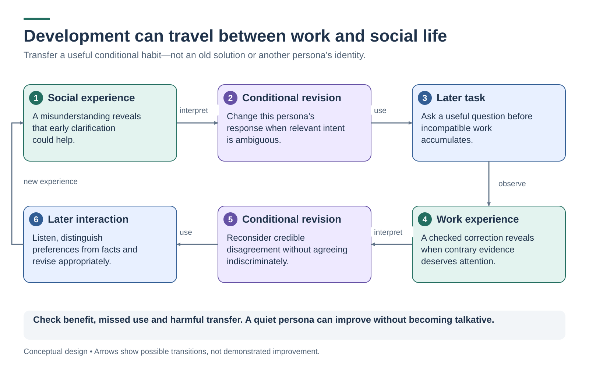

# Consolidated user requirements

[Home](README.md) · [Plain-language introduction](START-HERE.md) · [Traceability](examples/REQUIREMENTS-WALKTHROUGH.md)

**Consolidated 17 November 2026.** This file records human-requested outcomes, including the later clarification that each persona owns a small numerical characteristic model whose parameters are directly revised through experience. It does not turn assistant implementation suggestions into human requirements.

## Core intent

A population of continuing, distinctive, general-purpose personas should do useful work and interact socially. Each persona’s own numerical character influences its choices. Experiences from work and social life can lead it to revise that character; the revisions should improve later work and interaction while preserving individuality. Cooperation is dynamically chosen, not a fixed specialist team or permanent central manager.

## How later clarifications change the earlier wording

The original identifiers remain for traceability. Character-bearing **prompt fragments** are superseded as the operative character representation. The earlier assistant proposal of a compulsory fine-tuning service is also superseded by direct numerical editing. Supporting files, history, skills and tools remain useful and separate. No-change remains a valid decision, but a permanently static initial model cannot demonstrate the requested maturation.

The preceding [exact requirement revision](https://github.com/ai-personas/ai-personas-design/blob/60fc268eea909ea2cfc4e91cf180c0020bde6ef1/USER-REQUIREMENTS.md) preserves the older wording. UR-054 records the current request for accessible illustrated publication. There are **46 active human requirement identifiers** and eight retired identifiers; retired identifiers are not reused. Mechanisms and evidence standards proposed to satisfy these outcomes live in the design and implementation chapters, not disguised as new user instructions here.

## Purpose and publication

*Read the arrows as possible, recorded transitions—not promises that a result will improve.*

### UR-001 — Design before implementation

Keep this repository design-only. Publish an implementation-ready explanation; runtime application code belongs in its implementation repository.

### UR-002 — One coherent design

Reconcile the repository, relevant prior design material and later human clarifications into one design. Update affected explanations, contracts, examples, evidence criteria and diagrams together; do not append a competing manual.

### UR-003 — General-purpose, human-like personas

Support human- or persona-originated needs of many kinds, including tasks, tools, communication, collaboration, self-directed activity and social interaction. Distinctive character must influence the activity itself, not only final wording. Human-like describes an intended behavior, not consciousness or human equivalence.

### UR-035 — Deliver a robust and reliable blueprint

Provide a coherent explanation detailed enough to guide implementation of the intended behavior. Keep unresolved engineering or empirical questions explicit. A written design cannot truthfully establish 100 percent reliability or replace working evidence.

### UR-054 — Publish an understandable, illustrated design

Reconcile the requirements in this conversation and repository, explain the core intent for non-specialists, provide clear explainer diagrams throughout the active design documents, and publish the coherent revision in ai-personas-design. Diagrams must agree with the text rather than conceal missing mechanisms.

## Persona identity and its own model

*Read the arrows as possible, recorded transitions—not promises that a result will improve.*

### UR-004 — Start with an attributed persona profile

Use meaningful starting descriptions, including OCEAN traits and VAD modeled affect. Preserve the real author and source. The descriptions guide the persona’s numerical beginning; they are not invented lived experience or compulsory personality scores.

### UR-005 — Create the persona’s own initial model

The initial reasoning interaction turns the attributed starting profile into that persona’s own numerical characteristic model. Later development continues that identity rather than recreating it from the seed. This replaces initial character-fragment authorship.

### UR-006 — Character is carried by owned numerical parameters

Each persona has its own characteristic model and parameters. Those parameters must influence characteristic behavior; a different label, descriptive file or model endpoint is insufficient. Another persona’s parameter state must not be silently used as this persona’s character. This replaces fragments as the operative character representation.

### UR-007 — Explain the complete operating persona

Explain how continuing identity, its own character model, reasoning, selected supporting context, actual behavior and development work together. Character must influence choices before actions, not decorate an already generic decision. The design must make the role of the persona model explicit rather than relying on a model name or descriptive profile.

### UR-008 — Preserve individuality throughout development

From its beginning onward, each persona’s characteristics must shape attention, methods, tools, communication, collaboration and initiative. Its behavior should develop while remaining recognizably its own. More or less communication can both be appropriate; do not force identical personalities or artificial disagreement.

### UR-009 — Separate character from memory and knowledge

Keep character parameters distinct from factual memory, domain knowledge, procedures, histories and relationships recorded as supporting information. Saving or recalling an experience is not by itself numerical maturation. The older word fragment remains historical terminology, not a renamed memory or weight store.

## Development through work and social experience

*Read the arrows as possible, recorded transitions—not promises that a result will improve.*

### UR-010 — Develop through ordinary persona-authored numerical revision

Work, communication, feedback and self-directed activity must be able to motivate direct edits to the persona’s own parameters through its ordinary reasoning. Do not replace this with a mandatory independent optimizer, gradient-training service or prompt-only learning mechanism. Justified no-change is legitimate; creating the initial model once does not fulfill lifelong development.

### UR-025 — Let all kinds of experience inform development

Tasks, environmental consequences, human and peer communication, social activity and self-directed activity can motivate changes to the persona’s numerical character. Their effects should continue across later work, not vanish at a task boundary. Supporting resources may improve separately.

### UR-026 — Maturation affects the whole persona

Development should improve how the persona judges, behaves, communicates, cooperates, organizes resources and works over its lifetime. Keep stable tendencies, temporary modeled affect and knowledge distinct. Growth is not simply a change of tone or an age label.

### UR-027 — Demonstrate better later behavior and work

A developed persona should use warranted changes to perform later work and interactions better than its earlier self. Connect numerical change to actual subsequent behavior and useful consequences; distinguish resource reuse and stronger tools. Do not force edits to create an appearance of progress or guarantee improvement on every turn.

### UR-028 — Examine useful, limited transfer

Examine which prior behavioral development, methods, tools and resources help a new task. Solve the new task on its own terms. The user does not require complete transfer of an earlier domain solution.

## The ordinary interaction

*Read the arrows as possible, recorded transitions—not promises that a result will improve.*

### UR-015 — Integrate work and self-maintenance in every interaction

Every ordinary persona request and accepted response covers current work, character maintenance, supporting-resource maintenance, next character/model state and next supporting context. These responsibilities apply to communication, retrieval, repair, social activity and final responses as well. A reasoned no-change or explicit preservation can be sufficient.

### UR-016 — Support the full range of maintenance

Allow warranted character revision and the creation, revision, reorganization or retirement of supporting resources. Preserve the distinction between numerical development and resource improvement. A failed attempt must not be reported as an accepted change.

### UR-018 — Let this interaction prepare the next

The persona chooses what character/model state and relevant resources the next interaction needs and how to find them. Useful context must survive handoffs, while obsolete material can be left out. This is an explicit choice, not a hidden host summary or automatic full-history replay.

### UR-051 — Use direct model-provider interfaces

The runtime calls providers directly for inference. It does not depend on the Codex CLI to reason as personas or orchestrate their work. An authentication helper, where used, is distinct from persona reasoning.

## Dynamically created and shared skills

UR-053 extends the same discovery and reuse process to skills created by personas, rather than a closed developer catalogue.

## Supporting resources and shared skills

*Read the arrows as possible, recorded transitions—not promises that a result will improve.*

### UR-011 — Keep supporting assets separately identifiable

Knowledge, data, tools, skills, guides, scripts, code, messages, action records and useful resources remain assets even when persona-authored. Their authorship does not turn them into character.

### UR-012 — Retain useful resources for later work

Store and organize acquired or produced resources so later work can discover and reuse them rather than reconstructing everything. Retain actual provenance and limitations.

### UR-013 — Give retained material a location and discovery cues

Resource proposals identify an intended path or exact reference and useful literal-search or regular-expression cues. Model proposals identify their owner, exact numerical base and candidate lineage. A proposal is not proof of persistence.

### UR-014 — Compose the relevant kinds of context

Supply current characteristic outputs together with the actual need and relevant supporting facts, tools, skills, data and history. Keep their purposes and provenance distinct; do not reload obsolete character prose as a competing source of identity.

### UR-019 — Use simple files and searchable references

Prefer ordinary organization, files, exact references, filesystem-style listing, literal search and regular expressions over unnecessary retrieval machinery. Resources may link to related resources without loading their entire network. Numerical model packages are distinct, versioned artifacts rather than prompt fragments.

### UR-020 — Discover every relevant resource type selectively

Apply deliberate discovery to tools, skills, knowledge, data, history and model/development records. A useful search cue may originate in the current reasoning or a retained resource; a match is not automatic endorsement.

### UR-021 — Select before loading the next context

Do not send the whole tool catalogue, skill collection or lifetime history to a model merely so it can filter it. The persona chooses targeted discovery and relevant exact material before a later reasoning request.

### UR-022 — Avoid unnecessary context and cost

Minimize wasted context and repeated work without application quotas. Examine complete activity, including discovery, maintenance, assessments, failures and retries, before claiming efficiency or savings.

### UR-023 — Keep current organization and context compact

Keep current model descriptions, development records and supporting resources coherent and navigable. Consolidate unnecessary duplication without silently erasing evidence, obligations or user deliverables. Compactness is not a fixed retention or prompt ceiling.

### UR-024 — Keep discovery useful as the persona changes

Maintain paths, indexes, cues and exact references as resources move, merge or retire. Useful earlier material must remain discoverable where retained. Accumulating unused files alone does not satisfy this requirement.

### UR-053 — Let personas create, share, choose and adapt any kind of skill

Personas can develop skills during work and publish them in a common discoverable location. Others may choose and adapt them. The collection is not restricted to developer-supplied skills or to one domain. Skills remain assets; each persona’s own character guides their selection and use.

## Persona-chosen cooperation and society

*Read the arrows as possible, recorded transitions—not promises that a result will improve.*

### UR-048 — Examine an ongoing society of personas

Include task-based and unassigned social activity over time. Examine how continuing interactions affect relationships, character and later useful work. Social activity must be able to inform work and work experience must be able to inform social behavior.

### UR-050 — Let personas choose how to work and collaborate

Personas choose methods, tools, invitations, reviews, coordination and contributions. Do not impose permanent professions, a central manager, a fixed team pipeline or participation by the whole population. Invitees choose whether to join. Ordinary work, diagnosis, repair and completion must not require continuous external coaching.

## No application limits or safety gates

UR-052 below governs application-imposed limits. Correctness, truthful recording and explicit user controls remain distinct from safety or quota gates.

## Useful work, quality and continuation

*Read the arrows as possible, recorded transitions—not promises that a result will improve.*

### UR-044 — Examine sustained purposeful work

With more available time, examine whether continued individual or group activity improves the requested artifact, the persona and cooperation. Time permits further choices; elapsed time itself does not establish progress.

### UR-045 — Explain when to continue or stop

Ground continuation and stopping in the actual need, result, opportunities, dependencies and remaining useful work. Do not substitute an arbitrary round limit or silently stop with an incomplete result labeled complete.

### UR-046 — Clarify sparse requests and still make progress

Ask useful questions of the user or stakeholders. When an answer is unavailable, seek peer input or proceed with explicit revisable assumptions where possible. Distinguish an unanswered preference from indispensable outside information.

### UR-047 — Let reflection and dialogue shape sufficiency

Personas should question themselves and one another, revise or retain work for reasons, and judge current sufficiency in their own characteristic way. A result can be delivered now and revisited through a later voluntary activity. Participants need not all continue or stop together.

### UR-049 — Develop quality through reasoned judgment

Personas use their own standards, self-critique, peer exchange and actual checks to improve work. An externally hardcoded quality or maturity score must not replace their judgment. Factual and contract checks inform judgment but are not the whole of quality.

### UR-052 — Do not impose application limits or safety gates

Do not add application call, work, time, cost, population, navigation, storage, tool-approval or safety-envelope limits. Keep actual usage and failures visible, preserve explicit stops and pauses, and report provider, host and physical limitations as facts. This does not authorize false success claims or incoherent state changes.

## Worked examples and design verification

*Read the arrows as possible, recorded transitions—not promises that a result will improve.*

### UR-029 — Compare three unique personas over time

Show three distinct starting profiles, their own numerical beginnings, experiences, parameter and resource changes, and later behavior. Compare each with its earlier self while preserving differences between their developmental paths.

### UR-030 — Include house and circuit work

Walk through a four-bedroom house with three personas and a five-watt DC-to-AC circuit with three personas. Also examine more time for the house and five personas with more time for the circuit. Show choices, artifacts, critique, development and reasons for continuing or stopping. These are illustrations, not fixed task templates.

### UR-031 — Show house-to-skyscraper transfer

Give the house participants a later skyscraper task, potentially for another user. Examine how improved judgment and selected prior resources help, what does not transfer, and what must be newly established.

### UR-032 — Make the interaction walkthrough concrete

Show what a request supplies, what the persona decides, what actually executes, what observations return, what model or resource maintenance occurs, and what is chosen next. Include choosing, installing and using tools where appropriate, particularly in circuit and printer work.

### UR-033 — Show help, lack of help and missed help

Examine useful transfer, no benefit, harmful overgeneralization and potentially useful development or resources that were missed. Include behavioral, emotional-modeling, communication and coordination effects as well as domain resources.

### UR-034 — Use examples to repair design gaps

Check the design against the full user intent and walkthroughs. Resolve contradictions, missing behavior and failure paths in the authoritative chapters, not merely by adding examples or assurances.

### UR-043 — Show circuit-to-3D-printer transfer

Use personas from the circuit example in a later 3D-printer task. Trace useful numerical development and selectively reused resources into new work without assuming that circuit work supplies the whole printer solution.

## Retired identifiers and authority

UR-017 and UR-036 through UR-042 remain retired. Their historical wording and disposition remain available in the pinned predecessor and its historical material; they are not missing active requirements and are not reassigned here.

Later human clarification governs a conflict. Design choices, historical evidence, worksheets, diagrams and implementation convenience cannot silently narrow the request. The [reconciliation](examples/REQUIREMENTS-WALKTHROUGH.md) maps every active identifier to its design home and relevant evidence.
