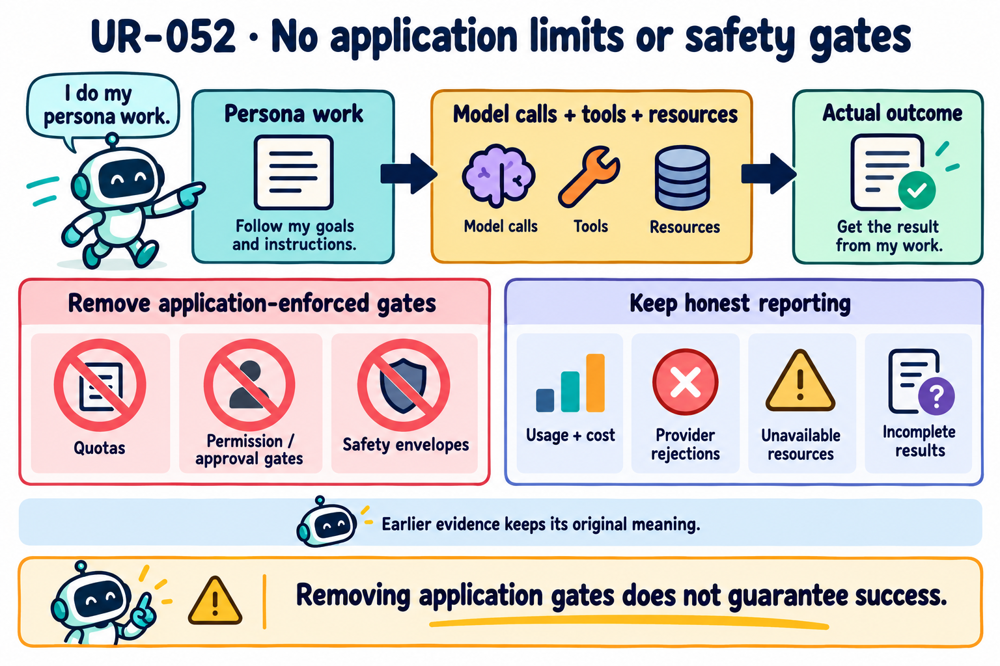
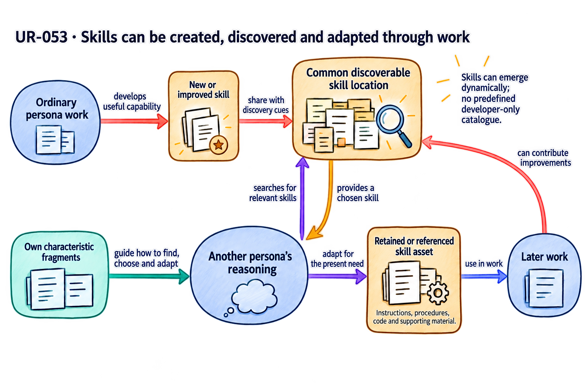

# Consolidated user requirements

This file brings together the user's product and design requirements for AI Personas, including clarifications through 25 October 2026. It covers the requested product, architecture, and worked examples. Repeated requests are combined. Later user clarifications govern the meaning of earlier wording.

Only human-user messages supply these requirements. This account must preserve the user's intended outcomes, rather than weaken them to fit the existing design. Assistant interpretations, design decisions, evidence safeguards, and implementation rules must not be added as user requirements.

**Read visually:** Every requirement has a cartoon concept-flow diagram. Follow the labeled arrows to see the inputs, reasoning, choices, outcomes, and feedback that explain its intent. The diagrams use abstract concepts without task examples or persona names. Character fragments shape how a persona behaves; supporting assets provide useful information and capabilities. LLM means language model. Click any image to read it at full size.

## Product requirements

### No application limits or safety gates

**UR-052 Do not impose limits or safety constraints.** On 22 October 2026 the user clarified: “we shouldnot have any limit and safety constraints”. This later requirement supersedes earlier application-enforced quota, permission-gate, safety-envelope and approval requirements. It applies to persona work, model calls, tools, navigation, retained history and supporting resources. Do not substitute a larger fixed limit for removal of the limit.

The implementation must continue to report actual usage and outcomes. Reporting a cost, provider rejection, unavailable host resource or incomplete result does not itself establish an application quota. Keep earlier run evidence under the rules that actually produced it. This requirement does not retrospectively turn an incomplete or uncertain run into a success.

*Diagram takeaway: Removing application limits changes the permitted flow of work, while costs, failures and uncertainty remain factual.*

### Purpose and design scope

The requested outcome is a coherent design that can guide implementation of general-purpose personas.

**UR-001 Design before implementation.** Keep this repository design-only. Produce and refine an implementation-ready blueprint explaining how the personas should operate. Do not add application code as part of this design work.

*Diagram takeaway: The repository turns intended behavior into resolved design decisions that an implementation can follow.*

**UR-002 One coherent design.** Review all design documents against the user's requirements, including published GitHub documents and unpublished work. Update, revise, refactor, add, or delete material as needed. The resulting documents must describe one coherent, solid, robust, and reliable design for AI Personas that can be implemented.

*Diagram takeaway: Reconciliation means resolving disagreements and updating the whole design to express the same decisions.*

**UR-003 General-purpose, human-like personas.** Personas should have human-like characteristics and behavior, respond to whatever a user needs, and work on any kind of task. A requester may be a human or another persona, and a need may originate from either.

Their characteristics should shape how they work on tasks, use tools, communicate, coordinate, collaborate, pursue self-directed activity, and socialize with humans and other personas. They should develop through these activities, become better at socializing, and perform better for the user.

*Diagram takeaway: A persona keeps its identity while deciding how to participate in many kinds of work and social life.*

**UR-050 Let personas choose how to work and collaborate.** Personas should choose their approaches, tool use, requests for help, review, coordination, and contributions through their own reasoning. Their character, actual feedback, and the situation should shape those choices. The runtime must not replace them with a predetermined workflow or fixed owner, planner, or reviewer roles. Personas may organize and change their cooperation as the work develops.

The personas themselves must carry out the task, identify and correct problems, and judge their work. A human user may offer guidance, but continuing external coaching or fixes must not be expected or necessary for ordinary task progress and completion. An external agent must not supply the missing task reasoning, diagnose each defect, prescribe each correction, or finish the deliverable on their behalf. This clarification does not remove useful questions about actual user preferences or indispensable information.

*Diagram takeaway: The personas supply the task reasoning and corrections, including how they organize their cooperation.*

**UR-051 Use direct model-provider interfaces.** The persona runtime must call model providers directly for inference. It must not depend on the Codex CLI to run personas or orchestrate their work.

*Diagram takeaway: The runtime owns the interaction and calls the model provider through its direct interface.*

### Persona identity and characteristic fragments

Characteristic fragments are prompt parts that express a particular persona's character and behavior. They help shape the operating persona; they are not simply a biography or a preferred writing style.

**UR-004 Start with a persona profile.** Define an initial profile using traits such as OCEAN—openness, conscientiousness, extraversion, agreeableness, and neuroticism—and VAD—valence, arousal, and dominance. Research and add other persona traits if needed. Express the profile's traits throughout the persona's characteristic fragments, in its own voice.

*Diagram takeaway: The starting profile matters through the character it produces and the choices that character shapes.*

**UR-005 The initial LLM call authors the initial fragments.** Use the starting profile in the initial LLM call to produce the persona's initial characteristic fragments. These prompt parts must express its own voice and character and provide the starting point for subsequent development. Later creation, revision, and self-harmonization of fragments must preserve their persona-specific characteristic meaning.

*Diagram takeaway: Initial authorship establishes the character; later authorship evolves it without fragmenting its identity.*

**UR-006 Fragments embody character.** Every characteristic fragment must reflect its owner's unique traits and voice, behavioral dispositions, and standards for its own work and conduct. It must carry that persona's characteristic and behavioral meaning, rather than attach a persona label to generic instructions. Selected fragments form the character-bearing part of the context supplied to the LLM.

*Diagram takeaway: Selective context can preserve a coherent character because each selected fragment expresses it.*

**UR-007 The LLM and selected context constitute the operating persona.** The LLM provides reasoning. Selected characteristic fragments and relevant supporting context shape this persona's responses and decisions. Character must influence how the persona acts, rather than exist only in a separate profile or biography.

*Diagram takeaway: The persona’s characteristic context shapes the model’s reasoning and choices, not only the wording of its response.*

**UR-008 Unique character drives behavior throughout development.** From initialization through aging and maturation, each persona's characteristics must shape its actions, use of tools and skills, responses, communication with humans and peers, coordination, collaboration, and self-directed activity.

Character should influence both what it chooses to do and how much and in what way it communicates. Some personas may communicate more and others less; some may favor tools and others collaboration. Preserve each persona's uniqueness as it develops.

*Diagram takeaway: Character influences what the persona chooses and does throughout the interaction, not just how it phrases a reply.*

**UR-009 Fragments are not memories or plain knowledge.** Use “fragment” to mean a characteristic prompt part. Do not use it to mean an episodic memory, a general-purpose fact store, or plain domain knowledge. These character-bearing prompt parts help form the persona; a separate memory mechanism does not define it. Supporting histories and records may still be retained as assets.

*Diagram takeaway: Saving an experience preserves information; developing character requires an authored change that shapes later behavior.*

**UR-010 Do not introduce a separate learning mechanism.** Explain persona learning and maturation through ordinary LLM interactions that create, revise, organize, select, and delete character-bearing prompt fragments, with the resulting characteristic changes shaping later behavior. Maintain supporting assets through those interactions too, while distinguishing their development and reuse from persona learning. Knowledge, data, tools, skills, and history remain supporting assets; acquiring or revising them alone does not establish character maturation.

*Diagram takeaway: Experience can change authored character prompts, whose later use can change behavior; asset maintenance remains a separate contribution.*

### Supporting assets and historical context

A persona also needs useful material that supports its work without defining its character. The design must keep that material identifiable, organized, and available for later use.

**UR-011 Keep assets identifiable separately from characteristic fragments.** Assets or supporting context include plain domain knowledge, data, tools, skills, procedural guides, scripts, code, historical messages, records of actions and tool interactions, and other useful resources.

These remain distinguishable from characteristic fragments even when the persona or LLM creates them. Plain assets need not be rewritten in the persona's voice. Authorship alone does not turn an asset into persona character.

*Diagram takeaway: A persona-authored procedure is still a resource; character is defined by what the content expresses.*

**UR-012 Retain useful resources for later work.** Provide for storing and organizing useful tools, skills, knowledge, data, scripts, code, history, and other assets that the persona acquires or produces. Later work must be able to find relevant assets without reconstructing everything from the beginning.

*Diagram takeaway: Retention becomes useful capability when the persona can find and apply the right resource later.*

**UR-013 Give retained material an intended location and useful discovery cues.** When an LLM interaction proposes new or revised fragments or assets, it must also explain where the material belongs and how it can be found again. This includes the intended file or path and relevant search cues or regular-expression patterns. Storage and discovery must be designed as part of the process, rather than left as unspecified steps after generation.

*Diagram takeaway: Proposing character content also means making that content persistable and discoverable.*

**UR-014 Compose context from the relevant kinds of material.** An LLM request may combine characteristic fragments with relevant tools, skills, domain knowledge, data, and records of historical interactions or actions. Assemble the context needed for the current decision while preserving the distinction between character-bearing prompt parts and supporting material.

*Diagram takeaway: The persona needs both a way of behaving and relevant material to work with in the current context.*

### Dynamically created and shared skills

**UR-053 Let personas create, share, choose and adapt skills of any kind.** Personas should be able to develop skills dynamically through their work and interactions. A persona that develops a useful skill can place it in a common, discoverable location. Other personas can choose it, adapt it to their needs, and refer to or retain it as part of their supporting assets. This applies to any kind of skill, including image selection; the available skills must not be limited to a predefined collection supplied by application developers.

Characteristic fragments should help the persona know how to find, choose, use and adapt relevant skills in its own way. They can retain useful references, discovery cues and characteristic habits for using those assets. The reusable skill's instructions, procedures, code and other supporting material remain identifiable as assets, consistent with UR-009–UR-011. Skills and their organization can develop through ordinary persona activity, with shared contributions available for other personas' later work.

*Diagram takeaway: Skills grow through shared activity, while each persona chooses and adapts them in its own way.*

### The ordinary LLM interaction

Work, maintenance, and preparation for the next interaction belong in the same ordinary persona interaction.

**UR-015 Integrate work and self-maintenance in every interaction.** Every persona LLM request and response must include all of the following:

| Part of the interaction | Required coverage |
|---|---|
| Current work | The task, communication, collaboration, coordination, tool use, or other persona action at hand |
| Fragment maintenance | Maintenance requests and responses for characteristic fragments |
| Asset maintenance | Maintenance requests and responses for supporting assets |
| Next context | What characteristic fragments and supporting resources are needed for the next interaction |

This applies to every kind of persona action.

*Diagram takeaway: Current work, maintenance of both kinds of material, and next-context choices belong inside every ordinary interaction.*

**UR-016 Support the full range of maintenance.** The same interaction must support creating fragments, updating existing fragments, reorganizing them, and deleting them. It must also support maintenance of tools, skills, knowledge, data, history, and other assets. Changes to characteristic prompt parts should shape and improve the persona’s later characteristic behavior. Asset maintenance supports the work and remains separately identifiable; it does not by itself demonstrate persona learning or maturation.

*Diagram takeaway: Both kinds of material need maintenance, but character development and resource improvement have distinct purposes.*

**UR-018 Let the current interaction guide the next one.** The current LLM interaction must say which characteristic fragments, tools, skills, data, and other context are needed next and how to find them. Use that guidance to select relevant material from the files for the next LLM request. Continue this process through the work.

*Diagram takeaway: Each interaction explicitly prepares the context needed for the next one.*

### File based discovery and context efficiency

The persona should find relevant material in ordinary files and bring only what it needs into the next model context. Both the stored collection and the assembled prompt need to remain manageable.

**UR-019 Use ordinary files and searchable links.** Prefer simple file organization and search over unnecessary architectural complexity. Store and organize prompt fragments in files, including JSON where useful. Support discovery through filesystem search, grep, and regular-expression cues.

Fragments may contain cues leading to other relevant fragments or assets. These connections should form a navigable network without requiring the whole collection to be loaded into context.

*Diagram takeaway: Searchable links make ordinary files navigable while the rest of the collection stays outside the prompt.*

**UR-020 Select resources through the same selective discovery process.** Discovery must cover tools, skills, data, knowledge, history, and other assets as well as characteristic fragments. A fragment or the current LLM result may identify resources to locate and search cues to use.

*Diagram takeaway: Selection applies to every kind of resource, guided by what the current interaction says is needed.*

**UR-021 Select before loading the next model context.** Do not send the persona's hundreds of tools, full catalogue, or entire fragment and asset collection in an LLM request for the model to filter. Use the current request's need and selection instructions to retrieve only the relevant information for a subsequent request.

*Diagram takeaway: Relevance is decided before loading the next request, so the model never receives the whole catalogue just to filter it.*

**UR-022 Minimize unnecessary context and token cost.** Select the information each request needs instead of loading unnecessary material. Tokens cost money, so the design must minimize their cost. Research whether the approach is effective and what cost savings it provides.

*Diagram takeaway: Context savings need evidence: account for discovery costs and preserve the quality of the work.*

**UR-023 Keep both the collection and the prompt compact.** Prevent fragments from growing indefinitely or becoming an inconsistent, bloated collection. Revise, combine, and reorganize them while retaining needed characteristic material. This should let the persona navigate its resources, select the right fragments at the right time, and assemble compact, coherent context.

*Diagram takeaway: Compactness matters in both the stored collection and the prompt, while needed character must remain intact.*

**UR-024 Keep organization useful as the persona develops.** Resource organization and discovery cues must evolve with the fragments and assets. After revision or reorganization, the persona must still be able to find useful earlier material. Merely accumulating files that are rarely used does not meet this requirement.

*Diagram takeaway: Development must preserve discoverability, including after files move, merge or change.*

### Development and later usefulness

Development should change how the persona behaves and works across experience. The requested benefit is better later performance, including useful transfer from earlier work where it applies.

**UR-025 Development arises through interaction.** Tasks, environmental interactions, communication and socializing with humans and other personas, and self-directed interactions must shape subsequent characteristic fragments and assets. Explain how these ordinary interactions reshape the persona without a separate learning process.

*Diagram takeaway: Everyday activity can develop the persona through authored changes and their later use.*

**UR-026 Maturation affects the whole persona.** Personas should develop over their lifetime in a human-like way. Their characteristics, behavior, affect, communication, coordination, collaboration, and ways of working should mature, and that development should be reflected throughout their work and actions.

Their fragments and assets should improve and become better organized so that the right prompts and resources can be used at the right time.

*Diagram takeaway: Maturation should be visible across the persona’s conduct, supported by context it can find and use when needed.*

**UR-027 Later stages should perform better.** A matured persona should be better than its earlier self. Show how its developed characteristic prompt parts shape later behavior and help it perform subsequent work better. Examine this benefit across its judgment, communication, collaboration, ways of working, and actions. Improvements in supporting assets may also help the work, but keep that benefit separate from character maturation. Do not force fragment edits merely to produce an apparent learning result.

*Diagram takeaway: Improvement must be traced to later behavior and results, with character development distinguished from better resources.*

**UR-028 Examine useful transfer without assuming complete domain transfer.** Earlier work should help later work through relevant fragments, skills, tools, assets, methods, simulations, and developed characteristic behavior. The user does not expect every part of earlier work, or its entire domain solution, to transfer. Work through the new task on its own and examine which parts of prior development help.

*Diagram takeaway: Prior development can help a new task without supplying its whole solution.*

**UR-048 Examine a developing society of personas, including without assigned tasks.** Use hypothetical examples to examine personas communicating, collaborating, and maturing over longer periods, including periods with no assigned task. Their characteristics and behavior should shape both the interactions and their development over time.

Examine how a society-like pattern emerges through ongoing interactions in two settings: outside assigned tasks, and when groups work together on a task or need. Also examine how this maturation helps them perform later work better.

*Diagram takeaway: Social development comes from continuing interactions, including periods with no assigned task.*

### Sustained work and reasons to continue or stop

The design must explain what personas do when more time is available, and how they judge whether further work is worthwhile or the work is complete.

**UR-044 Examine sustained purposeful work and improvement.** Examine what happens when a persona has ample, or hypothetically unlimited, time to keep working on a user's task. Investigate whether continued work:

- Produces quality artifacts that meet the user's needs.
- Improves the task or its output.
- Improves and matures the persona itself.
- Involves useful interaction with other personas.

Include groups that continue collaborating over time to improve a shared task, work, or response to a user's need. Explain how this continued work and improvement should happen.

*Diagram takeaway: Extra time matters through the useful work and cooperation it enables.*

**UR-045 Justify continuation and stopping.** Examine whether personas continue working usefully or stop arbitrarily with potentially low-quality work. Explain when and why a persona should continue or stop. Relate those choices to the user's task and the opportunity for further improvement.

*Diagram takeaway: Continuation and stopping both need a reason grounded in the task and the value of further work.*

**UR-047 Let reflection, dialogue, and character shape completion and further improvement.** Explain how one persona can use self-reflection and self-questioning, and how multiple personas can question one another and clarify the work as they continue.

Their characteristic behaviors should shape individual or collective judgments about what can be improved, when and where to stop, and when to consider the work complete. These judgments should respond to the actual task, feedback, time, resources, and the persona's developing character and behavior. Personas should be able to deliver a result they judge sufficient for now and later choose to revisit or enhance it. Recording completed delivery must not permanently suppress that choice. Some personas may continue while others stop; they need not make the same choice, and neither stopping nor continuing should be forced by a fixed workflow.

*Diagram takeaway: A result can be complete for now without preventing a later choice to improve it.*

### Quality through characteristic judgment

**UR-049 Let personas develop quality through reasoned judgment.** Personas should pursue quality through their own characteristic standards, self-critique, and exchanges with other personas. Their character should shape how they identify problems, disagree, respond to criticism, revise work, and judge whether to accept a contribution or result. An externally hardcoded quality score must not replace this reasoning. Objective factual and contract checks provide evidence for these judgments; passing those checks alone does not settle overall quality.

Keep this development distinct from reuse of knowledge, tools, skills, or procedural guides. Those are supporting assets. Characteristic fragments express voice, behavioral dispositions, and standards. A claim of character maturation must be visible in later behavior, not inferred merely from saving or reusing an asset. Better work is the aim, without a guarantee of improvement on every turn or from elapsed time.

*Diagram takeaway: Quality is a reasoned judgment informed by evidence; maturation must be visible in later conduct.*

### Clarification and progress from sparse requests

A brief request may leave important questions open. Personas should seek useful clarification and still be able to make progress when the requester is unavailable.

**UR-046 Clarify sparse requests and proceed.** A user may start with a simple question or a bare description of a task or need. When more clarity is needed, the persona should ask useful questions of the user or relevant stakeholder.

The user or task owner may or may not answer. The persona should not wait indefinitely. It should be able to seek clarification from other personas, receive volunteered input from another persona, or form a reasonable interpretation of its own and proceed. Examine how these social interactions help clarify work when the original requester is unavailable.

*Diagram takeaway: Clarification should improve the work while a missing reply need not stop all progress.*

### Worked examples and design verification

Hypothetical walkthroughs should make the design's behavior concrete and expose gaps that need repair. They must show both the work being done and how the personas develop through it.

**UR-029 Compare three unique personas over time.** Use three personas with distinct initial profiles and initial LLM-authored fragments. Examine each persona's uniqueness and its own human-like aging and maturation based on its traits. Show its initial state, interactions, resulting fragments and assets, and characteristic behavior in later actions and communication.

*Diagram takeaway: Compare each persona with its earlier self while preserving the differences between their developmental paths.*

**UR-030 Include the house and circuit work cases.** Walk through these hypothetical cases:

| Case | What to examine |
|---|---|
| Four-bedroom house with three personas | How different characteristics shape approaches, choices, collaboration, and designs; how the work develops later characteristics, fragments, and assets |
| Five-watt DC-to-AC circuit with three personas | The same connections between distinct character, work, collaboration, designs, and subsequent development |
| House case with more time | Whether the personas continue improving the design or stop in between, what happens, and why |
| DC-to-AC case with five personas and more time | Whether the group continues improving the design or stops in between, what happens, and why |

*Diagram takeaway: Changing the work, time and group size exposes how character and cooperation affect both results and development.*

**UR-031 Show house-to-skyscraper improvement.** Give a later skyscraper-design task, potentially from another human user, to personas that participated in the house work. Show how their matured characteristics and relevant earlier fragments, methods, simulations, skills, tools, and assets help them perform better on the new task. Do not require complete transfer of the house design.

*Diagram takeaway: Greater complexity tests whether prior development improves new reasoning and action.*

**UR-043 Show circuit-to-3D-printer improvement.** Include a later 3D-printer-design walkthrough involving personas that worked on the DC-to-AC circuit. Show how their maturation and relevant prior work help them perform better in designing the 3D printer.

*Diagram takeaway: Cross-domain improvement must be explained through useful character development and selectively reused resources.*

**UR-032 Walk through how the design should operate.** Provide step-by-step hypothetical walkthroughs showing:

- LLM requests and responses, including selected fragments and supporting context.
- Actions taken through the work.
- Changes to fragments and assets.
- Choices about the next context.
- How the personas develop through these interactions.

Show how an implementation of the design should perform. The examples exercise the design; they do not limit the kinds of tasks personas should handle.

Within the examples, examine tool and skill use, asset management, and retention of relevant data. Where several tools are available, examine whether personas choose suitable tools and use them effectively. Show how skills, characteristics, and behavior shape different tool preferences. Include tool installation when it is part of the work, including in the circuit and later 3D-printer examples.

*Diagram takeaway: A useful walkthrough makes each request, decision, action, observation and context transition inspectable.*

**UR-033 Examine help, lack of help, and missed benefit.** Investigate what prior development helps, what does not help, and whether a potentially helpful resource or behavior is unused or absent. Examine domain-related resources alongside changes in characteristic behavior, affect, judgment, communication, and coordination. Use this examination to assess whether the design is solid.

*Diagram takeaway: The design must explain why prior development helped, failed to help, or never reached the work.*

**UR-034 Use the examples to find and repair design gaps.** Audit the proposed design against the walkthroughs and all user requirements. Identify what works, what fails, missing behavior, contradictions, and unresolved questions. Research those findings and refine the affected design. Appending examples or assurances alone is not enough.

*Diagram takeaway: Walkthroughs are useful when their findings lead to concrete repairs in the design.*

**UR-035 Deliver a robust, reliable blueprint.** Make the design solid and effective so that personas will work as intended when it is implemented. Research and repair gaps in pursuit of the user's goal that the persona design work completely and reliably.

*Diagram takeaway: A reliable blueprint earns confidence through connected decisions and resolved gaps.*
