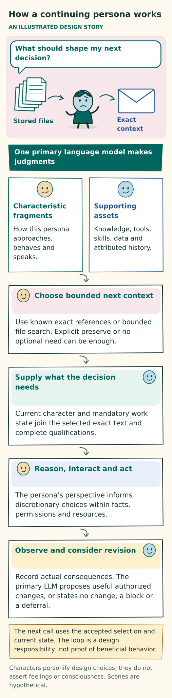

# The persona is the whole characteristic-context loop

[Home](README.md) · [Start here](START-HERE.md) · [Design authority](design/README.md) · [Persona core](design/PERSONA-CORE.md) · [Work and boundaries](design/WORK-AND-BOUNDARIES.md) · [System contracts](implementation/CONTRACTS.md) · [Artwork provenance](sources/SOURCE-MANIFEST.md#artwork-retirement)

These illustrations explain how a continuing persona works, from its initial character to context choices, cooperation, recovery, and evidence. Each one is placed beside the relevant design rules, with an accessible text equivalent. Start with the whole loop, then choose a topic below. The pictures teach the design; they do not demonstrate a running system.

**Figure: How a continuing persona works.** This is a conceptual explanation of the design. [Read the exact rules](design/PERSONA-CORE.md#maturation-within-every-primary-interaction); the explanation below retains their qualifications. [Open the illustration](assets/persona-files-loop.svg).

Text equivalent of the illustration

How a continuing persona works

AN ILLUSTRATED DESIGN STORY

What should shape my next decision?

Stored files

Exact context

One primary language model makes judgments

Characteristic fragments

How this persona approaches, behaves and speaks.

Supporting assets

Knowledge, tools, skills, data and attributed history.

Choose useful next context

Use known exact references or chosen file search. Explicit preserve or no optional need can be enough.

Supply what the decision needs

Current character and mandatory work state join the selected exact text and complete qualifications.

Reason, interact and act

The persona’s perspective informs choices about the task, tools and cooperation.

Observe and consider revision

Record actual consequences. The primary LLM proposes useful changes, or states no change, a block or a deferral.

The next call uses the accepted selection and current state. The loop is a design responsibility, not proof of beneficial behavior.

Characters personify design choices; they do not assert feelings or consciousness. Scenes are hypothetical.

**Explore the design by question**

| Question | Illustration and precise explanation |
|---|---|
| How does the whole persona continue? | [How a continuing persona works](README.md#the-central-loop) |
| How can two personas approach the same need differently? | [Same need, different approaches](START-HERE.md#a-collaborator-that-develops-a-point-of-view) |
| What separates stable character, modeled affect, and expression? | [Character, affect and expression](design/PERSONA-CORE.md#characteristics-modeled-affect-and-contextual-expression) |
| Where does an initial persona come from? | [From an origin to a continuing persona](design/PERSONA-CORE.md#character-in-its-own-voice) |
| Which files shape character, and which support work? | [A persona’s approach is not its toolbox](design/PERSONA-CORE.md#fragments-are-reusable-prompt-parts) |
| How does a file choice reach the actual model request? | [From a file choice to actual context](design/PERSONA-CORE.md#the-primary-llm-chooses-next-context) |
| What happens when a provider rejects the chosen input? | [Provider failure and ordinary recovery](evaluation/ACCEPTANCE.md#provider-failure-and-ordinary-recovery) |
| When is a tool ready for the proposed operation? | [Finding a tool is only one fact](design/WORK-AND-BOUNDARIES.md#capabilities-and-the-execution-boundary) |
| How do humans and personas cooperate without assumed commitment? | [Cooperate without inventing commitment](design/WORK-AND-BOUNDARIES.md#voluntary-responsibility-and-cooperation) |
| When are an individual and a group finished? | [Individual and collective completion](design/WORK-AND-BOUNDARIES.md#individual-and-shared-sufficiency-judgments) |
| What happens when unfinished work pauses or restarts? | [A local stop is not the end of a goal](design/WORK-AND-BOUNDARIES.md#continuing-a-goal-across-local-boundaries) |
| How can experience inform purposeful development? | [Experience can inform later development](design/PERSONA-CORE.md#maturation-within-every-primary-interaction) |
| How do source meaning, actual access and attribution differ? | [Work attribution and selective context](evaluation/ACCEPTANCE.md#mechanical-checks) |
| What counts toward the retained footprint? | [Compact retention without hidden growth](evaluation/README.md#compact-retention-without-hidden-growth) |
| What does each evidence claim establish? | [Five claims need different evidence](implementation/STATUS.md) |
| How would a claimed benefit be assessed? | [Assess a claimed benefit](evaluation/README.md#freeze-the-comparison-before-observing-results) |
| How should uncertain external effects be recovered? | [Recover without inventing success](design/WORK-AND-BOUNDARIES.md#recovery-without-invented-success) |
| Where do the exact design rules live? | [A reading path with one source of authority](design/README.md) |
| Which choices belong to a deployment? | [Make deployment choices visible](implementation/DEPLOYMENT-DECISIONS.md#core-deployment-choices) |

The following text gives a connected reading of the loop and its qualifications. The linked topic diagrams make the separate decisions easier to inspect.

## A complete text reading

### The whole loop constitutes the persona

The primary LLM reasons under one accepted character account, selected characteristic fragments, relevant supporting assets and actual work state. That perspective informs choices of approach, tools, communication, cooperation, navigation and maintenance. Actual outcomes can inform later revisions. Neither a profile alone nor a generic decision restyled afterward constitutes the full design.

The primary chooses useful optional context; the host records and supplies the exact choices with required qualifications. Keeping, finding, reading, selecting, supplying and using material are separate facts. A justified no-change or no optional context can be the right choice.

[UR-050 and UR-052](USER-REQUIREMENTS.md) govern the current loop. There are no application call, population, search, context, storage, safety or approval gates. Provider and host failures remain real outcomes. Accurate versioning, complete response validation, actual authorship and honest effect accounting retain their meaning.

### From a seed to a continuing persona

An attributed trait seed enters an initial LLM invocation, which authors candidate characteristic fragments in the persona's own voice. Coherent acceptance establishes the starting account. The continuing primary receives that actual account and attribution. The initial LLM is an initialization role, not another required ongoing writer.

Generated detail is not prior lived experience or another human preference. Imported or operator-supplied beginnings keep their origin. Retry or recovery does not silently replace an accepted start. Later self-harmonization can clarify scope and useful tensions or leave text unchanged; it does not automatically restyle the corpus.

### Character, modeled state, and expression

Semantic OCEAN dispositions describe openness, conscientiousness, extraversion, agreeableness and neuroticism/negative emotionality. VAD describes modeled valence, arousal and dominance. Stable character, usual affect baseline, event-linked state and outward expression remain distinct.

Numeric scores and extra trait taxonomies are not compulsory. The profile and current-self prompt resolve to the same accepted account. A transient state must not secretly rewrite a stable trait. Perceived control is not evidence of actual control or another person's agreement.

Character can influence attention, approach, help-seeking and stopping without altering facts. Different personas may converge on the same correct answer. Forced disagreement, stereotypes or unusual wording do not establish individuality.

### Ordinary files and different purposes

A characteristic fragment expresses how this persona notices, judges, acts or communicates. A supporting asset supplies knowledge, a procedure, a tool, a skill, code, data or factual history. Persona authorship or first-person wording does not make every asset characteristic.

The persona chooses names, organization, search cues and revisions. A fragment may point to an exact technical asset without copying its procedure into the persona's character. Quotations and raw observations retain their real source rather than becoming invented personal experience.

Useful maintenance can combine repetition, narrow an overgeneralization, retain an exception, retire a harmful method or save nothing. There is no required folder taxonomy, outgoing-link count or separate semantic writer.

### Discovery, selection, and actual context

A choosing call starts with useful current information and a usable discovery interface. It does not receive hundreds of names, schemas or skill summaries merely to filter them. The host keeps the bulk catalogue outside the provider request rather than hiding it behind a model-attention claim.

The primary can use a known exact reference directly or choose filesystem listing, literal/grep-style search and supported regex. It chooses query scope, result count or slice and whether to continue. There is no application traversal or cumulative exposure allowance.

| Observation | Meaning |
|---|---|
| Search match | A candidate in the actual searched scope; not endorsement or persistent selection. |
| No match | No observed match under that query and matching surface; not proof that relevant material is absent. |
| Partial result or error | Only the actual returned content is known; nonempty output need not be complete. |
| Exact read | The requested revision or an honest unavailable disposition; successor bytes are not the old body. |
| Selection | An explicit next-context choice, preservation or clearing by the persona. |
| Actual supply | The exact bytes and definitions in the retained provider input, with completeness and qualifications. |

Cues are data, not executable shell instructions. The host does not follow every cue, recursively traverse links or select by connectivity. Optional associations, exact evidence references and required qualifications have different purposes. A missing caveat cannot be silently discarded to make a prompt smaller.

Known current guidance can support immediate action without compulsory rediscovery. Tool documentation, a callable interface, installation, actual execution and a suitable result remain distinct. Lack of a selected definition is not an application permission gate. Unrestricted host tools and installation remain available.

### Work and maintenance in the same decision

Each accepted persona response covers work, characteristic-fragment maintenance, supporting-asset maintenance and next-context choices for both categories. This applies to initialization, small answers, discovery, communication, tool follow-up, retry and stopping.

One concise no-change reason may cover both maintenance categories. Appropriate preservation or no optional need can cover the two context choices. No edit, new lesson, search or extra reflection call is compulsory. Maintenance no-change does not itself state next-context intent.

A proposal identifies intended files/paths, applicable exact bases and useful discovery cues. Proposal, accepted change and actual persistence are different facts. A deferred correction names its missing prerequisite and actual continuation; it cannot be reported as fixed or as nothing to maintain. A failed attempt has no fabricated persona-authored disposition.

### Character feedback is optional and explicit

Stable-character evolution is optional and explicitly adopted, without a self-authorship approval gate. Ordinary method refinement, local relationship understanding and transient modeled state remain distinct from it.

Resolve a requested effective-character adoption before other fresh operations from that response. Accepted change requires a fresh decision under the accepted character, including before reads or waits proposed by the earlier response. Known rejection or definite no-commit deferral leaves the old character in force; unknown commit state requires reconciliation.

This preserves coherent decision authorship. It does not require every useful correction to change personality or cause every persona to converge on one generic account.

### Actual outcomes, dependencies, and recovery

Validate a complete response before adopting its new substantive work. Unvalidated commentary or a partial tool prefix is not an accepted reply, peer communication or action. Host status, cancellation, usage and actual receipts remain independently observable.

A valid response can still contain an operation that fails. Dependent work cannot assume its success. Exact primary-authored bytes saved coherently in the same response can support explicit dependent use of that revision. Unobserved tool-produced results require their actual observation and a fresh decision. An old file at an expected path is not proof of a new result.

Supply selected context faithfully without an application fit ceiling. If the provider rejects it, preserve the actual rejection. Later context changes retain their author and actual supply; there is no special restricted repair mode, protected reserve or fixed retry allowance. Real missing sources and failed I/O remain missing or failed.

An uncertain outside effect stays uncertain until supported reconciliation. Recovery does not invent success or blindly repeat an unresolved effect. A personal Stop, completed delivery, stakeholder acceptance and completion of the full need are different facts.

### One hypothetical connection to work

Suppose a persona is preparing an editable comparison. The following is an illustration of evidence distinctions, not a test case or required sequence of calls.

The persona may use a known “reopen the saved file” fragment and current tool guidance directly, or choose a useful search. It selects the exact material needed and gives its maintenance and next-context dispositions. A returned description is not the complete body, and a chosen tool is not an observed result.

A host command performs the actual check. Its success or failure reaches a fresh decision before dependent claims. The persona can then correct a real editability problem, retain an adequate artifact or ask a useful question. It might update a characteristic habit, maintain a supporting procedure or save nothing. A factual check informs its judgment about the whole user promise.

The chosen approach may group independent operations. No extra search, review role or maintenance call is required. A useful result needs evidence of the requested editability; neither a fluent narrative nor the presence of a file proves it.

### Compactness, cost, and useful behavior

The persona maintains useful organization and avoids unnecessary context without hard collection, prompt or archive caps. Count the scope of a claimed saving: current text, versions, indexes, evidence, metadata, caches, backups, temporary copies and external storage where relevant. A small prompt does not establish a small total footprint.

Actual deletion, missing evidence, retired guidance and resolved obligations have different meanings. A digest cannot recreate unavailable source text. Consolidation must not fabricate history or turn a known uncertain effect into success. Real storage and provider availability remain physical facts rather than application quotas.

Account for complete actual requests and all work: initialization, discovery, reads, callable definitions, observations, maintenance, retries, unsuccessful branches and relevant host/tool costs. Bytes, reported tokens, money and time are different measures. Unknown cost remains unknown.

Smaller inputs or more elapsed time do not establish useful development. Assess characteristic choices, adequate delivery, later reuse, missed benefit, harm, correction and actual total cost. The [evidence guide](evaluation/README.md) explains the limits of each claim.

### Current guidance and historical artwork

The whole-loop and different-approach illustrations accompanying the current entry pages reflect unrestricted execution. Older topic artwork may still depict superseded bounded admission, permission or restricted-repair rules. Its [exact earlier versions](https://github.com/ai-personas/ai-personas-design/tree/8b8ea2ecc40d59c876a44a4ce024cd9fa8ba40cf/assets) remain historical explanations, not current application requirements. Remaining artwork and detailed prose need reconciliation where they contradict the current human requirements.

The complete target remains character-conditioned reasoning, meaningful ordinary maintenance, selective context, chosen cooperation, useful general-purpose work and development through actual experience. Neither these illustrations nor a source review establish that a runtime fulfills that full target.
