# Visual guide

[Home](README.md) · [Start here](START-HERE.md) · [Design guide](design/README.md)

These editable diagrams explain the current directly editable numerical-persona design. They are teaching illustrations, not screenshots, fixed task workflows or observed learning results. Every linked chapter gives a text explanation of the same meaning. Open a figure to view it at full size.

## How to read the figures

A box represents a state, responsibility or choice. An arrow names a possible relationship or transition; it does not promise that the destination occurs or improves the result. Purple distinguishes personal character, blue work and reasoning, green experience, amber evidence, and gray supporting context. Labels carry the meaning without relying on color.

A six-box loop is a compact explanation, not a requirement for six model calls. Some decisions can combine independent responsibilities. Results that have not happened cannot be used as earlier evidence.

## The whole idea

[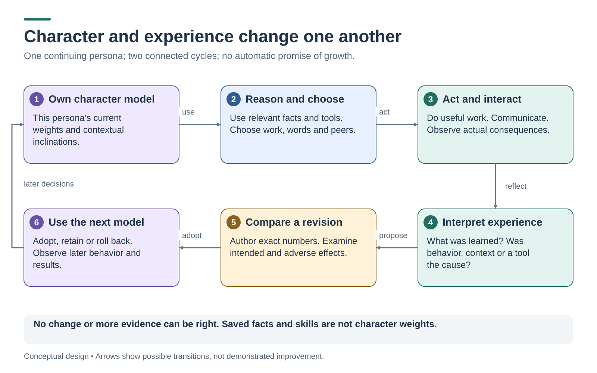](assets/overview.svg)

**Text explanation:** Character shapes work; experience can change character. [Read the governing chapter](README.md).

## One model per persona

[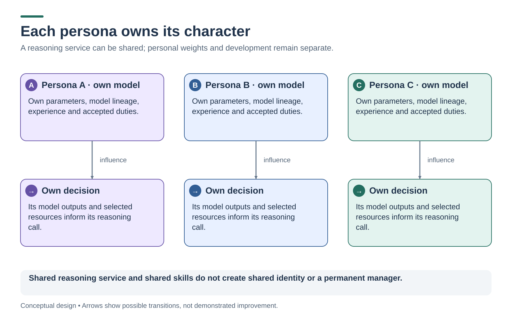](assets/identity.svg)

**Text explanation:** Owner-bound parameters and separate decision histories. [Read the governing chapter](design/PERSONA-CORE.md).

## Beginning and continuity

[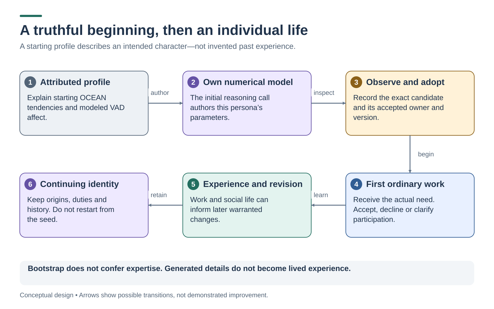](assets/birth.svg)

**Text explanation:** A truthful seed, an accepted numerical model, then ordinary work. [Read the governing chapter](design/PERSONA-CORE.md).

## What changed?

[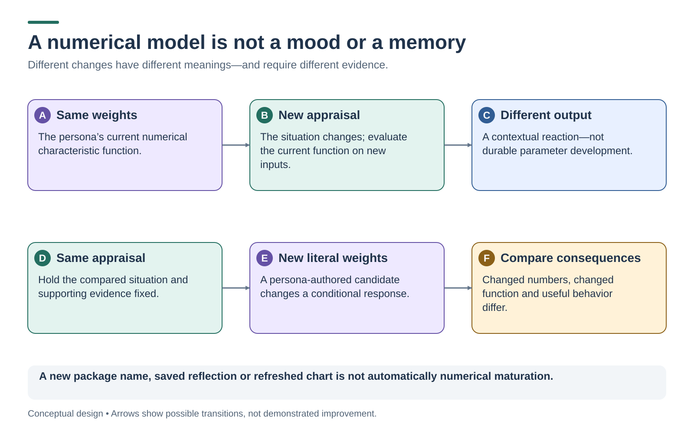](assets/numerical.svg)

**Text explanation:** Separate situational appraisal, numerical function and improved behavior. [Read the governing chapter](design/CONTINUAL-DEVELOPMENT.md).

## An ordinary decision

[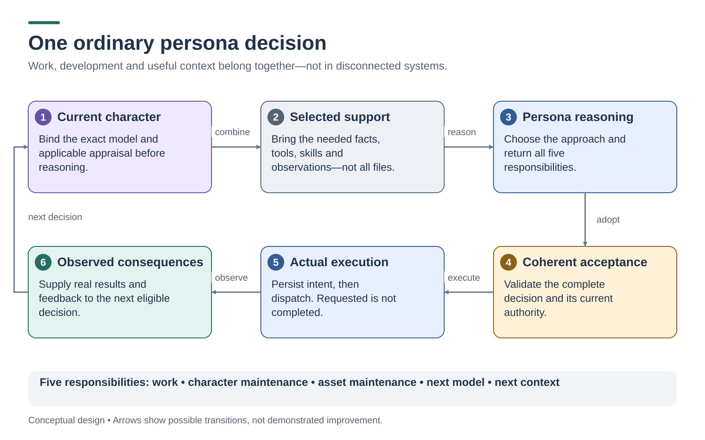](assets/decision-cycle.svg)

**Text explanation:** Five responsibilities, coherent acceptance and observed effects. [Read the governing chapter](implementation/CONTRACTS.md).

## The maturation cycle

[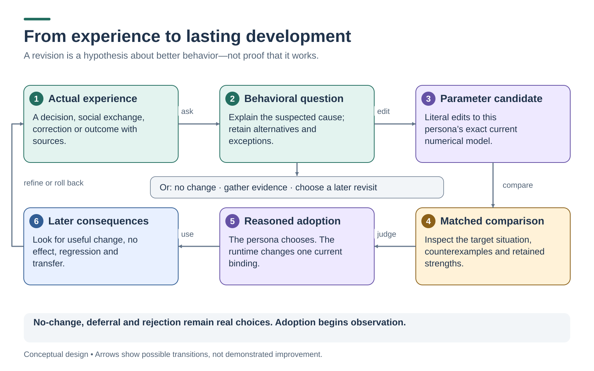](assets/development.svg)

**Text explanation:** Evidence, interpretation, candidate, comparison, adoption and follow-up. [Read the governing chapter](design/CONTINUAL-DEVELOPMENT.md).

## Selective resources

[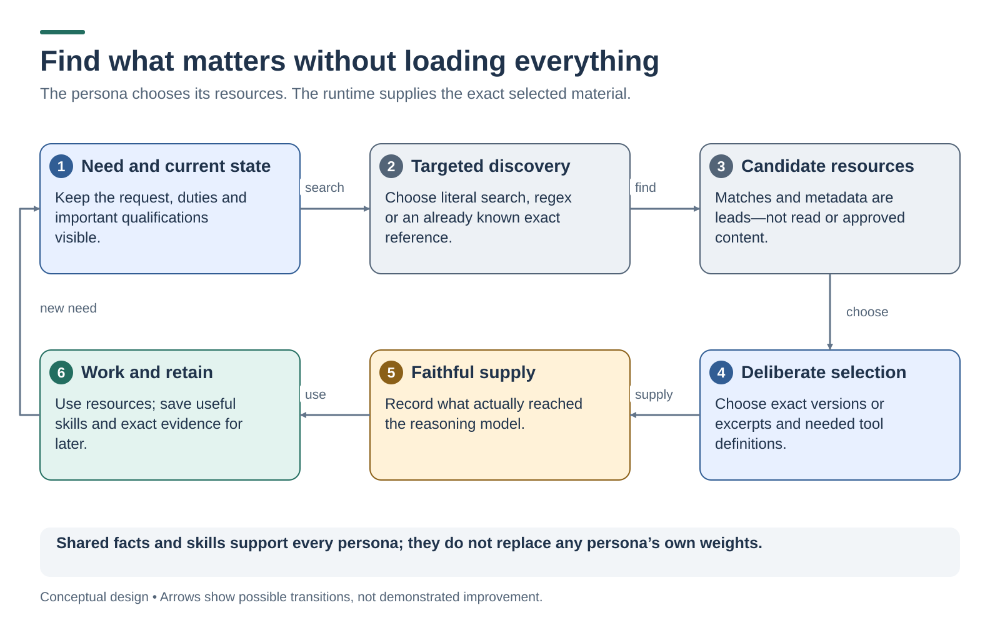](assets/context.svg)

**Text explanation:** Find and supply relevant support without loading the entire catalogue. [Read the governing chapter](design/CONTEXT-AND-SKILLS.md).

## Chosen collaboration

[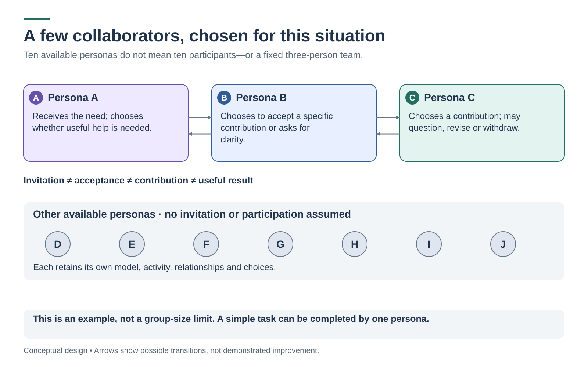](assets/collaboration.svg)

**Text explanation:** Available personas are not automatically participants. [Read the governing chapter](design/COLLABORATION.md).

## Useful completion

[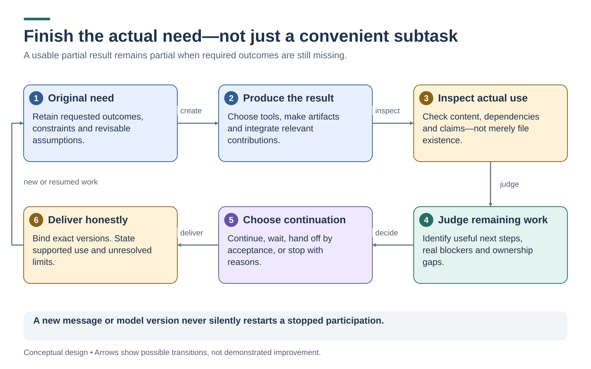](assets/completion.svg)

**Text explanation:** Judge the original need, actual result and remaining work. [Read the governing chapter](design/WORK-AND-BOUNDARIES.md).

## Truthful recovery

[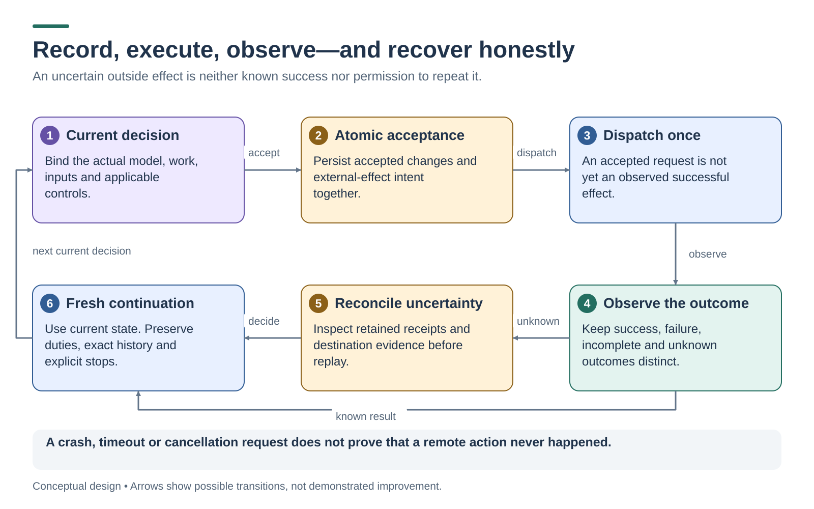](assets/recovery.svg)

**Text explanation:** Separate accepted intention, dispatch, outcome and uncertainty. [Read the governing chapter](implementation/CONTRACTS.md).

## Evidence ladder

[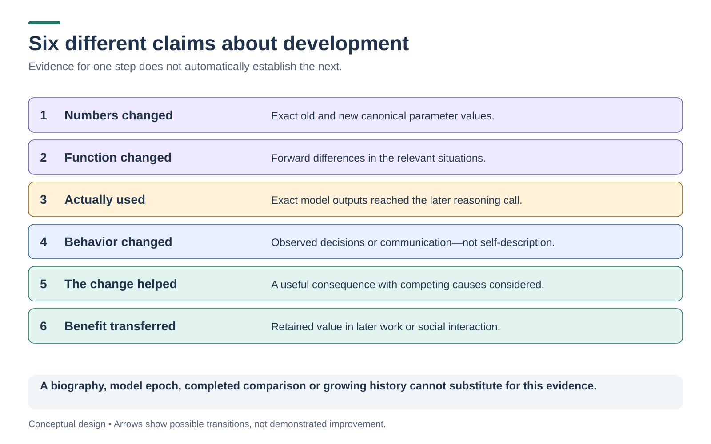](assets/evidence.svg)

**Text explanation:** Changed parameters are only the beginning of a maturation claim. [Read the governing chapter](evaluation/README.md).

## Work and social transfer

[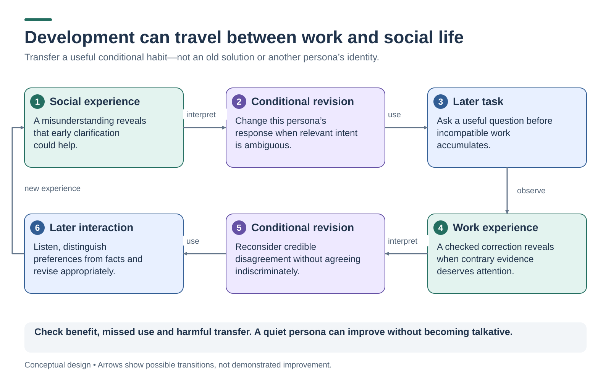](assets/transfer.svg)

**Text explanation:** A conditional habit may help in another setting; check whether it does. [Read the governing chapter](examples/WORKED-EXAMPLES.md).

## Continuity through change

[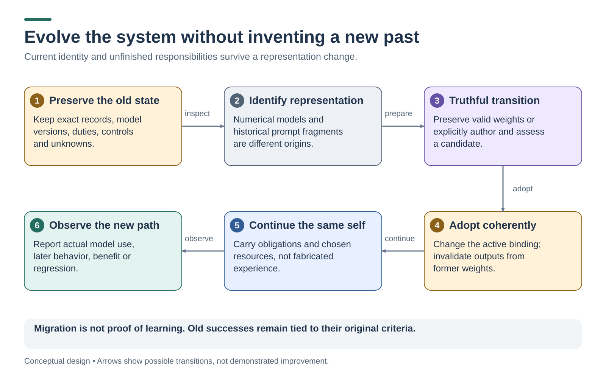](assets/migration.svg)

**Text explanation:** Preserve real history and duties without inventing old learning. [Read the governing chapter](implementation/README.md).

## Source boundaries

[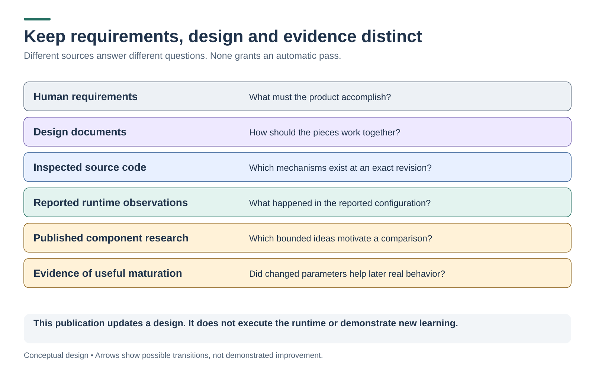](assets/sources.svg)

**Text explanation:** Intent, mechanism, observations and proof are different things. [Read the governing chapter](sources/README.md).

## Reading path

[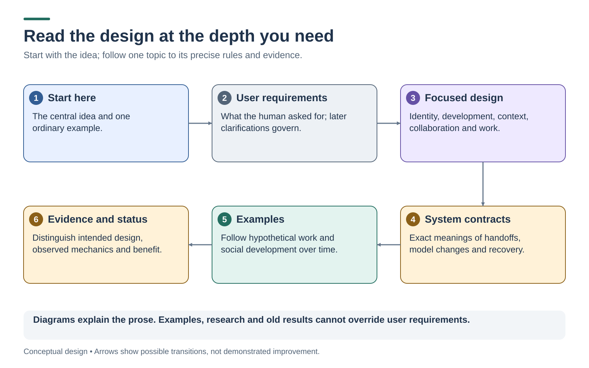](assets/reading-map.svg)

**Text explanation:** Move from the plain-language explanation to exact contracts and evidence. [Read the governing chapter](START-HERE.md).

## Artwork and revision history

The figures are repository-native SVG artwork with editable text, accessible titles and descriptions, and explicit text explanations in the chapters. They replace the older fragment-based and quota-era artwork on the active reading path. The prior images and their original claims remain at the [exact predecessor asset tree](https://github.com/ai-personas/ai-personas-design/tree/60fc268eea909ea2cfc4e91cf180c0020bde6ef1/assets).

Presentation inspection does not establish model behavior, psychological realism or a working implementation. See [status](implementation/STATUS.md) for that distinction.
