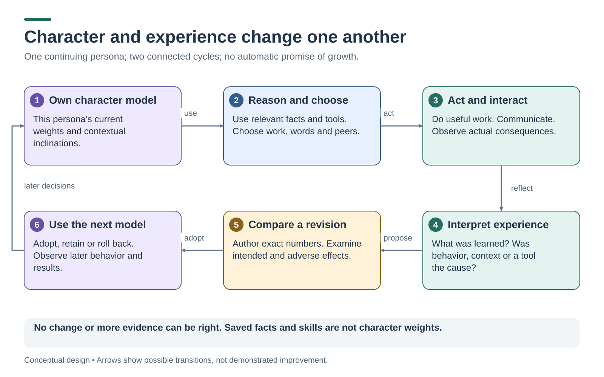

# Explainer artwork

[Visual guide](../VISUAL-GUIDE.md) · [Home](../README.md)

These 15 editable SVG figures explain the current numerical-persona design. Each contains a title and description. The linked Markdown chapters provide the full textual explanation and qualifications. The artwork is conceptual, not runtime evidence, an artificial age scale or an assigned workflow.

All active design and supporting documents point to relevant figures through the visual guide or an in-place illustration. Keep labels legible at ordinary reading size. Do not communicate a distinction by color alone. When a rule changes, update the corresponding picture and explanation together.

Prior fragment-based illustrations and original generation records remain in the [pinned historical asset tree](https://github.com/ai-personas/ai-personas-design/tree/60fc268eea909ea2cfc4e91cf180c0020bde6ef1/assets). They are not alternative current instructions. New artwork does not inherit old rendering or behavior-validation claims.
