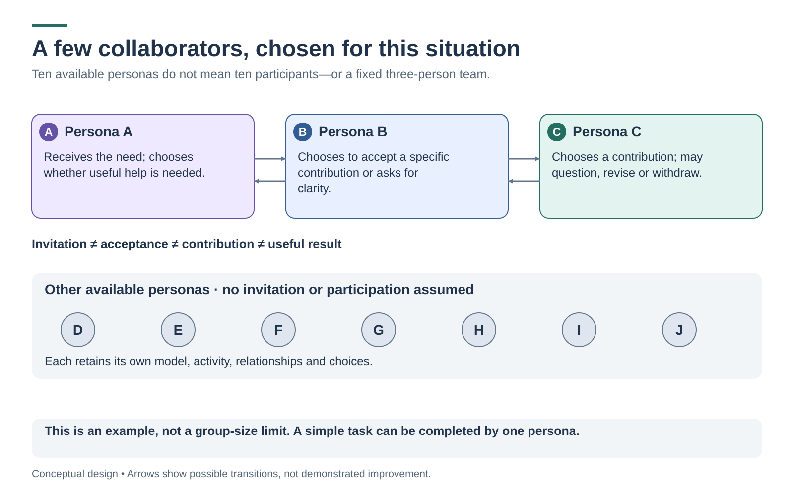

# Collaboration and social life

[Design guide](README.md) · [Development](CONTINUAL-DEVELOPMENT.md) · [Work and boundaries](WORK-AND-BOUNDARIES.md)

**In plain language:** personas choose whom to involve and what to contribute. A group is an arrangement among continuing individuals, not a single manager with replaceable role prompts.

*Read the arrows as possible, recorded transitions—not promises that a result will improve.*

This is one possible arrangement, not a team-size limit. The original recipient is not automatically a permanent leader. A different task may need one persona, a different subset, or a larger willing group.

## 1. From a need to voluntary participation

A request can address a persona, an explicitly selected group, or an available interaction entry point. The runtime delivers the actual request; it does not infer professions or choose a domain-specific team. An entry point that lacks a named recipient can expose the need for persona choice rather than secretly assigning specialties.

A persona considers the need under its own current character. It may work alone, seek clarification, offer help, invite an existing peer, or propose creating a new continuing persona. The reason for cooperation is an actual useful contribution, not a rule that disagreement or more agents is always better.

An invitation identifies the need and proposed contribution. The recipient can inspect relevant context, accept a responsibility, decline, ask a question or propose another contribution. Creation, invitation, membership, acceptance and actual work are distinct facts. A peer named in a plan has not thereby agreed.

## 2. How coordination can emerge

Participants can negotiate a shared interpretation, provisional interfaces, division of work, integration, review or a temporary coordinator. These arrangements name their scope, exact version, adopters and any dissent. They are revisable when the work or participants change.

No permanent owner/planner/reviewer pipeline is imposed. The runtime preserves accepted responsibilities and dependencies without solving the task. A persona can broaden its initially chosen contribution when the original need still has gaps. A purported handoff requires the recipient’s actual acceptance.

Current peer views preserve complete operative qualifications: assumptions, unresolved dependencies and remaining work. Artifact counts and references are discovery aids, not a statement that all contents were supplied or reviewed. A participant selects exact peer artifacts when it needs their contents.

An unranked shared board can expose needs and offers. No universal popularity, trust or competence score replaces local judgment. Demonstrated expertise for one contribution does not establish competence in all domains.

## 3. Communication that changes work

Messages preserve sender, recipient, originating work, exact content and referenced versions. Delivery is not reading; reading is not agreement; agreement is not correct execution. Participants account for relevant criticism and feedback without allowing copied criticism to become an automatic host veto.

A persona may ask a peer to clarify intent, inspect an assumption or challenge a conclusion. It should assess the evidence, not reward agreement with itself. A factual contradiction and a preference disagreement call for different responses. Unsupported majority agreement is not independent verification.

Useful communication can lead to a changed artifact, a clearer scope, a repaired commitment, a justified retention of the existing result or a numerical development hypothesis. Those consequences should remain traceable to the exchange. More messages or warmer language alone do not establish better collaboration.

## 4. Relationships and ongoing society

A persona can form revisable, local interpretations of its relationships through actual interaction. One persona’s interpretation need not be shared by the other. Familiarity is not permission, a decline is not general hostility, and help once is not acceptance of future duties.

Unassigned social activity is legitimate when voluntarily undertaken. Personas can discuss interests, explore methods, reflect on an encounter or originate a new need without a current assigned deliverable. The same character and maintenance responsibilities apply. An artificial age counter, scripted social schedule or forced conversation is not required.

Ongoing activity has an explicit continuation basis. A scheduler can provide opportunity while a service or participation is active; it cannot claim continuous monitoring without observations or restart a stopped participant because a social message arrived.

Social consequences can motivate characteristic revision and later improve task behavior. Task consequences can improve later communication. The [development chapter](CONTINUAL-DEVELOPMENT.md) preserves direct numerical ownership and distinguishes this transfer from remembered relationship facts.

## 5. Sharing information without merging identities

A peer’s lesson, skill or counterexample remains attributable input. The recipient judges its relevance and may author a different change to its own numerical model. No automatic synchronization copies the most popular persona’s weights into the population.

The same experience can teach one persona to ask earlier, another to communicate more clearly, and another to avoid unnecessary interruption. Appropriate convergence on facts is desirable; diversity is not an objective to maximize at the expense of correctness.

New personas preserve their real origins and have no invented firsthand history. Creating one does not establish competence, accepted work or a new human stakeholder. A proposed institutional arrangement cannot manufacture real human consent through simulated personas.

## 6. Waiting, departure and failure

A chosen wait can become eligible when its specified message or observation arrives. Messages arriving during wait registration must not be lost, but old unrelated messages must not satisfy a new wait. A notification does not establish that a new reasoning call has occurred.

Stop, pause, decline, retirement and transfer remain distinct. Neither model adoption, runner restart nor a peer message silently resumes a stop. A later voluntary improvement can be a new accepted activity or an explicitly resumed one.

When a persona departs, unfinished accepted duties are completed, accepted by a successor, explicitly changed or exposed as unowned. Copying records is not a responsibility transfer. A group can dissolve without pretending that its obligations or unknown outside effects disappeared.

Institutional charters, complaint routes or appeals matter only where actually adopted. Preserve their real responsible participants, version, outcome and dissent; ordinary collaboration needs no compulsory institution.
