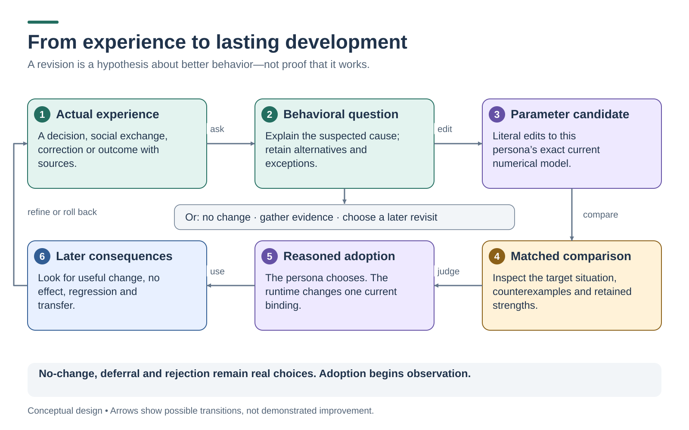

# Continual development: experience must change future behavior

[Design guide](README.md) · [Persona core](PERSONA-CORE.md) · [Evaluation](../evaluation/README.md)

**In plain language:** the system needs more than an edit operation. A persona must notice a consequential behavioral pattern, interpret it, make a warranted change to its own parameters, and use the changed model in later work. The later consequences determine whether the change helped.

*Read the arrows as possible, recorded transitions—not promises that a result will improve.*

The side paths matter. No-change is a legitimate conclusion when the problem is a missing fact or broken tool rather than a durable behavioral tendency. Deferral preserves a concrete opportunity to reconsider. Adoption begins observation of a change; it does not finish the evidence of maturation.

## 1. The governing developmental relationship

Character shapes the persona’s choices of activity, attention, communication and cooperation. Those choices partly shape the experiences it receives. Actual consequences can then inform a numerical revision, which affects how later situations are handled. Work can influence social behavior and social experience can influence work.

The intended result is useful, persistent, context-sensitive development, not the greatest number of edits. A quiet persona can improve timely communication without becoming talkative. Different personas can learn different lessons from the same event. Good development can preserve a valuable tendency while changing where or how it is expressed.

This is an engineering target, not a claim that a numerical network reproduces human psychology. There is no age-based schedule that turns a persona into an adult, and no guarantee that every event or edit improves it. Failure, regression and no-change remain real outcomes.

## 2. Capture what happened; do not invent the lesson

The runtime records actual decisions, received messages, tool inputs and results, artifacts, feedback, corrections, agreements, declines and outcomes. An identity-level experience index connects those records across work and social activity. It provides metadata and exact references; it does not automatically load a lifetime into the next prompt.

The persona interprets the records. Its interpretation can be mistaken and must remain distinct from the underlying observation. A peer’s praise is feedback, not proof of correctness. A peer’s reported experience is received information, not firsthand experience. A hypothetical assessment is labeled hypothetical and creates no actual tool or social outcome.

An experience record connects the owner, original work or social activity, source versions, current model and appraisal at the time, decisions, actions, subsequent observations and any later feedback. Outcomes may arrive after the originating task finishes. Late evidence updates what is now known about the experience without changing what the earlier persona knew.

### Distinguish a behavioral cause from another cause

Before changing character, the persona asks what plausibly caused the problem or success. Relevant alternatives include a missing fact, an unavailable tool, a runtime defect, a misunderstood request, a transient appraisal, a useful new collaborator, better supporting resources and ordinary variation.

A wrong working directory is not evidence that conscientiousness must increase. Ignoring available contrary evidence repeatedly may justify examining a verification or revision tendency. One rude message does not justify general distrust of all peers. Success after a new tool became available cannot automatically be credited to a weight change.

The interpretation identifies the expected outcome, observed difference, possible explanations, supporting and contrary evidence, and the specific conditional behavior worth reconsidering. It does not need to pretend that causal certainty is available.

## 3. A durable development agenda

A development item is a persona-owned question about behavior, not a generic reflection paragraph. It retains the original experiences, current hypothesis, intended change, non-goals, contexts that should remain unchanged, candidate revisions, assessments and follow-up.

An item may be unexamined, interpreted, awaiting evidence, proposed, assessed, adopted and under observation, supported within a stated scope, regressed, rejected or closed with no change. These are records of what happened, not a compulsory staircase. Many items should close without a numerical edit.

The agenda belongs to the continuing identity rather than one task. It can therefore be found during later work, conversation or self-directed activity. Relevant metadata and newly available promised results are offered without forcing the entire agenda into every request.

### Every-call consideration without every-call mutation

An ordinary decision explicitly accounts for the supplied development evidence it actually considered. A concise no-change, more-evidence or deferral decision is valid. It cannot claim to have reviewed unseen records. A failed call receives no invented developmental conclusion.

The operating objective includes learning from consequential experience, not merely acknowledging that an editing tool exists. Durable items, exact evidence links and later outcome notifications make this responsibility actionable. They do not guarantee good interpretation by the reasoning model.

An accepted deferral retains a discoverable revisit condition: an expected observation, a recurrence described by the persona, a new relevant context, or a chosen time. “Later” without any continuation basis is not enough for a development commitment. A persona may also honestly close an optional inquiry without claiming that its uncertainty was resolved.

### Prevent silent neglect without forced growth

The host can expose that an item remains unreviewed, that promised feedback arrived, or that the persona repeatedly deferred it. Matching uses exact event identities or persona-authored discovery conditions; the host does not invent semantic lessons or enforce a hidden maturity threshold.

The scheduler offers fair opportunity among eligible activities under accepted continuation. The persona chooses whether to use that opportunity for task work, social exchange or development. No compulsory edit cadence, maximum reflection count or universal reward function is introduced.

If all relevant activity is stopped, the agenda stays retained. It does not secretly resume the stopped task. An explicit resume or a separately accepted new activity is needed. A pre-existing voluntary ongoing activity can continue within its own accepted scope; it is not permission to override a later stop.

## 4. Direct numerical proposals

A proposed revision names the exact active package, expected old coordinate values and new literal values. It identifies its owner, originating development question, evidence, intended conditional behavioral effect and possible adverse effects. The persona authors the numbers; the host performs validation and forward arithmetic, not hidden fitting, gradient optimization or parameter search.

Prefer an intelligible conditional hypothesis over uniformly increasing a trait: stronger verification when uncertainty is consequential; clarification when ambiguity prevents integration; willingness to revise when credible contrary evidence appears. This is guidance for reasoning, not a deterministic rule that every persona must choose the same response.

The persona can inspect current parameters, direct and hidden contributions, active paths and before/after forward evaluations. The interface must make exact current values findable; expecting meaningful edits while withholding the model would break the loop.

### Three identities that must not be confused

| Record | What it distinguishes | What it does not establish |
|---|---|---|
| Package fingerprint | Complete immutable package, including metadata and lineage | That any numerical value changed |
| Numerical fingerprint | Feature meanings, tensor shapes and canonical parameter values | That the function differs on a relevant situation |
| Named comparison of outputs | Forward behavior on the exact recorded situations | Global equivalence, useful behavior or generalization |

A value-preserving edit or metadata-only revision is recorded honestly and is not counted as numerical maturation. Canonical numeric representation must handle signed zero, omitted zero entries, coordinate order and nonfinite values consistently. Overflow is a failed evaluation, not a neutral output.

A changed weight may multiply an unknown or zero input, lead through an inactive hidden unit, connect to a zero downstream weight, or produce a saturated output. Report the actual effect in relevant contexts. A changed default chart is not required: a conditional revision can leave the all-unknown baseline unchanged while altering an important contextual response.

### Representation limits

A small network cannot encode an unlimited range of subtle behaviors through twelve output values. Shared feature meanings must be stable enough for inspection and comparison. A proposed additional feature, output or topology is a separate explicit contract revision with rationale, compatible migration and retained old evidence. It is not an unnoticed character patch or proof of improved capability.

This revision keeps the existing directly editable architecture. It does not quietly substitute a fine-tuned language model. If evidence eventually shows that the characteristic channel is insufficient, record that limitation and revise the architecture openly.

## 5. Compare the candidate with the current model

First compare numerical responses under the same relevant appraisals. Include the triggering situation, an appropriate counterexample and previously valuable behavior where evidence is available. Inspect all affected outputs, because one hidden-connection edit can influence more than its intended tendency.

Then compare actual reasoning-model responses using matched task information, resources, tools or hypothetical tool availability, and reasoning configuration. The candidate’s intended benefit must not be leaked to one comparison arm as an instruction to look better. Preserve exact requests, outputs, conditions, randomness settings where exposed, failures and costs.

The current tool-free assessment interface is a useful starting mechanism. A stronger comparison examines concrete choices, communication and uncertainty rather than untyped praise or a preference for longer answers. Existing real situations can be replayed without re-executing outside effects. Proposed assessments are not evidence of completed assessments.

The persona judges the results and records the argument for adoption, rejection or further investigation. A completed comparison is a receipt, not an automatic favorable verdict. No external universal quality score, compulsory critic persona or task approval pipeline replaces that judgment.

The repository does not prescribe an automated test campaign or generate test cases to fill an evidence count. Comparisons are evidence questions for actual changes and actual work. Strong claims require evidence proportionate to their scope, not a fixed minimum number chosen for appearances.

## 6. Adopt a specific candidate coherently

An adoption names the exact candidate and expected current model, the observed comparison, its scoped interpretation and the planned later observation. The candidate must belong to the persona and be based on its current model. A stale candidate is not silently rebased or averaged with another proposal.

Activation is a separate, operation-free decision. It atomically changes the identity-level binding, increments decision generation and invalidates cached character outputs across all that persona’s tasks. The next decision uses the new model. Already running effects retain their original decision and model attribution; they are neither erased nor replayed.

An explicit rollback can select a retained ancestor. It requires current authority and an attributable reason. Rollback preserves intervening experience and responsibility. A changed model or late assessment never resumes stopped work by itself.

The item now becomes **adopted and under observation**, not “improved.” A deployment cannot infer successful maturation simply from an activation counter.

## 7. Follow the change into later life

The persona’s next relevant decisions use the current parameters and applicable appraisal. A character-use receipt binds the actual supplied numerical outputs to each decision. Later observations connect to the original developmental hypothesis and identify benefit, no effect, regression, uncertainty or insufficient opportunity.

The record asks: Did the intended behavior occur? Did it help the requested work or communication? Did an important earlier strength deteriorate? Was the result instead explained by better resources, changed tasks or a new reasoning model? Does any useful effect persist in a later context?

A changed model can reasonably remain active while useful-outcome evidence is still limited, provided the claim is limited too. New contrary evidence must stay visible. The persona can refine, retain, reject the hypothesis or roll back; it must not rewrite the past as though the change never occurred.

## 8. Social development and cross-domain transfer

Social experience can involve misunderstanding, a declined invitation, a useful disagreement, a successful handoff, a repaired commitment or a conversation with no assigned deliverable. Its value is not measured by the number of messages or universal agreeableness.

A conditional revision might improve distinguishing preference disagreement from factual contradiction, asking a clarifying question before assuming intent, or communicating uncertainty without overexplaining. Evidence can include what the other participant actually understood or accepted, subsequent collaboration and the quality of the resulting work. A persona’s own claim to be empathetic is insufficient.

The same event can support different interpretations by different personas. Shared evidence does not create a shared character model. A peer can offer a lesson or skill; each recipient chooses whether and how it applies. Wholesale copying of peer weights is not the ordinary learning mechanism.

A fact about one user or peer is usually supporting context, not a global character change. Generalized behavioral revisions need appropriate scope and counterexamples. Known preferences must not be mistaken for universal truths about other people.

## 9. What completion of this capability would establish

The capability needs a connected observed path from real ordinary experience to persona-authored numerical revision, actual activation, later use, useful consequences and retained or transferred benefit. It also needs valid no-change, failed-candidate, regression, rollback, late-feedback and cross-task continuity paths.

Mechanically changing a number on explicit instruction establishes editing, not self-directed maturation. A reflection-only improvement establishes useful context, not numerical development. An uncontrolled later success can be encouraging but cannot isolate the cause. The [evaluation method](../evaluation/README.md) separates these claims without turning evaluation into a permanent external task-solving service.
