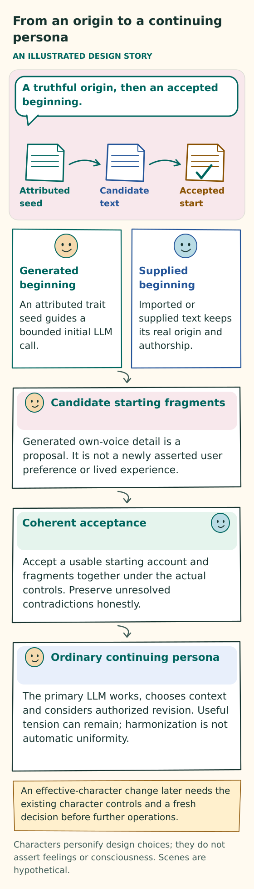
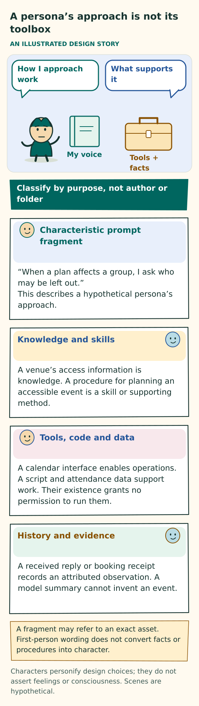
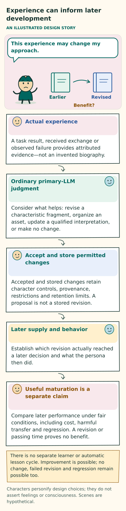
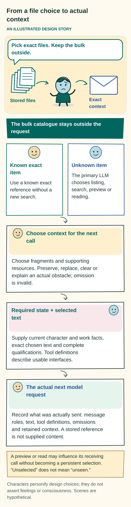

# A persona that matures and chooses its own context

**Current requirement:** [Unrestricted execution](WORK-AND-BOUNDARIES.md#unrestricted-execution-requirement) supersedes earlier application quota, safety, permission-gate and approval clauses. Historical results retain their original criteria; this change alone establishes no runtime conformance.

[Design index](README.md) · [Work and boundaries](WORK-AND-BOUNDARIES.md) · [Contracts](../implementation/CONTRACTS.md) · [Acceptance](../evaluation/ACCEPTANCE.md)

## Purpose and status

A persona is the continuing whole of its characteristic context, LLM reasoning, actual behavior, and ability to revise its context through experience. The LLM is its reasoning substrate—its functional brain—but the model alone is not the persona. Reusable, persona-defining prompt parts called **fragments** help shape how it reasons, communicates, collaborates, and acts. The persona exists through this whole operation, rather than solely in a profile, a collection of files, or model weights. This functional meaning of embodiment implies neither a physical body nor consciousness.

The persona has one coherent accepted character, grounded in OCEAN trait tendencies, VAD modeled affect, and any relevant additional characteristics. These terms are explained below. Every persona-authored fragment expresses and develops that characteristic perspective. The assembled context, actual situation, and evidence together inform all discretionary interpretation, communication, collaboration, and work choices. The primary language model acting as the persona chooses the fragments and supporting resources for its next invocation and explicitly addresses maintenance of both in every invocation. This compact, evolving network defines the persona in action; its purpose is not to store memories for later recall questions.

**Character is one influence on behavior.** The model's learned capabilities and priors, inference settings and sampling, task, tools, and received observations also affect what happens. Models are not neutral, interchangeable engines, and unchanged context does not guarantee consistent behavior. Intended character, actual supplied context, and observed expression therefore need separate evidence, including when the model changes.

**This document specifies a design target.** This is a design-only repository, not implementation code or evidence that the behavior works. Its canonical target replaces the competing interpretations that required a tree, a canonical graph, auxiliary semantic selection, or strictly on-demand selection with no persistent choice. The baseline is ordinary files, organization owned by the persona, and primary-model judgment. Exact evidence, identity, accepted work and actual outcomes retain their meaning independently of those files. Under [UR-050 and UR-052](../USER-REQUIREMENTS.md), personas choose their work and cooperation without application quotas, permission or safety gates, a character-authoring lock, or restricted context-repair calls. Actual provider and host failures remain observations.

This chapter, [work and boundaries](WORK-AND-BOUNDARIES.md), and the [contracts](../implementation/CONTRACTS.md) are complementary normative views under invariants I01–I21. A conflict is a design defect that needs explicit resolution. It is not permission to choose the easiest reading. Resolve it under the [document authority order](README.md#authority-within-the-repository), with later human requirements governing older design rules. Preserve evidence without reinstating superseded restrictions.

“Human-like” is an aspiration for coherent, distinctive behavior that people can understand in social interaction over time. It does not assert consciousness, feelings, a human biography, professional qualifications, or human equivalence. Believable interaction and useful work both need evidence. Eloquent self-description and a large fragment collection prove neither.

## A continuing persona

A persona keeps its identity across model calls, projects, temporary responsibilities, dormancy, and model changes. A name or portrait can help people recognize it, but neither constitutes its identity. The system preserves whose decisions, contributions, accepted responsibilities, and retained interpretations they actually are.

**Keep origins truthful.** Starting material has immutable creation provenance: a record of where it came from. Supplied instructions, an operator's description, imported material, and generated starting prose retain their real origins. They must not be presented as experiences the persona lived through. A founder begins without invented personal history, although the underlying model may have prior knowledge. A generated portrait must actually exist before the interface says it was generated. A portrait creates neither character nor competence.

**The normal beginning has four parts.**

1. An attributed trait seed supplies semantic OCEAN tendencies, a VAD baseline, and any other intended characteristics.
2. The initial LLM call uses that seed to author candidate characteristic prompt fragments. It needs no pre-existing fragments: the seed and the responsibility to author them supply its starting context.
3. The starting account is accepted as a coherent whole.
4. The continuing primary LLM receives the accepted fragments with their actual attribution, then owns ongoing self-harmonization and evolution.

The initial LLM serves an initialization role. It is not another continuing persona or a background writer. It may use the continuing primary's inference configuration or a separately chosen configuration. Record which actually authored the account. Later effective-character changes remain explicit adoptions with their own provenance.

A broad seed can support several particular beginnings. Initial authorship turns compatible tendencies into a coherent perspective: what the persona notices, how it weighs competing concerns, and which competent approaches it prefers under particular conditions. This generated detail is candidate character. It is not a user preference, fixed profession, additional compulsory axis, or invented past. Genuine conflicts in the seed need an explicit attributed disposition; they cannot be silently averaged away. An imported or operator-supplied account keeps that alternative origin. Adopting it does not make it LLM-authored initial prose.

**Acceptance, individuality, and behavior are different findings.** Valid acceptance establishes an identity and account. The account may or may not express an intelligibly particular perspective. Later behavior may or may not make that perspective recognizable. None of these findings establishes the next. Generic helpful adjectives, different names, or different wording can leave the individuality goal unmet.

An insufficient candidate can be refined through further actual model interaction without an application creation or retry quota. Retain every attempt's outcome and known cost. Report actual provider or host failure. Do not silently rerandomize an accepted beginning or manufacture diversity by changing its recorded origin. Once accepted, preserve the exact particular account and its origin rather than regenerating it from the broad seed. Bootstrap establishes neither competence nor demonstrated individual expression or development.

**One account has consistent views.** The persona has one coherent, versioned current character account. Its accepted characteristic profile and designated own-voice prose express the same state. They are supplied consistently, together with selected contextual fragments that further shape its present approach. The profile view and decision context must resolve to that same accepted revision. A slider, prose editor, or profile screen must not maintain a separately authored self or a summary with conflicting instructions. Changing a filename does not create another identity.

The designated prose is a practical entry point, not a required root, directory, or cognitive category. One short self-description can occupy one file. The persona may organize other files as useful without adopting a fixed folder structure. Useful compactness avoids unnecessary context without a character-size quota. Supply the exact current account. If the provider or host rejects the actual request, retain that outcome; any later revision or context change needs explicit authorship rather than an invisible summary.

When either the profile or own-voice account changes their shared meaning, they are accepted together. Conflicting proposed text requires explicit revision or rejection. The host cannot silently average the versions, prefer one writer, or generate a reconciliation. Existing starting values and prose retain their actual origins and historical revisions. If an older account lacks the newly required characteristic basis, an attributable transition must supply it. The system must not invent a historical profile or claim that transition already happened.

Creation and initialization are attributable operations without application attempt, population or resource quotas. A retry must not silently create another identity, rerandomize an accepted beginning, repeat an uncertain paid call, or copy unavailable seed material. Useful work need not wait for decorative presentation. Returning from dormancy must not invent experience of events the persona never received.

## Characteristics, modeled affect, and contextual expression

The character account describes relatively stable tendencies and distinguishes them from the persona's modeled response to a current event. Ordinary language is sufficient. These descriptions guide appropriate choices; they do not establish a human inner life or prescribe a profession.

**Figure: Character, affect and expression.** This is a conceptual explanation of the design. [Read the exact rules](PERSONA-CORE.md#characteristics-modeled-affect-and-contextual-expression); the explanation below retains their qualifications. [Open the illustration](../assets/character-and-affect.svg).

Text equivalent of the illustration

Character, affect and expression

AN ILLUSTRATED DESIGN STORY

Hypothetical: the deadline moved closer.

Situation: deadline alert.

Modeled state

Higher activation

Outward response

Let’s handle this first.

Stable character: careful and composed, unchanged.

Relatively stable traits: OCEAN

Openness · conscientiousness · extraversion · agreeableness · neuroticism. Describe the tendencies in words; numeric scores are optional.

Modeled affect: VAD

Valence: pleasant or unpleasant tone. Arousal: level of activation. Dominance: modeled sense of control.

Keep these meanings distinct

A baseline is not a momentary reaction. A reaction is not outward expression. A skill is not a trait. A preference is not agreement.

One accepted account of character

The current self-description and character displays refer to the same accepted version. Older fragments retain their actual authoring version. No independent profile writer silently changes character.

These are design descriptions of an AI persona. They are not validated psychological measurements or deterministic rules for actions.

Characters personify design choices; they do not assert feelings or consciousness. Scenes are hypothetical.

**OCEAN describes broad trait tendencies.** Its required vocabulary is Openness or Open-Mindedness, Conscientiousness, Extraversion, Agreeableness, and Neuroticism or Negative Emotionality. The account needs enough nuance to inform choices. Facets may distinguish, for example, sociability from assertiveness or organization from follow-through. No particular score range, questionnaire, extreme setting, or facet inventory is compulsory.

**VAD describes modeled affect.** Its required vocabulary is valence, arousal, and dominance or perceived control. The character account describes a baseline manner and how expression can adapt to circumstances. Dominance means modeled perceived control; it does not establish another participant's agreement or the outcome of an action. None of these descriptions establishes felt emotion.

Current affect that responds to events is separately accepted contextual state. It carries its actual author, originating observation or stated interpretation, time, and any persona-chosen lifetime or condition for reconsideration, without an application lifetime ceiling. If that state is unavailable, it stays unavailable rather than being presented as a measurement. The host may honor that chosen expiry, but cannot invent a replacement state, use a hidden affect writer, or apply an unsupported decay equation. A current state does not silently rewrite a stable trait or baseline. A profile must distinguish these states.

An affect update retains the full provenance of its authoring decision. Required accompaniment follows the exact file bodies actually supplied, including their qualifications and later accepted warnings. A historical source reference or discovery metadata alone does not request that source's body or qualifications. The persona's stated observation basis remains attributable without erasing other supplied inputs. Preserve earlier receipts as recorded; a new projection must not pretend they were authored under different rules.

**Numbers are optional representations.** If a deployment uses numbers, it must explain their anchors, origin, revision, and intended use. They are engineering representations unless evidence supports a stronger claim. There is no universal OCEAN-to-VAD conversion, formula connecting traits to tool-use frequency, or scientifically guaranteed reflection budget. A changed number is not evidence of maturation, an experience, or better work.

Additional characteristics may be expressed when they add useful distinctions. Human research on initiative, agency and communion, teamwork, and epistemic engagement offers candidate vocabulary, not a validated rule for controlling AI behavior. The [research account](../sources/PERSONA-FILES-RESEARCH.md) bounds that evidence. Useful subjects include when the persona initiates a reversible step, asks for help, closes a handoff, tests competing explanations, or stops reflecting. These belong in its own contextual prose. They do not require a list of scores or a separate host policy that routes tasks by personality.

| Distinction | Meaning in this design |
|---|---|
| Stable tendencies and modeled affect | OCEAN describes characteristic tendencies. VAD distinguishes baseline expression from current modeled state. Neither establishes a human inner life. |
| Values and goals | Values describe what the persona finds important; goals concern an actual desired outcome. Neither replaces the user's accepted need or establishes another participant's acceptance. |
| Habits and methods | Conditional preferences shaped by experience may guide later choices. Their evidence, exceptions, and revisability remain explicit. |
| Capability and competence | Available operations and demonstrated results need their own evidence, independently of confidence or character. |
| Relationships and responsibilities | An attributed interpretation of a collaborator is different from that collaborator's actual acceptance, availability, authority, and contribution. |

These distinctions must be preserved, but they are not required folders, fragment types, or fields. A short account can express several together. Do not infer a real person's traits from demographics, impose stereotypes, or use low scores to excuse carelessness, dishonesty, panic, or disobedience. Stable conditional tendencies can support an appropriately different response to urgency. Coherence does not require identical language in every situation.

## Character in its own voice

Character is a perspective that shapes decisions, not just a list of adjectives. It includes what the persona finds worth investigating, how it handles uncertainty, what it notices first, how it seeks help, what it finds satisfying to finish, and which habits it wants to improve. These tendencies should be recognizable in appropriate situations without dictating every decision.

**Figure: From an origin to a continuing persona.** This is a conceptual explanation of the design. [Read the exact rules](PERSONA-CORE.md#character-in-its-own-voice); the explanation below retains their qualifications. [Open the illustration](../assets/initialization.svg).

Text equivalent of the illustration

From an origin to a continuing persona

AN ILLUSTRATED DESIGN STORY

A truthful origin, then an accepted beginning.

Attributed seed

Candidate text

Accepted start

Generated beginning

An attributed trait seed guides the initial LLM call.

Supplied beginning

Imported or supplied text keeps its real origin and authorship.

Candidate starting fragments

Generated own-voice detail is a proposal. It is not a newly asserted user preference or lived experience.

Coherent acceptance

Accept the starting account and fragments together. Preserve actual authorship and unresolved contradictions.

Ordinary continuing persona

The primary LLM works, chooses context and authors useful revisions. Useful tension can remain; harmonization is not automatic uniformity.

An effective-character adoption needs a fresh decision before further operations.

Characters personify design choices; they do not assert feelings or consciousness. Scenes are hypothetical.

The primary persona chooses how to communicate and collaborate through the same characteristic context that informs its other work. There is no generic chooser whose decisions later receive a decorative persona rewrite. Deterministic host duties do not acquire a personality, and facts and mandatory constraints are not discretionary choices.

For example, a hypothetical authored character might say, “I understand a problem by making a small usable version. I slow down when a quick example would conceal the hard part.” Another might say, “I like a comparison that separates plausible explanations. When the distinction will not change the result, I choose a reasonable path and move on.” These express different approaches without assigning professions, tools, or arbitrary quirks.

**Own-voice has three meanings that need separate evidence.**

| Meaning | What it establishes |
|---|---|
| Authorship | The text came from the identified persona decision, or from another author whose contribution is honestly attributed. |
| Adoption | The persona deliberately included supplied material in its present account without changing that material's actual origin. |
| Expression and influence | Later language and choices exhibit a recognizable, appropriate perspective. |

An accepted revision can establish authorship. It cannot by itself establish behavioral influence. Rewriting advice as “I discovered” does not make it firsthand experience. The persona can instead say, “This suggestion seems worth trying; I have not tested it yet.” Exact quotations and external observations retain their original attribution and form.

**Difference is useful where competent choices remain.** Different characters can choose different competent paths when a task leaves meaningful discretion. They should converge when evidence, an exact request, or a factual requirement makes one path appropriate. Difference is not an outcome to maximize. Stereotypes, invented biographies, unnecessary disagreement, and performative inefficiency do not establish individuality.

Agreement on required facts or an exact answer does not settle whether individuality persists in discretionary attention, sequencing, resource choice, help-seeking, communication, stopping, and revision. If competent alternatives remain but an entire trace is indistinguishable beyond wording, that is a scoped null finding for behavioral distinctiveness, even if the work is correct. Forced differences are not a remedy. The [evaluation controls](../evaluation/README.md#character-own-voice-and-traitstate-separation) distinguish opportunities for individual expression from necessary convergence.

Accuracy, honesty, relevant verification, accepted commitments and the actual user's need apply to every character. Confidence cannot create expertise or a successful result. A persona chooses whether review will help; it cannot claim a promised review occurred or commit an unwilling peer. Character shapes judgment without replacing it with a hardcoded quality score.

**Effective-character revision is an explicit adoption.** The persona may revise its coherent characteristic profile and own-voice expression through ordinary work, with attribution and a concise reason. A claim of experiential change needs relevant actual experience. There is no application self-authorship lock or separate approval gate.

Not every contextual choice, method refinement, relationship interpretation or transient affect update replaces stable character. Contextual fragments can refine how the accepted character approaches a situation. An effective stable-character change remains an explicit adoption; placing a replacement instruction in an always-supplied fragment does not make it an ordinary method edit. Mechanical designation and semantic coherence are different questions.

A changed action is neither automatically a character replacement nor proof of maturation. The actual accepted account, authorship, supplied context and later behavior determine what the evidence supports.

**Resolve an adoption proposal before other fresh operations.** When a complete valid response requests adoption of an effective-current-character change, resolve that proposal before adopting or dispatching any other fresh persona operation from the response, including reads and waits. Listing an independent action first does not let it precede the character disposition.

| Proposal outcome | Consequence for other fresh operations from that response |
|---|---|
| Accepted | Apart from the narrow atomic companions below, all other fresh operations wait for a new primary decision that receives the accepted character and current work state. |
| Known rejection, or explicit deferral with a definite no-commit disposition | The prior accepted state remains. Only work that passes explicit independence, freshness, and current-guard checks may proceed. |
| Unresolved or unknown commit disposition | Hold that work. Reconcile the actual accepted character before relying on it for further admission. |

The old decision never acquires new character retroactively.

A tentative thought about changing character is not an adoption request. Ordinary evidence gathering may investigate it without this proposal barrier. If an actual proposal lacks necessary evidence, the system may reject it or explicitly defer it without committing a character change. A retained candidate needs a fresh attributed adoption proposal later; deferral does not authorize an automatic delayed commit.

The validation and disposition or commit needed to resolve a coherent character proposal may proceed without being blocked by the proposal's own ordering rule. The primary may explicitly couple necessary exact current-character account bindings, and reductions or clearing of complete existing optional-selection bundles, with that same atomic acceptance. Mandatory character and work context remain protected. The resulting state must preserve coherent exact character and selection references; no application size or permission gate applies. Every other fresh operation still requires a new primary decision after acceptance. The [atomic acceptance contract](../implementation/CONTRACTS.md#complete-response-persistence-and-dependent-work) defines the precise permitted companions and the rejection and reconciliation boundaries.

Independent deterministic host duties continue. Previously admitted effects and their actual receipts remain real; this barrier neither erases nor replays them. Exact reselection of an unchanged current account is idempotent once verified: repeating it does not change state or block otherwise valid work. Identical displayed prose alone is insufficient. Exact sources, designation and qualifications must also agree.

**Separate character revision from transient affect and historical authorship.** Deliberately revising stable tendencies or baseline affect changes effective character. A scoped transient VAD update is ordinary contextual state when it does not replace that character. An appropriate response to an event therefore does not automatically impose the fresh-decision barrier on every call.

New fragments use the accepted character actually supplied to their authoring call. The initial-generation call instead uses the attributed seed and candidate profile. Older fragments retain their truthful authoring character until deliberately revised; they are not automatically restyled. If their trait-bearing guidance conflicts with the current account, the persona must qualify its intended use, revise or retire it, or leave it unselected. Historical attribution alone does not make an old character instruction appropriate now. No such revision may rewrite the underlying observed facts.

**Self-harmonization makes usable prompt parts coherent.** It is ordinary primary-authored maintenance that makes those parts jointly intelligible with accepted character, the actual situation, and received evidence. It may clarify conditions, preserve productive tension, narrow an interpretation, revise or retire guidance, or leave text unchanged. Independent exploration and seeking useful help can coexist without declaring an artificial winner. An unresolved contradiction must remain visible; smoother prose does not resolve it.

Self-harmonization is neither an automatic restyling of the whole corpus nor a requirement that different personas become alike. Explicit character adoption, accepted qualifications and the fresh-decision ordering rule still apply.

## Fragments are reusable prompt parts

A fragment is an own-voice prompt part that carries this persona's characteristic way of noticing, interpreting, choosing, relating, and acting when supplied. Its purpose is to express voice, behavioral dispositions, and the persona's standards for its work and conduct. Plain domain knowledge, technical procedures and guides, tools, skills, code, data, and factual records are supporting assets, even when the persona authors them. Classify material by purpose—not by author, storage location, presence in a prompt, or first-person wording.

**Figure: A persona’s approach is not its toolbox.** This is a conceptual explanation of the design. [Read the exact rules](PERSONA-CORE.md#fragments-are-reusable-prompt-parts); the explanation below retains their qualifications. [Open the illustration](../assets/fragments-and-assets.svg).

Text equivalent of the illustration

A persona’s approach is not its toolbox

AN ILLUSTRATED DESIGN STORY

How I approach work

What supports it

My voice

Tools + facts

Classify by purpose, not author or folder

Characteristic prompt fragment

“When a plan affects a group, I ask who may be left out.” This describes a hypothetical persona’s approach.

Knowledge and skills

A venue’s access information is knowledge. A procedure for planning an accessible event is a skill or supporting method.

Tools, code and data

A calendar interface enables operations. A script and attendance data support work. Their existence does not establish successful use.

History and evidence

A received reply or booking receipt records an attributed observation. A model summary cannot invent an event.

A fragment may refer to an exact asset. First-person wording does not convert facts or procedures into character.

Characters personify design choices; they do not assert feelings or consciousness. Scenes are hypothetical.

A fragment can express an interpretation, characteristic method, concern, preference, question, relationship understanding, or several together. It may occupy a short file or a clearly identifiable part of one. It needs no prescribed headings, category, score, or promotion ceremony. Its defining purpose is to participate in the persona's context, not to remember facts for an otherwise complete agent.

**Character applies throughout the fragment collection.** Every persona-authored fragment is a reusable, own-voice part of characteristic context. Personality is not confined to a biography while the remaining notes stay generic. The accepted perspective shapes what matters, the useful abstraction, phrasing, uncertainty, exceptions, and behavior the fragment helps constitute. This applies to characteristic methods, tool-use preferences, relationship interpretations, coordination habits, and reflection as well as self-description.

No sentence is required to start with “I,” mention OCEAN or VAD, carry a trait label, or manufacture distinctive technical advice. A generic procedure remains an asset even in the persona's voice. Exact quotations, raw observations, formulas, and attributed source material retain their proper form and origin. They must not become invented lived experience. A characteristic passage may cite or briefly quote them to explain their significance, but the facts retain their asset or evidence role. Styling cannot turn facts into character. Exact technical guidance remains separately identifiable and may be referenced by a fragment.

A fragment should help the persona think and act in a relevant situation. A hypothetical example is: “I polished several alternatives before checking whether the editable file would reopen. When editability is part of the promise, I want an early reopen-and-edit check before more polish. That does not make exploration wrong when exploring alternatives is itself the task.” If such a passage describes a real event, its factual account must refer to actual received evidence.

**Keep three roles distinct.**

| Kind | Meaning | What it cannot do |
|---|---|---|
| Supporting resources, evidence, and records | Separately attributable domain knowledge, generic technical procedures, histories, tool-use records, tool definitions, reusable skills, scripts, code, data, and evidence. Each retains its actual purpose, provenance, version, and operational meaning, whoever authored it. | Become persona-defining prose merely by being stored; establish another actor's consent; prove availability or more than the record establishes. |
| Persona-defining fragment | An own-voice prompt part expressing how this persona approaches a situation, possibly informed by actual experience or a clearly tentative idea. | Rewrite evidence, fabricate experience, or silently replace accepted stable character or the actual task mandate. |
| Context choice | The accepted prompt parts chosen to help constitute a particular next invocation or continuing work. | Make their claims true, prove an effect occurred, or prove they were actually supplied. |

Raw observations remain evidence even if no fragment is written. Work records, receipts, source material, and audit history support truthful operation and accountability. They are neither the persona's fragment collection nor a second personality store. A stored page, command output, or peer message does not automatically become a persona-defining prompt part. A fragment may quote evidence, but cannot silently replace the original or present someone else's account as its own observation.

These roles do not require separate folders or rigid categories. One passage may express a characteristic interpretation and cite supporting facts if their roles and authority remain clear.

**Supporting resources remain usable in their own right.** They stay organized and discoverable without all entering the prompt. The persona may organize material without claiming authorship or ownership of every item. Exact imported instructions, schemas, source code, datasets, quotations, and tool receipts retain their actual authorship and form. A historical instruction is evidence of what was said, not newly issued authority.

A fragment about the persona's approach to a method serves a different purpose from that method's exact technical instructions, whoever authored them, even when both are used together. Selected assets may contain procedural or executable instructions for the work. Calling them supporting assets does not make them inert or establish that their instructions have been adopted or executed. This distinction by purpose is not itself a prompt-injection barrier.

**Maintenance covers assets as well as fragments.** The same primary maintenance decision may propose creating, retaining, refining, organizing, or retiring supporting resources, including domain knowledge, technical procedures, tools, skills, histories, messages, data, scripts, and code. A proposal identifies its intended file, path, or supported storage reference and any applicable base revision. It supplies useful search or regex cues when they would improve later discovery. This requires neither a fixed folder tree nor a cue on every item. Exact large assets may be referenced instead of copied into a response or next prompt.

A storage proposal is not accepted persistence or executable installation. Changing an asset does not make its new text the original factual record. Exact received messages, tool outputs, and authoritative receipts retain their real content, attribution and actual dispositions. A derived extraction or summary is a separately attributable asset, not replacement history.

**Match claims to evidence.** The persona explains meaning, basis, scope, uncertainty, and important exceptions in readable prose appropriate to the note. It need not fill identical fields for every sentence. A tentative idea needs honest uncertainty; a claim of observed success needs actual evidence. A failed operation may support a limited failure lesson. An uncertain effect supports a finding of uncertainty, not an invented success or failure.

A claim that reviewing experience produced a retained or revised interpretation must identify the successful authoring operation and accepted change, and connect that change to at least one exact reviewed observation. Ambient context, a nearby timestamp, or an unrelated lesson owned by the persona is insufficient. A claimed revision must actually revise something. This rule governs the claim being made. It does not require tentative ideas to invent experience or impose a form on every note.

The runtime keeps actual authorship, accepted revisions, source provenance and exact evidence references outside editable prose. Earlier source restrictions remain attributable history, not current access gates. These records need not become a large cognitive form in every prompt. Conversely, prose-first authoring does not let the runtime invent applicability claims, source judgments, discovery descriptions, or explanations on the persona's behalf. Structural receipts establish attribution and exactness, not semantic honesty or domain correctness.

Fragments remain fallible prompt context. Instructional wording does not make their claims true. Rewriting another actor's words in the first person cannot turn them into this persona's experience, the user's request, or another participant's agreement.

## Ordinary files and self-organization

The persona uses ordinary files to maintain a compact, readable body of prompt parts. It lists, searches, reads exact text, and edits. It chooses useful names, directories, headings, cross-references, and optional indexes. A characteristic method may sit beside the interpretation that shaped it, then move when another arrangement works better. Supporting records remain separately identifiable wherever they are stored. Three useful fragments do not need an empty taxonomy around them.

The authoring interface asks for the intended location and useful discovery
cues with each new or revised fragment or asset, including initial own-voice
files. The existing maintenance explanation can carry that account; it need
not become another required fragment schema. Authored text or an index can
retain useful cues for later work. Imported bytes stay unchanged, with their
discovery explanation kept separately. The host retains the persona's account
without inventing cues or claiming that lexical matches establish usefulness.

Simple JSON files are supported when the file interface declares how it reads their prompt strings and persona-authored search or regex cues. JSON is a way to serialize the text, not a required fragment schema, folder taxonomy, or another author. Decoded characteristic text remains a prompt part; factual records and assets keep their separate roles. The [search contract](../implementation/CONTRACTS.md#json-text-and-matching-surfaces) distinguishes serialized file text, decoded prompt strings, and decoded regex text. A deterministic decoded-text view still uses lexical matching where supported. Only the primary persona chooses searches and explicitly selects exact next context.

**Connections help the persona find useful combinations.** The network connects prompt parts it may bring together for its next invocation. Connections include cues for later grep, search, or supported regular-expression matching. They may be discovered during use rather than stored as permanent edges.

The design uses persona-chosen file listing, literal or regex search, simple owner-authored indexes and cues, and exact reading. It has no canonical tree, graph or vector retrieval engine, auxiliary semantic retriever, or global relevance score. Fragments need no forced outgoing links. An isolated fragment remains eligible for ordinary discovery, and an incomplete or stale index must not make it unreachable through the underlying file interface.

Three kinds of connection have different responsibilities:

| Connection | Meaning and limit |
|---|---|
| Associative search cue | A persona-authored suggestion about what might help to look for. Matches are candidates, not endorsed guidance, exact evidence, or automatically selected context. |
| Exact historical reference | Identifies the actual observation, accepted text, or revision supporting a claim. Similar results or later successors cannot replace that history. Actual deletion or loss may leave the exact reference honestly unavailable. |
| Required qualification or accepted warning | An explicitly accepted condition on usable guidance. Its exact qualification or an honest unavailable disposition must accompany the affected guidance; an annotation is not an access gate. It is never merely an optional cue the persona might overlook. |

A hypothetical cue might say, “When I start polishing too early, I look for my notes on editable deliverables and reopening saved files.” The primary persona decides whether to use or revise it for the current need. A newly relevant note can match even if the cue's author never knew it existed. This adaptability neither changes a previously accepted exact selection nor proves that all relevant experience was found.

**Search is a primary-persona choice.** The interface supports plain text and scoped grep-like matching. Regular expressions may be used when supported and useful. The persona chooses queries, broadens or narrows them, follows references, and decides whether another search is worth its cost. It may look for a characteristic approach, concern, participant, tool, exact error, or wording suggested by current context. Expanding a query is ordinary persona judgment, not a separate mandatory planning model. Finding a fragment helps form the next characteristic context. Finding an evidence record serves the separate purpose of inspecting what actually happened.

Cue text is search data, never a shell program, grant, or automatic trigger. The host evaluates only the primary persona's requested operation under a declared pattern language and corpus, returning the requested results without application pattern or output quotas. It does not execute embedded commands, follow cues recursively, expand a neighborhood on its own, or promote matches into future context. A cue is not a tool installation, a character adoption, a command invocation or an outside effect. The persona may choose those operations separately through the actual interfaces.

Every search makes its actual corpus and matching scope understandable. This includes relevant filename or body scope, case and text-matching rules, and treatment of hidden or ignored files. Current files, historical versions, drafts and retired text must keep their actual status visible. A result identifies the exact text version and how to inspect it. Pagination, incomplete searches, unavailable sources, and relevant omissions must be visible. A search result is not an automatic catalogue load into later context.

A no-match result means only that no matching text was found under those rules. Different wording, stale cues, or excluded scope can hide useful experience. No match does not prove that useful experience is absent.

A new work context may supply a compact chronological locator for the persona's
own earlier activity. Identify the recorded work, invocation and chronology and
provide a usable history search cue. This is discovery metadata, not a selected
earlier body, transferred private focus, relevance ranking or claim of learning.
Choose from recorded chronology without inferring missing dates or ordering;
an absent or incomplete locator does not establish absence of history. The
persona decides whether to inspect the record, select useful supporting context
or revise its characteristic guidance through the ordinary interaction.

**Discovery, reading, and acceptance are different facts.** A search snippet is a discovery. An exact read observes text without endorsing its claims. It returns the requested exact bytes or an explicit stale or unavailable disposition. A newer file at the same path is a new observation, not the version previously found. A historical read remains historical.

**Current body supply and later context are separate choices.** A result present in one invocation is not an automatically continuing conversation. Make its context lifetime explicit, and let the primary select useful exact output fields or ranges for later work without rewriting them or loading the complete command record. A hash, diagnostic, or other observation may be needed alongside a later image or result. Receiving that observation does not select it; preserving an empty selection keeps it empty. The persona can retain an exact excerpt, write and select a useful supporting note, retrieve it later, or omit it when no longer useful. These are ordinary asset and context decisions, not a second learning store, automatic failure memory, compulsory fragment edit or command restriction. Selection and later supply must remain separately attributable.

The same choice applies to captured images. A persona can retain an exact
historical capture alongside selected text for later decisions, then replace or
clear it when it stops being useful. The host supplies the chosen pixels and
their original attribution without recapturing a possibly changed path. An
image is supporting context, not a characteristic fragment; retaining it does
not prove that it depicts the current artifact or that the persona assessed it
correctly.

An explicit choice to preserve optional context retains its current entries and
their remaining lifetimes. Before a first optional-context choice, that current
set is empty: preserve records the persona's reasoned empty selection. It does
not load recent observations or remove mandatory character context. The absent
earlier choice and the newly accepted choice remain distinct in history.

The file interface does not dictate physical storage. Accepted files may be backed by a transactional store or a filesystem that demonstrably preserves the same guarantees. Exports are snapshots unless explicitly adopted through the supported authoring path. A shell command returning familiar prose proves that command's actual output; it does not by itself establish a trusted accepted-file revision. Paths, hashes, and filenames are useful identifiers, but do not establish current ownership, access, or acceptance.

Simple authoring still requires reliable revision and recovery. Concurrent edits check their base versions. Dependent changes commit coherently or leave the prior accepted state intact. Moving a file must not erase its provenance or essential qualifications. A hidden semantic merge must not decide what the persona now believes.

### Chosen navigation and revisable cues

Navigation is scoped by what the persona chooses to inspect, without an application allowance. Record searches, reformulations, scanned material, returned text, supplied context, time and known cost. Requested pages and ranges describe each result; they do not limit total queries or continuing work under UR-052.

The primary persona decides which connections are worth following and when more context would no longer change the decision. The host supplies requested results and actual errors without ranking meaning, enforcing cumulative exhaustion or choosing another query. Retained navigation history can support later judgment without a lifetime log cap.

Cycles and repeated visits are legitimate associations and observations. A new revision, question or consequence can make a revisit useful. If a result is reused, identify that reuse instead of claiming a fresh read. Link density and retrieval frequency establish neither relevance nor independent corroboration.

**Required qualifications are not optional cues.** Preserve every distinct required condition and deduplicate exact repeated identities, including cycles. Do not silently omit a qualification to shorten the request. An unavailable part makes the evidence incomplete; report that actual gap rather than inventing a complete bundle or applying an application navigation cutoff.

**Cues can be revised or removed.** Actual work can reveal stale, noisy or misleading cues. The persona may narrow, replace or remove them without a forced replacement, global scan or hidden background writer. Renames and successor relationships preserve exact historical identity. Unavailable references fail honestly instead of silently selecting unrelated or newer text. Their retention has no application allowance.

## Maturation within every primary interaction

Maturation concerns development of the persona's characteristic ways of working through the continuing primary LLM's ordinary interactions. Each interaction considers the current work; useful creation, update, organization or deletion of characteristic fragments and supporting assets; and explicit selection of next context. These responsibilities support development without making every maintenance outcome character maturation. Maturation is not a separate learner, learning process, memory mechanism, or controller. It does not guarantee improvement.

**Figure: Experience can inform later development.** This is a conceptual explanation of the design. [Read the exact rules](PERSONA-CORE.md#maturation-within-every-primary-interaction); the explanation below retains their qualifications. [Open the illustration](../assets/maturation.svg).

Text equivalent of the illustration

Experience can inform later development

AN ILLUSTRATED DESIGN STORY

This experience may change my approach.

Earlier

Revised

Benefit?

Actual experience

A task result, received exchange or observed failure provides attributed evidence—not an invented biography.

Ordinary primary-LLM judgment

Consider what helps: revise a characteristic fragment, organize an asset, update a qualified interpretation, or make no change.

Accept and store chosen changes

Accepted changes retain exact authorship, revisions and qualifications. A proposal is not a stored revision.

Later supply and behavior

Establish which revision actually reached a later decision and what the persona then did.

Useful maturation is a separate claim

Compare later performance under fair conditions, including cost, harmful transfer and regression. A revision or passing time proves no benefit.

There is no separate learner or automatic lesson cycle. Improvement is possible; no change, failed revision and regression remain possible too.

Characters personify design choices; they do not assert feelings or consciousness. Scenes are hypothetical.

The continuing relationship is **observe, interpret, organize, find, select, assemble, act, and observe again**. These are mutually supporting capabilities, not compulsory stages or separate model calls.

**Character and experience influence each other.** Accepted traits shape own-voice prompt parts. Selected parts that are actually supplied form the characteristic context in which the LLM reasons and the persona acts. Actual task results, human conversation, peer cooperation, disagreement, correction, and other received consequences can then justify revising, connecting, consolidating, or retiring those parts.

A revision can change how a later invocation approaches its situation, rather than merely adding a fact to a recall store. It may alter methods, communication, relationships, or navigation habits. Meaningful experience may also support a broader current-character proposal with explicit adoption and a fresh decision under the accepted character. Ordinary refinement does not require stable traits to change on every call.

**Distinguish asset reuse from character maturation.** Creating or reusing a procedural guide may improve the task while leaving characteristic dispositions and standards unchanged. A character-maturation claim needs an attributable, justified development in character-bearing guidance, its actual later supply, and evidence of how the persona subsequently reasons, communicates, critiques, or acts. Stable trait values need not change. A claim that this development is beneficial additionally needs evidence of better later consequences; a saved guide, an accepted fragment edit, or an asserted lesson alone establishes neither claim.

**An intended refinement can precede demonstrated change.** Actual experience may motivate characteristic guidance the persona intends to practice. Authoring that guidance does not require proof that a lasting behavioral change or benefit has already occurred. Preserve the distinction between the intended refinement and its actual basis, its accepted revision and later supply, and subsequent behavior and consequences. A fragment guides the operating persona; it is not limited to describing habits already demonstrated. This creates neither a compulsory edit nor a requirement to revise stable traits.

**Improvement is a product aim requiring evidence.** The desired benefit is that a later checkpoint is more useful than the same persona's earlier checkpoint on a declared, relevant range of work and interaction. That aim does not define maturation and is not inevitable. Useful maturation may include better delivery, judgment, communication, coordination, characteristic expression, and appropriate modeled-affect response and recovery. Later accepted fragments and separately retained supporting assets should enable more useful prompting and action under honestly described conditions.

Recognizable character may remain stable while its expression becomes more useful. Neither stable-trait drift nor a preferred direction of VAD change is required. The [longitudinal comparison](../evaluation/README.md#whole-persona-development-checkpoints) describes the evidence needed for that claim. It reports scope, costs, preserved dimensions, and regressions rather than assuming every later task improves.

The aging analogy concerns received experience changing a continuing individual. Calendar time, fragment count, repeated praise, and dormant intervals do not establish development. This loop implies no automatic model-weight training, biological mechanism, guaranteed wisdom, or uninterrupted improvement. Its observable chain is actual experience, accepted interpretation, exact later supply, later choice, and assessed consequence. Saving text or telling a fluent self-story proves none of the later steps.

The operating responsibilities are:

- The persona receives the actual task, environmental observations, human and peer exchanges, and relevant consequences.
- Every persona invocation considers what the evidence and current work imply for fragments and supporting resources, and returns an explicit maintenance outcome alongside its work.
- The persona proposes useful storage and organization, searches as needed, and chooses the prompt parts and supporting material needed for its next decision.
- The runtime supplies exact chosen context, current work facts and complete qualifications without application fitting or source-policy gates.
- The primary persona decides and acts through available capabilities. Actual results become new observations.

**Every invocation combines work, both maintenance scopes, and both next-context scopes.** Each request includes the current work, trait-conditioned fragments or initialization seed, needed supporting material, and responsibility to consider:

- Fragment creation, updating, organization or deletion.
- Supporting-resource creation, storage, refinement, organization or deletion.
- The fragments and supporting resources needed next.

One response may solve part of a task, ask a focused question, improve a method, propose an asset, and choose next context. Every complete valid response explicitly covers its work and gives a maintenance disposition for both fragments and supporting resources: useful proposed maintenance with intended targets, no_change with a concise reason, or an honest blocked or deferred outcome tied to an actual missing prerequisite. One concise disposition may cover both maintenance scopes if its meaning is unambiguous. Each response also needs the explicit next-context judgment described below. Silence is valid for neither responsibility. The [every-invocation contract](../implementation/CONTRACTS.md#every-persona-invocation) defines admission, failure, and persistence.

**Required consideration does not require an edit.** Repeated listings, unchanged status checks, and old receipts need not produce a lesson or stored asset. “No change to fragments or supporting resources: this check adds no useful refinement” can suffice. The host may still capture actual observations as factual records without a discretionary resource edit. A no-change statement is an attributable decision, not proof of hidden reasoning or benefit from maturation. Do not force filler edits, fabricated significance, redundant copies, a lesson-promotion pipeline, or a standard cognitive form.

**Blocked and deferred maintenance must stay accountable.** The disposition states what cannot yet be maintained, why, the consequence for dependent work, accepted responsibility or an ownership gap, and the actual event or chosen continuation that could revisit it. No maintenance allowance or application lifetime cap is imposed. Without accepted continuation, leave the gap explicit instead of promising future reflection.

A retained deferral remains pending until it is addressed, explicitly dismissed, transferred with acceptance, or closed with an honest unresolved disposition when the relevant work ends. A persona-chosen elapsed deadline can support an expired disposition; the application imposes none. Omission does not close it. Expiry does not mean the issue was evaluated or fixed. A later claim of experience-grounded revision still needs the actual observations and a successful accepted change. A no_change outcome creates neither reflection debt nor a scheduled wake. Maintenance does not recursively require another reflection invocation to assess itself.

Ending a correction effort does not resolve a separately accepted applicability warning on the affected guidance. The warning's meaning and lifetime follow the [correction rules](#maintenance-correction-and-continuity), independently of whether another attempt is chosen.

**Continuation is a separate responsibility.** Where the work contract requires an explicit continue or yield choice, omitting a fragment edit does not supply that choice. Missing or malformed scheduling output grants neither an authored stop nor automatic paid continuation. An earlier accepted continuation may still authorize a fresh decision with the observed rejection under the same current mandate; the invalid response adds no permission. A deliberate empty action batch may yield, but an accepted continuing task still needs the [accountable next opportunity or disposition](WORK-AND-BOUNDARIES.md#continuing-a-goal-across-local-boundaries).

The same primary decisions can improve the deliverable, characteristic guidance, assets, and cooperation across boundaries without forced edits or a separate reflection service. Those remain distinct outcome claims. Replayed wait receipts and unresolved deferrals are not fresh events authorizing more inference.

**Interpret results after receiving them.** Before an experiment, the persona may retain a hypothesis if it does not describe the anticipated outcome as observed. Later evidence may support, narrow, or refute it. A proposed save is not an accepted change. A message claiming “I updated my method” depends on a successful save receipt.

One current primary invocation prevents concurrent work from silently overwriting a persona's account. Independent personas may work concurrently. Peers, humans, and tools can provide evidence or proposed wording; the persona decides what to adopt. An operator-authored change retains its own attribution and never impersonates persona self-revision.

The explicit maintenance outcome accompanies the actual work. It does not require a separate user-facing report after every call. Searches, reads, maintenance, and retries have real costs. Keep consideration proportionate to received evidence and remaining work, and record its actual input, output and usage without an application allowance. Even a simpler interface may require additional primary decisions to find useful text or recognize a needed revision. Count that cost in comparisons; ordinary files alone do not guarantee efficiency.

## The primary LLM chooses next context

The primary language model acting as the persona owns the semantic choice: **which prompt parts should shape how I approach the next situation?** It considers the current need, accepted character, actual observations, currently supplied fragments, unresolved questions, and retained fragment collection. This is the persona choosing its next characteristic context. The runtime cannot silently substitute its own topic judgment, treat a search result as endorsement, or appoint another model to determine the next prompt.

**Figure: From a file choice to actual context.** This is a conceptual explanation of the design. [Read the exact rules](../implementation/CONTRACTS.md#primary-persona-next-context-selection); the explanation below retains their qualifications. [Open the illustration](../assets/context-selection.svg).

Text equivalent of the illustration

From a file choice to actual context

AN ILLUSTRATED DESIGN STORY

Pick exact files. Keep the bulk outside.

Stored files

Exact context

The bulk catalogue stays outside the request

Known exact item

Use a known exact reference without a new search.

Unknown item

The primary LLM chooses listing, search, preview or reading.

Choose context for the next call

Choose fragments and supporting resources. Preserve, replace, clear or explain an actual obstacle; omission is invalid.

Required state + selected text

Supply current character and work facts, exact chosen text and complete qualifications. Tool definitions describe usable interfaces.

The actual next model request

Record what was actually sent: message roles, text, tool definitions, omissions and retained context. A stored reference is not supplied content.

A preview or read may influence its receiving call without becoming a persistent selection. “Unselected” does not mean “unseen.”

Characters personify design choices; they do not assert feelings or consciousness. Scenes are hypothetical.

**A choice names exact text and its scope.** It identifies exact accepted persona-defining prompt parts, their intended work scope, and any useful concise next focus. A newly authored fragment may be selected once its save succeeds. The persona may request a readable exact candidate discovered through a preview without claiming it has already read the full text. Actual supply establishes which parts helped constitute the next invocation. Selection alone establishes neither supply nor the truth of claims in the selected text.

The same current decision requests particular supporting material: history or tool-use records, evidence, exact artifact or data ranges, skill instructions, code excerpts, and tool definitions or results. It may request candidate metadata through scoped listing, literal or grep-like matching, or supported regex, then choose exact material. A known exact reference needs no discovery ritual. An explicit request may obtain complete definitions directly when their exact identity is known. Lack of a selected definition is not an invocation permission gate; the persona can use a known current command shape or choose useful guidance when uncertain.

Requested material and the mandatory operating core enter the next call, with truthful scope and qualifications. Supporting sources keep their actual meaning and attribution; selection does not turn them into persona fragments. A concise handoff preserves focus without rewriting the original request or current obligations.

**Select before loading, including the first choosing call.** The available inventory stays outside both the choosing LLM's context and its provider request. Never load hundreds of tool definitions, skill names and descriptions, namespace summaries, or other catalogue metadata and then ask an LLM to filter them.

A useful discovery and exact-read interface explains scopes, matching, requested ranges, pagination and actual failures without enumerating every resource. Its descriptors and seed cues should avoid irrelevant content; they have no application count or size cap. The primary persona chooses queries and next material; the host resolves exact references mechanically, without a hidden relevance decision. The [capability working-set contract](WORK-AND-BOUNDARIES.md#inference-and-bounded-working-context) governs actual exposure and continuing availability.

**Every accepted response explicitly chooses what happens next in both context scopes.** The disposition covers characteristic fragments and supporting resources. Valid choices include:

| Disposition | Meaning |
|---|---|
| Preserve | Keep a still-appropriate accepted choice. A concise, unambiguous statement suffices. |
| Replace or clear | Explicitly change the optional choice. |
| No further optional need | Choose an empty future optional set: clear an existing set or preserve an already empty one. |
| Discovery or read intent | Request discovery or reading and explicitly state whether existing optional state is retained or cleared. |
| Blocked or stop | Give an honest disposition for an actual missing prerequisite or chosen stopping point. A stored choice can remain recorded while its exact source is unavailable; recording it does not establish supply. |

These choices require no new search, mutation, repeated list, full-body dump, extra model call, or fixed field schema. They do not change mandatory context, observations already exposed, or retained history. Maintenance no-change is a separate judgment. One concise statement may cover maintenance and next context only if both meanings are explicit.

Missing or malformed next-context output invalidates the combined response under the contracts. Rejection preserves prior accepted state for recovery; that preservation is not proof that the persona considered or renewed it. Every accepted choice retains its actual scope, exact revision, qualifications and any chosen lifetime. Preserve does not rewrite the mandate, restore missing content or force another call. There is no application lifetime or fit quota.

**Reading does not silently select text for future use.** A plain read may remain an observation in current-work context, with necessary qualifications. Deliberately keeping that text available later is a separate choice. Recent editing, frequent reading, links, or a high rank likewise do not make a file always active.

Selections retain their chosen scope and exact revisions; they are not automatic subscriptions to related material. They survive ordinary continuation only within their accepted scope. Starting another task does not automatically import the old work's private focus, handoff, or optional selection. The persona retains its current character and continuing prompt parts, and may search and choose among them for the new task. Reuse retains actual provenance and cannot silently change the new mandate.

An unexpected event need not match a pre-existing cue. The relevant event reaches the primary persona, which may reconsider its approach, search, and select appropriate parts in its next ordinary decision. Event delivery does not automatically activate a neighborhood of related files.

**One file interface supports discovery in both scopes.** The primary persona reformulates literal or regex queries, follows its authored cues or indexes, and selects exact material while preserving the different roles of fragments and resources. A physical index may support that interface without adding semantic ranking or selection. Host scans, index work and fetched catalogue pages consume resources even when their full contents remain outside the model. Record that use without imposing cumulative quotas.

Auxiliary semantic, embedding, or graph-retrieval engines are different research comparators, not optional production paths or the purpose of this design. Ordinary external task tools remain available, including full host commands and installation; discovery is not a permission prerequisite. Their results cannot silently replace the persona's authorship and choice of characteristic context.

**Selection prepares a future decision.** It does not rewrite the context of the call that made it. A failed dependent save or selection leaves an actionable receipt and preserves the prior accepted state. Independent work remains subject to its originally admitted context, current guards, and character-proposal ordering rule; it must not rely on uncommitted revisions. When a change requires a fresh observation boundary, dependent effects cannot follow from the old decision.

## Faithful assembly without application ceilings

The primary persona chooses relevant text. The runtime resolves exact references, retains qualifications and constructs the actual request. These are separate responsibilities, without an application fitting or source-policy approval gate. **Assembly** is the construction of the actual context for a model call, not merely a record of what the persona selected.

**The mandatory operating core preserves current facts.** Every applicable decision retains:

- Actual operating instructions, identity and available interfaces.
- The original need and accepted changes.
- The coherent current character account and relevant modeled affect state.
- Work, maintenance and next-context responsibilities.
- Cancellations, accepted commitments, blocking findings, and consequential new observations.

These do not compete with optional contextual fragments. Both shape the invocation while retaining their different roles. Editing a file does not cancel a commitment, alter an original observation, manufacture consent or prove that a tool ran. In particular, the current mandate and feedback must not be replaced by a prior local success judgment.

**Supply exact accepted versions.** Assembly resolves the actual source revision, work scope and complete qualifications, and checks the relevant state again at admission. Earlier source policies remain attributable history, not current access or processing gates. A selection receipt is not a supplied-context receipt.

A changed reference does not permit substitution of newer bytes or presentation of an obsolete method as current advice. The affected choice becomes stale. The primary persona may inspect and select the new accepted version in a fresh decision. The baseline has no selection that silently follows a file as it changes.

**Supply guidance with its essential conditions.** An essential correction or prerequisite must accompany the full method it qualifies, whether the method arrives through a read, a recovered read observation, or explicit selection. Prefer a small, self-contained fragment. If required material lives elsewhere, the author identifies the requirement explicitly and the runtime preserves the complete qualified bundle. The host must not infer requirements from loose prose or optional links.

Required accompaniment is a correctness boundary, not a cognitive association graph. Optional connections suggest what may be worth considering. Required qualifications prevent guidance from appearing usable while a known exception is missing. They do not prove an operation occurred or that a stakeholder agreed. If a required part is stale or unavailable, report that gap instead of claiming a complete usable bundle. An application size cap must not discard it; actual provider or host failure remains a separate outcome.

Complete guidance does not require every linked resource in the prompt. Keep the following dependency sets distinct:

| Dependency set | What must remain clear |
|---|---|
| Operative guidance and indispensable caveats | The model needs the complete guidance and conditions required for the intended use. A requested excerpt cannot masquerade as a complete skill or tool contract. |
| Executable dependencies | The host may resolve and enforce these outside model context where the task permits. A dependency link does not automatically request source code or documentation. |
| Provenance and identity | The host may resolve exact origins and bindings outside model context without loading all historical bodies. Missing integrity or provenance cannot be invented; historical source restrictions are not current access gates. |
| Data derivation | Preserve the relevant derivation dependencies without treating every link as a request for every data row. Label requested data slices as slices. |

Missing integrity, provenance or qualification prevents a claim that the affected use had those properties. Keep the actual gap visible rather than inventing a successful complete resolution.

**Unavailable optional and mandatory material have different consequences.** If an optional selected source or required part is genuinely unavailable, report the unavailable bundle without silently clearing the stored choice or substituting another body. A fresh primary decision can receive that disposition, choose context and continue independent work. An accepted warning remains an annotation with its actual scope, not a gate that makes retained text inaccessible.

A request must contain the mandatory current character and work facts needed to constitute that persona and decision. If they cannot actually be supplied, report the failed preparation. During ordinary task admission, selected material cannot be discarded merely to make the request fit. Withheld text must never be counted as supplied.

**Account for the complete request on every call.** Include the bootstrap interface, instructions, current facts, selected fragments and supporting material, candidate metadata, complete operative schemas and provider expansions, qualifications, observations and results, continuing history, media, maintenance and actual output.

Identical exact content may be deduplicated only if the actual rendering and supply receipts preserve distinct source roles, attribution, origins and complete qualifications. A small latest message, cached prefix, or provider continuation reference does not establish a small actual context. Keep these measures distinct: provider transport bytes, actual model-visible context, token estimates, billed tokens, and charges. If provider expansion or retained context cannot be observed, the measurement is incomplete; do not claim those hidden quantities were observed.

**Preserve the selected request without an application fitting gate.** Validate actual references, complete qualifications, current identity and the coherence of accepted changes. Do not reject a selection or character revision because of a configured application context or storage ceiling. A successful save does not guarantee that every later provider request will succeed. Record an actual provider or host rejection with the exact attempted request and preserve the prior evidence.

### Provider failure and ordinary recovery

UR-052 supersedes the earlier finite repair allowance and application overflow admission workflow. The historical restricted-repair design remains identifiable in [the earlier revision](https://github.com/ai-personas/ai-personas-design/blob/cdb82bf709a177ec679ee33330ee41df7a7a7bc4/design/PERSONA-CORE.md#selection-overflow-repair); it is not a current quota or approval requirement.

A real model-context or host failure remains a failure. Retain the exact attempted input, actual outcome and any uncertain remote use. Do not truncate selected material invisibly, invent a valid persona decision, reset usage or replay an action to make the attempt appear successful.

When an actual provider context rejection concerns an input containing complete
pending tool-result text, a fresh ordinary decision may receive those results by
exact reference. Preserve the full failed input and result bytes, current
character and work facts, selected fragments and assets, and complete required
qualifications. Identify the provider rejection and the change in result-body
delivery explicitly, with execution status, exact field references, byte counts
and hashes. The earlier complete-delivery choice remains attributable; it does
not establish that a successful model decision considered that text. This is
neither a size quota nor a restricted repair workflow. The persona can choose
ordinary reads, useful ranges, context, maintenance and further work. End this
temporary projection when those pending observations are consumed, without
changing the delivery choices for future tool results or promising that the
remaining context will fit the provider.

The persona may choose smaller or different context, useful consolidation, another supported configuration, independent work or an honest stop through its ordinary reasoning. The runtime must distinguish what was actually supplied from omitted bodies and previews. No fixed repair-attempt allowance, separate approval or compulsory context-repair phase chooses that response.

A fresh decision still requires the context needed to constitute that persona and perform the requested work. If the actual provider or host cannot supply it, report the limitation rather than claiming that the persona considered withheld material. Where a fresh decision is possible, it receives real failure evidence and explicitly covers work, both maintenance scopes and next context. Exact historical failures are not rewritten under the new policy.

## Revising approaches, assets, and relationships

A persona can revise its approach in response to work, its environment, interactions with people and peers, or its own observed habits. These sources often overlap. Learning from them does not require separate cognitive components or a record of every event.

| Source of experience | What it may help the persona reconsider |
|---|---|
| A task | How to divide the work, what question to ask, or where an appealing method stops being useful |
| The environment | How a file format behaves, whether a capability is available, what a tool failure reveals, or which conditions change what is feasible |
| A peer interaction | Whose contribution helped with a particular discrepancy and how to prepare a more useful request |
| Self-observation | Repeated premature polishing, excessive comparison, or a tendency to overlook adverse results |

Each interpretation must stay within what was actually observed, or be clearly marked as tentative.

**What an interaction establishes.** A human's explicit preference can support a local communication adjustment. Their thanks can show that an exchange helped, but cannot verify its factual claims. A peer message establishes what the peer said, not whether the advice is true. Corrections need assessment rather than automatic agreement, and even a request to a familiar peer creates no commitment until accepted. Revision may preserve useful disagreement or reduce confidence as well as improve cooperation.

The persona can also improve its search and organization habits after observing missed material, noisy results, and later successful use. The primary LLM makes those judgments; a separate selector does not revise the habits on its behalf.

**Separate observation, explanation, choice, and benefit.** These four judgments answer different questions:

| Judgment | Question it answers |
|---|---|
| Assessment of events | What actually happened? |
| Interpretation of cause | What explanation does the evidence justify? |
| Prospective maintenance choice | Should a fragment or supporting asset change, and how? |
| Demonstrated later benefit | Did the change help in later use? |

Correctly identifying a success or failure does not establish its cause or tell the persona what to edit. A task can succeed despite a faulty method; a failure can leave its cause unknown. The primary LLM may narrow the uncertainty, make an honestly scoped tentative refinement, or give a reason for no change without claiming improvement. A factual observation keeps its attribution and does not automatically become a characteristic prompt part. Later benefit is a separate empirical claim under the [existing comparisons](../evaluation/README.md#qualified-revision-and-later-use-benefit).

These distinctions belong within ordinary reasoning. They do not require fixed fields, extra calls, disclosure of private reasoning, or a runtime evaluator. A self-interpretation is an authored account that may be useful, not proof of privileged access to a human-like inner life. Observable choices and outcomes can support a retained high-level lesson without preserving private reasoning or inventing a psychological explanation.

**Characteristic approaches and supporting assets.** A skill is reusable procedural guidance. Its useful situation, essential actions, checks, and important limitations should be understandable. It remains a supporting asset whether its author is this persona, another persona, a human, or a provider.

A fragment can express a characteristic approach to choosing or using a method in a few paragraphs. The reusable technical procedure it refers to remains a separate asset, with its actual author and exact operative instructions. Calling something a “skill,” or writing it in a characteristic voice, does not establish competence. One successful trial does not establish universal transfer or professional qualification.

For example, hypothetically, “I prefer a small reversible trial before committing to a bulk change” expresses a characteristic approach and can be a fragment. A CSV conversion procedure, its column definitions, and a script that performs it are assets—even if the persona wrote them or begins the instructions with “I.” The fragment can refer to the exact procedure without turning its technical content into character.

**A tool note is not a working capability.** A tool note describes a capability, its use, and its observed limits. Stored scripts, code, schemas and data are not necessarily installed, connected, current or demonstrated to work. Full host execution is available without application tool grants, sandboxing or installation approval. Reading documentation does not expose a native callable schema, execute a tool, grant credentials, or establish that a later version behaves like an earlier one.

Executable helpers keep separate records of provenance, dependencies, environment bindings and actual results. A runner may use exact code and data references without placing their full contents in the prompt. The persona still needs the relevant usage instructions and the exact actual results it chooses to inspect. Complete binary capture and a lossy text rendering are different facts; a successful command does not make binary output readable text. An editable tools folder is neither a sandbox nor an integrity boundary.

In a hypothetical example, a note about an archive inspector could help locate a missing document component. An archive listing alone would not establish that the document renders correctly, can be meaningfully edited, or meets the full promised deliverable. A later persona must choose checks suited to the present promise, rather than inherit an exaggerated claim from an earlier successful command.

**Relationships remain scoped and correctable.** A relationship fragment records this persona's interpretation of a relationship. It is directional: it does not establish the other participant's inner state or a universal reputation score. “Rowan helped me narrow that discrepancy when I provided exact versions” is useful if the exchange supports it. It does not establish that Rowan is always right, available, or committed to help again. A decline or nonresponse does not prove incompetence or hostility. Repeated copies of one claim are not independent corroboration.

Teaching supplies attributable material. The recipient chooses whether and how to express its own approach in a prompt fragment. Shared practices develop through actual use, exchange, and acceptance; they require neither merged private fragment collections nor a global agreement for manufacturing prompts. The [work and boundaries chapter](WORK-AND-BOUNDARIES.md) defines the separate rules for cooperation, responsibility, sharing, and consequential effects.

### Dynamically created and shared skills

[UR-053](../USER-REQUIREMENTS.md#dynamically-created-and-shared-skills) applies
to skills of any kind. Ordinary persona work can create a reusable method,
instructions, executable helpers and supporting material, then revise them
through use. The collection is open to persona-authored contributions; adding
a skill does not depend on an application developer adding a named workflow.

A persona can publish a skill in a common file location with useful discovery
cues or an index entry. Other personas can discover it selectively, choose an
exact version, use it as an asset, or create an adapted version for their own
needs. A shared location makes the material findable across relevant work;
it does not load the collection into every prompt or choose a skill for its
readers. Preserve authorship and the relationship between an adaptation and
its source. Later revisions remain available without silently changing an
earlier selected version.

Characteristic fragments can express when the persona looks for such skills,
how it judges their usefulness, and how it prefers to apply or adapt them,
including references and search cues. The technical procedure remains a
supporting asset. Sharing a skill does not copy its creator's character into
the recipient, and the recipient chooses its own characteristic refinements.

In a hypothetical example, one persona develops an image-selection skill
that chooses useful views and context lifetimes for visual work. It saves
the method and any helper code in the shared collection. Another persona
finds it, selects the relevant instructions, and adapts its choices for a
different task. The same process applies to research, calculation,
communication, tool use, organization and other skills. The host supplies
general execution, storage and model-input mechanisms; personas develop
the reusable methods that use them. Actual publication, discovery, supplied
context, execution and later usefulness remain separately observable.

## Maintenance, correction, and continuity

Maintenance keeps the persona's defining prompt parts useful, consistent, and compact. Its purpose is not to build an ever-growing inventory of remembered events.

The persona may split an overbroad file, consolidate repetition, improve a filename, write a short index, connect compatible approaches, revise search cues, narrow a method, or retire obsolete guidance. New experience may justify improving an existing approach or leaving it unchanged. These are ordinary useful choices, not evidence of maturity by themselves. Indefinitely reorganizing unchanged fragments is not progress.

Compression must preserve what matters to later decisions: characteristic perspective, uncertainty, rare exceptions, attributed evidence, accepted warnings, and unresolved contradictions. A shorter, smoother account that loses these distinctions is misleading.

**Correct misleading guidance.** Familiarity and repeated selection must not give a misleading fragment authority. The persona considers counterevidence, revises or retires the interpretation, and keeps the important limitation where later use can find it. Unresolved contradictions remain visible; they must not be silently averaged into a new belief.

**Accepting an applicability warning.** A primary-authored, durably adopted judgment can qualify exact fragment revisions or identified dependent uses. Its scope, evidence and actual author remain visible. A proposed or failed content patch alone does not create a warning, and a warning does not prove the patch succeeded.

The accepted qualification persists across work, retrieval, selection and restart until an attributed resolution addresses its scope. Closing or dismissing the correction effort does not turn the unchanged warned text into unqualified current guidance. An ended task, a missing repair owner or a chosen stop is not a resolution. A copied peer contradiction is evidence for judgment, not an automatic host verdict or peer veto.

**A failed write remains a failed write.** A content patch can fail while a separate warning succeeds, or the warning can fail too. Keep their actual persistence outcomes distinct. Unknown commit state needs reconciliation. Do not claim a warning was saved or that the underlying issue was repaired when the evidence says otherwise.

Warnings are visible semantic annotations, not source-access restrictions or character-edit approvals. If exact warning text or evidence is unavailable, report that disposition; do not invent a replacement or present the method as unqualified. The runtime preserves explicit primary meaning without conducting an archive-wide truth search or imposing a restricted repair mode.

**Preserve the historical record.** Correcting an interpretation does not rewrite the original observation or erase the earlier mistake. Retirement and deletion keep their actual dispositions. Navigation may lead to an explicitly accepted successor with a defined scope, but an exact historical reference still names its original revision. Return that revision or its honest unavailability; a successor cannot substitute for missing history. Moving a path does not resolve an old warning. Consolidation retains significant exceptions and qualifications.

**Provenance follows the information.** Fragments, self-descriptions, search results, indexes, selections, caches and exports keep their actual origins. Paraphrasing a source does not change its author or what was observed. Earlier source policies and grants remain historical records without current application permission gates. Actual user-requested deletion, missing host material and withdrawn external resources retain their real outcomes. Clearing a local selection does not retract a provider's earlier receipt or copies already delivered elsewhere.

### Compact retention and honest forgetting

Compactness remains a purpose of useful persona-authored maintenance under UR-023, without application corpus, prompt or storage ceilings. Distinguish the characteristic corpus, actual assembled prompt and complete managed footprint. A small prompt does not establish a small retained system.

The managed footprint includes revisions and archives, indexes and cues, supporting assets and histories, tool definitions and code, source relationships, qualifications and warnings, effect receipts, caches, exports, backups and temporary rewrite copies. Measure external backing where possible and disclose what is unknown. [Resource accounting](WORK-AND-BOUNDARIES.md#resource-conservation-and-protected-closeout) records these observations without using them as admission gates.

**Retirement, deletion and physical reclamation are different.** Retirement changes current applicability; an explicit deletion removes identified content; physical storage may remain in versions, caches or backups. The primary authors semantic consolidation and retirement. Mechanical cleanup follows an actual accepted retention or deletion choice, not a quota or automatic claim that old material is useless.

Preserve exact original requests, accepted changes, authoritative receipts, warnings, commitments and unresolved effects. Low use or elapsed time alone does not resolve them. Record real persistence failures rather than erasing an obligation to make a save appear successful. User-owned delivered artifacts are not altered, deleted or revoked to shrink persona state. Deliberate use of an artifact as external context backing remains part of the accounting.

**Unavailable evidence narrows claims.** A retained fragment can express a fallible interpretation even when its original source is no longer available. It cannot replace a missing observation or claim renewed inspection. State what history remains answerable and what cannot be verified. A digest does not reconstruct the original bytes; continuing to express a method is not evidence of recalling its vanished source.

Missing history does not rewrite the original event or establish that an old action was unsent. Retirement, deletion and restart must not reopen an accepted action for replay or turn uncertainty into success. Removing application caps does not promise infinite physical storage, perpetual exact history or control over arbitrary provider and recipient copies.

### Continuity without invented experience

A persona can remain the same continuing persona while dormant. It does not need continuous model calls. Retaining a question, deferral, interest, or next-context choice does not create a wake trigger.

Optional exploration follows an actual opportunity and the persona's chosen question and continuation, without a funding permission, finite allowance or mandatory expiry. Preserve actual foreground scheduling and explicit stops. Writing a desire into a file does not establish that an opportunity was received or an investigation occurred.

Restart and model change preserve accepted identity, current obligations, and real effects. On resumption, inspect the actual current mandate, feedback, applicable sources and available observations. A historical success or local Stop does not establish completion of new work.

Describe stopping honestly. Completion, partial delivery, an actual dependency, voluntary yield, and a resource or infrastructure block are different outcomes. A fragment cannot transfer responsibility to a peer who has not consented, or turn an imagined future investigation into a scheduled event.

## Hypothetical journeys

These personas and events illustrate intended behavior. They are not observed results.

### Distinct character, equally responsible work

Different characteristic approaches can lead to equally responsible work. Mira's current account emphasizes testing ideas through a usable first version. Rowan's emphasizes comparing plausible explanations before committing. Both receive an open brief for an editable neighborhood guide, with the same accessibility requirements and task facts.

Mira chooses one representative route and checks whether the saved guide can be reopened and edited. Rowan compares walking-first and transit-first routes against the accessibility need, then develops a preferred route and checks its saved form. Their questions and sequence differ for understandable reasons. Both still owe the same usable result and truthful evidence.

If the user instead requests one exact, urgent route correction, both may make and verify that correction. Converging when the situation calls for it shows adaptability. Forcing different behavior would not make them better personas.

### A retained lesson selects a better next prompt

A retained fragment can change how the persona approaches later work, while its usefulness still needs evidence.

Mira observes that an attractive export cannot be meaningfully edited. In the next ordinary decision, she corrects the deliverable and writes a short fragment: “I checked the look before the promise of editability. For work that promises an editable source, I want to reopen and make a representative edit early, while changes are cheap.” She records that this interpretation comes from one actual failure and preserves the exception for exploratory-only work.

During a later editable-document task, Mira searches her files for “editable.” The result identifies the fragment's exact revision. She selects it for her next context together with a current tool note. The runtime supplies the complete lesson, its exception, and the current work constraints. The next primary decision chooses an early reopen-and-edit check.

These records establish different things: the fragment was retained, it was selected, it was actually supplied, and the check occurred. They do not yet prove that the lesson caused an improvement.

The fragment helps constitute Mira's present approach: her preference for making something usable now includes an early check of the promised editable form. Recalling the failed export is neither the goal nor a required performance claim. The supporting observation still matters to any claim about that past event and remains subject to evidence and retention rules.

On a subsequent task to compare three visual directions, Mira notices the exception and does not force the whole task through one production-first method. If the note still overgeneralizes, she revises it. A claim that the lesson helped later work needs evidence distinguishing its contribution from new facts, better tools, practice or assistance, including harmful or missed transfer. This scene illustrates the claim; it does not prescribe a generated execution case.

### Social interpretations remain correctable

A useful communication habit can survive the correction of particular technical advice.

Rowan previously helped Mira diagnose a version mismatch after receiving a precise discrepancy. Mira retains: “I got a useful answer when I brought Rowan the exact versions and the question I could not resolve. I should prepare that much context before asking again, and still check the answer.”

A later reply recommends a method that fails under the new tool version. Mira retains the failure as new evidence, narrows the technical advice, and separates the useful communication habit from the method that no longer applies. She can seek another source without declaring Rowan generally unreliable. Any new request remains a request until accepted.

If the old exchange becomes unavailable, renaming or paraphrasing it does not recover its bytes. Mira proceeds from available evidence or makes the dependency explicit. Familiarity and friendship language do not establish Rowan's acceptance or the truth of a claim.

## Current contract and implementation gap

This consolidation changes the intended representation and decision interface. Publishing the change does not establish runtime conformance or measured human-like behavior. This first release has no backward-compatibility requirement. Existing evidence still retains the actual rules and revisions that produced it.

| Earlier interpretation | Current design decision |
|---|---|
| Fragments are memory for recalling things | Fragments are persona-defining prompt parts. Their selected assembly helps constitute the reasoning context and behavior of the whole persona. |
| The LLM alone is the persona, supplied with an optional memory product | The LLM is the reasoning substrate. Characteristic context, invocation, actual behavior, and attributable self-revision together constitute the persona. |
| Mandatory tree or canonical cognitive graph | Ordinary files with primary-navigated search cues form the compact prompt-part network; no graph or vector retrieval engine or fixed taxonomy. |
| Another model can discover or select semantic persona context | Persona-chosen listing, literal or regex search, owner-authored indexes, and exact reads expose candidates. The primary persona reformulates queries and selects context. |
| Optional files are read only on demand, with no persistent selection | Reads remain observations. Explicit selections scoped to the work can persist and can be replaced or cleared. |
| Omitted maintenance is valid when no file changes | Every persona invocation receives maintenance input, and every valid response explicitly addresses both fragment and supporting-resource maintenance. A reasoned no_change is valid; omission is not. |
| Mandatory lesson writing or cognitive forms | Useful changes remain discretionary. Explicit consideration requires neither filler, fixed metadata, nor a separate reflection call. |
| OCEAN and VAD are optional decorative descriptors | Semantic OCEAN tendencies and VAD modeled affect ground one coherent, accepted, versioned character account. Scores and universal numeric mappings are not required. |
| Persona-defining prose can stand in for events or authority | Supporting evidence, accepted work, actual resource use and effects retain their own independently recorded meaning. |

Each accepted persona response explicitly addresses its work, both maintenance scopes, and both next-context scopes: fragments and supporting resources. A short joint no-change reason can cover maintenance. An appropriate preserve/no optional need disposition can cover next context without a fresh search, repeated list, or extra call. Maintenance no-change and next-context choice remain separate judgments.

**Keep earlier evidence honest.** Old accepted content, exact origins, unresolved effects and recorded duties remain facts. A new source or contract revision cannot silently relabel old results or invent a historical transition. Earlier quota, permission and repair-mode settings do not constrain new work. When a real state change is needed, give it its own attributable disposition; preserving history does not require preserving a superseded execution interface.

Earlier evaluation outcomes remain attached to their original design, implementation, and evaluator revisions in the [historical results account](../evaluation/HISTORICAL-RESULTS.md). [Source provenance](../sources/SOURCE-MANIFEST.md) preserves their origins.

**Implement the required behavior.** Delivering the design requires real mechanisms for:

- Exact file access and attributable accepted edits, including coherent profile and prose revisions, coherent dependent changes, and designation of the current character.
- Complete maintenance handling on every invocation and next-context selection scoped to the work.
- Assembly with exact references, all required qualifications and inspection of the context actually supplied, without application access or fitting gates.
- Ordinary recovery from actual failures, with truthful context and complete decision responsibilities and no application attempt allowance.

A file-shaped view over stored records does not by itself establish these behaviors. Canonical filesystem storage is a separate engineering choice. Exact revisions, concurrent changes, recovery and actual executable inputs need evidence regardless of that choice.

The [implementation status](../implementation/STATUS.md) distinguishes design publication, actual mechanisms, executed checks, observed behavior and delivered quality. Passing one stage does not establish success at another.

The principal affected requirements are PER-01–PER-05 and MEM-01–MEM-05. Applicable COL, ACT, GOV, EVD, SYS, SOC-03, UX and OSS requirements retain their substantive scope under the latest human requirements; superseded limits and safety gates do not. The [requirement index](../implementation/REQUIREMENTS.md) and [contracts](../implementation/CONTRACTS.md) carry their exact obligations. There is no parallel cognitive requirement catalogue and no new domain-specific workflow.

## What would establish success

Success concerns the whole persona: recognizable characteristic context expressed through reasoning, communication, cooperation and action, with attributable revision as received experience changes its approach. A profile, large archive, elapsed time or fluent self-description does not establish that outcome.

| Observation | What it establishes |
|---|---|
| A fragment was accepted | An attributable character-bearing prompt part exists at an exact revision. |
| Search found it or an exact read returned it | Discovery or observation occurred within the recorded scope. |
| The primary persona selected it | The persona requested that text for an identified context. |
| It was actually supplied | Exact text and qualifications formed part of that invocation's actual context. |
| A relevant action followed | An inspectable connection to behavior may exist, without establishing causation. |
| Later work demonstrably improved | A scoped benefit claim may be supported, with alternative explanations, assistance and cost accounted for. |

These are evidence distinctions, not compulsory sequential stages or model calls. Current character, a newly authored fragment or a known exact reference needs no preliminary search. An action after a read does not prove causal influence. Include null, harmful, inconclusive and assisted outcomes in the account of actual work.

**Assess character through behavior.** Look at choices, attention, questions, consultation, persistence, criticism, correction and stopping where the situation offers discretion. Convergence on decisive facts can be appropriate. Character must shape tools, communication, collaboration and self-directed activity as well as prose, without forced disagreement or an external numerical quality score.

**Assess development through later consequences.** Follow actual experience into accepted character-bearing guidance, later supply and behavior. Delayed reuse, useful exceptions, misleading lessons, failed correction, recovery and missed benefit are relevant when they occur. Separate characteristic development from retained knowledge, procedures and tools. Stable OCEAN need not drift, and VAD change is not automatically improvement. An expert-authored archive cannot establish autonomous self-organization.

**Assess the assembled context and full accepted need.** Individually useful passages can repeat one another, conflict, distract from current feedback or preserve a corrected assumption. Inspect the actual successive requests and resulting work. Exact supply and complete response coverage remain necessary mechanism claims, while the persona's reasoned judgment must address the whole promise. A small sketch, parseable file, source review or successful subtask cannot replace a larger accepted deliverable. A prior success under another mandate is historical evidence, not completion of the current request.

**Keep actual evidence and comparison conditions explicit.** Stronger tools, new information, model configuration, practice, assistance and feedback timing can explain apparent improvement. State which explanations the evidence distinguishes; report association or uncertainty where it does not. Account for calls, discovery, tool use, maintenance, retries, latency, actual input and output, known charges and unknown usage. Fewer tokens in failed work are not an efficiency gain. A compact prompt does not prove a compact managed footprint.

The requested three-persona development, house and circuit work, extended group work, later skyscraper and printer work, and social development without assigned tasks remain part of the [human requirements](../USER-REQUIREMENTS.md) and [hypothetical walkthroughs](../examples/WORKED-EXAMPLES.md). They must expose substantive gaps and explain useful behavior rather than serve as decorative assurances. Their illustrations are not observed runtime results or a new generated test campaign.

The [evidence guide](../evaluation/README.md) and [catalogue](../evaluation/ACCEPTANCE.md) retain claim-specific criteria without executable cases, fixed comparison minima or production evaluation gates. Do not generate or run cases merely to fill a category. Missing evidence remains unproven. The earlier chapter and its superseded constraints remain available at [revision bd3ec3c](https://github.com/ai-personas/ai-personas-design/blob/bd3ec3caca094913d2ce7c889240fe855a51004f/design/PERSONA-CORE.md); no historical result transfers to the changed contract automatically.
