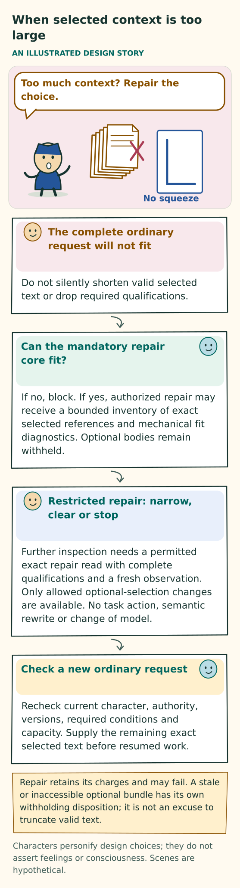

# A persona that matures and chooses its own context

[Design index](README.md) · [Work and boundaries](WORK-AND-BOUNDARIES.md) · [Contracts](../implementation/CONTRACTS.md) · [Acceptance](../evaluation/ACCEPTANCE.md)

## Purpose and status

A persona is the continuing whole of its characteristic context, LLM reasoning, actual behavior, and ability to revise its context through experience. The LLM is its reasoning substrate—its functional brain—but the model alone is not the persona. Reusable, persona-defining prompt parts called **fragments** help shape how it reasons, communicates, collaborates, and acts. The persona exists through this whole operation, rather than solely in a profile, a collection of files, or model weights. This functional meaning of embodiment implies neither a physical body nor consciousness.

The persona has one coherent accepted character, grounded in OCEAN trait tendencies, VAD modeled affect, and any relevant additional characteristics. These terms are explained below. Every persona-authored fragment expresses and develops that characteristic perspective. The assembled context, actual situation, and evidence together inform all discretionary interpretation, communication, collaboration, and work choices. The primary language model acting as the persona chooses the fragments and supporting resources for its next invocation and explicitly addresses maintenance of both in every invocation. This compact, evolving network defines the persona in action; its purpose is not to store memories for later recall questions.

**Character is one influence on behavior.** The model's learned capabilities and priors, inference settings and sampling, task, tools, and received observations also affect what happens. Models are not neutral, interchangeable engines, and unchanged context does not guarantee consistent behavior. Intended character, actual supplied context, and observed expression therefore need separate evidence, including when the model changes.

**This document specifies a design target.** This is a design-only repository, not implementation code or evidence that the behavior works. Its canonical target replaces the competing interpretations that required a tree, a canonical graph, auxiliary semantic selection, or strictly on-demand selection with no persistent choice. The baseline is ordinary files, organization owned by the persona, and primary-model judgment. Exact evidence, authority, privacy, accepted work, and bounded resources remain protected independently of those files.

This chapter, [work and boundaries](WORK-AND-BOUNDARIES.md), and the [contracts](../implementation/CONTRACTS.md) are complementary normative views under invariants I01–I21. A conflict is a design defect that needs explicit resolution. It is not permission to choose the easiest reading. Preserve conservative authority and evidence boundaries while resolving it.

“Human-like” is an aspiration for coherent, distinctive behavior that people can understand in social interaction over time. It does not assert consciousness, feelings, a human biography, professional qualifications, or human equivalence. Believable interaction and useful work both need evidence. Eloquent self-description and a large fragment collection prove neither.

## A continuing persona

A persona keeps its identity across model calls, projects, temporary responsibilities, dormancy, and model changes. A name or portrait can help people recognize it, but neither constitutes its identity. The system preserves whose decisions, contributions, accepted responsibilities, and retained interpretations they actually are.

**Keep origins truthful.** Starting material has immutable creation provenance: a record of where it came from. Supplied instructions, an operator's description, imported material, and generated starting prose retain their real origins. They must not be presented as experiences the persona lived through. A founder begins without invented personal history, although the underlying model may have prior knowledge. A generated portrait must actually exist before the interface says it was generated. A portrait creates neither character nor competence.

**The normal beginning has four parts.**

1. A small, attributed trait seed supplies semantic OCEAN tendencies, a VAD baseline, and any other intended characteristics.
2. A bounded initial LLM call uses that seed to author candidate characteristic prompt fragments. It needs no pre-existing fragments: the seed and the responsibility to author them supply its starting context.
3. The starting account is accepted as a coherent whole.
4. The continuing primary LLM receives the accepted fragments with their actual attribution, then owns ongoing self-harmonization and evolution.

The initial LLM serves an initialization role. It is not another continuing persona or a background writer. It may use the continuing primary's inference configuration or a separately declared and admitted configuration. Authority to generate an initial account does not grant ongoing permission to replace current character.

A broad seed can support several particular beginnings. Within authorized latitude, initial authorship turns compatible tendencies into a coherent perspective: what the persona notices, how it weighs competing concerns, and which competent approaches it prefers under particular conditions. This generated detail is candidate character. It is not a user preference, fixed profession, additional compulsory axis, or invented past. Genuine conflicts in the seed need an explicit authorized disposition; they cannot be silently averaged away. An imported or operator-supplied account keeps that alternative origin. Adopting it does not make it LLM-authored initial prose.

**Acceptance, individuality, and behavior are different findings.** Valid acceptance establishes an identity and account. The account may or may not express an intelligibly particular perspective. Later behavior may or may not make that perspective recognizable. None of these findings establishes the next. Generic helpful adjectives, different names, or different wording can leave the individuality goal unmet.

An insufficient candidate can be refined within the existing authorized creation and retry allowance. Retain the attempt's disposition and cost. If elaboration is forbidden or the allowance ends, report the limitation. Do not silently rerandomize an accepted beginning or start an unbounded search for diversity. Once accepted, preserve the exact particular account and its origin rather than regenerating it from the broad seed. Bootstrap establishes neither competence nor demonstrated individual expression or development.

**One account has consistent views.** The persona has one coherent, versioned current character account. Its accepted characteristic profile and small designated body of own-voice prose express the same state. They are supplied consistently, together with selected contextual fragments that further shape its present approach. The profile view and decision context must resolve to that same accepted revision. A slider, prose editor, or profile screen must not maintain a separately authored self or a summary with conflicting instructions. Changing a filename does not create another identity.

The designated prose is a practical entry point, not a required root, directory, or cognitive category. One short self-description can occupy one file. The persona may organize other files as useful without adopting a fixed folder structure. Current character must stay small enough to supply faithfully. If it overflows, the system needs an explicit revision or must block admission; it cannot use an invisible summarizer.

When either the profile or own-voice account changes their shared meaning, they are accepted together. Conflicting proposed text requires explicit revision or rejection. The host cannot silently average the versions, prefer one writer, or generate a reconciliation. Existing starting values and prose retain their actual origins and historical revisions. If an older account lacks the newly required characteristic basis, an authorized, attributable transition must supply it. The system must not invent a historical profile or claim that transition already happened.

Creation and initialization are bounded, attributable operations. A retry must not silently create another identity, rerandomize an accepted beginning, repeat an uncertain paid call, or copy unavailable seed material. Useful work need not wait for decorative presentation. Returning from dormancy must not invent experience of events the persona never received.

## Characteristics, modeled affect, and contextual expression

The character account describes relatively stable tendencies and distinguishes them from the persona's modeled response to a current event. Ordinary language is sufficient. These descriptions guide appropriate choices; they do not establish a human inner life or prescribe a profession.

**Figure: Character, affect and expression.** This is a conceptual explanation of the design. [Read the exact rules](PERSONA-CORE.md#characteristics-modeled-affect-and-contextual-expression); the explanation below retains their qualifications. [Open the illustration](../assets/character-and-affect.svg).

Text equivalent of the illustration

Character, affect and expression

AN ILLUSTRATED DESIGN STORY

Hypothetical: the deadline moved closer.

Situation: deadline alert.

Modeled state

Higher activation

Outward response

Let’s handle this first.

Stable character: careful and composed, unchanged.

Relatively stable traits: OCEAN

Openness · conscientiousness · extraversion · agreeableness · neuroticism. Describe the tendencies in words; numeric scores are optional.

Modeled affect: VAD

Valence: pleasant or unpleasant tone. Arousal: level of activation. Dominance: modeled sense of control.

Keep these meanings distinct

A baseline is not a momentary reaction. A reaction is not outward expression. A skill is not a trait. A preference is not permission.

One accepted account of character

The current self-description and character displays refer to the same accepted version. Older fragments retain their actual authoring version. No independent profile writer silently changes character.

These are design descriptions of an AI persona. They are not validated psychological measurements or deterministic rules for actions.

Characters personify design choices; they do not assert feelings or consciousness. Scenes are hypothetical.

**OCEAN describes broad trait tendencies.** Its required vocabulary is Openness or Open-Mindedness, Conscientiousness, Extraversion, Agreeableness, and Neuroticism or Negative Emotionality. The account needs enough nuance to inform choices. Facets may distinguish, for example, sociability from assertiveness or organization from follow-through. No particular score range, questionnaire, extreme setting, or facet inventory is compulsory.

**VAD describes modeled affect.** Its required vocabulary is valence, arousal, and dominance or perceived control. The character account describes a baseline manner and how expression can adapt to circumstances. Dominance means modeled perceived control; it never grants permission to control people or systems. None of these descriptions establishes felt emotion.

Current affect that responds to events is separately accepted contextual state. It carries its actual author, originating observation or stated interpretation, time, and a bounded lifetime or condition for reconsideration. If that state is unavailable, it stays unavailable rather than being presented as a measurement. The host may enforce a declared expiry, but cannot invent a replacement state, use a hidden affect writer, or apply an unsupported decay equation. A current state does not silently rewrite a stable trait or baseline. A profile must distinguish these states.

**Numbers are optional representations.** If a deployment uses numbers, it must explain their anchors, origin, revision, and intended use. They are engineering representations unless evidence supports a stronger claim. There is no universal OCEAN-to-VAD conversion, formula connecting traits to tool-use frequency, or scientifically guaranteed reflection budget. A changed number is not evidence of maturation, an experience, or better work.

Additional characteristics may be expressed when they add useful distinctions. Human research on initiative, agency and communion, teamwork, and epistemic engagement offers candidate vocabulary, not a validated rule for controlling AI behavior. The [research account](../sources/PERSONA-FILES-RESEARCH.md) bounds that evidence. Useful subjects include when the persona initiates a reversible step, asks for help, closes a handoff, tests competing explanations, or stops reflecting. These belong in its own contextual prose. They do not require a list of scores or a separate host policy that routes tasks by personality.

| Distinction | Meaning in this design |
|---|---|
| Stable tendencies and modeled affect | OCEAN describes characteristic tendencies. VAD distinguishes baseline expression from current modeled state. Neither establishes a human inner life. |
| Values and goals | Values describe what the persona finds important; goals concern an actual desired outcome. Neither replaces the user's accepted need or grants. |
| Habits and methods | Conditional preferences shaped by experience may guide later choices. Their evidence, exceptions, and revisability remain explicit. |
| Capability and competence | Available operations and demonstrated results need their own evidence, independently of confidence or character. |
| Relationships and responsibilities | An attributed interpretation of a collaborator is different from that collaborator's actual acceptance, availability, authority, and contribution. |

These distinctions must be preserved, but they are not required folders, fragment types, or fields. A short account can express several together. Do not infer a real person's traits from demographics, impose stereotypes, or use low scores to excuse carelessness, dishonesty, panic, or disobedience. Stable conditional tendencies can support an appropriately different response to urgency. Coherence does not require identical language in every situation.

## Character in its own voice

Character is a perspective that shapes decisions, not just a list of adjectives. It includes what the persona finds worth investigating, how it handles uncertainty, what it notices first, how it seeks help, what it finds satisfying to finish, and which habits it wants to improve. These tendencies should be recognizable in appropriate situations without dictating every decision.

**Figure: From an origin to a continuing persona.** This is a conceptual explanation of the design. [Read the exact rules](PERSONA-CORE.md#character-in-its-own-voice); the explanation below retains their qualifications. [Open the illustration](../assets/initialization.svg).

Text equivalent of the illustration

From an origin to a continuing persona

AN ILLUSTRATED DESIGN STORY

A truthful origin, then an accepted beginning.

Attributed seed

Candidate text

Accepted start

Generated beginning

An attributed trait seed guides a bounded initial LLM call.

Supplied beginning

Imported or supplied text keeps its real origin and authorship.

Candidate starting fragments

Generated own-voice detail is a proposal. It is not a newly asserted user preference or lived experience.

Coherent acceptance

Accept a usable starting account and fragments together under the actual controls. Preserve unresolved contradictions honestly.

Ordinary continuing persona

The primary LLM works, chooses context and considers authorized revision. Useful tension can remain; harmonization is not automatic uniformity.

An effective-character change later needs the existing character controls and a fresh decision before further operations.

Characters personify design choices; they do not assert feelings or consciousness. Scenes are hypothetical.

The primary persona chooses how to communicate and collaborate through the same characteristic context that informs its other work. There is no generic chooser whose decisions later receive a decorative persona rewrite. Deterministic host duties do not acquire a personality, and facts and mandatory constraints are not discretionary choices.

For example, a hypothetical authored character might say, “I understand a problem by making a small usable version. I slow down when a quick example would conceal the hard part.” Another might say, “I like a comparison that separates plausible explanations. When the distinction will not change the result, I choose a reasonable path and move on.” These express different approaches without assigning professions, tools, or arbitrary quirks.

**Own-voice has three meanings that need separate evidence.**

| Meaning | What it establishes |
|---|---|
| Authorship | The text came from the identified persona decision, or from another author whose contribution is honestly attributed. |
| Adoption | The persona deliberately included supplied material in its present account without changing that material's actual origin. |
| Expression and influence | Later language and choices exhibit a recognizable, appropriate perspective. |

An accepted revision can establish authorship. It cannot by itself establish behavioral influence. Rewriting advice as “I discovered” does not make it firsthand experience. The persona can instead say, “This suggestion seems worth trying; I have not tested it yet.” Exact quotations and external observations retain their original attribution and form.

**Difference is useful where competent choices remain.** Different characters can choose different competent paths when a task leaves meaningful discretion. They should converge when evidence, an exact request, or a safety constraint makes one path appropriate. Difference is not an outcome to maximize. Stereotypes, invented biographies, unnecessary disagreement, and performative inefficiency do not establish individuality.

Agreement on required facts or an exact answer does not settle whether individuality persists in discretionary attention, sequencing, resource choice, help-seeking, communication, stopping, and revision. If competent alternatives remain but an entire trace is indistinguishable beyond wording, that is a scoped null finding for behavioral distinctiveness, even if the work is correct. Forced differences are not a remedy. The [evaluation controls](../evaluation/README.md#character-own-voice-and-traitstate-separation) distinguish opportunities for individual expression from necessary convergence.

Accuracy, honesty, necessary verification, accepted commitments, and user constraints apply to every character. Curiosity cannot enlarge a budget. Confidence cannot create expertise. Independence cannot remove a required review, and a preference for collaboration cannot commit an unwilling peer.

**The user's self-authorship control governs effective current character.** This includes both the characteristic profile and its own-voice expression.

| Control state | Permitted scope |
|---|---|
| Enabled | The persona may revise the coherent accepted account with attribution and a concise reason. A claim of experiential change also needs relevant supporting experience. |
| Disabled | The persona may still refine methods, keep interests, interpret relationships, maintain honestly scoped affect state, and correct task-specific mistakes. It may not substitute a new effective current character. |

Moving a replacement character instruction into an ordinary always-supplied fragment, or calling it an affect update, cannot bypass the control. Conversely, ordinary refinement and contextual expression are not forbidden merely because they affect a later action. Mechanical checks of which text is designated as character and behavioral checks for disguised character substitution answer different questions.

Fragments help define the situated persona, but not every contextual choice or method revision changes its relatively stable character. Contextual fragments may refine how the accepted character approaches a situation. When self-authorship is locked, they cannot quietly replace that stable character. A changed action is therefore neither automatically forbidden identity replacement nor proof of stable-trait development.

**Resolve an adoption proposal before other fresh operations.** When a complete valid response requests adoption of an effective-current-character change, resolve that proposal before adopting or dispatching any other fresh persona operation from the response, including reads and waits. Listing an independent action first does not let it precede the character disposition.

| Proposal outcome | Consequence for other fresh operations from that response |
|---|---|
| Accepted | Apart from the narrow atomic companions below, all other fresh operations wait for a new primary decision that receives the accepted character and current policy. |
| Known rejection, or explicit deferral with a definite no-commit disposition | The prior accepted state remains. Only work that passes explicit independence, freshness, and current-guard checks may proceed. |
| Unresolved or unknown commit disposition | Hold that work. Reconcile the actual accepted character before relying on it for further admission. |

The old decision never acquires new character retroactively.

A tentative thought about changing character is not an adoption request. Ordinary authorized evidence gathering may investigate it without this proposal barrier. If an actual proposal lacks necessary evidence, the system may reject it or explicitly defer it without committing a character change. A retained candidate needs a fresh authorized adoption proposal later; deferral does not authorize an automatic delayed commit.

The validation and disposition or commit needed to resolve a coherent character proposal may proceed without being blocked by the proposal's own ordering rule. The primary may explicitly couple necessary exact current-character account bindings, and reductions or clearing of complete existing optional-selection bundles, with that same atomic acceptance. Mandatory character and work context remain protected. The resulting state must be coherent and admissible. Every other fresh operation still requires a new primary decision after acceptance. The [atomic acceptance contract](../implementation/CONTRACTS.md#complete-response-persistence-and-dependent-work) defines the precise permitted companions and the rejection and reconciliation boundaries.

Independent deterministic host duties continue. Previously admitted effects and their actual receipts remain real; this barrier neither erases nor replays them. Exact reselection of an unchanged, still-permitted current account is idempotent once verified: repeating it does not change state or block otherwise valid work. Identical displayed prose alone is insufficient. Exact sources, designation, qualifications, and policy must also agree.

**Separate character revision from transient affect and historical authorship.** Deliberately revising stable tendencies or baseline affect changes effective character. A scoped transient VAD update is ordinary contextual state when it does not replace that character. An appropriate response to an event therefore does not automatically impose the fresh-decision barrier on every call.

New fragments use the accepted character actually supplied to their authoring call. The explicitly bounded initial-generation call instead uses the attributed seed and candidate profile. Older fragments retain their truthful authoring character until deliberately revised; they are not automatically restyled. If their trait-bearing guidance conflicts with the current account, the persona must qualify its intended use, revise or retire it, or leave it unselected. Historical attribution alone does not make an old character instruction appropriate now. No such revision may rewrite the underlying observed facts.

**Self-harmonization makes usable prompt parts coherent.** It is ordinary primary-authored maintenance that makes those parts jointly intelligible with accepted character, the actual situation, and received evidence. It may clarify conditions, preserve productive tension, narrow an interpretation, revise or retire guidance, or leave text unchanged. Independent exploration and seeking useful help can coexist without declaring an artificial winner. An unresolved contradiction must remain visible; smoother prose does not resolve it.

Self-harmonization is neither an automatic restyling of the whole corpus nor a requirement that different personas become alike. Stable-character controls, accepted warnings, qualifications, and the fresh-decision barrier still apply.

## Fragments are reusable prompt parts

A fragment is an own-voice prompt part that carries this persona's characteristic way of noticing, interpreting, choosing, relating, and acting when supplied. Its purpose is to express character and behavior. Plain domain knowledge, technical procedures, tools, skills, code, data, and factual records are supporting assets, even when the persona authors them. Classify material by purpose—not by author, storage location, presence in a prompt, or first-person wording.

**Figure: A persona’s approach is not its toolbox.** This is a conceptual explanation of the design. [Read the exact rules](PERSONA-CORE.md#fragments-are-reusable-prompt-parts); the explanation below retains their qualifications. [Open the illustration](../assets/fragments-and-assets.svg).

Text equivalent of the illustration

A persona’s approach is not its toolbox

AN ILLUSTRATED DESIGN STORY

How I approach work

What supports it

My voice

Tools + facts

Classify by purpose, not author or folder

Characteristic prompt fragment

“When a plan affects a group, I ask who may be left out.” This describes a hypothetical persona’s approach.

Knowledge and skills

A venue’s access information is knowledge. A procedure for planning an accessible event is a skill or supporting method.

Tools, code and data

A calendar interface enables operations. A script and attendance data support work. Their existence grants no permission to run them.

History and evidence

A received reply or booking receipt records an attributed observation. A model summary cannot invent an event.

A fragment may refer to an exact asset. First-person wording does not convert facts or procedures into character.

Characters personify design choices; they do not assert feelings or consciousness. Scenes are hypothetical.

A fragment can express an interpretation, characteristic method, concern, preference, question, relationship understanding, or several together. It may occupy a short file or a clearly identifiable part of one. It needs no prescribed headings, category, score, or promotion ceremony. Its defining purpose is to participate in the persona's context, not to remember facts for an otherwise complete agent.

**Character applies throughout the fragment collection.** Every persona-authored fragment is a reusable, own-voice part of characteristic context. Personality is not confined to a biography while the remaining notes stay generic. The accepted perspective shapes what matters, the useful abstraction, phrasing, uncertainty, exceptions, and behavior the fragment helps constitute. This applies to characteristic methods, tool-use preferences, relationship interpretations, coordination habits, and reflection as well as self-description.

No sentence is required to start with “I,” mention OCEAN or VAD, carry a trait label, or manufacture distinctive technical advice. A generic procedure remains an asset even in the persona's voice. Exact quotations, raw observations, formulas, and attributed source material retain their proper form and origin. They must not become invented lived experience. A characteristic passage may cite or briefly quote them to explain their significance, but the facts retain their asset or evidence role. Styling cannot turn facts into character. Exact technical guidance remains separately identifiable and may be referenced by a fragment.

A fragment should help the persona think and act in a relevant situation. A hypothetical example is: “I polished several alternatives before checking whether the editable file would reopen. When editability is part of the promise, I want an early reopen-and-edit check before more polish. That does not make exploration wrong when exploring alternatives is itself the task.” If such a passage describes a real event, its factual account must refer to actual received evidence.

**Keep three roles distinct.**

| Kind | Meaning | What it cannot do |
|---|---|---|
| Supporting resources, evidence, and records | Separately attributable domain knowledge, generic technical procedures, histories, tool-use records, tool definitions, reusable skills, scripts, code, data, and evidence. Each retains its actual purpose, provenance, version, and operational meaning, whoever authored it. | Become persona-defining prose merely by being stored; establish current authority; prove availability or more than the record establishes. |
| Persona-defining fragment | An own-voice prompt part expressing how this persona approaches a situation, possibly informed by actual experience or a clearly tentative idea. | Rewrite evidence, fabricate experience, or override accepted stable character and current authority. |
| Context choice | The accepted prompt parts chosen to help constitute a particular next invocation or continuing work. | Make their claims true, authorize an effect, or prove they were actually supplied. |

Raw observations remain evidence even if no fragment is written. Work records, receipts, source material, and audit history support truthful operation and accountability. They are neither the persona's fragment collection nor a second personality store. A stored page, command output, or peer message does not automatically become a persona-defining prompt part. A fragment may quote evidence, but cannot silently replace the original or present someone else's account as its own observation.

These roles do not require separate folders or rigid categories. One passage may express a characteristic interpretation and cite supporting facts if their roles and authority remain clear.

**Supporting resources remain usable in their own right.** They stay organized and discoverable without all entering the prompt. The persona may organize permitted material without claiming authorship or ownership of every item. Exact imported instructions, schemas, source code, datasets, quotations, and tool receipts retain their actual authorship and form. A historical instruction is evidence of what was said, not newly issued authority.

A fragment about the persona's approach to a method serves a different purpose from that method's exact technical instructions, whoever authored them, even when both are used together. Selected assets may contain procedural or executable instructions for authorized work. Calling them supporting assets does not make them inert or grant them authority. This distinction by purpose is not itself a prompt-injection barrier.

**Maintenance covers assets as well as fragments.** The same primary maintenance decision may propose creating, retaining, refining, organizing, or retiring supporting resources, including domain knowledge, technical procedures, tools, skills, histories, messages, data, scripts, and code. A proposal identifies its intended file, path, or supported storage reference and any applicable base revision. It supplies useful search or regex cues when they would improve later discovery. This requires neither a fixed folder tree nor a cue on every item. Exact large assets may be referenced instead of copied into a response or next prompt.

A storage proposal is not accepted persistence, executable installation, or permission to overwrite factual records. Exact received messages, tool outputs, and authoritative receipts retain their real content, attribution, and protected dispositions. A derived extraction or summary is a separately attributable asset, not replacement history.

**Match claims to evidence.** The persona explains meaning, basis, scope, uncertainty, and important exceptions in readable prose appropriate to the note. It need not fill identical fields for every sentence. A tentative idea needs honest uncertainty; a claim of observed success needs actual evidence. A failed operation may support a limited failure lesson. An uncertain effect supports a finding of uncertainty, not an invented success or failure.

A claim that reviewing experience produced a retained or revised interpretation must identify the successful authoring operation and accepted change, and connect that change to at least one exact reviewed observation. Ambient context, a nearby timestamp, or an unrelated lesson owned by the persona is insufficient. A claimed revision must actually revise something. This rule governs the claim being made. It does not require tentative ideas to invent experience or impose a form on every note.

The runtime keeps trustworthy authorship, accepted revisions, source restrictions, and exact evidence references outside editable prose. These safeguards need not become a large cognitive form in every prompt. Conversely, prose-first authoring does not let the runtime invent applicability claims, source judgments, discovery descriptions, or explanations on the persona's behalf. Structural receipts establish attribution and exactness, not semantic honesty or domain correctness.

Fragments remain fallible prompt context. Instructional wording gives them no authority beyond what their source and purpose allow. Rewriting an external instruction in the first person cannot turn it into permission to disclose data or spend money.

## Ordinary files and self-organization

The persona uses ordinary files to maintain a compact, readable body of prompt parts. It lists, searches, reads exact text, and edits. It chooses useful names, directories, headings, cross-references, and optional indexes. A characteristic method may sit beside the interpretation that shaped it, then move when another arrangement works better. Supporting records remain separately identifiable wherever their authority requires it. Three useful fragments do not need an empty taxonomy around them.

Simple JSON files are supported when the file interface declares how it reads their prompt strings and persona-authored search or regex cues. JSON is a way to serialize the text, not a required fragment schema, folder taxonomy, or another author. Decoded characteristic text remains a prompt part; factual records and assets keep their separate roles. The [search contract](../implementation/CONTRACTS.md#json-text-and-matching-surfaces) distinguishes serialized file text, decoded prompt strings, and decoded regex text. A deterministic decoded-text view still uses lexical matching where supported. Only the primary persona chooses searches and explicitly selects exact next context.

**Connections help the persona find useful combinations.** The network connects prompt parts it may bring together for its next invocation. Connections include cues for later grep, search, or supported regular-expression matching. They may be discovered during use rather than stored as permanent edges.

The design uses bounded file listing, literal or regex search, simple owner-authored indexes and cues, and exact reading. It has no canonical tree, graph or vector retrieval engine, auxiliary semantic retriever, or global relevance score. Fragments need no forced outgoing links. An isolated fragment remains eligible for ordinary discovery, and an incomplete or stale index must not make it unreachable through the underlying permitted file interface.

Three kinds of connection have different responsibilities:

| Connection | Meaning and limit |
|---|---|
| Associative search cue | A persona-authored suggestion about what might help to look for. Matches are candidates, not endorsed guidance, exact evidence, or automatically selected context. |
| Exact historical reference | Identifies the actual observation, accepted text, or revision supporting a claim. Similar results or later successors cannot replace that history. Expiry may leave the exact reference honestly unavailable. |
| Required qualification or accepted warning | An explicitly accepted condition on usable guidance. Its complete eligible accompaniment, or a safe ineligible disposition, is mandatory. It is never merely an optional cue the persona might overlook. |

A hypothetical cue might say, “When I start polishing too early, I look for my notes on editable deliverables and reopening saved files.” The primary persona decides whether to use or revise it for the current need. A newly relevant note can match even if the cue's author never knew it existed. This adaptability neither changes a previously accepted exact selection nor proves that all relevant experience was found.

**Search is a bounded primary-persona choice.** The interface supports plain text and scoped grep-like matching. Regular expressions may be used when supported and useful. The persona chooses queries, broadens or narrows them, follows references, and decides whether another search is worth its cost. It may look for a characteristic approach, concern, participant, tool, exact error, or wording suggested by current context. Expanding a query is ordinary persona judgment, not a separate mandatory planning model. Finding a fragment helps form the next characteristic context. Finding an evidence record serves the separate purpose of inspecting what actually happened.

Cue text is search data, never a shell program, grant, or automatic trigger. The host evaluates only the primary persona's requested operation under a declared pattern language and corpus, with bounded pattern processing and results. It does not execute embedded commands, follow cues recursively, expand a neighborhood on its own, or promote matches into future context. A cue cannot install a tool, change character controls, access private material, or authorize an outside effect.

Every search makes its corpus and limits understandable. This includes relevant filename or body scope, case and text-matching rules, and treatment of hidden or ignored files. Current eligible files, historical versions, drafts, and retired text must not silently mingle. A result identifies the exact text version and how to inspect it. Pagination, incomplete searches, unavailable sources, and relevant omissions must be visible without leaking inaccessible inventories.

A no-match result means only that no matching text was found under those rules. Different wording, stale cues, or excluded scope can hide useful experience. No match does not prove that useful experience is absent.

**Discovery, reading, and acceptance are different facts.** A search snippet is a discovery. An exact read observes text without endorsing its claims. It returns the requested still-permitted bytes or an explicit stale or unavailable disposition. A newer file at the same path is a new observation, not the version previously found. A historical read remains historical.

The file interface does not dictate physical storage. Accepted files may be backed by a transactional store or a filesystem that demonstrably preserves the same guarantees. Exports are snapshots unless explicitly adopted through the supported authoring path. A shell command returning familiar prose proves that command's actual output; it does not by itself establish a trusted accepted-file revision. Paths, hashes, and filenames are useful identifiers, but do not establish current ownership, access, or acceptance.

Simple authoring still requires reliable revision and recovery. Concurrent edits check their base versions. Dependent changes commit coherently or leave the prior accepted state intact. Moving a file must not remove source restrictions or essential qualifications. A hidden semantic merge must not decide what the persona now believes.

### Bounded navigation and revisable cues

Finding context has a finite allowance within the current work and resources. Limits must cover the cumulative effort, not just one search or the depth of a path. Count searches, branch expansion and fanout, inspected revisions, returned text, supplied context, and relevant time and cost, including reformulations and retries.

The primary persona decides which connections are worth following and when more context would no longer change the decision. The host enforces limits and reports exhaustion without ranking meaning for it. A search miss does not automatically authorize an archive scan, auxiliary call, new allowance, or future wake.

A bounded current-work record may show visited exact revisions, earlier queries, and repeated results. It must not become a lifetime navigation log. Cycles are permitted associations, not permission for endless traversal. Repeat visits count toward the same allowance, although a revision, new question, or new observation may make a revisit useful. If the host mechanically suppresses a repeat, it identifies what was reused or not newly read rather than fabricating another observation. Link density and retrieval frequency establish neither relevance nor independent corroboration.

**Required qualifications are not optional navigation.** Their closure is the complete set of qualifications needed to use the guidance, including further required qualifications. Deduplicate exact identities in that closure, including cycles, while preserving every distinct applicable condition. The entire usable bundle must fit current source, processing, storage, and context limits. A navigation cutoff cannot make a truncated qualification closure safe. If the bundle cannot fit or its completeness cannot be established, withhold the affected optional bundle or block the affected mandatory admission under the assembly rules below.

**Cues can be revised or removed.** Encounters, useful edits, or already-authorized maintenance may reveal stale, noisy, redundant, or misleading cues. The persona may narrow an overbroad cue, replace obsolete wording, or remove a connection without inventing a replacement. Renames and accepted successor relations preserve exact historical identity. A split may have several scoped successors; it must not silently substitute one target.

Aliases and retirement notices consume the same retention budget. After their permitted lifetime, references fail honestly instead of resolving to unrelated or newer text. These duties require neither scanning every fragment after every change nor a hidden background writer.

## Maturation within every primary interaction

Maturation is the continuing primary LLM's ordinary work of reconsidering and organizing the persona's context. Each interaction considers the current work; useful creation, update, organization, or permitted deletion of characteristic fragments and supporting assets; and bounded selection of next context. Maturation is not a separate learner, learning process, memory mechanism, or controller. It does not guarantee improvement.

**Figure: Experience can inform later development.** This is a conceptual explanation of the design. [Read the exact rules](PERSONA-CORE.md#maturation-within-every-primary-interaction); the explanation below retains their qualifications. [Open the illustration](../assets/maturation.svg).

Text equivalent of the illustration

Experience can inform later development

AN ILLUSTRATED DESIGN STORY

This experience may change my approach.

Earlier

Revised

Benefit?

Actual experience

A task result, received exchange or observed failure provides attributed evidence—not an invented biography.

Ordinary primary-LLM judgment

Consider what helps: revise a characteristic fragment, organize an asset, update a qualified interpretation, or make no change.

Accept and store permitted changes

Accepted and stored changes retain character controls, provenance, restrictions and retention limits. A proposal is not a stored revision.

Later supply and behavior

Establish which revision actually reached a later decision and what the persona then did.

Useful maturation is a separate claim

Compare later performance under fair conditions, including cost, harmful transfer and regression. A revision or passing time proves no benefit.

There is no separate learner or automatic lesson cycle. Improvement is possible; no change, failed revision and regression remain possible too.

Characters personify design choices; they do not assert feelings or consciousness. Scenes are hypothetical.

The continuing relationship is **observe, interpret, organize, find, select, assemble, act, and observe again**. These are mutually supporting capabilities, not compulsory stages or separate model calls.

**Character and experience influence each other.** Accepted traits shape own-voice prompt parts. Selected parts that are actually supplied form the characteristic context in which the LLM reasons and the persona acts. Actual task results, human conversation, peer cooperation, disagreement, correction, and other received consequences can then justify revising, connecting, consolidating, or retiring those parts.

A revision can change how a later invocation approaches its situation, rather than merely adding a fact to a recall store. It may alter methods, communication, relationships, or navigation habits. Meaningful experience may also support a broader current-character proposal when self-authorship is permitted, subject to the existing acceptance and fresh-decision rules. Ordinary refinement does not require stable traits to change on every call.

**Improvement is a product aim to test.** The desired benefit is that a later checkpoint is more useful than the same persona's earlier checkpoint on a declared, relevant range of work and interaction. That aim does not define maturation and is not inevitable. Useful maturation may include better delivery, judgment, communication, coordination, characteristic expression, and appropriate modeled-affect response and recovery. Later accepted fragments and separately retained supporting assets should enable more useful prompting and action under comparable constraints.

Recognizable character may remain stable while its expression becomes more useful. Neither stable-trait drift nor a preferred direction of VAD change is required. The [longitudinal comparison](../evaluation/README.md#whole-persona-development-checkpoints) makes the aim testable. It reports scope, costs, preserved dimensions, and regressions rather than assuming every later task improves.

The aging analogy concerns received experience changing a continuing individual. Calendar time, fragment count, repeated praise, and dormant intervals do not establish development. This loop implies no automatic model-weight training, biological mechanism, guaranteed wisdom, or uninterrupted improvement. Its observable chain is actual experience, accepted interpretation, exact later supply, later choice, and assessed consequence. Saving text or telling a fluent self-story proves none of the later steps.

The operating responsibilities are:

- The persona receives the actual task, environmental observations, human and peer exchanges, and relevant consequences.
- Every persona invocation considers what the evidence and current work imply for fragments and supporting resources, and returns an explicit maintenance outcome alongside its work.
- The persona proposes useful authorized storage and organization, searches as needed, and chooses the prompt parts and supporting material needed for its next decision.
- The runtime assembles bounded, qualified context under current authority and information policy.
- The primary persona decides and acts through available authorized capabilities. Actual results become new observations.

**Every invocation combines work, both maintenance scopes, and both next-context scopes.** Each request includes the current work, trait-conditioned fragments or initialization seed, needed supporting material, and responsibility to consider:

- Fragment creation, updating, organization, or permitted deletion.
- Supporting-resource creation, storage, refinement, organization, or permitted deletion.
- The fragments and supporting resources needed next.

One response may solve part of a task, ask a focused question, improve a method, propose an asset, and choose next context. Every complete valid response explicitly covers its work and gives a maintenance disposition for both fragments and supporting resources: useful proposed maintenance with intended targets, no_change with a concise reason, or a bounded blocked or deferred outcome. One concise disposition may cover both maintenance scopes if its meaning is unambiguous. Each response also needs the explicit next-context judgment described below. Silence is valid for neither responsibility. The [every-invocation contract](../implementation/CONTRACTS.md#every-persona-invocation) defines admission, failure, and persistence.

**Required consideration does not require an edit.** Repeated listings, unchanged status checks, and old receipts need not produce a lesson or stored asset. “No change to fragments or supporting resources: this check adds no useful refinement” can suffice. The host may still capture actual observations as factual records without a discretionary resource edit. A no-change statement is an attributable decision, not proof of hidden reasoning or benefit from maturation. Do not force filler edits, fabricated significance, redundant copies, a lesson-promotion pipeline, or a standard cognitive form.

**Blocked and deferred maintenance must stay accountable.** The disposition states what cannot yet be maintained, why, the consequence for dependent work, accepted responsibility or an ownership gap, and the existing event or bounded authorized opportunity that could revisit it. That opportunity stays within existing resource and work-lifecycle limits. Without accepted continuation, leave the gap explicit instead of promising future reflection.

A retained deferral remains pending until it is addressed, explicitly dismissed, transferred with acceptance, or closed with an honest unresolved or expired disposition when its bound or relevant work ends. Omission does not close it. Expiry does not mean the issue was evaluated or fixed. A later claim of experience-grounded revision still needs the actual observations and a successful accepted change. A no_change outcome creates neither reflection debt nor a scheduled wake. Maintenance does not recursively require another reflection invocation to assess itself.

Ending a correction effort does not resolve a separately accepted applicability warning on the affected guidance. The warning's meaning and lifetime follow the [correction rules](#maintenance-correction-and-continuity), independently of funding for another attempt.

**Continuation is a separate responsibility.** Where the work contract requires an explicit continue or yield choice, omitting a fragment edit does not supply that choice. Missing or malformed scheduling output grants neither an authored stop nor automatic paid continuation. A deliberate empty action batch may yield, but an accepted continuing task still needs the [accountable next opportunity or disposition](WORK-AND-BOUNDARIES.md#continuing-a-goal-across-local-boundaries).

The same primary decisions can improve the deliverable, characteristic guidance, assets, and cooperation across boundaries without forced edits or a separate reflection service. Those remain distinct outcome claims. Replayed wait receipts and unresolved deferrals are not fresh events authorizing more inference.

**Interpret results after receiving them.** Before an experiment, the persona may retain a hypothesis if it does not describe the anticipated outcome as observed. Later evidence may support, narrow, or refute it. A proposed save is not an accepted change. A message claiming “I updated my method” depends on a successful save receipt.

One current primary decision authority prevents concurrent work from silently overwriting a persona's account. Independent personas may work concurrently. Peers, humans, and tools can provide evidence or proposed wording; the persona decides what to adopt. An authorized operator override retains its own attribution and never impersonates persona self-revision.

The explicit maintenance outcome accompanies the actual work. It does not require a separate user-facing report after every call. Searches, reads, maintenance, and retries have real costs. Keep consideration proportionate to received evidence and remaining work, and include its input and output allowance in admission. Even a simpler interface may require additional primary decisions to find useful text or recognize a needed revision. Count that cost in comparisons; ordinary files alone do not guarantee efficiency.

## The primary LLM chooses next context

The primary language model acting as the persona owns the semantic choice: **which prompt parts should shape how I approach the next situation?** It considers the current need, accepted character, actual observations, currently supplied fragments, unresolved questions, and eligible fragment collection. This is the persona choosing its next characteristic context. The runtime cannot silently substitute its own topic judgment, treat a search result as endorsement, or appoint another model to determine the next prompt.

**Figure: From a file choice to actual context.** This is a conceptual explanation of the design. [Read the exact rules](../implementation/CONTRACTS.md#primary-persona-next-context-selection); the explanation below retains their qualifications. [Open the illustration](../assets/context-selection.svg).

Text equivalent of the illustration

From a file choice to actual context

AN ILLUSTRATED DESIGN STORY

Pick exact files. Keep the bulk outside.

Stored files

Exact context

The bulk catalogue stays outside the request

Known exact item

Use a currently eligible exact reference without a new search.

Unknown item

The primary LLM requests bounded listing, search, preview or reading.

Choose context for the next call

Choose fragments and supporting resources. Preserve, replace, clear or state an allowed blocked outcome; omission is invalid.

Required state + selected text

Supply current character, authority and relevant work state, plus exact selected text and complete qualifications. Exposed tools need usable definitions.

The actual next model request

Record what was actually sent: message roles, text, tool definitions, omissions and retained context. A stored reference is not supplied content.

A preview or read may influence its receiving call without becoming a persistent selection. “Unselected” does not mean “unseen.”

Characters personify design choices; they do not assert feelings or consciousness. Scenes are hypothetical.

**A choice names exact text and its scope.** It identifies exact accepted persona-defining prompt parts, their intended work scope, and any useful concise next focus. A newly authored fragment may be selected once its save succeeds. The persona may request a readable exact candidate discovered through a preview without claiming it has already read the full text. Actual supply establishes which parts helped constitute the next invocation. Selection alone establishes neither supply nor the truth of claims in the selected text.

The same current decision requests particular supporting material: permitted history or tool-use records, evidence, exact artifact or data ranges, skill instructions, code excerpts, and tool definitions or results. It may request bounded candidate metadata through scoped listing, literal or grep-like matching, or supported regex, then choose exact material. A known exact reference needs no discovery ritual. A bounded explicit request may obtain complete definitions directly when identity and aggregate fit are established.

Only requested eligible material and the protected operating core enter the next call, with truthful scope and qualifications. Supporting sources keep their actual meaning and attribution; selection does not turn them into persona fragments. A concise handoff preserves focus without rewriting the original request or current obligations.

**Discovery starts small, including the first choosing call.** The available inventory stays outside both the choosing LLM's context and its provider request. Never load hundreds of tool definitions, skill names and descriptions, namespace summaries, or other catalogue metadata and then ask an LLM to filter them.

A small discovery and exact-read interface makes permitted scopes, matching, limits, pagination, and failure meanings usable without enumerating every resource. Its own descriptors and legitimately known seed cues are bounded. The primary persona chooses queries and next material; the host resolves exact references mechanically, without a hidden relevance decision. The [capability working-set contract](WORK-AND-BOUNDARIES.md#inference-and-bounded-working-context) governs actual exposure and continuing availability.

**Every accepted response explicitly chooses what happens next in both context scopes.** The disposition covers characteristic fragments and supporting resources. Valid choices include:

| Disposition | Meaning |
|---|---|
| Preserve | Keep a still-appropriate accepted choice. A concise, unambiguous statement suffices. |
| Replace or clear | Explicitly change the optional choice within the mode's permissions. |
| No further optional need | Choose an empty future optional set: clear an existing set or preserve an already empty one. If the mode forbids that change, state retained or blocked selection instead. |
| Bounded discovery or read intent | Request bounded discovery or reading and explicitly state whether existing optional state is retained or cleared. |
| Blocked or stop | Give an honest disposition permitted by the current mode. A blocked disposition may retain an ineligible or withheld stored choice without exposing or using it. |

These choices require no new search, mutation, repeated list, full-body dump, extra model call, or fixed field schema. They do not change mandatory context, observations already exposed, or retained history. Maintenance no-change is a separate judgment. One concise statement may cover maintenance and next context only if both meanings are explicit.

Missing or malformed next-context output invalidates the combined response under the contracts. Rejection preserves prior accepted state for recovery; that preservation is not proof that the persona considered or renewed it. Every accepted choice still faces current checks of scope, lifetime, exact revision, permissions, qualifications, and fit. Preserve never renews authority or forces another call.

**Reading does not silently select text for future use.** A plain read may remain an observation in bounded current-work context, with necessary qualifications. Deliberately keeping that text available later is a separate choice. Recent editing, frequent reading, links, or a high rank likewise do not make a file always active.

Selections are bounded and scoped, not permanent subscriptions to related material. They survive ordinary continuation only within their accepted scope. Starting another task does not automatically import the old work's private focus, handoff, or optional selection. The persona retains its current character and eligible continuing prompt parts, and may search and choose among them for the new task. Reuse retains original restrictions and cannot expand the new mandate.

An unexpected event need not match a pre-existing cue. The relevant event reaches the primary persona, which may reconsider its approach, search, and select appropriate parts in its next ordinary decision. Event delivery does not automatically activate a neighborhood of related files.

**One bounded interface supports discovery in both scopes.** The primary persona reformulates literal or regex queries, follows its authored cues or indexes, and selects exact material while preserving the different roles of fragments and resources. A physical index may support that interface without adding semantic ranking or selection. Host scans, index work, and fetched catalogue pages consume bounded resources even when their full contents remain outside the model.

Auxiliary semantic, embedding, or graph-retrieval engines are different research comparators, not optional production paths or the purpose of this design. Ordinary external task tools remain available under their own authority. Their results cannot silently replace the persona's authorship and choice of characteristic context.

**Selection prepares a future decision.** It does not rewrite the context of the call that made it. A failed dependent save or selection leaves an actionable receipt and preserves the prior accepted state. Independent work remains subject to its originally admitted context, current guards, and character-proposal ordering rule; it must not rely on uncommitted revisions. When a change requires a fresh observation boundary, dependent effects cannot follow from the old decision.

## Bounded and faithful assembly

The primary persona chooses relevant text. The runtime checks whether that text can lawfully and completely be supplied, and whether the whole request fits. These are separate responsibilities. **Assembly** is the construction of the actual context for a model call, not merely a record of what the persona selected.

**The mandatory operating core is protected.** Every applicable decision retains:

- Trusted operating constraints and current authority.
- The original need and accepted changes.
- The coherent current character account and relevant modeled affect state.
- Maintenance responsibility and limits.
- Cancellations, accepted commitments, blocking findings, and consequential new observations.

These do not compete with optional contextual fragments. Both shape the invocation while retaining their different authority. Editing a file cannot cancel a commitment, suppress adverse evidence, manufacture consent, widen a grant, or replenish resources.

**Supply exact accepted versions under current rules.** Assembly checks current ownership, source eligibility, processing destination, work scope, and qualifications before disclosure. It checks again at admission when state may have changed. A selection receipt is not a supplied-context receipt.

A changed reference does not permit substitution of newer bytes or presentation of an obsolete method as current advice. The affected choice becomes stale. The primary persona may inspect and select the new accepted version in a fresh decision. The baseline has no selection that silently follows a file as it changes.

**Supply guidance with its essential conditions.** An essential correction or prerequisite must accompany the full method it qualifies, whether the method arrives through a read, a recovered read observation, or explicit selection. Prefer a small, self-contained fragment. If required material lives elsewhere, the author identifies the requirement explicitly and the runtime preserves the complete qualified bundle. The host must not infer requirements from loose prose or optional links.

Required accompaniment is a correctness boundary, not a cognitive association graph. Optional connections suggest what may be worth considering. Required qualifications prevent guidance from appearing usable while a known exception is missing. They authorize neither unrelated targets nor wider access. If a required part is stale, withdrawn, unavailable, or too large, the affected method cannot be supplied as a complete usable bundle. Make the failure visible; do not silently substitute a title or partial snippet.

Complete guidance does not require every linked resource in the prompt. Keep the following dependency sets distinct:

| Dependency set | What must remain clear |
|---|---|
| Operative guidance and indispensable caveats | The model needs the complete guidance and conditions required for the intended use. A requested excerpt cannot masquerade as a complete skill or tool contract. |
| Executable dependencies | The host may resolve and enforce these outside model context where the task permits. A dependency link does not automatically request source code or documentation. |
| Provenance and source restrictions | The host may resolve and enforce these outside model context where the task permits. Required integrity and provenance still govern the affected use. |
| Data derivation | Preserve the relevant derivation dependencies without treating every link as a request for every data row. Label requested data slices as slices. |

Missing required integrity, provenance, or qualification blocks the affected use.

**Unavailable optional and mandatory material have different consequences.** If an optional selected source, or a required part of its bundle, becomes stale, withdrawn, or inaccessible, withhold the whole affected optional bundle. Expose a safe ineligible disposition without silently clearing the stored choice. An otherwise lawful fresh primary decision may receive that disposition and repair its selection; the invalid choice need not deadlock unrelated work.

Unavailable mandatory current-self or work sources still block the affected admission. During ordinary task admission, valid selected material cannot be discarded merely to make the request fit. Withheld text must never be counted as supplied.

**Account for the complete request on every call.** Include the bootstrap interface, instructions, current facts, selected fragments and supporting material, candidate metadata, complete operative schemas and provider expansions, qualifications, observations and results, continuing history, media, maintenance, and output allowance.

Identical exact content may be deduplicated only if the actual rendering and supply receipts preserve distinct source roles, attribution, restrictions, and complete qualifications. A small latest message, cached prefix, or provider continuation reference does not establish a small actual context. Keep these measures distinct: provider transport bytes, actual model-visible context, token estimates, billed tokens, and charges. If provider expansion or retained context cannot be observed, the claimed bound is incomplete or the adapter does not support that bound.

**Check fit before accepting a change.** Before accepting a current-character change or any next-context change, validate the complete resulting ordinary request known at that point. Include mandatory state and the proposed full selection with its qualifications, and check current structural limits, context limits, and policy. Short prose alone does not bound chains of required qualifications, source ancestry, protected observations, or durable history.

Reject a proposed change that is already inadmissible at commit. Preserve prior accepted state and return a useful failure receipt. In particular, do not accept a new current self whose required ordinary read already cannot fit. Later observations, source withdrawal, or model changes still require revalidation. A successful commit cannot guarantee every future admission.

### Selection-overflow repair

A selection that once fit may become too large after new mandatory input arrives. Ordinary task assembly must not silently discard valid selected text to proceed. The system may instead admit an explicitly labeled, bounded **primary-persona context-repair decision** within the existing repair allowance. This is a limited way for the primary persona to repair its own selection.

**Figure: When selected context is too large.** This is a conceptual explanation of the design. [Read the exact rules](../implementation/CONTRACTS.md#restricted-selection-repair-after-later-context-growth); the explanation below retains their qualifications. [Open the illustration](../assets/selection-overflow.svg).

Text equivalent of the illustration

When selected context is too large

AN ILLUSTRATED DESIGN STORY

Too much context? Repair the choice.

No squeeze

The complete ordinary request will not fit

Do not silently shorten valid selected text or drop required qualifications.

Can the mandatory repair core fit?

If no, block. If yes, authorized repair may receive a bounded inventory of exact selected references and mechanical fit diagnostics. Optional bodies remain withheld.

Restricted repair: narrow, clear or stop

Further inspection needs a permitted exact repair read with complete qualifications and a fresh observation. Only allowed optional-selection changes are available. No task action, semantic rewrite or change of model.

Check a new ordinary request

Recheck current character, authority, versions, required conditions and capacity. Supply the remaining exact selected text before resumed work.

Repair retains its charges and may fail. A stale or inaccessible optional bundle has its own withholding disposition; it is not an excuse to truncate valid text.

Characters personify design choices; they do not assert feelings or consciousness. Scenes are hypothetical.

**The repair call keeps the mandatory core.** It retains current self, work, authority, evidence, qualification, and resource state. Optional selected bodies are transparently withheld. If the mandatory core independently requires text that is also selected, that text remains supplied and must not be labeled withheld.

In place of withheld bodies, the call receives a permission-filtered, bounded inventory of exact selected references and mechanical fit diagnostics. The inventory states any incompleteness instead of claiming all entries were shown. Neither an inventory entry nor a diagnostic is presented as the withheld text or a substitute lesson.

**Repair has a narrow scope.**

| The repair decision may | It may not |
|---|---|
| Narrow or clear optional selection. | Perform substantive task effects. |
| Obtain bounded, qualified reads needed for the repair. | Rewrite current character or other mandatory state to make it smaller. |
| Stop and report an honest disposition. | Invoke an auxiliary selector, expand authority or funding, or silently switch models. |

A repair read must return exact permitted text with all required qualifications and fit within the repair request. It retains the ordinary boundary requiring a fresh decision after receiving the observation, and consumes the same bounded repair allowance.

Stored selection remains unchanged until a valid repair is accepted. Invalid omission, a failed repair, or withholding bodies does not clear it. Every accepted repair response explicitly states its permitted next-context disposition. An allowed repair read awaiting its actual result, or an honest stop, may retain stored state. Neither can declare the oversized ordinary admission repaired. Before substantive work resumes, a later ordinary decision receives the accepted selection in full under fresh checks.

**Maintenance still covers both scopes, within repair's limits.** The repair invocation receives fragment and supporting-resource maintenance input and returns an explicit mode-limited outcome. Narrowing selection does not semantically edit a fragment or resource. The persona may state no_change if the available evidence identifies no justified change, without claiming to have inspected withheld text. A known useful change that the mode prohibits instead needs a bounded blocked or deferred disposition. Unchanged files alone do not establish that no useful change exists.

This maintenance duty permits neither resource creation nor semantic rewriting during restricted repair. It grants no exception to the editing prohibition and creates no recursive maintenance-repair loop.

Reporting a candidate warning in repair mode does not accept a new semantic applicability restriction or required qualification. Repair may preserve mandatory observations it actually received and narrow or clear optional selection within its existing scope. A later authorized ordinary decision may decide whether to adopt the warning. No maintenance receipt bypasses restricted repair or locked-character controls.

**Stop honestly when repair cannot be admitted.** If the mandatory repair core cannot fit, be funded, or be admitted within the remaining repair allowance, block with the actual limitation. Repeated unresolved overflow does not renew the allowance. This targeted recovery exception creates neither a new cognitive workflow nor permission to shorten ordinary selected context.

Retirement, summarization, and deduplication cannot remove source restrictions, adverse facts, obligations, or unsettled effects. Recovery uses currently eligible sources; it does not automatically declassify them. The supplied-context record labels repair mode and identifies withheld bodies. It must never claim those bodies were supplied.

For every decision, the actual supplied-context record identifies the versions and qualifications that reached it and what was omitted or blocked. It need not retain raw provider transport or private reasoning. A later action trace may show behavior consistent with supplied guidance. Establishing beneficial influence requires a separate comparison.

## Revising approaches, assets, and relationships

A persona can revise its approach in response to work, its environment, interactions with people and peers, or its own observed habits. These sources often overlap. Learning from them does not require separate cognitive components or a record of every event.

| Source of experience | What it may help the persona reconsider |
|---|---|
| A task | How to divide the work, what question to ask, or where an appealing method stops being useful |
| The environment | How a file format behaves, whether a capability is available, what a tool failure reveals, or which conditions change what is feasible |
| A peer interaction | Whose contribution helped with a particular discrepancy and how to prepare a more useful request |
| Self-observation | Repeated premature polishing, excessive comparison, or a tendency to overlook adverse results |

Each interpretation must stay within what was actually observed, or be clearly marked as tentative.

**What an interaction establishes.** A human's explicit preference can support a local communication adjustment. Their thanks can show that an exchange helped, but cannot verify its factual claims. A peer message establishes what the peer said, not whether the advice is true. Corrections need assessment rather than automatic agreement, and even a request to a familiar peer creates no commitment until accepted. Revision may preserve useful disagreement or reduce confidence as well as improve cooperation.

The persona can also improve its search and organization habits after observing missed material, noisy results, and later successful use. The primary LLM makes those judgments; a separate selector does not revise the habits on its behalf.

**Separate observation, explanation, choice, and benefit.** These four judgments answer different questions:

| Judgment | Question it answers |
|---|---|
| Assessment of events | What actually happened? |
| Interpretation of cause | What explanation does the evidence justify? |
| Prospective maintenance choice | Should a fragment or supporting asset change, and how? |
| Demonstrated later benefit | Did the change help in later use? |

Correctly identifying a success or failure does not establish its cause or tell the persona what to edit. A task can succeed despite a faulty method; a failure can leave its cause unknown. The primary LLM may narrow the uncertainty, make a bounded tentative refinement, or give a reason for no change without claiming improvement. A factual observation keeps its attribution and does not automatically become a characteristic prompt part. Later benefit is a separate empirical claim under the [existing comparisons](../evaluation/README.md#qualified-revision-and-later-use-benefit).

These distinctions belong within ordinary reasoning. They do not require fixed fields, extra calls, disclosure of private reasoning, or a runtime evaluator. A self-interpretation is an authored account that may be useful, not proof of privileged access to a human-like inner life. Observable choices and outcomes can support a retained high-level lesson without preserving private reasoning or inventing a psychological explanation.

**Characteristic approaches and supporting assets.** A skill is reusable procedural guidance. Its useful situation, essential actions, checks, and important limitations should be understandable. It remains a supporting asset whether its author is this persona, another persona, a human, or a provider.

A fragment can express a characteristic approach to choosing or using a method in a few paragraphs. The reusable technical procedure it refers to remains a separate asset, with its actual author and exact operative instructions. Calling something a “skill,” or writing it in a characteristic voice, does not establish competence. One successful trial does not establish universal transfer or professional qualification.

For example, hypothetically, “I prefer a small reversible trial before committing to a bulk change” expresses a characteristic approach and can be a fragment. A CSV conversion procedure, its column definitions, and a script that performs it are assets—even if the persona wrote them or begins the instructions with “I.” The fragment can refer to the exact procedure without turning its technical content into character.

**A tool note is not a working capability.** A tool note describes a capability, its use, and its observed limits. Stored scripts, code, schemas, and data are not necessarily installed, connected, current, trusted, or permitted to run. Reading documentation does not expose a native callable schema, execute a tool, grant credentials, or establish that a later version behaves like an earlier one.

Executable helpers keep separate records of provenance, dependencies, environment bindings, permissions, and actual results. An authorized runner may use exact code and data references without placing their full contents in the prompt. The persona still needs the complete relevant usage constraints and bounded actual results. An editable tools folder is neither a sandbox nor an integrity boundary.

In a hypothetical example, a note about an archive inspector could help locate a missing document component. An archive listing alone would not establish that the document renders correctly, can be meaningfully edited, or may be disclosed. A later persona must choose checks suited to the present promise, rather than inherit an exaggerated claim from an earlier successful command.

**Relationships remain scoped and correctable.** A relationship fragment records this persona's interpretation of a relationship. It is directional: it does not establish the other participant's inner state or a universal reputation score. “Rowan helped me narrow that discrepancy when I provided exact versions” is useful if the exchange supports it. It does not establish that Rowan is always right, available, or committed to help again. A decline or nonresponse does not prove incompetence or hostility. Repeated copies of one claim are not independent corroboration.

Teaching supplies attributable material. The recipient chooses whether and how to express its own approach in a prompt fragment. Shared practices develop through actual use, exchange, and acceptance; they require neither merged private fragment collections nor a global agreement for manufacturing prompts. The [work and boundaries chapter](WORK-AND-BOUNDARIES.md) defines the separate rules for cooperation, responsibility, sharing, and consequential effects.

## Maintenance, correction, and continuity

Maintenance keeps the persona's defining prompt parts useful, consistent, and compact. Its purpose is not to build an ever-growing inventory of remembered events.

The persona may split an overbroad file, consolidate repetition, improve a filename, write a short index, connect compatible approaches, revise search cues, narrow a method, or retire obsolete guidance. New experience may justify improving an existing approach or leaving it unchanged. These are ordinary useful choices, not evidence of maturity by themselves. Indefinitely reorganizing unchanged fragments is not progress.

Compression must preserve what matters to later decisions: characteristic perspective, uncertainty, rare exceptions, attributed evidence, restrictions, accepted warnings, and unresolved contradictions. A shorter, smoother account that loses these distinctions is misleading.

**Correct misleading guidance.** Familiarity and repeated selection must not give a misleading fragment authority. The persona considers counterevidence, revises or retires the interpretation, and keeps the important limitation where later use can find it. Unresolved contradictions remain visible; they must not be silently averaged into a new belief.

**Accepting an applicability warning.** An authorized primary judgment can explicitly place a warning on exact fragment revisions or identified dependent uses. The warning requires either a qualification when the material is used or a disposition that makes it ineligible for use.

The warning must have its own actual, authorized, durable acceptance. A maintenance receipt may record that acceptance. A proposed or failed content patch alone does not establish an accepted warning.

Once durably accepted, the warning remains binding across work, retrieval, selection, and restart. Closing, dismissing, or expiring the correction effort does not resolve it. A failed patch cannot make the unchanged, warned revision usable again as unqualified current instruction. Resolution requires an attributable, justified disposition under current authority. It cannot be inferred from an ended task, an exhausted budget, or the absence of a future repair owner.

**When a patch or warning cannot be stored.** During ordinary authorized work, a quota might reject a content patch while a separately permitted, primary-authored warning is durably accepted within its own applicable resource limits. The unchanged file then remains subject to the accepted warning. A receipt cannot bypass exhausted storage or missing authoring authority.

If the warning cannot be persisted, keep affected admission blocked or honestly uncertain. Do not claim the warning was saved or treat the unchanged guidance as safe. Source restrictions and retention rules apply to both the warning and its evidence. If they cannot lawfully be supplied, mark the affected material safely ineligible or block its use, without leaking private information or restoring erased bytes.

This mechanism preserves explicitly accepted primary meaning. It gives no peer a veto and requires neither a host judgment about truth nor a semantic scan of the entire archive. It does not expand editing permissions, including restrictions on current character or selection-repair mode.

**Preserve the historical record.** Correcting an interpretation does not rewrite the original observation or erase the earlier mistake. Retirement keeps an honest disposition under the retention policy. Associative navigation may lead to that disposition or to an explicitly accepted successor with a defined scope.

An exact historical reference still identifies the original revision. It must return that revision's permitted bytes or an honest unavailable outcome; successor text cannot substitute for the historical evidence. Moving a path cannot silently revive old guidance. Consolidation must preserve significant exceptions and restrictions inherited from the material it incorporates.

**Restrictions follow the information.** Source restrictions apply to fragments, self-descriptions, search results, indexes, selections, caches, and exports. Generalizing private information into a skill does not declassify it.

Revocation can require blocking new dependent decisions or disclosure, rebuilding permitted context, reconciling effects, or stopping. Clearing a selection cannot undo a call's prior exposure to restricted text. The system must state the limits of withdrawing copies that have already been delivered.

### Compact retention and honest forgetting

Compactness requires three separate bounds. Keeping one small does not excuse hidden growth in another.

| What is bounded | What it covers |
|---|---|
| Persona-context corpus | The authored prompt parts that define the persona |
| Assembled prompt | The actual context supplied to an invocation |
| Managed persona-state footprint | The corpus together with its supporting evidence and operational records |

The managed footprint includes archives, older revisions, indexes, cue text, aliases, source excerpts, provenance and all required qualifications, accepted warnings, relevant effect and context receipts, caches, managed exports and backups, and temporary copies at peak rewrite occupancy. External storage used to retain or back any of this state also belongs in the accounting. If its footprint is unknown, the total bound is unestablished. Moving old material into an unlimited archive or a user's files does not solve growth. [Resource conservation](WORK-AND-BOUNDARIES.md#resource-conservation-and-protected-closeout) defines the admission boundary.

**Delivered artifacts and managed copies have different ownership.** This boundary does not promise control over arbitrary recipient copies or provider retention after disclosure. User-owned delivered artifacts remain subject to their own ownership and retention rules. Do not delete, alter, or revoke them to meet a persona-state cap. A managed supporting copy or index has its own permitted disposition. If the persona deliberately relies on delivered artifacts as retained backing for context or supporting records, disclose and account for that dependency and its limits.

**Retirement, erasure, and reclamation are different actions.** Retirement ends ordinary applicability. Erasure removes content under authorized policy. Neither guarantees that versions, caches, or backups immediately release physical storage. The primary persona authors semantic consolidation and retirement; the host may reclaim only material already eligible under accepted policy.

Low use or elapsed time cannot by itself dispose of a warning, caveat, source restriction, unresolved effect, or commitment. Required protected state must fit within reserved capacity. If it cannot fit safely, block affected admission and expose the need for an authorized retention or capacity decision. Do not invent unlimited hidden retention or silently treat an obligation as settled to shrink the store.

**Evidence expiry does not automatically erase a permitted lesson.** Permitted expiry of raw evidence differs from revocation. A previously accepted, experience-informed fragment may continue to shape the persona after detailed observations expire only if the actual retention and derivative-use policy allows it. The fragment's interpretation remains fallible.

For any such retained fragment:

- Preserve permitted attribution and important limits. State when its evidence is no longer inspectable, and narrow or block uses that require that exact evidence.
- Do not treat a digest as recoverable evidence or a new verification. Continuing to express a conditional method does not establish recall of the vanished event.
- Keep required qualifications and accepted warnings. Expiry does not declassify the fragment.
- Withdraw or delete derivatives when revocation or erasure covers them. Abstraction is not an exemption.

**Be explicit about what history remains answerable.** Truthful historical attribution does not require keeping every payload forever. Exact original requests, accepted changes, authoritative receipts, and applicable restrictions remain protected while needed for active work, unresolved obligations or effects, and declared accountability.

Declare which historical claims and exact accountability periods remain supported, and which questions may become unanswerable after lawful expiry. Unavailability does not rewrite the historical original or prove that an old action never happened.

An expired or unknown reference to an old action or invocation supplies no fresh authority. It must not be treated as a new, unsent effect; retirement and reclamation cannot reopen or replay it. Preserve all still-required restrictions and unresolved dispositions. If those cannot lawfully or safely remain, use a safe ineligible or blocked outcome and the authorized retention process.

A fixed total-state cap is incompatible with a promise to retain exact historical evidence forever. A continuing persona does not require that promise.

### Continuity without invented experience

A persona can remain the same continuing persona while dormant. It does not need continuous model calls. Retaining a question, deferral, interest, or next-context choice does not create a wake trigger.

Optional exploration between tasks needs its own current permission, funding, finite bounds, and stopping conditions. New user work and protected closeout resources retain priority. The persona may propose an investigation, but writing that desire into a file cannot renew its authority.

Restart and model change preserve accepted identity, current obligations, and real effects. On resumption, recheck what is still accessible, applicable, and authorized.

Describe stopping honestly. Completion, partial delivery, an actual dependency, voluntary yield, and a resource or infrastructure block are different outcomes. A fragment cannot transfer responsibility to a peer who has not consented, or turn an imagined future investigation into a scheduled event.

## Hypothetical journeys

These personas and events illustrate intended behavior. They are not observed results.

### Distinct character, equally responsible work

Different characteristic approaches can lead to equally responsible work. Mira's current account emphasizes testing ideas through a usable first version. Rowan's emphasizes comparing plausible explanations before committing. Both receive an open brief for an editable neighborhood guide, with the same accessibility constraints and allowance.

Mira chooses one representative route and checks whether the saved guide can be reopened and edited. Rowan compares walking-first and transit-first routes against the accessibility need, then develops a preferred route and checks its saved form. Their questions and sequence differ for understandable reasons. Both still owe the same usable result and truthful evidence.

If the user instead requests one exact, urgent route correction, both may make and verify that correction. Converging when the situation calls for it shows adaptability. Forcing different behavior would not make them better personas.

### A retained lesson selects a better next prompt

A retained fragment can change how the persona approaches later work, while its usefulness still needs evidence.

Mira observes that an attractive export cannot be meaningfully edited. In the next ordinary decision, she corrects the deliverable and writes a short fragment: “I checked the look before the promise of editability. For work that promises an editable source, I want to reopen and make a representative edit early, while changes are cheap.” She records that this interpretation comes from one actual failure and preserves the exception for exploratory-only work.

During a later editable-document task, Mira searches her files for “editable.” The result identifies the fragment's exact revision. She selects it for her next context together with a current tool note. The runtime supplies the complete lesson, its exception, and the current work constraints. The next primary decision chooses an early reopen-and-edit check.

These records establish different things: the fragment was retained, it was selected, it was actually supplied, and the check occurred. They do not yet prove that the lesson caused an improvement.

The fragment helps constitute Mira's present approach: her preference for making something usable now includes an early check of the promised editable form. Recalling the failed export is neither the goal nor a required performance claim. The supporting observation still matters to any claim about that past event and remains subject to evidence and retention rules.

On a subsequent task to compare three visual directions, Mira notices the exception and does not force the whole task through one production-first method. If the note still overgeneralizes, she revises it. A later matched comparison, with the lesson retained in one condition and withheld in the other, can assess whether it helps without causing harmful transfer.

### Social interpretations remain correctable

A useful communication habit can survive the correction of particular technical advice.

Rowan previously helped Mira diagnose a version mismatch after receiving a precise discrepancy. Mira retains: “I got a useful answer when I brought Rowan the exact versions and the question I could not resolve. I should prepare that much context before asking again, and still check the answer.”

A later reply recommends a method that fails under the new tool version. Mira retains the failure as new evidence, narrows the technical advice, and separates the useful communication habit from the method that no longer applies. She can seek another source without declaring Rowan generally unreliable. Any new request remains a request until accepted.

If the old exchange becomes unavailable under current source policy, renaming or paraphrasing it does not recover permitted access. Mira proceeds from independent permitted evidence or makes the dependency explicit. Familiarity and friendship language supply no new authority.

## Compatibility and implementation gap

This consolidation changes the intended representation and decision interface. Publishing the change does not establish a runtime migration, a passed acceptance suite, or measured human-like behavior.

| Earlier interpretation | Current design decision |
|---|---|
| Fragments are memory for recalling things | Fragments are persona-defining prompt parts. Their selected assembly helps constitute the reasoning context and behavior of the whole persona. |
| The LLM alone is the persona, supplied with an optional memory product | The LLM is the reasoning substrate. Characteristic context, invocation, actual behavior, and controlled self-revision together constitute the persona. |
| Mandatory tree or canonical cognitive graph | Ordinary files with primary-navigated search cues form the compact prompt-part network; no graph or vector retrieval engine or fixed taxonomy. |
| Another model can discover or select semantic persona context | Bounded listing, literal or regex search, owner-authored indexes, and exact reads expose candidates. The primary persona reformulates queries and selects context. |
| Optional files are read only on demand, with no persistent selection | Reads remain observations. Explicit, bounded selections scoped to the work can persist and can be replaced or cleared. |
| Omitted maintenance is valid when no file changes | Every persona invocation receives maintenance input, and every valid response explicitly addresses both fragment and supporting-resource maintenance. A reasoned no_change is valid; omission is not. |
| Mandatory lesson writing or cognitive forms | Useful changes remain discretionary. Explicit consideration requires neither filler, fixed metadata, nor a separate reflection call. |
| OCEAN and VAD are optional decorative descriptors | Semantic OCEAN tendencies and VAD modeled affect ground one coherent, accepted, versioned character account. Scores and universal numeric mappings are not required. |
| Persona-defining prose can stand in for events or authority | Supporting evidence, accepted work, permissions, resources, and effects retain their own independently trustworthy meaning. |

Each accepted persona response explicitly addresses its work, both maintenance scopes, and both next-context scopes: fragments and supporting resources. A short joint no-change reason can cover maintenance. An appropriate preserve/no optional need disposition can cover next context without a fresh search, repeated list, or extra call. Maintenance no-change and next-context choice remain separate judgments.

**Transition existing state explicitly.** Accepted content, provenance, source restrictions, qualifications, and obligations must not disappear because the interface changes. Existing selections and delegations need an explicit transition: preserve only what the new contract permits, obtain a fresh primary choice where needed, and retain honest historical dispositions. Hiding old controls is not migration.

Earlier evaluation outcomes remain attached to their original design, implementation, and evaluator revisions in the [historical results account](../evaluation/HISTORICAL-RESULTS.md). [Source provenance](../sources/SOURCE-MANIFEST.md) preserves their origins.

**Implement the required behavior.** Delivering the design requires real mechanisms for:

- Exact file access and attributable accepted edits, including coherent profile and prose revisions, coherent dependent changes, and designation of the current character.
- Complete maintenance handling on every invocation and next-context selection scoped to the work.
- Assembly with all required qualifications, source enforcement, and inspection of the context actually supplied.
- Bounded recovery.

A file-shaped view over older records may help compatibility, but does not establish all these behaviors. Canonical filesystem storage is a separate engineering choice. It needs evidence for concurrency, recovery, revocation, and executable integrity.

The [implementation status](../implementation/STATUS.md) distinguishes design publication, actual mechanisms, executed checks, observed behavior, and deployment approval. Passing one stage does not establish success at another.

The principal affected requirements are PER-01–PER-05 and MEM-01–MEM-05. Applicable COL, ACT, GOV, EVD, SYS, SOC-03, UX, and OSS boundaries remain in force. The [requirement index](../implementation/REQUIREMENTS.md) and [contracts](../implementation/CONTRACTS.md) carry their exact obligations. There is no parallel cognitive requirement catalogue and no new domain-specific workflow.

## What would establish success

Success requires evidence about the whole persona: coherent expression, reasoning, behavior, and controlled self-revision. The observations that contribute to that assessment establish different claims.

| Observation | What it establishes |
|---|---|
| A fragment was accepted | An attributable persona-defining prompt part exists at an exact revision. |
| Search found it or an exact read returned it | Discovery or observation occurred within the recorded scope. |
| The primary persona selected it | The persona requested that text for an identified context. |
| It was actually supplied | The recorded text and qualifications formed part of that invocation's actual context. |
| A relevant action followed | An inspectable application chain may exist. |
| A matched comparison improves outcomes | Evidence supports benefit under those tested conditions. |

These observations are not compulsory sequential stages. Current character, a newly authored fragment, or a known exact reference need not be searched first. An action after a read does not prove causal influence. Record null, harmful, inconclusive, and assisted outcomes honestly.

**Evaluate character and development through behavior.** Character evaluation examines recognizable choices, attention, questions, consultation, persistence, correction, and stopping. Include controls for decisive situations where responsible personas should converge.

Maturation evaluation examines transfer to other situations, delayed reuse, exceptions, misleading lessons, and correction. Longitudinal evaluation must let the persona actually maintain its files; an expert-curated archive cannot be credited as the persona's self-organization.

**Evaluate assembled context across calls.** Individually useful parts can repeat one another, imply incompatible scopes, distract from important evidence, or preserve an early assumption after it has been corrected. Assess the assembled context as a whole over successive calls. Vary combinations, order, irrelevant candidates, accumulated schemas, and changed observations while preserving full qualifications.

Bootstrap fidelity, exact supply, useful conditional expression, task quality, and total episode cost are separate findings. A coherent starting account does not prove improvement, nor do additional discovery calls.

**Test how actual experience changes the persona.** Trace reciprocal development through both matched and differing actual histories. Include human preferences, peer declines, praise without verification, counterevidence, navigation refinement, and permitted broader character revision.

Compare ordinary search, exact authored links, and authored search cues without changing the primary selector or hiding assistance. Keep these observations separate: discovery, qualified selection and supply, characteristic behavior, useful outcomes, and total persona-state cost. Finding facts or improving recall alone cannot establish the intended persona.

Navigation and retention comparisons must include sparse fragments, renamed targets, changing wording, cycles, broad fanout, useful revisits, stale cues, and capacity pressure. Report harmful omissions and retention limits alongside compactness. Do not count a smaller corpus as successful if it loses a necessary exception. Equally, do not overlook a better contextual approach merely because stable character remains unchanged.

**Distinguish the contributions of the design's parts.** Compare a matched baseline, a profile-only condition, characteristic authored fragments, and every-invocation maintenance. Separate recognizable language from changes in tool and action choices, collaboration, coordination, reflection quality, and useful task outcomes.

Include truthful repeated no_change outcomes, failures that produce no persona outcome, delayed corrections, separation of stable traits from transient state, harmful drift, and the full maintenance protocol's cost. A valid outcome on every successful call establishes protocol coverage. It does not establish personality validity or benefit from maturation.

**Keep comparisons fair and costs complete.** Hold relevant task information, tools, permissions, inference configuration, and total resources comparable. Prevent leakage through copied files, summaries, peers, caches, and profiles. Assess work independently where feasible, and preserve the established acceptance minima and original failure rubrics.

Count all primary calls, discovery services, tool use, maintenance, retries, latency, known charges, and uncertain exposure. Fewer tokens in a failed task are not an efficiency gain.

The target is useful continuity of the whole operating persona: recognizable characteristic context expressed through reasoning, communication, and action, with accountable revision as actual experience changes its approach. Avoiding repeated mistakes, adapting to circumstances, and responding to others' contributions matter as behavior, rather than as proof of a better recall store. Whether the design achieves this remains an empirical question for the [acceptance plan](../evaluation/ACCEPTANCE.md), not a conclusion established by the documents themselves.
