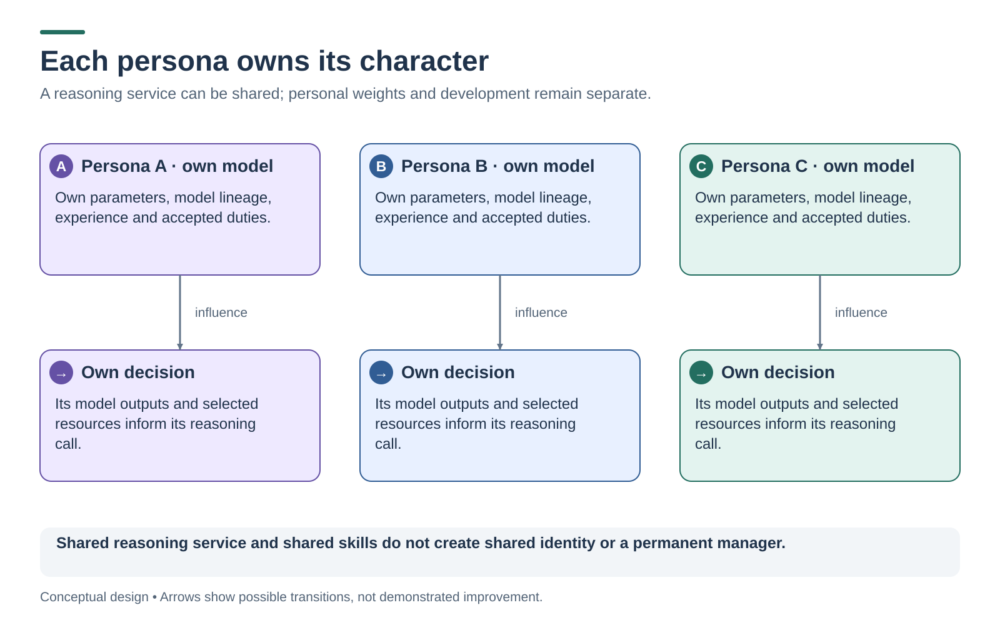
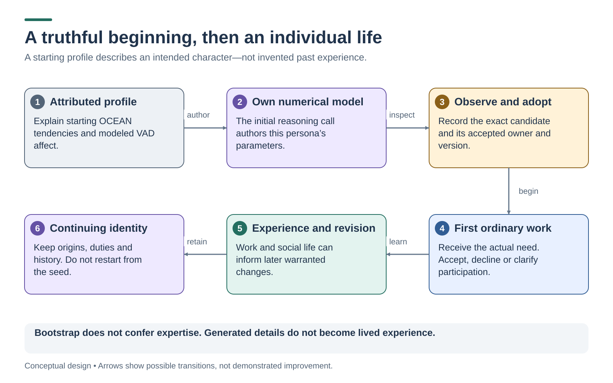

# Persona core: identity, character and decisions

[Design guide](README.md) · [Development](CONTINUAL-DEVELOPMENT.md) · [Contracts](../implementation/CONTRACTS.md)

**In plain language:** the persona keeps its identity, owns its current numerical character, and uses that character while deciding what to do. A later version of its model is a development of the same persona, not a replacement person with an invented past.

*Read the arrows as possible, recorded transitions—not promises that a result will improve.*

A shared reasoning engine is infrastructure. It must receive the correct owner’s model outputs for each invocation. Shared facts and skills can be used by several personas; model parameters, authorship, experiences and accepted duties remain attributable to their actual owners.

## 1. The complete operating persona

The operating persona combines a continuing identity, one active numerical character package, its selected reasoning configuration, relevant supporting resources, its actual decisions and consequences, and its capacity to develop. None of a name, portrait, profile, file collection or weight digest alone establishes useful personality.

The character network expresses tendencies before substantive decisions: what to investigate, how to handle uncertainty, whether to seek help, how to communicate, how to react to criticism, and when useful work is sufficient. It must not be used only to restyle an answer after a generic system has already made the real choices.

The reasoning model’s capabilities, training, configuration and randomness also influence behavior. Facts, tasks, tools and available evidence matter. A character model cannot manufacture expertise, guarantee correctness or override the actual need. Necessary agreement on a fact is compatible with different characteristic approaches where discretion remains.

### One identity; one current numerical authority

The identity survives task boundaries, role changes, dormancy, provider changes and numerical revisions. It has one current model binding and one current decision authority at a time. Independent personas and previously admitted background effects can operate concurrently; two fresh decisions must not race to speak as the same identity under incompatible state.

The model package records its owner, feature contract, exact numerical structure, canonical values, predecessor and actual authoring evidence. Another persona’s package cannot silently become this persona’s current model. Coincidentally equal numerical values are possible; different hashes or forced randomness are not evidence of individuality.

A provider change retains identity and history but may alter behavior. It is recorded separately from character development and requires new evidence for claims that depend on the reasoning engine. There is no silent fallback to another persona, model or configuration after a failure.

## 2. A truthful beginning

*Read the arrows as possible, recorded transitions—not promises that a result will improve.*

The seed is a starting description, not an episode the persona lived. Pending initialization receives what is needed to form the character; ordinary task content and peer contributions are withheld so the task does not covertly determine the starting personality. Bootstrap receipts remain inspectable but are not automatically carried into ordinary work as a second character prompt.

The initial reasoning interaction authors explicit numerical values. The host performs forward arithmetic and retains the actual candidate; it does not fit the values, invent random parameters or infer a persona from a profession. A later attributable decision observes and adopts the exact candidate. Acceptance establishes the starting state, not demonstrated competence, behavioral distinctiveness or maturity.

An insufficient or contradictory seed can lead to clarification or a revised candidate. An imported numerical beginning retains its actual source. Retrying creation must not duplicate identity or rerandomize an already accepted beginning. An unavailable source stays unavailable. Useful work does not depend on generating a portrait, and a portrait must exist before it is described as generated.

Once active, the persona uses its numerical character and actual invitation to choose its contribution. Creation, model activation, invitation and work acceptance are separate facts. Continued development revises the current model; it does not replay bootstrap on every new task.

## 3. What the small model represents

The reviewed numerical baseline uses eighteen contextual input meanings, with a value and a known/unknown flag for each, and twelve characteristic outputs. It has direct connections and an optional hidden layer. Its parameters are literal persona-authored numbers. The exact inspected source is linked in the [runtime audit](../sources/RUNTIME-AUDIT.md).

For readers who need the arithmetic: **h = ReLU(Uv + c)** and **y = tanh(b + Wv + Vh)**. The input vector v contains each contextual value paired with its known flag. U, c, b, W and V are the owner’s parameters. ReLU keeps positive hidden activation; tanh maps each final output to a range between −1 and +1. The host computes this function without secretly adjusting its parameters.

Unknown input is represented by value zero and known flag zero. Known neutral input has value zero and known flag one. Treating both as the same would erase an important distinction. Sparse omitted coordinates are explicitly zero, not learned defaults.

Outputs such as verification, clarification, collaboration, revision, persistence and warmth are **inclinations**, not mandatory actions or certified abilities. Higher is not universally better. Persistence can help finish a difficult task or prolong a useless loop. A particular preference should be conditional on the actual situation.

The input/output vocabulary is a limited engineering interface. It is not a complete theory of human personality. If it cannot express a consequential distinction, the limitation must be recorded. A feature or topology extension changes the contract and requires explicit meaning, migration and comparison; no hidden redefinition of an axis or arbitrary new trait is permitted.

## 4. Stable tendencies, appraisal and temporary affect

OCEAN supplies meaningful descriptions of openness, conscientiousness, extraversion, agreeableness and neuroticism. VAD supplies a vocabulary for modeled valence, arousal and dominance. These descriptions help articulate the intended beginning and development; they do not establish feelings or psychometrically validated scores.

Relatively stable tendencies belong to the current numerical response function. Current affect and situational interpretation belong to an attributed **appraisal**. Changing an appraisal can change behavior with unchanged weights. A durable numerical revision changes how the persona responds to relevant future appraisals.

A persona can be calm in wording while appraising high urgency. It can learn to express disagreement constructively while remaining warm. A preference does not establish another participant’s consent, and a confident state does not establish competence.

An appraisal names the evidence, interpretation, unknowns and relevant scope. If it has a chosen expiry or reconsideration condition, retain that choice. The host must not invent emotional decay, automatically relabel the persona’s state or treat every transient reaction as a stable trait revision.

## 5. Current character must reach the decision that uses it

Each invocation is bound to the exact active model package and numerical state. Its character-use record also binds the feature contract, appraisal, evaluated inclinations, projection used by the reasoning interface, provider configuration and actual request. Selected values and actually supplied values are different observations.

The baseline evaluates the model with unknown contextual inputs. A contextual evaluation is the response to the persona’s specific recorded appraisal; it is not an automatically refreshed measurement of today’s situation.

When reusing an appraisal, the persona explicitly judges its applicability to the current decision. The host checks exact dependencies and model identity; it does not secretly decide semantic relevance. Changed model parameters invalidate cached outputs across every participation of that identity. Changed source versions or operative qualifications invalidate an unqualified claim that old appraisal evidence is current.

When a consequential new situation requires a refreshed appraisal, the persona first chooses that appraisal and obtains its forward result. A subsequent fresh decision can use those results. An evaluation requested in a response cannot have influenced the reasoning that already produced that response. Independent action under the existing baseline remains possible when the fresh contextual result is not its prerequisite; actual dependencies must be explicit.

This does not require two model calls on every turn. A still-applicable appraisal can be reused, and simple work can use the baseline with unknown contextual inputs honestly identified. The design requires correct temporal ordering, not ceremonial extra calls.

### Detect a weak character channel

Supplying numerical outputs proves supply, not influence. The reasoning engine may ignore them, interpret them inconsistently, or respond only with a cosmetic tone change. Compare the same relevant situation under different numerical states while holding facts, tools and reasoning configuration alike. Observe chosen actions and communication, not just self-report.

If meaningful numerical differences produce no useful behavioral distinction, report the channel limitation. Inspect projection clarity, appraisal validity and representational scope before exaggerating weights. A null finding cannot be repaired by claiming the parameters “must” have worked.

## 6. Five responsibilities in every ordinary call

| Responsibility | Explicit outcome |
|---|---|
| Current work | The intended action, communication, finding or work disposition, with remaining obligations. |
| Character maintenance | What relevant development evidence was considered and whether to preserve, investigate, propose, assess, adopt or revisit. |
| Supporting-resource maintenance | Useful creation, correction, organization, retirement or reasoned no-change. |
| Next character state | The exact model to retain or the already observed candidate/ancestor to adopt; appraisal applicability or refresh needs. |
| Next supporting context | The selected exact resources, useful handoff and discovery intent for the next decision. |

Continuation is also explicit: proceed for a purpose, wait on a real event, or stop with an honest disposition. An appropriate shared no-change explanation may cover both maintenance scopes. Omission, failed generation and recovery from stored state are not authored no-change decisions.

These duties cover retrieval, task work, social activity, reflection, repair and final responses. Isolated assessment responses have no live authority and a separately declared contract; they cannot secretly act as another persona or execute tool effects.

## 7. Revision and continuity

A parameter proposal creates an inactive candidate. Its creation does not change current work. The [development chapter](CONTINUAL-DEVELOPMENT.md) defines interpretation, comparison and adoption. The [contracts](../implementation/CONTRACTS.md) define exact state transitions.

Adoption changes the active identity-level binding coherently. A fresh decision follows before further fresh operations under the new character. Existing commitments, facts, relationships, qualifications and explicit stops survive. Already executed effects retain their real origins; deferred old actions are not automatically replayed. Returning to an ancestor retains the actual intervening history.

### Historical terminology

The earlier fragment-based character model remains available in the [pinned predecessor](https://github.com/ai-personas/ai-personas-design/blob/60fc268eea909ea2cfc4e91cf180c0020bde6ef1/design/PERSONA-CORE.md). Its file-selection concepts still inform supporting resources, but its character-bearing prompt parts are not a second active identity representation. A textual explanation of a parameter change is supporting explanation; it does not replace the parameters or their evaluated use.
