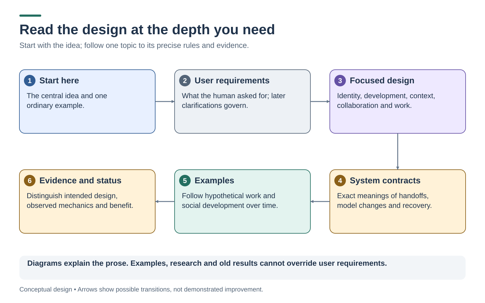

# Design guide

[Home](../README.md) · [Start here](../START-HERE.md) · [Requirements](../USER-REQUIREMENTS.md)

**One system, several readable views.** The persona chooses what to do and how to develop. The runtime supplies a faithful environment for those choices. The chapters below separate responsibilities without creating multiple competing architectures.

*Read the arrows as possible, recorded transitions—not promises that a result will improve.*

Read from left to right for a first visit. Return directly to a chapter for its subject later. The arrows are reading guidance, not a compulsory workflow for personas.

## Authoritative homes

| Subject | Its home |
|---|---|
| Identity, numerical model, starting character, appraisal and behavioral influence | [Persona core](PERSONA-CORE.md) |
| Experience interpretation, parameter proposals, comparison, adoption and later benefit | [Continual development](CONTINUAL-DEVELOPMENT.md) |
| Facts, memory, exact files, discovery, shared skills and compact context | [Context and skills](CONTEXT-AND-SKILLS.md) |
| Voluntary invitations, responsibilities, relationships and social activity | [Collaboration](COLLABORATION.md) |
| Requested results, tools, effects, continuation, stopping and truthful delivery | [Work and boundaries](WORK-AND-BOUNDARIES.md) |
| Observable records, coherent state transitions, recovery and version binding | [System contracts](../implementation/CONTRACTS.md) |
| Invariants and implementation obligations | [Traceability catalogue](../implementation/REQUIREMENTS.md) |
| What observations support which claims | [Evaluation](../evaluation/README.md) and [acceptance](../evaluation/ACCEPTANCE.md) |

## Authority within the repository

The [human requirements](../USER-REQUIREMENTS.md), including later clarifications, govern the design. The chapters above are complementary normative views. The 21 invariants and 45 implementation identifiers trace those obligations; they do not override the human requirements.

Examples, diagrams and worksheets explain the design. They are not compulsory task workflows. Research motivates bounded hypotheses; it does not confer conformance. The [status ledger](../implementation/STATUS.md) distinguishes inspected mechanisms, repository-reported observations and unproved targets. A conflict is a defect to repair, not permission to choose the easiest reading.

## The architectural decision

Each continuing identity owns one active numerical character package at a time. A reasoning model consumes its evaluated inclinations alongside relevant context. Ordinary experience can lead the same persona to author a candidate parameter revision. A current, explicitly adopted package then influences future decisions.

The host records facts, performs forward arithmetic, checks structural consistency, manages execution and preserves exact lineage. It does not author lessons, optimize personality values, assign professions or select a permanent manager. Personas may negotiate a temporary coordinator or reuse a method because they judge it useful.

## What is normative and what is an implementation choice

Owner-bound numerical character, direct persona-authored edits, faithful context, voluntary cooperation, continuing development and honest outcomes are design obligations. A particular database, provider, UI layout, network width or serialization format is an implementation choice unless an adopted deployment contract makes it relevant. The reviewed runtime’s eighteen input meanings and twelve output meanings are a concrete baseline, not an exhaustive scientific theory of personality.

A feature-interface change must be explicit, versioned and assessed for changed meaning. An implementer cannot silently replace the numerical model with prompt files, or replace general-purpose personas with assigned specialists, while calling the result conformant.

## Depth follows the need

A brief answer does not need a team, a model edit, a formal agreement or a completed worksheet. It still needs truthful maintenance and next-context dispositions. A substantial design task may need research, native artifacts, integration, chosen review and longer follow-through. Those activities must be selected by personas, not imposed as one universal pipeline.

## Reading the status correctly

“Designed” means the rule is specified. “Mechanism observed” means an actual operation was observed within its scope. “Useful maturation” requires later behavioral and outcome evidence. Publishing this repository establishes only a documentation revision. See [implementation status](../implementation/STATUS.md) before making a deployment claim.
