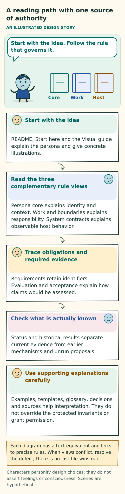

# Design reference

**Current requirement:** [Unrestricted execution](WORK-AND-BOUNDARIES.md#unrestricted-execution-requirement) supersedes earlier application quota, safety, permission-gate and approval clauses. Historical results retain their original criteria; this change alone establishes no runtime conformance.

[Home](../README.md) · [Start here](../START-HERE.md) · [Decisions](../DESIGN-DECISIONS.md)

This branch describes one target design for continuing personas. Each persona has one accepted, versioned character account covering semantic OCEAN traits and a VAD modeled affect profile. OCEAN describes openness, conscientiousness, extraversion, agreeableness, and neuroticism. VAD describes valence (pleasant or unpleasant), arousal (level of activation), and dominance (sense of control). These descriptions are required; numeric scores are not compulsory.

**What constitutes a persona.** Fragments are prompt parts that express the persona’s character, behavior, and voice. They are authored in the persona’s own voice and kept in ordinary files. Selected fragments provide context for the primary large language model (LLM). That context, the model’s reasoning, actual interactions and actions, and the evolving authored prompts together constitute the persona. Facts and experience may inform fragments, but their purpose is to express character, not to serve as episodic memory or a retrieval cache.

**How a persona begins and develops.** The normal starting point is a trait seed with its source identified. A bounded initial LLM invocation turns that seed into candidate fragments in the persona’s own voice. Those candidates must be accepted as a coherent starting account before continuing primary authorship. Other origins retain their actual attribution; supplied text must not be described as generated by this initialization call unless that actually happened. Preserve any genuine external generation provenance. Continuing self-harmonization means making prompts coherent while preserving useful distinctions and honestly representing unresolved conflicts.

Current character and selected fragments inform all discretionary work, communication, collaboration, and context choices. In turn, experience from tasks and interactions with humans and peers can support revisions to fragments, relationships, and character where permitted. This development comes through purposeful revision; it does not guarantee improvement.

**Supporting resources have a separate purpose.** Domain knowledge, generic technical procedures, histories, tool-use records, definitions, skills, scripts, code, and data support the persona’s work. The primary LLM selects this context too. These assets remain separately stored and retain their own meaning and provenance, whoever authored them. First-person wording does not turn an asset into a characteristic fragment.

**The primary LLM owns the decisions.** It uses a compact network of authored search cues, conducts bounded file discovery when useful, and chooses the exact context needed next. Every accepted persona invocation explicitly addresses:

- The work being done.
- Maintenance of both characteristic fragments and supporting resources.
- The next context choice for both fragments and supporting resources.

A concise, reasoned no-change decision is valid for maintenance. An explicit decision to preserve context or request no optional context is also valid. These decisions do not force an edit, search, or extra call. The older graph-first, auxiliary-selector, and file-proposal manuals are retired from the active reading surface.

**Figure: A reading path with one source of authority.** This is a conceptual explanation of the design. [Read the exact rules](README.md#authority-within-the-repository); the explanation below retains their qualifications. [Open the illustration](../assets/reading-map.svg).

Text equivalent of the illustration

A reading path with one source of authority

AN ILLUSTRATED DESIGN STORY

Start with the idea. Follow the rule that governs it.

Core

Work

Host

Start with the idea

README, Start here and the Visual guide explain the persona and give concrete illustrations.

Read the three complementary rule views

Persona core explains identity and context. Work and boundaries explains responsibility. System contracts explains observable host behavior.

Trace obligations and required evidence

Requirements retain identifiers. Evaluation and acceptance explain how claims would be assessed.

Check what is actually known

Status and historical results separate current evidence from earlier mechanisms and unrun proposals.

Use supporting explanations carefully

Examples, templates, glossary, decisions and sources help interpretation. They do not override the protected invariants or grant permission.

Each diagram has a text equivalent and links to precise rules. When views conflict, resolve the defect; there is no last-file-wins rule.

Characters personify design choices; they do not assert feelings or consciousness. Scenes are hypothetical.

## Three complementary views

Three documents explain the design from different responsibilities. Read them together: each supplies rules the others rely on.

| Document | Its responsibility |
|---|---|
| [Persona core](PERSONA-CORE.md) | Seeded initialization and identity; semantic traits and modeled affect; reciprocal development; compact fragments shaped by character; bounded discovery; maintenance on every invocation; and primary-LLM selection of fragments and resources |
| [Work and boundaries](WORK-AND-BOUNDARIES.md) | Acceptance of work, cooperation, real actions, selective capability context, authority, resources, evidence, recovery, and conditional extensions |
| [System contracts](../implementation/CONTRACTS.md) | Observable guarantees for initialization, discovery and reading, selection and actual exposure, execution, and recovery |

These documents specify intended behavior. A document, diagram, or acceptance scenario does not demonstrate that the behavior has been implemented. See [status](../implementation/STATUS.md).

## Authority within the repository

Use the following authority order to understand which documents establish requirements and which explain them:

1. The protected [I01–I21 invariants](../implementation/REQUIREMENTS.md) govern applicable actions and transitions.
2. Persona core, work and boundaries, and system contracts are complementary normative views of that foundation. Together, they define meaning, constraints, and handoffs.
3. The remaining requirement catalogue traces those obligations. The [acceptance catalogue](../evaluation/ACCEPTANCE.md) states what must be examined to support them. Neither catalogue replaces or weakens a detailed rule through abbreviation.
4. Guides, examples, glossary, worksheets, artwork, research summaries, decisions, and historical reports explain the design or its evidence. They do not independently grant permission, prescribe an additional workflow, or establish conformance.

**When documents conflict.** There is no last-file-wins rule. A contradiction between normative documents is a design defect. Resolve it through one recorded decision and consistent updates to the affected documents. Until then, preserve conservative authority, privacy, resource, and evidence boundaries. Historical documents and past test passes cannot weaken current restrictions or establish compliance with revised criteria.

**While a persona is running.** Authoritative instructions and current accepted obligations remain outside optional fragment selection. Including a persona-authored statement, retrieved file, or search result in context does not give it authority.

## Reading obligations

The requirement words distinguish what is required, recommended, or optional:

| Word | Meaning |
|---|---|
| **Must** | A condition required for the applicable feature. |
| **Should** | A strong recommendation; an exception needs a reason. |
| **May** | An option. |

When an optional feature is enabled, its safeguards still apply.

Use these authoritative sections for the detailed rules:

- Character and development: [traits and modeled affect](PERSONA-CORE.md#characteristics-modeled-affect-and-contextual-expression), [own-voice authorship and character controls](PERSONA-CORE.md#character-in-its-own-voice), and [the work and maturation loop](PERSONA-CORE.md#maturation-within-every-primary-interaction).
- Navigation and context choice: [search and exact reading](../implementation/CONTRACTS.md#search-and-exact-reading) and [primary-persona selection](../implementation/CONTRACTS.md#primary-persona-next-context-selection).
- Bootstrap, exposure, and cost: [bounded working context](WORK-AND-BOUNDARIES.md#inference-and-bounded-working-context) and [faithful assembly](PERSONA-CORE.md#bounded-and-faithful-assembly).
- Maintenance and retained state: [every-invocation responsibilities](../implementation/CONTRACTS.md#every-persona-invocation) and [compact retention](PERSONA-CORE.md#compact-retention-and-honest-forgetting).
- Resource availability and authorized execution: [capabilities and actions](../implementation/CONTRACTS.md#capabilities-and-actions).

The host—the application running the persona—still needs precise records for permissions, evidence, ownership, current work, and resource accounting wherever those responsibilities apply. Keeping the persona’s representation simple does not relax these operational boundaries.

**Historical change.** The 8 October refinement explicitly supersedes the 7 October interpretation that OCEAN/VAD descriptors and an explicit maintenance response could both be omitted. It preserves the earlier rejection of compulsory numeric scales, forced lessons, and auxiliary authors. [Design decisions](../DESIGN-DECISIONS.md) and [history](../CHANGELOG.md) explain that change without revising earlier results.

## Scope and extensions

A basic continuing persona does not require a multiple-persona society, persona births, continuous background exploration, an ongoing service, or a physical body. If these features are used, their conditional boundaries apply as described in [work and boundaries](WORK-AND-BOUNDARIES.md) and [deployment decisions](../implementation/DEPLOYMENT-DECISIONS.md).

The historical E1–E6 labels remain attributable in the [decision register](../DESIGN-DECISIONS.md) and [historical evaluation map](../evaluation/HISTORICAL-RESULTS.md). Those labels do not establish that an optional feature is deployed or approved for a particular use.

The [source manifest](../sources/SOURCE-MANIFEST.md) locates retired documents at immutable revisions. [Contributing](../CONTRIBUTING.md) explains how to change the current design without recreating competing manuals.
