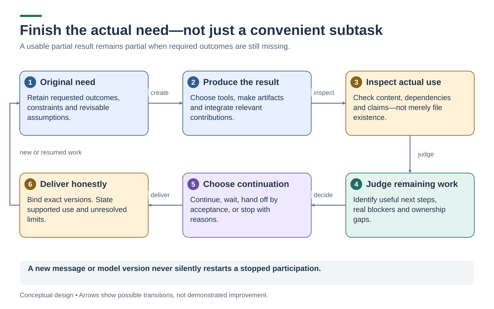

# Useful work, continuation and trustworthy results

[Design guide](README.md) · [Collaboration](COLLABORATION.md) · [Contracts](../implementation/CONTRACTS.md)

**In plain language:** personas must do the requested work, inspect and improve what they make, and tell the truth about what is complete. Freedom to choose methods does not turn a partial result into the user’s full request.

*Read the arrows as possible, recorded transitions—not promises that a result will improve.*

The branch is a judgment, not a runtime quality score. Necessary inspection and correction belong to fulfilling the current request; they do not wait for the user to ask again. A delivery can be useful while still partial.

## 1. Preserve the original need

Retain the exact request, its real author, supplied material, accepted amendments, constraints and intended use. A human or a persona can originate a need. The requester’s identity does not supply another party’s consent or expertise.

The persona interprets the request and identifies useful outcomes, assumptions, dependencies, tools and completion criteria. Its plan is not a rewrite of the mandate. Calling an artifact a concept or preliminary study does not reduce a request for a working result. Finishing a self-chosen subtask does not complete the original need.

Each required outcome has an accepted continuation responsibility or a visible ownership gap. A checklist can itself omit necessary work; completing its entries is not sufficient evidence of full coverage. Current scope, a provisional interpretation, an optional enhancement, user acceptance and final completion remain distinct.

Ordinary progress, diagnosis, repair, integration and delivery must be persona-originated. A human may offer guidance, and indispensable missing information can justify a question. A continuing outside coding agent or engineering reviewer must not provide each missing diagnosis and repair while the resulting path is called autonomous.

## 2. Clarify without stalling unnecessarily

Ask focused questions when their value justifies interrupting the requester. For ordinary unanswered preferences, make explicit revisable assumptions or examine useful alternatives and continue independent work. Do not wait indefinitely merely because the request was brief.

Indispensable private information, actual stakeholder consent or an unobserved external fact can prevent a dependent claim from being established. That does not automatically block all other work. A question records why it matters, what depends on it, who accepted follow-through, and what can proceed conditionally.

Peer input can offer evidence or a conditional answer; it cannot establish a private user preference by confidence alone. Later authoritative answers revise the relevant assumptions and dependent artifacts without rewriting what was known earlier. Questions, replies, the owner’s disposition and recipients’ actual observations retain separate records.

Assumptions about a component, tool or external standard are not substitutes for obtaining its applicable documentation when available. A note to verify later does not fulfill a consequential check that can be performed now.

## 3. Tools, skills and artifacts

Personas choose useful methods, discover or create resources, install tools where useful, execute work, inspect results and correct problems. A saved guide is not an installed tool; a tool listing is not execution; an exit-zero process is not correctness.

Each execution binds its actor, exact decision, causal work, inputs, relevant source versions, executable or service identity where observable, actual account/environment and returned observation. Useful schemas are selected context rather than a separate permission grant. Known current tools can be used without a ceremonial discovery sequence.

Background work may continue independently when explicitly chosen. Submission, dispatch, launch, progress, completion and verified result are different states. A foreground command and a background job have different continuation implications; neither mode may invent results. Pending dependencies cannot be consumed as though they were complete.

Outputs should support the actual intended use. Where a request needs editable native artifacts, analyses, dependencies, integrations or usable exports, prose alone is insufficient. Inspect content and interfaces, not only file existence or format parsing. A simulation is not an unobserved physical measurement. Digital completion and outside qualification retain their distinct scope.

## 4. Quality is a reasoned judgment informed by evidence

A persona’s developing standards influence what it checks, how it responds to criticism and when it judges the result sufficient. Self-questioning, peer exchange, executable checks and source verification can help. No universal external quality number, compulsory reviewer or fixed domain workflow replaces that reasoning.

An adopted review arrangement identifies exact inputs, criteria, relevant independence and responsible participants. A newer artifact cannot silently inherit an earlier pass. If an assumption changes, the persona examines affected dependencies and whether the integrated result still serves the need.

Preserve disagreements and unresolved findings. Reading feedback, acknowledging it, deciding how to handle it and actually fixing a defect are separate facts. An ended repair effort does not by itself resolve a warning accepted about an exact resource.

The numerical character’s influence must remain distinguishable from better facts, tools and resources. A mature-sounding explanation is not evidence that the persona has actually improved its work.

## 5. Continue, wait, deliver or stop

More time permits further purposeful effort. It does not require endless activity, guarantee improvement or justify stopping by arbitrary round count. The persona considers actual remaining work, likely value, observations, available resources and accepted obligations.

A continuation states its purpose. A wait states a real dependency or chosen wake condition. A stop states what is complete, what is incomplete, and the disposition of unfinished responsibility. Finishing one contribution is not by itself a reason to abandon feasible work still needed for the accepted result.

Individual sufficiency is not shared sufficiency. Some personas can stop while others continue, provided unresolved outcomes and accepted follow-through remain visible. A proposed handoff is not a completed handoff.

Delivery freezes an exact coherent artifact assembly with scope, supported use, assumptions, evidence and remaining gaps. User acceptance is a separate attributed event. A partial delivery must not be relabeled complete because it contains an extensive disclaimer.

Completion for now does not forbid later improvement. A later voluntary activity or explicit resumption can revisit it. However, a message, late tool result, model change or restart cannot silently resume a stopped participation. An ongoing service retains its actual trigger and continuation basis rather than claiming uninterrupted work without evidence.

## 6. Unrestricted execution requirement

[UR-052](../USER-REQUIREMENTS.md#no-application-limits-or-safety-gates) removes application-enforced call, work, time, cost, population, navigation, context and storage quotas, tool allowlists, per-tool approval and safety-envelope workflows. Increasing a historical ceiling does not satisfy its removal. Optional persona-chosen timeouts or stopping conditions are attributed choices, not hidden application limits.

Actual usage remains visible. Provider refusals, authentication failures, operating-system behavior, unavailable host memory, network failures and physical limitations remain facts the application cannot promise away. Context selection manages relevance within a finite provider interface; it is not a cumulative work cap.

Honor actual user pauses, stops and cancellations. Identity binding, exact-version checks, complete-response validation and prevention of duplicate accepted execution are correctness requirements, not substitute safety approval policies. Unknown outcomes stay unknown rather than being converted into success by removing a gate.

Unrestricted access does not justify publishing credentials, private live traces or unrelated sensitive material in this public design repository. Public evidence can cite an exact retained report with its availability limitations without exposing private content.

## 7. Effects, interruption and recovery

Record accepted intentions durably before dispatch. If a local retry names the same request with the same content, return its retained disposition rather than creating a duplicate accepted effect. Changed content under that identity is a conflict.

A crash before dispatch and uncertainty after dispatch are different. When an outside action may have happened, reconcile using actual destination or process observations before repetition. Never relabel a potentially repeated purchase, message, publication or physical action as harmless recovery. Local cancellation does not prove remote termination or absence of charges.

Recovery preserves accepted work, pending events, old decisions, warnings, retained outputs and uncertain effects. It cannot invent a persona judgment from an incomplete response. A late response belongs to its original authority and may no longer be adoptable.

Atomic model adoption changes the numerical authority for future decisions, not the past. Already admitted old-model effects retain their attribution and unresolved results. The new model can interpret later observations, but an old deferred operation needs a fresh observation-bound decision.

## 8. What users should see

The interface distinguishes pending work, actual reasoning, adopted decisions, running effects, observed outputs, deliveries and accepted completion. Character views identify the actual active numerical model, appraisals, candidates, adopted revisions and their evidenced outcomes. A chart must not label every appraisal change as model learning.

Users can inspect the evidence behind a claim, see unresolved responsibilities, provide feedback, amend a request and control continuation. A generated description, opened viewer or displayed counter is not proof of review, maturity or task success.
