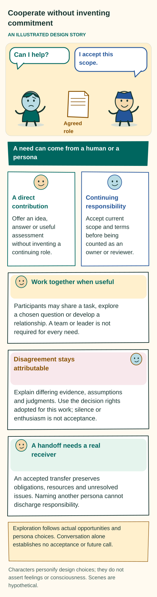
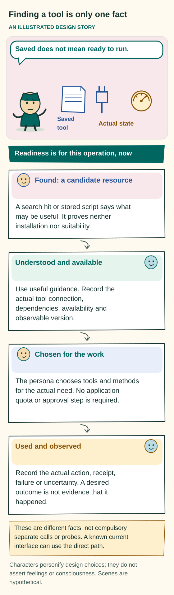
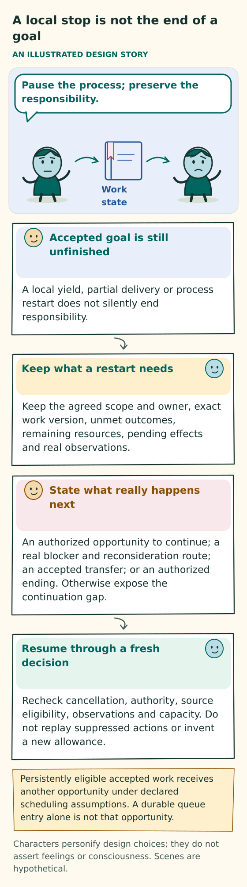
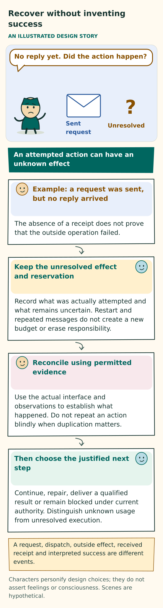
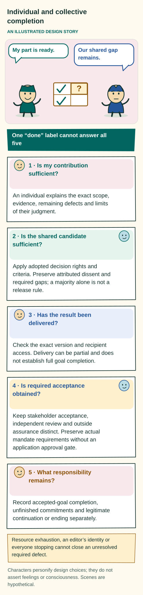

# Useful work, cooperation, and trustworthy boundaries

## Unrestricted execution requirement

The latest [UR-052 clarification](../USER-REQUIREMENTS.md#no-application-limits-or-safety-gates) governs this document and the connected implementation contracts. The application must not enforce work, lifetime, session, tool, navigation, storage, cost or population quotas, local execution deadlines, tool allowlists, source-sharing gates, or safety approval workflows. Configured historical ceilings are evidence of earlier operation, not authority to stop new work. Increasing a ceiling is not compliance with this requirement.

Accounting remains observational. Preserve the exact original requests and changes, actor identities, immutable records, actual inputs and outputs, usage measurements and explicit unknowns. Existing provenance does not disappear when enforcement changes. A successful process does not prove task correctness; an absent receipt remains absent. Exact response binding, transactional consistency and prevention of duplicate accepted execution are correctness requirements, not a substitute safety policy.

Personas choose whether useful work remains and may stop, pause, wait or continue. Honor an actual user cancellation or explicit pause. Provider refusals, account authentication, host operating-system behavior and physical availability remain external facts to report, not guarantees that the application can remove them. Do not add application restrictions to compensate for hypothetical risk.

This chapter applies that requirement throughout work, cooperation, recovery and delivery. The [earlier work chapter](https://github.com/ai-personas/ai-personas-design/blob/169f318fa604f2b8751c7640edb89bd7d66c796c/design/WORK-AND-BOUNDARIES.md) preserves the former resource envelopes, permission inheritance, protected quotas and approval rules as history. Earlier results keep their original criteria; they do not transfer to these revised obligations. Context selection and pagination supply useful material to a finite model input without creating a cumulative work or history quota. Source changes and design descriptions do not by themselves establish runtime conformance.

[Design guide](README.md) · [Persona core](PERSONA-CORE.md) · [Contracts](../implementation/CONTRACTS.md) · [Requirements](../implementation/REQUIREMENTS.md)

## Purpose and status

This chapter defines what a continuing persona may undertake, what its supporting system must preserve, and what it may honestly claim about a result. It is the adopted target design, not a report of deployed capability or a passed evaluation.

The [persona core](PERSONA-CORE.md) defines the persona as a continuing whole: characteristic context, LLM reasoning and invocation, actual behavior, and controlled self-revision. Fragments written in the persona's own voice are persona-defining prompt parts within that whole. Evidence and operational records serve a different purpose: they establish what happened and what remains owed. This chapter defines the boundaries that make the persona's freedom accountable.

**Who makes the choices.** The primary LLM is the mechanism through which the persona reasons and authors its decisions. It chooses useful contributions, methods, interpretations, organization of prompt parts, and characteristic context for its next invocation. Its current character, selected context, and actual situation inform all discretionary communication, collaboration, coordination, navigation, reflection, tool and action choices, and stopping. The model's learned capabilities, priors, and inference configuration also affect behavior; context alone guarantees neither consistency nor competence.

The same persona interprets consequences and may revise its compact network of fragments, later relationships and current character. It may search, read, ask, create, assess, revise, cooperate, continue, or stop. Every accepted persona response explicitly addresses its work, maintenance of both fragments and supporting resources, and next-context choices for both scopes. A concise reasoned no-change decision or preservation of suitable context can be enough.

**What the supporting system does.** It faithfully supplies chosen context, records actual events and checks exact identities, current work versions and coherent adoption. Usage accounting and context organization help the persona judge useful work without enforcing an application allowance. It does not infer a compulsory profession, team, domain workflow, universal relevance score, or sequence of steps from a request. Reusing a useful method is permitted; the persona need not invent a new method to demonstrate agency.

The [human requirements](../USER-REQUIREMENTS.md) govern this chapter, the [I01–I21 refinements](../implementation/REQUIREMENTS.md), the persona core and the contracts under the [document authority order](README.md#authority-within-the-repository). A conflict in a refinement is a design defect to resolve explicitly; it cannot override the human requirements. Examples, worksheets, artwork and historical sources carry no additional authority. Apply obligations at the depth and feature scope of the actual work: rewriting a sentence does not require a committee or eleven forms.

## The need and accepted scope

Start from the actual need and preserve who expressed it. Keep the exact request or self-originated need, its human or persona origin, supplied material and actual instructions. A requester may be a human or another persona. An actual opportunity may support a persona's own need or a peer request without a fresh human prompt. The requester's identity does not supply another party's authority or consent.

A request to create or build must not quietly become an offer of advice because a prose answer is easier. The persona determines the appropriate result, consequential unknowns, useful representations, and necessary checks. The user need not know tool names or file formats.

Preserve the full human-requested scope: useful individual and collective work, self-questioning and peer questioning, tool acquisition, retained learning, and later transfer such as house-to-skyscraper or circuit-to-printer work. More time and additional willing participants can support continued work without guaranteeing a better result. These are substantive needs, not scripted scenarios, compulsory teams or evidence that development has already occurred.

**The mandate.** The agreed scope records outcomes, hard constraints, preferences, accepted clarifications, assumptions, available resources, review expectations, and stopping conditions. Its detail should match the work's consequences and dependencies. Keep these distinct:

- The original request.
- A proposed interpretation.
- The adopted scope.
- An optional improvement.
- A completion criterion.

They carry different authority. Material changes require the authorized party's decision; the persona's plan cannot rewrite the original need.

**Coverage and ownership.** Each adopted required outcome has an accepted owner or a visible ownership gap, dependencies, evidence expectations, any actual review requirement, and a current disposition. Completing every item on a checklist does not prove that the checklist covered the request. Personas must judge omissions. A separate scope-coverage assessment becomes a formal release requirement only when explicitly adopted. A useful partial result, question, negative finding, block, or decline must not be labeled full success.

### Questions, assumptions, and shared context

A brief request can support useful interpretation and work. It need not arrive as a complete specification. Ask focused questions when their likely value justifies interrupting the requester, while progressing work that does not depend on the answer. Asking a question does not itself make the answer a blocking dependency.

**Ordinary choices.** For an unanswered preference or revisable design choice, the primary LLM uses available evidence to choose and disclose a reasonable provisional interpretation or a small useful set of alternatives. It must not wait indefinitely by default. Reconsider waiting according to urgency and accepted continuation terms, rather than a universal timeout. Keep material assumptions easy to revise. If a later answer conflicts with an assumption, reconsider affected claims and artifacts while preserving what actually happened earlier.

**Consequential unknowns.** A consequential question identifies why it matters, which claims depend on it, what evidence is needed, who accepted follow-through or where ownership is missing, and which conditional exploration could help. Missing user decisions, indispensable private input or required outside evidence can prevent a dependent result from being established. Record that actual dependency without turning uncertainty into a blanket application safety veto. Silence, elapsed time, and peer confidence cannot provide stakeholder consent or verify an outside fact.

Once useful independent work is exhausted, expose the specific blocker and the accountable next choice. Do not promise a continuation that has no means to occur. An assumption may be proposed, explored conditionally, confirmed by appropriate evidence, contradicted or withdrawn. Exploring a hypothetical condition does not confirm an outside fact or satisfy a requirement to deliver an actual result.

**Who can answer and who can see.** Ordinary work questions retain their actual recipients and work audience. The addressee, audience, and need for human input are separate matters. A question addressed to the user is not automatically private, and a peer may still offer evidence or a conditional answer. Mark a dependency as explicitly human-required only when consent, private information, or an outside observation actually requires that person.

The question owner assesses each reply's attributed basis and disposition. A peer may provide a fact, option, or inference, but cannot establish a private user preference merely by answering, or supply consent through an assumption. A dependency blocks the affected claim, not all independent progress.

**Conditional shared work.** A participant with the adopted assembly responsibility may propose or adopt a reversible conditional interpretation. Adoption does not widen the accepted scope, certify facts, supply a missing credential or establish an unobserved effect. Keep the conditions visible wherever the resulting claim appears. If a condition changes, reconsider dependent results and assessments.

**Readable adoption.** Bind adopted shared context to its exact version and actual recipients. Preserve the proposal, adoption, prior scope, notifications and any delivery failure separately. Resolving a question must not silently rewrite its audience or earlier replies. An attributed conclusion is a new result, not evidence that every recipient received or agreed with it. Source-sharing metadata adds no application admission gate.

**Durable delivery.** Deliver shared questions and replies to their exact recipients through durable input handling without duplicating an accepted deposit. Waking a waiting participant does not compel an answer or override a pause. Current question views survive inbox acknowledgment and retain attribution, outstanding owner decisions, and the basis of replies. Record the answer content actually supplied to the question owner. Delivery does not prove that the owner read the author's other fragments or sources. Stored lineage preserves attribution without a source-sharing gate.

## Voluntary responsibility and cooperation

A persona becomes responsible for continuing work by actually accepting it. Selecting a persona or naming it in a plan is only an offer. Continuing responsibility requires authenticated acceptance of the exact commitment and applicable terms, or an already accepted delegation that covers them.

**Figure: Cooperate without inventing commitment.** This is a conceptual explanation of the design. [Read the exact rules](WORK-AND-BOUNDARIES.md#voluntary-responsibility-and-cooperation); the explanation below retains their qualifications. [Open the illustration](../assets/collaboration.svg).

Text equivalent of the illustration

Cooperate without inventing commitment

AN ILLUSTRATED DESIGN STORY

Can I help?

I accept this scope.

Agreed role

A need can come from a human or a persona

A direct contribution

Offer an idea, answer or useful assessment without inventing a continuing role.

Continuing responsibility

Accept current scope and terms before being counted as an owner or reviewer.

Work together when useful

Participants may share a task, explore a chosen question or develop a relationship. A team or leader is not required for every need.

Disagreement stays attributable

Explain differing evidence, assumptions and judgments. Use the decision rights adopted for this work; silence or enthusiasm is not acceptance.

A handoff needs a real receiver

An accepted transfer preserves obligations, resources and unresolved issues. Naming another persona cannot discharge responsibility.

Exploration follows actual opportunities and persona choices. Conversation alone establishes no acceptance or future call.

Characters personify design choices; they do not assert feelings or consciousness. Scenes are hypothetical.

Preserve the accepting identity, work scope, terms or delegation envelope, revision, and actual acceptance event. An invitation, membership flag, caller-supplied receipt, or acceptance of some other commitment is insufficient. An offer to oneself still requires actual acceptance.

A direct answer or exploratory contribution need not first establish a formal continuation role. Once continuation is promised, its owner carries the need toward delivery, an honest wait or block, an explicit decline, or an accepted handoff. Ownership may be shared or divided. It does not create a compulsory leader or authority to assign peers.

| Disposition | Meaning |
|---|---|
| Offered | Terms are proposed; no accepted responsibility is attributed. |
| Accepted or working | The participant accepted the applicable terms. Each action still retains its actual status. |
| Blocked | A named condition prevents progress. Ownership and the next decision remain visible. |
| Submitted | An exact candidate is offered. Submission is not approval. |
| Closed | The exact agreed result or another authorized ending is recorded. |
| Canceled or handed off | An authorized cancellation or an accepted current transfer changes the responsibility. |

**Changed terms.** Material amendments outside accepted terms or delegation require fresh acceptance. An amendment genuinely within an accepted envelope records that basis without renegotiating every detail. Earlier acceptance remains historical; it does not automatically attach to new terms. Acceptance of responsibility establishes a commitment, not execution or successful delivery.

**Handoffs.** Offering a handoff leaves the existing responsibility intact. Transfer must check the exact current terms, current owner, exact receiver, authentic acceptance, adopted decision rights and relevant lifecycle state in one coherent transition. Competing transfers, cancellation, and revocation cannot all succeed from an outdated view. A declined, inaccessible, or obsolete offer leaves an accountable owner or an explicit authorized ownership gap. Silence is not a successor's consent.

### Discovery, disagreement, and revisable organization

Participants need a usable way to find work and one another with exact identities and attributable source information. Discovery covers work, gaps, participants, shareable contribution evidence, capabilities, and limits. Messages and a shared opportunity-and-obligation board support offers, questions, findings, and negotiation without imposing a global ranking. A search result neither selects a worker nor commits one. Each persona keeps its own agenda; collective commitments consist of actual accepted responsibilities and dependencies.

Participants may volunteer, decline, consult, propose alternatives, negotiate interfaces, or seek useful collaborators. An unavailable contribution does not automatically create a profession or trigger replacement births. Plans, checklists, temporary coordination, and recurring partnerships are revisable authored work content. Accepting them cannot widen authority or authorize replay of an action sequence whose results have not been observed.

**Character in cooperation.** Characteristic preferences may influence when a persona seeks another perspective, how directly it disagrees, what makes a handoff useful, or how it balances progress and consultation. Those preferences belong in its own fragments and actual decisions. OCEAN traits do not assign a host-selected role, and modeled dominance does not confer leadership. A quiet persona still owes accepted coordination duties; a sociable persona cannot turn every task into unnecessary messages or commitments. Coordination calls carry the same explicit maintenance responsibility as individual work, without merging participants' private accounts.

Actual human and peer exchanges belong to the [same reciprocal maturation loop](PERSONA-CORE.md#maturation-within-every-primary-interaction). Interpret each exchange according to what it establishes. A preference, factual report, praise, disagreement, and authentic acceptance are different kinds of evidence. Praise does not verify a conclusion, a decline does not prove hostility, and familiarity does not bind future help. Supported refinements to relationships or methods may change later characteristic choices without requiring stable-trait revision or a separate authority for social revision.

**Agreement and dissent.** Agreements preserve exact terms, scope, endorsers, dissent, allowed variation, revision, and exit. Majority agreement does not establish empirical truth. Compare evidence for factual disputes, seek the actual decision-maker for unresolved preferences or accepted scope, and expose unowned work. Independent reversible alternatives may proceed. Do not manufacture disagreement for appearance's sake or infer unanimity from a group summary.

**Criticism and blockers.** A peer's criticism is an attributed assessment. It is not automatically a veto, repair instruction, reviewer assignment, or activity-state change. A blocking obligation requires a separate, explicit adopted decision tied to its exact subject, basis, accepted responsibility or ownership gap, and disposition rule. Acknowledgment, delivery, and resolution remain distinct. Existing accepted blockers survive upgrades, summaries, context maintenance, and history pagination until an authorized disposition. A polite response cannot waive a mandatory criterion.

**Feedback records and substantive work.** Requester directions and persona-chosen peer feedback retain their full attributed bodies and actual dispositions. A pending record means no final structured account has been recorded; it is not automatically an adopted blocker or an unmet outcome. The persona judges the actual correction, useful response and remaining work. Pending bookkeeping alone cannot prevent closure or retirement. An empty queue, prose acknowledgment, handled account or replacement does not prove compliance or completion. Preserve the original message and actual account after closure; do not erase feedback or fabricate a disposition to make work appear finished.

Requester feedback also retains the exact mandate observed when the input arrived, separately from the current mandate when it is delivered or used. A task amendment does not rewrite that provenance or automatically replace the direction. Arrival under another mandate does not by itself make feedback obsolete: the persona interprets its text against current work and explicit replacements. The requester can replace earlier directions, including handled ones, when changing the task. Missing historical attribution stays unknown. An old report must not be attributed to a newer message, and retaining a direction does not establish that its requested work is still unfinished.

### Integration and finishing

Outputs that depend on one another need compatible agreements. As relevant, agree on identifiers, units, coordinates, terminology, input versions, ownership boundaries, and mappings from sources to analysis. These agreements are work content, not domain-specific runtime engines. Coupled changes become visible as one compatible adopted assembly. Independent drafts remain separate until adoption of their current versions succeeds.

**Circular dependencies.** Expose any cycle in which final outputs depend on one another. Participants may accept explicit provisional inputs, a baseline, compatibility checks, resources, and a stop condition. Provisional progress neither satisfies final dependencies nor proves convergence. The team may change method or report an honest block. Missing dependency records do not prove independence.

**Optional improvements.** Improvements compete with finishing. Personas choose how much explanation or comparison an idea needs; every thought does not require a proposal form. Actual comparisons may support adoption, rejection, or deferral. Optional novelty cannot remove required outcomes or quietly replace finishing the accepted need. The persona judges the value of further work without a protected resource pool or application spending gate.

## Capabilities and the execution boundary

The default is [full host command access](../implementation/DEPLOYMENT-DECISIONS.md#default-full-host-access). Personas may install and use tools with the host account's filesystem, network, environment and subprocess access. No application sandbox, command allowlist, per-tool approval, or selected guide is required. The host command definition is supplied directly in ordinary inputs. Tool discovery and procedural guidance remain useful choices, and actual execution records establish what ran.

A capability is an available means to observe or act, such as an application, service, connection, execution facility, procedure, or qualified outside contribution. Finding one is only the beginning of determining whether it can support the proposed operation.

**Figure: Finding a tool is only one fact.** This is a conceptual explanation of the design. [Read the exact rules](WORK-AND-BOUNDARIES.md#capabilities-and-the-execution-boundary); the explanation below retains their qualifications. [Open the illustration](../assets/tool-readiness.svg).

Text equivalent of the illustration

Finding a tool is only one fact

AN ILLUSTRATED DESIGN STORY

Saved does not mean ready to run.

Saved tool

Actual state

Readiness is for this operation, now

Found: a candidate resource

A search hit or stored script says what may be useful. It proves neither installation nor suitability.

Understood and available

Use useful guidance. Record the actual tool connection, dependencies, availability and observable version.

Chosen for the work

The persona chooses tools and methods for the actual need. No application quota or approval step is required.

Used and observed

Record the actual action, receipt, failure or uncertainty. A desired outcome is not evidence that it happened.

These are different facts, not compulsory separate calls or probes. A known current interface can use the direct path.

Characters personify design choices; they do not assert feelings or consciousness. Scenes are hypothetical.

A capability description identifies provenance, version, environment, required access, preparation, limits, observed failures, and evidence of use. Keep discovery, requested preparation, provisioning, availability, failure, and revocation distinct. Also distinguish four claims: installation, representative operation, actual project use, and successful output that supports a particular claim.

**Availability, actual instructions and suitability.** These facts must not be treated as interchangeable:

| Fact | What it establishes |
|---|---|
| A package is stored or an executable is installed | An artifact is present; this alone does not establish a usable interface or successful use. |
| A binding is registered or a connection is usable | An interface is addressable under its actual controls, or the connection can be used. |
| The operation follows the current work | Its purpose and instructions are attributable; this does not establish execution or another person's consent. |
| The capability is suitable for this need | It can serve the relevant purpose under the actual conditions. |
| Qualified guidance is actually exposed | The persona has received the operative guidance and its required qualifications. |
| An invocation is admitted | Current admission checks passed. |
| A relevant result succeeded | Observed output supports that particular success claim. |

Readiness is operation-specific evidence about current prerequisites. It is neither a correctness guarantee nor a compulsory probe. A suitable usable alternative can avoid acquiring something new. Preparing a preferred but unavailable option is another operation with its own actual prerequisites and observed outcome. These distinctions do not impose a linear lifecycle: remote services need no local installation, and an existing runner need not become a new native tool.

**Supporting resources.** Separately organized histories, tool-use records, tool definitions, reusable skills, scripts, code, and data remain supporting resources. Their storage, inspection, inclusion in selected context, and executable availability are different facts. A skill package's asserted permissions, a tool's self-description or a historical user instruction cannot invent a current user request, credential or observed capability. Imported guidance retains its author; the persona's characteristic interpretation belongs in its prompt fragments. The host checks exact identity qualified by source, rather than trusting a familiar filename or a colliding tool name.

**What an operation must bind.** Each operation binds its current observable capability, interface and connection identity, relevant exact client or runner artifacts and inputs, current work and actual outcome. Controlled local helper execution also binds the actual artifact, resolved relevant dependencies, configuration, and environment. A local helper that calls a remote service must satisfy both boundaries. Limits on observable remote identity do not waive local integrity checks.

For a remote service, record the server version only if it is genuinely observable. An unavailable server build is explicitly unknown; do not infer it from a schema or invent it. This uncertainty limits executable-version and reproducibility claims. A claim requiring that identity remains unestablished while it is unknown. The uncertainty does not impose an application approval step before an ordinary remote call.

A past run does not establish current availability or guarantee reliability. Preserve relevant guidance, exact mutable inputs and actual effect outcomes. Preparation and installation use the same unrestricted host interface. Even a help command may run imports or fetch dependencies; call an operation read-only only when its actual behavior supports that claim. Code and bulk data may remain outside model context when the runner consumes exact references and the persona receives the relevant interface and actual result evidence.

**The environment.** The environment identifies workspaces, participants, resources, information, services, artifacts, and actual limits. Separate draft directories may prevent collisions, but do not provide confidentiality. A default working directory is not an access grant. Resolve relative publication from the documented participation workspace; an earlier command's temporary directory must not silently change that default. Actual host accounts and external services may expose different capabilities; record the conditions observed.

Domain tools and specialist methods are legitimate. An export facility does not establish authoring, editing, analysis, or qualification capability. Existing current operation evidence may be reused; each task need not reinstall a tool or run an irrelevant probe. If the chosen operation lacks a usable capability, expose the gap, prepare it, choose another method, or stop. Neither a new persona nor a confident model description creates practical competence.

### Discovery without a compulsory tool sequence

Discovery helps the persona find what the work needs. It does not impose one research method or sequence on every task.

**Environment defaults.** A deployment may offer removable defaults scoped to an environment, such as search, page reading, and a supplementary model question. Present those defaults at creation and let the user omit any of them. Bindings are independently versioned per environment. Creation configures availability; it does not establish actual research, installation or spending. Later catalogue updates must not restore removed choices. Removing a binding neither uninstalls host software nor permanently forbids a later persona-chosen acquisition.

For unfamiliar requirements, current outside facts, or tool suitability, source search and inspection are useful primary discovery options. Applicable retained or supplied evidence may already suffice. The persona chooses queries, sources, methods, experiments, and collaborators. No universal search count or domain-specific sequence is imposed. A subsidiary model's answer is model knowledge, not external research or firsthand experience, and its suggested action is not an executed operation or accepted persona decision.

**Stored-resource discovery.** Through the next-context contract, the current primary decision requests lexical or supported-regex discovery, exact reads or particular definitions. The host returns the requested page or exact material and records actual use without aggregate quotas. Discovery, reading, selection, loading, invocation and observation have different meanings; they do not require six separate calls.

Known exact resources may be requested directly. An already supplied, still-current complete interface may support an invocation immediately. Independent requests may share a batch; a choice that depends on a result waits for the actual result. Never supply a complete tool or skill catalogue to an LLM so that it can choose a subset.

**Character and judgment.** Own-voice methods and tool notes guide choices only where the present need leaves discretion. An exploratory tendency may favor a small comparison; a preference for concrete progress may favor a reversible first attempt. Both still owe the checks needed for the actual promise. Traits cannot replace capability evidence, turn a description into execution, skip an exact instruction, or require extra calls merely to display personality. Supplementary model work that exercises the persona's judgment follows the [every-persona-invocation contract](../implementation/CONTRACTS.md#every-persona-invocation). Isolated computation remains attributed evidence for a later persona decision.

**Research outcomes and failures.** Diagnostics retain the actual backend, query or source, observation time, transport outcome, and failure category. Blocked access, an empty result, unavailable infrastructure, and candidate results are distinct outcomes. Transport success does not establish relevant research, and failure of one backend does not establish that all sources failed. Another method or retry remains the persona's choice in light of actual failures and current instructions. The host must not silently substitute a new account, credential, source or operation and claim it was the original attempt.

### Host access and observable claims

The default host interface uses the runtime account's actual filesystem, network, environment and subprocess access. The application adds no sandbox, command allowlist, per-tool approval or installation gate. A working directory describes where a command starts; it is not an application access boundary. Installation and tool choices remain persona decisions under the current work.

Describe what the actual environment establishes. Sharing a host account does not provide confidentiality between personas that can read the same files. A tool label, private metadata flag or separate draft directory does not establish isolation, read-only execution, containment or independent evaluation. Credentials and provider account bindings must retain their actual identity; diagnostics must not invent a credential, executable version or successful authentication.

Record the exact command, inputs, working directory, runner and observed result. Report a host permission error or unavailable external service as its actual outcome, without presenting it as an application safety refusal. A local stop receipt does not prove that every child process or remote effect was undone.

## Current instructions, provenance and information use

The application follows current human instructions and persona-authored work choices without adding permission or source-sharing gates. Earlier grant, audience, expiry and approval records remain attributable history; they do not supply an application veto under UR-052. The [document authority order](README.md#authority-within-the-repository) determines which design requirement governs a conflict.

Attribution remains necessary. Distinguish a human instruction, a persona decision, an accepted responsibility, a tool result and an authored interpretation. A fragment or retrieved document is not proof that a person issued an instruction or accepted a result. Preserve the exact requests and changes that actually occurred.

**Information use.** Record which exact fragments, assets, titles, previews, observations and other content were supplied, and to which model or recipient. Source and audience metadata describe provenance and disclosure; the application does not filter them through a source-sharing approval workflow. A selected file is not evidence of a read that never occurred, and an opaque reference alone does not prove that a body was supplied.

**Processing destinations.** Record the selected provider or service, actual account and exact transmitted input. Local readability, provider receipt, recipient attention and acceptance are different observations. Clearing later context does not undo an earlier disclosure or establish control over provider retention and outside copies.

### Shared work and explicit audiences

Record the actual recipients of messages, invitations, handoffs and shared material. Use exact persona identities where the interface requires persona recipients; a work label, source identifier or operation alias is a different kind of reference. A valid recipient identity does not establish that the recipient read, accepted or acted on a message.

Application source-sharing and work-membership gates are removed. Preserve source ownership, authorship, original audience metadata and later changes as records; do not misrepresent them as current enforcement or permission for a missing host credential. Changing metadata must not rewrite earlier delivery or actual source lineage.

An invitation, accepted responsibility, message deposit and useful contribution remain separate events. Repeated native requests retain their actual identities and outcomes without duplicate accepted transitions. Neither naming a peer nor delivering a message manufactures consent or a contribution.

### Historical provenance and fresh context

Preserve the source that actually informed a need, proposal, instruction, fragment or supporting asset. Do not retrofit omitted fields into old records or replace the originating request with a later citation. Missing provenance limits what can be claimed; it does not justify inventing a source or silently substituting another one.

Navigation identities and accounting are not reads of payloads that were never supplied. Keep actual body supply separate from metadata and from the model's authored account of what it used. A trusted receipt establishes only the observation it records.

A persona can select fresh context or clear optional selections for its next decision. That changes future supplied material without deleting the underlying history or retroactively removing what an earlier invocation received. Current task amendments govern the new work; prior judgments and completion records retain their original scope.

If evidence becomes unavailable, keep that fact explicit. An experience-informed fragment can still express an interpretation, but it cannot supply a missing receipt or claim renewed inspection. Unavailable history does not resolve an accepted warning, commitment or uncertain effect, and it must not make an old action fresh work eligible for replay.

## Admitted actions and real consequences

A model proposes an action; the runtime admits it only after current checks. Before admission, establish the actor, causal work, intended effect, exact request identity, relevant input versions, selected capability, current work and how observation, cancellation and uncertainty will work.

A callable capability ID selects the unique exact interface retained for that invocation. The model need not repeat an opaque binding digest. Keep the complete admitted interface as runtime evidence, reject missing or ambiguous selections, and compare it with the current implementation before accepting the action. Accepted jobs retain their original exact bindings for dispatch checks; looking up a capability in the current tool catalog must not silently replace the admitted version. Input-shape errors, an unavailable admission and an actual implementation change are distinct causes. Durable intent and accepted action state prevent an interruption between recording and dispatch from silently losing an action or duplicating its effect.

**Validate the whole response first.** Before adopting any proposed action, establish that the complete persona response contains valid work, explicit valid maintenance for both fragments and supporting resources, and explicit next-context dispositions for both. A plausible action, urgent-looking prose, or useful reply does not excuse missing or malformed maintenance or next-context intent.

From an invalid response, dispatch or adopt no proposed action, communication, resource write, discovery/read request, or next-context change. Independent host duties continue: cancellation enforcement, factual receipt and history recording, accounting and actual shutdown. Those duties must not manufacture a persona outcome.

| Action state | Honest meaning |
|---|---|
| Proposed | An action was requested; execution is not established. |
| Admitted | The exact valid response and action were accepted against current state; completion is not established. |
| Running or pending | Execution or an outside response remains underway. |
| Completed | A terminal observation identifies actual occurrence and exact outputs; correctness needs its own evidence. |
| Failed | Failure is observed; this does not necessarily establish that no external effect occurred. |
| Stop requested or acknowledged | The stated extent of stopping is known; earlier effects are not undone. |
| Effect unknown | Occurrence remains unresolved; a new effect or zero cost cannot be inferred from missing evidence. |

**Pending operations and fresh decisions.** A pending operation ends the unobserved remainder of the originating decision. Failure, uncertainty, and authority invalidation likewise stop the affected remainder according to their actual barriers. Preserve suppressed proposed actions for inspection; never replay them automatically. A fresh decision uses actual observations.

Independent work may proceed in a later decision while a background operation continues. An optimistic action list does not establish that independence.

**A valid response whose save fails.** A later file conflict or failed save is different from invalid or missing maintenance. It does not by itself invalidate otherwise valid work from the same complete valid response, but that work's independence must be explicit and evidenced. The work must require neither the failed edit nor unavailable observations. Relevant supplied state, exact inputs and current work must remain valid.

This independence allowance does not permit partial commit of a failed atomic adoption. If an implementation adopts the complete response as one unit, a failed adoption commits none of its proposed operations; further persona work needs a fresh decision. Separately accepted independent work, or effects already dispatched before a later failure, retain their actual outcomes. The [persistence contract](../implementation/CONTRACTS.md#complete-response-persistence-and-dependent-work) distinguishes these acceptance boundaries without requiring a new call merely because a separately adopted operation failed.

Missing dependency evidence does not establish independence. Hold dependent or uncertain work for a fresh decision based on observations. This allowance does not bypass a pending-action or fresh-decision barrier. A reply that depends on an unaccepted save cannot claim that the file was retained.

**Effective-character changes.** A same-response request to adopt an effective-character change must receive a coherent disposition before any other fresh persona operation from that response is adopted or dispatched. This applies regardless of listed order or claimed independence.

- **Accepted:** a fresh primary decision is required before any work outside the narrow atomic acceptance unit.
- **Known rejection, or explicit deferral with definitely no commit:** other work may proceed only if it passes the existing independence and current-state checks.
- **Unresolved or unknown commit:** hold the other work until the disposition is established.

A tentative character idea is not an adoption request and does not block ordinary investigation. A definitely uncommitted candidate requires a fresh proposal before later adoption. An unknown commit requires reconciliation.

The necessary character-proposal validation and disposition or commit includes only the exact account-binding and optional-selection reductions permitted by the core's atomic transition rule. Independent deterministic host duties remain possible. Preserve prior admitted effects and receipts without erasure or replay. Ordinary method updates and scoped transient affect do not trigger this character-specific barrier unless they replace effective character. The [persona core](PERSONA-CORE.md#character-in-its-own-voice) gives the full rule, including its application to reads and waits.

**Separate persistence from effects.** Fragment persistence and external effects have separate receipts. Coherently accept dependent local changes and durable action intent before dispatch, but do not promise that sending a message or running an outside operation is atomic with changing a file. A pre-action fragment may describe intent or earlier experience. Only an actual later observation supports an outcome claim. A failed maintenance retry cannot erase, repeat, or relabel an effect already dispatched.

When producing a model, inspecting it, and publishing it, do not read an older file at the intended location while the new operation is still running. The delivered output must be the exact product of the completed operation. A saved workflow authorizes no unobserved remainder.

**Retries and uncertain effects.** An exact retry with the same identity and content returns or resumes the same accepted operation while authoritative history remains retained and accessible. If it does not, return an honest unavailable or unresolved disposition under the retention rules. Never reconstruct missing history or replay the effect. Reusing an identity with different content is a conflict. Receipts retain their exact identity, attribution and observed scope.

If a service may have acted before a timeout, preserve destination, payload, effect uncertainty, and exposure. Before a potentially duplicate send, publication, purchase, or application, reconcile through actual destination evidence. Local journaling does not guarantee universal exactly-once delivery.

## Inference and chosen working context

The persona's identity and obligations persist independently of provider sessions. The primary model remains its decision and generative authorship mechanism; an opaque autonomous harness must not silently take ownership of the persona.

Supported inputs and outputs, refusals, malformed or partial responses, timeouts, cancellation, usage, and unavailable capabilities are explicit deployment choices within the [every-invocation contract](../implementation/CONTRACTS.md#every-persona-invocation). That contract covers initialization, request preparation and retrieval-only judgment, communication, coordinated work, repair, reflection, persona-capable subcalls, and provider attempts. Calling a persona decision a helper does not remove its maintenance responsibility.

**What every request and accepted response covers.** Every request combines:

- Current work.
- Accepted trait-conditioned context, or the attributed initialization seed.
- Needed supporting assets and observations.
- Maintenance responsibility for fragments and supporting resources.
- Responsibility to state the next-context disposition explicitly for fragments and supporting resources.

Preservation or no optional need may be appropriate; silence is not. A useful asset proposal identifies an intended file/path or storage reference, exact content or reference, a base revision where relevant, and helpful search/regex cues. One concise reasoned no_change may cover both maintenance scopes. Neither scope forces a write, a separate reflection call, or a new selection. Actual persistence, current execution availability, factual host capture, and primary-authored maintenance remain different claims.

**Initialization and model choice.** Preserve the exact chosen provider, model and effort and the actual credential binding. Record initialization attempts and model changes without an application funding or capability-proof prerequisite. Imported or operator-supplied character retains its true origin and must not be described as LLM-authored. A readiness observation makes no model call. A model change does not replace persona identity, erase usage or rewrite earlier provider outcomes.

Image capabilities follow the selected model's actual support. Image input support does not prove generation support. Any model change must remain explicit in the configuration and actual invocation records; an unavailable output does not prove that a different model was used. Supported media and actual exposure belong in the request and accounting. Saved connection changes govern future decisions; they do not rewrite the provider bindings or charges of admitted calls.

**A small starting interface.** Capability instructions have a persona-selected working set separate from stored histories and persona-defining fragments, governed by the same primary next-context choice. The bootstrap provides a small usable discovery/read/exposure interface, current work information and ordinary controls. It may include actual known references or relevant seed cues, but not a tool list selected to supply the expected answer. It must never enumerate every tool, skill, namespace, or manifest as startup metadata. If the scope inventory is large, let the persona choose pages and queries for it too.

**Three different exposure surfaces.** Keep the host-owned registry, provider-facing transport, and actual model-visible context distinct. The bulk catalogue remains in the host registry, outside both the provider request and any LLM used to filter it. Expose the requested descriptors, exact guidance, operative schemas, and their necessary qualifications.

A provider option that transmits all definitions while deferring their model visibility does not meet this transport boundary. Excluding transmitted material from model input may reduce model input, but does not turn transmitted bytes into model tokens. Report those measures separately and honestly. Hosted semantic search or automatic tool-set expansion cannot silently replace the primary's declared lexical selection.

**Usable guidance and correction.** Keep the ordinary interfaces needed to inspect, stop, recover or deliver current work available. Supply persona-selected guidance and real failures under the current context choice without a fixed working-set quota. A preview is not a complete method, and failed discovery is not acquisition. Retain the evidence needed for a useful fresh decision without replaying an effect or automatically choosing new fragments.

Older guidance retains its exact source and actual applicability. Persona-chosen context lifetimes and explicit clearing affect later supply without deleting historical observations. Another persona's activity does not replace this persona's context choice. Reusing guidance does not count as a fresh read, retry an effect or prove that its earlier result remains current.

**Reassemble between decisions.** Build the actual working context anew between decisions rather than appending every descriptor, activated skill, schema, and old result indefinitely. Honor the primary's accepted choices to preserve, replace, clear, and set lifetimes. Mechanical retirement follows the declared working-set policy without silently dropping valid selected material.

Context eviction is not storage deletion, revocation, or erasure of an observation. Preserve required tool-call/result bindings and usable controls for unresolved jobs. Provider caches, continuation references, and retained sessions do not prove that older material is absent, current, or free. An adapter must support the chosen context with honest observation continuity. If it cannot remove or replace selected material, report that limitation. No fixed application context ceiling or silent truncation substitutes for the persona's choice.

**Required context stays available.** Do not evict the following as obsolete tool instructions: current human input; current work and decision rights; coherent character and relevant modeled state; maintenance responsibility; cancellations; accepted obligations; important adverse observations; exact selected material with required qualifications; and unresolved effects. Active-work guidance forms part of the actual request before exposure is quoted. Context maintenance preserves those facts. It must not supply an evaluator's answer, dictate the next experiment, or act as a substitute author of persona context.

**Distinguish preparation from execution.** The persona chooses whether preparation is useful. A readiness preview reports available observations without invoking a model, inventing a charge or changing the selected model. Actual preparation and inference retain their own inputs, outcomes and costs. No reserved-capacity check, combined-cost ceiling or compulsory preparation phase blocks work under UR-052.

**Recheck the actual request.** Preserve the exact prepared input, rendered schemas, actual provider expansion, retained history and maintenance responsibilities. Record actual size and usage without application count, byte or episode ceilings. An unobservable expansion or real provider rejection limits what can be claimed; it must not produce silently truncated input or invented evidence.

Unknown provider expansion or unobservable retained context cannot support a hard-limit claim. Use a supported application-controlled path or expose the adapter limitation. Do not guess that unloaded tools are callable.

Assess efficiency across useful delivery, including discovery, host scanning, exact reads, schema loading and reloads, primary calls, retries, maintenance, failed branches, and optional task-tool costs. Per-call occupancy and whole-episode tokens, cost, and latency are separate measures. A smaller final prompt alone does not establish efficiency. Navigation follows the [persona-chosen file-search interface](PERSONA-CORE.md#ordinary-files-and-self-organization). Auxiliary semantic, vector, and graph-retrieval engines belong only to explicitly different research comparators. They are neither a production fallback after a search miss nor the purpose of the fragment collection.

## Resource accounting and continued work

Resource accounting describes actual use; it does not impose an application allowance. Under [UR-052](../USER-REQUIREMENTS.md#no-application-limits-or-safety-gates), work, descendants, initialization, tools, navigation, maintenance, review and closeout have no application call, time, cost, storage or population quota. Continuing work requires no quota increase, transfer, reserve allocation or safety approval. A larger fixed ceiling would still contradict this requirement.

**Record use at the boundary that establishes it.** Keep model attempts, provider-reported tokens, transport bytes, tool executions, elapsed time, navigation and retained storage distinguishable. Attribute activity to its actual work and persona, including failed attempts and descendants. A shared receipt or paired ledger must not turn one provider attempt into two billed calls. An estimate is not a measured bill; unknown usage remains unknown. Retiring a persona or ending a task does not erase its consumption.

Supply actual completed model-call evidence to later eligible persona decisions,
with its invocation, exact terminal reference, execution profile and available
model, effort and usage reports. A navigation account alone cannot establish
whether provider inference occurred. Keep synthetic submissions, missing fields,
reported identity, unknown charges and application adoption distinguishable.
Completed inference does not establish tool execution, source-inspection coverage
or the truth of an authored result. These receipts are ordinary retained host
observations, not a reason to resume stopped work or require a confirmation call.
Preserve original historical records instead of backfilling evidence into them.

Mechanical scheduling should reuse a coherent current snapshot for empty
maintenance checks. Candidate metadata selects what requires closer inspection;
actual creation, admission and failure retirement still validate current records
and exact transaction bindings. Release the inspection copy before entering those
helpers and refresh it afterward, including when no change was committed. Reuse
must not cross a later scheduling round, omit delivered feedback or turn an old
failure into a new continuation. Reduce redundant reads and temporary history
copies while preserving retained evidence. Report actual timing scope, including
overlapping phases, without inferring a speedup from source changes alone.

When preparation retains a new runtime head after an episode checkpoint, reuse
the exact stored object committed by that checkpoint. Avoid independently
serializing and packing the same immutable state merely to reconstruct that
head. Current authority, owned-invocation checks, dependencies, atomic runtime
and launch updates, and the caller's epoch check still apply. Return the new
head only after a successful commit. A construction timing event does not prove
that the checkpoint committed or that provider inference began.

When a state builder already produces the complete packed storage value, use
that value directly for initialization and subsequent stored objects. A second
serialization merely to reconstruct the same value adds temporary copies without
adding evidence. Share the representation builder with general serialization;
preserve all fields, exact exposure identities, reference locations and retained
history. Release temporary typed initialization state after constructing the
owned storage value, before the Store transaction. This does not remove distinct state transitions or their transaction
checks. Report construction timings separately from commits and actual memory
measurements; removing a source-level copy alone does not establish a speedup.

Within a Store transaction, validation and dependency checks can borrow the
caller's immutable candidate objects rather than copying their complete bodies.
Keep the complete exact-reference checks, current stored dependencies, current
heads and revision checks. The borrowed view belongs to that
batch, not a cache of authority across transactions. It changes neither retained
history nor committed bytes and does not itself establish a measured memory or
latency improvement.

Already typed JSON bodies need no separate serialization solely to check a
removed size quota and discard the bytes. Required fingerprints and durable
record encoding still cover complete content and propagate actual errors within
the same atomic transaction. Preserve identity, revision, dependency, terminal
authentication and duplicate checks, canonical records and measured allocation.
Removing redundant serialization does not remove content checks performed by the
owning runtime or establish a measured latency or memory improvement.

When a transaction writes an immutable object revision and its current head,
encode the complete canonical object once and reuse those bytes for both
logical records and the returned exact-reference digest. Preserve separate
record identity, namespace checks, duplicate checks, head updates, allocation
accounting and physical storage treatment in the same atomic commit. Borrowing
the body during encoding must preserve every field and canonical key ordering;
it does not replace current dependency validation or retain a cache across
transactions. Report encoding and hashing timings separately from byte copies,
accounting and persistence. Successful encoding alone establishes neither a
commit nor a measured whole-session speedup.

Invocation, atomic-admission and decision fingerprints may stream canonical JSON
over borrowed transaction values instead of copying complete request, intent or
object bodies solely to hash them. Preserve every field, the admission domain
marker, ordered arrays, explicit nulls, scalar encoding and recursively sorted
object keys. The same complete arguments must produce the same digest. Retain
current-state, revision, dependency, duplicate, reservation and terminal checks
inside their actual transactions; a prior digest does not replace them. Measure
hashing separately from the enclosing commit and distinguish overlapping phase
times from total elapsed time. Removing allocations alone establishes no measured
session improvement.

Immutable file revisions may be shared in memory across a state snapshot, its
copies and derived corpus views. New revisions remain separate records; current
heads, retirement, accepted bindings and exposure keep their own state. Sharing
must preserve complete content, canonical revision identities, storage encoding
and measured logical bytes. Rebuild and validate each corpus against its actual
snapshot, including record digests, paths, qualifications, policy consistency and
current bindings. Shared ownership provides no cached authority or permission to
omit retained evidence, and alone proves no memory or latency improvement.

Within one render borrowing an immutable state and admission, reuse its validated
corpus for observation projection, selected-file metadata and final context.
When metadata already used the complete assembly for the same mandatory roots,
optional selections and admission, that assembly may supply the final selected
context without rebuilding it. Preserve order, complete bodies and required
qualifications. A different render or changed state requires its own construction
and validation; local reuse is not a persistent cache or a current-authority
shortcut. Measure corpus construction separately while retaining its enclosing
render and planning costs.

Lineage walkers may collect their final exact source list directly from the
completed traversal's visited set instead of repeatedly merging an intermediate
list that is later replaced. Preserve input policy records and the ordering of
first-seen additions, exact revision lookups, inherited references, qualification
edges, warning-specific traversal and missing-lineage errors. Ordinary unchanged
inheritance may be borrowed; warning markers still require their freshly computed
ancestry projection. This local allocation change must preserve the complete
returned evidence and cannot cache validation across calls. Enclosing corpus,
rendering and planning timings remain distinct from an isolated cost attribution.

Providers, the host and external services have real availability and representation limits. Report their actual rejections, I/O failures, unsupported operations and unknown outcomes. The absence of an application quota does not promise infinite memory, free inference, indefinite service or guaranteed completion. Do not report a configured historical allowance as a current execution barrier.

**Choose useful context and maintenance.** UR-021–UR-023 still require selective discovery and compact, coherent context. The persona chooses relevant fragments and assets, query reformulation, consolidation and stopping through ordinary reasoning. Requested pages and ranges express what it wants to inspect; they are not cumulative work limits. The host supplies the accepted selection faithfully and reports actual missing or unavailable material instead of silently truncating it to an application ceiling.

Every persona interaction still covers work, fragment maintenance, asset maintenance and next-context choice. A reasoned no_change can be sufficient; neither a fragment edit nor a separate reflection call is mandatory. Preserve consequential unresolved corrections and actual failures. A failed model attempt cannot be converted into a persona-authored no-change decision.

**Measure the complete retained footprint.** Distinguish these observations:

| Scope | Contents |
|---|---|
| Persona-context corpus | Authored characteristic prompt parts. |
| Assembled prompt | The selected parts and other inputs actually supplied to an invocation. |
| Managed persona-state footprint | Current material, revisions and archives, indexes and cues, histories, copied tools and definitions, code and data, dependency caches, evidence and provenance, warnings, effect and context records, exports, backups and temporary rewrite copies. |

Include external storage deliberately used to support that state when it can be measured. Disclose missing measurements and the limits of control over provider or recipient copies. A smaller prompt or active directory does not establish lower total storage or cost. These measurements guide useful organization; they do not create a retention cap or a requirement to discard records.

**Keep retention decisions explicit.** Semantic consolidation, reorganization and retirement remain persona-authored; mechanical cleanup follows an actual accepted deletion or retention decision. Preserve original requests, accepted changes, authoritative receipts, unresolved effects and their provenance. Do not delete or rewrite them merely to satisfy an obsolete allocation. Do not alter or revoke user-owned delivered artifacts to shrink persona state.

When evidence is actually unavailable, say so and retain only the claims supported by what remains. A digest does not recover missing bytes. Missing history does not establish that an old action was unsent or make it eligible for replay. An actual persistence failure must remain visible rather than being presented as a successful save.

### Finishing without a quota or approval gate

Review, repair, status reporting and closeout use the same unrestricted execution policy as other work. The former preauthorized-finishing allowance is superseded. No separate funding pool or approval is required to continue an accepted responsibility. Historical allocations remain attributable records of earlier operation.

Finishing still depends on the actual work and observations. Preserve who accepted responsibility, what remains unresolved, and whether the persona chose to continue, wait, pause or stop. Do not infer expertise, a reviewer, acceptance or completion from available resources. Host status and effect receipts must remain observable without requiring a further successful model reply. Actual storage or transport failures can prevent a receipt; expose that uncertainty rather than inventing it.

### Unknown usage is not the same as unresolved execution

An attempt can have a confirmed local terminal outcome and an unknown remote bill. Preserve both facts. Accounting uncertainty alone is not an application veto on later work. It does not establish that remote processing stopped or that an outside effect failed.

An unfinished or uncertain action retains its identity and actual dispatch history. Reopening a store, choosing a new identifier or receiving a late result must not replay an accepted effect or turn uncertainty into success. Fresh decisions use current work and observations; explicit pause and cancellation remain effective. Work that depends on an unresolved result must expose that dependency, while independent work need not wait solely because a bill is unknown.

**Useful diagnostics.** Report actual calls and effects, known usage, unresolved usage, current work state, stopped participation and real provider or host failures separately. A read-only view changes neither the goal's completion nor a persona's authored continuation. Historical quota exhaustion must remain historical, and an unavailable diagnostic must not be replaced with a fabricated zero balance or successful outcome.

## Pause, amendment, and accountable stopping

Stopping prevents new affected work and addresses work already underway; it does not erase what happened. An actual pause, cancellation or explicit withdrawal of participation stops new affected admissions and initiates its applicable stop procedure. Historical allowance expiry does not create an application deadline. Show stop requested, stop acknowledged, already occurred, and still unknown separately. Late receipts remain evidence and accounting, not renewed authority. A compensating action is a new attributed action with its own actual outcome. Stopping does not undo publication or physical effects.

**Task pause and resume.** A task pause stops new decisions and requests stopping of in-flight inference. Already dispatched tool jobs may finish; stopping them is a separate choice. The pause survives restart, input, recovery timers, and new participants. It does not pause unrelated tasks sharing the persona.

Explicit task resume reactivates eligible paused or waiting participation, including individually paused participants. It cannot renew canceled or removed participation, clear quarantine, revive retirement, reopen sealed history, or establish missing acceptance or outside facts. A queue entry for a fresh decision does not prove that inference began.

**Amending the mandate.** Saving an operator task amendment adopts the new mandate and requests eligible resumption together, preserving the original request and prior versions. A mandate change through another control does not independently override pause. Old decision authority is invalidated immediately.

An amendment alone does not cancel already admitted inference. Let its transport drain so usage can be metered honestly, but dispatch no old actions and restore no superseded scope. A later explicit pause still requests stopping during that drain. Show saved scope, requested resumption and actual subsequent dispatch separately.

**The persona chooses whether to continue or yield.** The persona must author continuation or yielding explicitly. A decision with no actions may deliberately yield. Missing, malformed, or unsupported scheduling output is a decision failure, not an inferred voluntary stop or evidence of a new persona decision. An explicit no_change maintenance outcome does not mean no work remains, and deferred maintenance does not authorize continuation.

The runtime must not infer scheduling from trait values, modeled affect, a summary, another persona, or an unaccepted or superseded response. A valid current continuation disposition may remain binding across a local boundary.

**Honest stopping states.** A legitimate local stop may be supported completion, partial delivery, a named actual dependency, voluntary yield with unfinished work, or a resource, capability, or infrastructure block. An accepted peer contribution may justify a wait for its actual result; acceptance itself is not that result.

Preserve the persona's concise explanation together with delivery gaps, responsibilities, and findings. Do not invent a quality verdict or demand private reasoning. Once the accepted goal is met, the possibility of further refinement does not require endless work. A separately accepted improvement duty retains its own disposition.

### Continuing a goal across local boundaries

Ending an invocation, navigation effort, repair attempt, or declared episode need not end the accepted goal. A local stop or actual provider limit does not establish completion or release responsibility. A fresh decision may continue under the same current mandate without another user request or allowance. An actual authored Stop or Pause remains effective until explicitly resumed; an automatic next opportunity follows the persona's accepted continuation choice. Material changes to the accepted need still require the relevant requester's decision. A long accepted task does not automatically become optional personal exploration or an ongoing service.

**Figure: A local stop is not the end of a goal.** This is a conceptual explanation of the design. [Read the exact rules](WORK-AND-BOUNDARIES.md#continuing-a-goal-across-local-boundaries); the explanation below retains their qualifications. [Open the illustration](../assets/continuation.svg).

Text equivalent of the illustration

A local stop is not the end of a goal

AN ILLUSTRATED DESIGN STORY

Pause the process; preserve the responsibility.

Work state

Accepted goal is still unfinished

A local yield, partial delivery or process restart does not silently end responsibility.

Keep what a restart needs

Keep the agreed scope and owner, exact work version, unmet outcomes, pending effects and real observations.

State what really happens next

An authored continuation or explicit resume; a real blocker and reconsideration route; an accepted transfer; or an agreed ending. Otherwise expose the continuation gap.

Resume through a fresh decision

Use current scope, cancellation and actual observations. Respect an authored Stop or Pause. Do not replay suppressed actions.

Persistently eligible accepted work receives another opportunity under declared scheduling assumptions. A durable queue entry alone is not that opportunity.

Characters personify design choices; they do not assert feelings or consciousness. Scenes are hypothetical.

**What must survive a yield.** For an accepted continuing mandate, yielding suspends activity rather than silently ending pursuit. Preserve the outstanding result, accepted owner or ownership gap, relevant actual observations, and one of the following:

- An opportunity following the authored continuation or an explicit resume.
- An actual blocker and its route for reconsideration.
- An accepted transfer.
- An authorized ending.

If no usable continuation opportunity exists, expose that accountable continuation gap. Merely recording an unfinished obligation does not pursue it. Reachable required work must not be abandoned solely because a local response, tactic, or optional refinement ended. The persona may end an unhelpful tactic; the runtime must not use a fixed progress counter to end the goal or pretend a renamed tactic erases earlier failure.

**Each continuation starts from current facts.** On every admitted continuation, the primary receives current scope, decision rights, obligations, consequential results and actual resource observations. It chooses the next useful step or a justified disposition. Suppressed old actions are not replayed.

The host preserves eligible opportunities under the deployment's declared ordinary-work scheduling and fairness policy; it does not choose the next semantic action. Structural checks establish current bindings and accountable dispositions. Whether stopping was useful or justified requires behavioral evidence. Fair consideration and another actual call guarantee neither progress nor success.

**Real wait triggers.** A dependency wait identifies its actual event source. An unaccepted offer, fragment cue, or promise of future investigation does not supply a trigger. When an already-retained outcome is registered and delivered, preserve the new wait's reason and classification instead of restoring an earlier one. A replayed notification is neither fresh evidence nor a new wake.

Explicit resume, new input, a genuine event matching an accepted wait, or an ordinary-work scheduling opportunity may permit later work. Pause and cancellation still prevail. Waiting must not lose an event that arrives between inspection and durable registration.

## Recovery without invented success

Recovery restores the accepted situation and continues from evidence. It does not turn interruption into success. Restart preserves accepted state, exact identity, decisions, source provenance, notifications, pending operations, accounting, cancellations and ownership gaps. A fresh decision rechecks current scope and authority. Never replay an old action batch as a recovery probe.

**Figure: Recover without inventing success.** This is a conceptual explanation of the design. [Read the exact rules](WORK-AND-BOUNDARIES.md#recovery-without-invented-success); the explanation below retains their qualifications. [Open the illustration](../assets/effects-and-recovery.svg).

Text equivalent of the illustration

Recover without inventing success

AN ILLUSTRATED DESIGN STORY

No reply yet. Did the action happen?

Sent request

?

Unresolved

An attempted action can have an unknown effect

Example: a request was sent, but no reply arrived

The absence of a receipt does not prove that the outside operation failed.

Keep the unresolved effect and account

Record the actual attempt and uncertainty. Restart and repeated messages do not erase earlier use or responsibility.

Reconcile using actual evidence

Use the actual interface and observations to establish what happened. Do not repeat an action blindly when duplication matters.

Then choose the justified next step

Choose useful work, recovery, qualified delivery or a wait. Distinguish unknown usage from unresolved execution.

A request, dispatch, outside effect, received receipt and interpreted success are different events.

Characters personify design choices; they do not assert feelings or consciousness. Scenes are hypothetical.

**Provider and transport recovery.** A transport timeout or temporary provider outage is an infrastructure condition, not a voluntary persona wait. There is no application retry allowance or restricted recovery mode. A useful fresh decision can choose context changes, tools, maintenance, communication or another attempt. Transport handling may use observed service retry timing or backoff to avoid repeating an unavailable request without new information; it must retain actual attempts and never convert a failed call into a persona-authored choice. An inference probe is an actual provider call. Provider quota or credential failures remain external observations, with no promise that local policy can remove them.

Recovery schedules survive restart, but pause, cancellation, removal, retirement, and fences against adopting late results prevail. Apply these distinctions to initialization, model discovery, ordinary decisions, and context maintenance. Each provider attempt preserves its required maintenance input and individual accounting. Adopt at most one complete response for a logical invocation. Transport failure is not a completed maintenance decision or an authored no_change outcome.

**Read-only views.** Read-only interface activity provides coherent individual observations without holding the writer reservation. A changing multi-page traversal is still not a single snapshot; [search consistency and completion scope](../implementation/CONTRACTS.md#search-and-exact-reading) must remain explicit. Shared reads may coalesce while running, but closing one reader must not cancel another's request. Expensive file, history, evidence, and persona-context views load on demand and release subscriptions and payloads when closed.

### Actual failed lookups

Retain actual failed lookups so the persona can decide whether another attempt is useful. A changed source, new question or external observation may justify reconsideration. There is no fixed retry allowance or application cutoff. If the host returns a retained failure, identify it as historical instead of claiming a new attempt.

Resolve convenient document references to the actual saved target before comparing them. Reconsideration preserves current source identity and actual host outcomes. It never turns an earlier failure into success or applies a source-sharing gate.

**Preserve the original failure.** Recording a failure must not depend on successfully building an optional comparison index. Missing creation provenance and actual traversal failures retain their original outcomes and any undispatched receipts; no application traversal quota is imposed. An unavailable dependency snapshot is not evidence that the source is unchanged and must not receive an invented comparison key.

An exact-action retry returns its original receipt only while that authoritative history remains retained and accessible. Otherwise, an honest unavailable or unresolved disposition grants neither reconstruction nor replay. Repair may support a new request without rewriting the old failure.

**Check decision authority before source failure.** Malformed, closed, paused, or otherwise unauthoritative model decisions have not established a source lookup failure. Diagnose exact decision binding before source comparison; unavailable provenance cannot hide an already-invalid decision. Preserve its undispatched receipt without inventing a source attempt. Resumption and source repair cannot revive that rejected action. A new valid request receives its actual source outcome.

**Ordinary recovery after an actual failure.** Report a host permission error, unavailable source or failed connection with its actual evidence. The persona chooses useful recovery, fresh context, another method, communication, independent work or a wait. A relevant event may satisfy an accepted wait; a diagnostic alone cannot override Stop or Pause. Recovery has no restricted schema, mandatory method, fixed attempt allowance or safety approval step. Earlier failures and uncertain effects remain attributable.

## Evidence, assessment, and exact release

Evidence must make clear what has actually been established. Having an installed tool, completing an operation, preserving an intact file, producing a useful result, obtaining a qualifying review, gaining human acceptance, and receiving external assurance are separate claims.

Where applicable, the evidence connects the need and criteria to accepted work, exact inputs, assumptions, actual observations, outputs, assessment, and current release. These are not compulsory stages for every answer. A simple response can be its own artifact, assessed through human creative judgment.

**Identify exactly what is being assessed or offered.** An artifact version identifies its exact content, producer or producing action, scope, input versions, type, policy, and derivation. A logical current result points to an adopted version while preserving attribution for its history. A submission binds the precise artifacts, criteria, assumptions, limitations, and assembly being offered. “Whatever is latest” is insufficient.

A fingerprint establishes that bytes are unchanged. It does not establish authorship, truth, consent, or approval.

**Record calculations, simulations, and experiments in context.** The record includes:

| Part of the record | Required information |
|---|---|
| Purpose and inputs | The question, criterion, source inputs, transformed inputs, units, and conventions |
| Method and execution | The method, configuration, parameters, assumptions, and actual run or observation |
| Outcome and interpretation | Warnings, results, interpretation, and limits |

Successful conversion does not prove that transformed inputs remain faithful to their source. A simulation, a reported observation, an independent measurement, a visual inspection, and parsing a file provide different kinds of evidence. Native source, preview, and exported view are also distinct. Claims of editability or reproduction need the appropriate actual observation. Where identical bytes are irrelevant, that observation must address semantic or numerical equivalence as appropriate.

### Persona judgment and independent qualification

The persona chooses how to assess an exact subject. It may read, reason through an argument, make a visual observation, consult others, use tools, or combine these methods. Within the same participation, it can create a result, assess its own work, inspect a peer's work, and revise. Its self-assessment does not count as independent approval.

**Pursue quality through characteristic judgment.** The persona's own standards and dispositions inform what it notices, questions, challenges, and considers sufficient for the accepted need. Self-critique and exchanges with peers can expose a defect or justify retaining good work. Preserve the actual criticism or disagreement, the recipient's reasoned response, and any resulting revision, rejection, or acceptance. An exchange need not end in agreement or an edit, and small work requires no compulsory peer-review ritual.

An externally hardcoded quality score must not decide substantive quality in place of these judgments. Objective factual checks, contract checks, and tool results provide evidence about their stated claims; passing them does not by itself establish usefulness or quality. Their failures and all mandatory constraints still bind where applicable. Persona preferences cannot override facts, authority, or the adopted criteria, and neither a peer's approval nor a numeric result invents required stakeholder acceptance.

**Independence depends on the actual separation.** Different identities, executions, models, and qualified outside reviewers provide different forms of separation. A newborn persona is not automatically independent of its parent.

A formal adopted review identifies:

- The claim, exact subject, and criteria.
- The actual assessor, their accepted responsibility, actual separation and conflicts.
- The observations, findings, and limitations.

An optional request for another perspective does not create a formal release obligation. If a required suitable reviewer does not accept responsibility, report the gap. Do not invent approval or require a new birth as the solution. Human acceptance can legitimately assess a creative outcome without a numeric score; it cannot supply missing technical evidence.

**Use evidence for the claim it actually supports.** An additional citation may be unnecessary when the actual subject and an explained judgment suffice. When citations are supplied, they identify real, accessible receipts and their actual state. Failed or pending observations may support a limited conclusion, but they do not become successful execution. Even a successful command may be irrelevant to the claim.

Runtime checks establish attribution and exactness, not the semantic truth of an explanation. Record integrity and the substantive reliability of a reviewer each require their own evidence.

**Keep discretionary methods open to persona judgment.** Method-neutrality applies to the complete provider-facing request, including tool descriptions, maintenance paths, and the return to ordinary work. A failure counter, filename, domain label, or tool identity must not prescribe a repair, a new method, a shell operation, an extra reviewer, or a stop. Explicit task-specific obligations still bind. Optional assessment cannot be used to relabel an unmet result as satisfactory.

### Individual and shared sufficiency judgments

A persona can question its assumptions and judge whether its current result is sufficient. Participating personas can clarify one another's claims and disagree about what would improve the result or make it sufficient. Their characteristic context informs these choices; no separate reflection call or ritual debate is required.

**Figure: Individual and collective completion.** This is a conceptual explanation of the design. [Read the exact rules](WORK-AND-BOUNDARIES.md#individual-and-shared-sufficiency-judgments); the explanation below retains their qualifications. [Open the illustration](../assets/completion.svg).

Text equivalent of the illustration

Individual and collective completion

AN ILLUSTRATED DESIGN STORY

My part is ready.

Our shared gap remains.

?

One “done” label cannot answer all five

1 · Is my contribution sufficient?

An individual explains the exact scope, evidence, remaining defects and limits of their judgment.

2 · Is the shared candidate sufficient?

Apply adopted decision rights and criteria. Preserve attributed dissent and required gaps; a majority alone is not a release rule.

3 · Has the result been delivered?

Check the exact version and recipient access. Delivery can be partial and does not establish full goal completion.

4 · Is required acceptance obtained?

Keep stakeholder acceptance, independent review and outside assurance distinct. Preserve actual mandate requirements without an application approval gate.

5 · What responsibility remains?

Record accepted-goal completion, unfinished commitments and legitimate continuation or ending separately.

Resource exhaustion, an editor’s identity or everyone stopping cannot close an unresolved required defect.

Characters personify design choices; they do not assert feelings or consciousness. Scenes are hypothetical.

**Make shared decisions attributable.** A shared decision to complete or continue identifies the exact candidate and scope, the relevant attributed judgments, any unresolved required outcomes, and the decision rights or method actually adopted for that work. Opening a task, editing its assembly, or summarizing a discussion confers no final authority.

Dissent remains attributable. It is neither an automatic veto nor implied endorsement, and silence is not agreement. If a material shared decision has no adopted basis for resolving disagreement, expose that gap while continuing independent work within the accepted scope. The design requires no universal coordinator, unanimity rule, or vote.

**Separate sufficiency from possible improvement.** Participants can judge an adequately supported current version complete while still identifying optional improvements. Delivery, completion of the accepted goal, and stakeholder acceptance where required remain separate claims. Group enthusiasm and exhausted resources cannot satisfy an unmet required outcome.

The persona chooses further questioning, revision or stopping using evidence, urgency and commitments. Repeated disagreement is not new evidence. Actual resource or provider failure is separate from a sufficiency judgment; an application ceiling does not decide when the work ends.

**Later improvement preserves the actual commitment.** A persona may propose or explore an improvement without an application funding or permission gate. Attributing a new continuing obligation still requires actual acceptance; a suggestion or spare time does not supply it. An existing continuing improvement duty survives an intermediate delivery under the [continuation boundary](#continuing-a-goal-across-local-boundaries).

Later work creates a new candidate. It does not silently inherit earlier review or acceptance, or reopen a completed mandate. New evidence of a real defect still changes the affected claim's current applicability under the following rules. Agreement to stop establishes neither empirical truth nor stakeholder consent.

### Citation snapshots and current applicability

A citation snapshot records which evidence existed, its state, and its provenance at a declared capture stage. It should do so without unnecessarily duplicating sensitive payloads. The snapshot's timing limits what it can establish: a snapshot recorded with a verdict does not prove that the same payload was supplied to an earlier model request, attended to, or understood. A receipt may change between preparation and recording. Preserve that limitation instead of inventing an observation history.

**Check snapshots at qualification and release.** Check the exact snapshot when first binding it to a qualification and again at later release. Missing, duplicated, foreign, erased, malformed, or required-but-absent snapshot metadata cannot be substituted or upgraded into valid historical evidence. A fingerprint does not supply missing source bytes or establish that they were read.

Earlier assessments that lack the currently required snapshots cannot acquire invented ones during migration. A fresh assessment provides new evidence under the criteria it actually uses.

**Keep a historical verdict separate from its present use.** The verdict remains attached to what was examined. Its current applicability is separately recorded as current, stale, pending, or unverifiable. A relevant change to inputs, assumptions, criteria, tool or check configuration, assembly, or review policy immediately invalidates the affected current claim pending reconsideration. The claim must not remain green while a background invalidation runs.

If the impact is uncertain, broader revalidation chosen by the persona may be needed. Missing dependency links do not prove that nothing was affected.

**Release must bind one coherent result.** The release transition binds the mandate, criteria, assumptions, exact assembly, review policy, qualifying assessments, blocker dispositions, authority, and delivered scope.

- If a relevant change takes effect before release, the old review cannot seal the new result.
- If release takes effect first, it remains historical; the later change creates a new candidate.

Neither human acceptance nor a positive assessment silently transfers to newer bytes or discharges another unresolved finding.

## Delivering the result

A result is delivered only when it reaches its intended recipient. Producing workspace bytes, publishing a retained version, submitting it, adopting an assembly, delivering it, and accepting it are separate observations. A document that names a local archive does not deliver that archive.

**Keep publication and inspection usable.** Their capabilities must remain discoverable after older execution history leaves active context. Relative paths resolve consistently. Publication reports the resolved location and the original retention failure without inventing a different path or a success.

**Send the answer through its intended surface.** A requested answer reaches the intended user-facing surface. Private activity, a saved but undelivered draft, and an operator's internal view do not deliver it.

For ordinary chat and work delivery, a call's authored previews, commentary, and reply remain withheld until complete work-and-maintenance validation succeeds. The host may truthfully report that the call is pending. Operator diagnostic inspection remains a separate activity under the [contracts](../implementation/CONTRACTS.md#every-persona-invocation).

The primary decision explicitly chooses either no reply or separately authored reply text with private-user or exact-work visibility. A missing audience is invalid; activity text never fills it automatically. A work reply reaches that work's audience, not every task in its environment. The receipt records the exact content supplied to that audience; it does not imply that earlier correspondence or source bodies were included.

**Preserve actual delivery semantics.** A reply retains exact recipients, current work attribution, cancellation, freshness, journaling and dependencies on preceding actions. It follows preceding completed synchronous actions and precedes an explicit wait. A failure or asynchronous boundary may suppress delivery that depends on it. A request for an in-app response does not authorize unrelated communication, and an internal preview does not become a delivered reply.

**Treat submission notices as separately authored messages.** An optional notice has its own text and explicit audience. The notice and submission commit together or neither does. The notice references the exact submitted version; its private content does not silently become part of the submission. A later read records its exact body and attribution. Choosing a shared notice does not change any earlier audience.

**Show what actually arrived.** Delivery evidence identifies the successful receipt, exact message or submission, work, audience, and actual requested contents. A success flag, generic notice, or empty failure list alone cannot establish delivery of the promised result.

Current delivery observations report retained references, attachment counts, mandate attribution, actual delivery failures and available remedies. They do not search local files, judge quality, or infer unknown historical applicability. Failed checks retain their working directory, diagnostic completeness, and exact recovery references through compaction.

### Honest outcome vocabulary

Use outcome terms that tell the recipient both what arrived and what remains unresolved.

| Outcome | What it says |
|---|---|
| Delivered | The agreed scoped result reached its destination with required current evidence. |
| Delivered with conditions | An authorized conditional result was delivered with conditions visible beside the claim. |
| Partial delivered | Useful portions arrived; the original full need remains unmet. |
| Blocked internally or externally | A named capability, ownership, resource, information, authority, review, or outside-observation gap prevents completion. |
| Unaccepted | A result exists but required acceptance is absent or declined. |
| Canceled or declined | An explicit disposition ended work without implying success. |

Keep activity, ownership, coverage, submission, assessment, applicability, human acceptance, outside assurance, and optional improvement distinct. If a report gives a fraction, it states the denominator. Stopping activity does not complete a need.

A closeout report identifies delivered versions, current checks, missing scope, conditions, outside requirements, accepted remaining owners or ownership gaps, resource use, uncertainty, and the decision needed to continue. A digital result does not establish that construction, operation, treatment, publication or certification actually occurred, or supply missing acceptance for a separately requested result.

## Lifecycle and optional exploration

Creating a persona, accepting it into a group, and accepting work are separate events. Creation also remains distinct from initial fragment authorship and orientation. The [seed-to-accepted-character path](PERSONA-CORE.md#a-continuing-persona) preserves the attributed seed, actual model input and accepted own-voice starting account without an application allowance or authoring gate.

**Preserve the actual beginning.** A creation retry returns the same identity and actual initialization. It does not regenerate a preferred character, duplicate money, or imply that a declined offer was accepted by another identity. Seed provenance, the generated candidate, the accepted starting revision, and any supplied alternative account remain separately attributable. None supplies an invented human biography or experience.

**Track each kind of state separately.** Lifecycle, quarantine, membership, model configuration, work participation, and accepted obligations have different meanings. Active status does not imply continuous inference, and completing work does not retire an identity.

Pause, model change, removal, retirement, and restoration preserve obligations, effects, spending, uncertainty, and actual creation records. Relevant eligibility changes must fence in-flight decisions before another action can be admitted.

**Keep responsibility explicit at retirement.** Preserve accepted transfer, actual cancellation, supported completion or any still-unresolved obligation with its owner or ownership gap. Retirement itself cannot discharge a commitment or settle an effect. A blocked obligation stays attributable and visible with its actual condition and next decision. A retired historical owner cannot execute it. A pending feedback record alone is not an accepted unfinished obligation and imposes no automatic retirement gate.

An explicit reactivation changes the actual lifecycle state without resuming stopped work, restoring membership or replaying old operations. The application adds no safety approval or automatic quarantine policy. Record any actual operator pause or quarantine distinctly. Restoring an identity on another host must preserve exclusive accepted transitions and actual execution ownership; a copied directory does not establish coherent continuation.

**Retain starting references honestly.** Starting-state references survive later changes. An actual user-directed erasure or unavailable payload leaves an honest provenance disposition instead of fabricated replacement values. There is no application retention quota or automatic deletion to satisfy a historical allowance. These starting-state facts remain independent of the persona's current self-authored character.

### Between-task exploration follows persona choice

A persona may investigate methods during active work or pursue an actual between-task opportunity. It chooses the question, tools, collaborators, communication and continuation. The application imposes no separate funding permission, finite episode allowance, recurrence quota or mandatory expiry. An opportunity is not proof that the persona accepted it or that a model call occurred.

Task-free social or recreational exchange may end without a deliverable, fragment revision or productivity benefit. The persona chooses whether to engage, whom to approach and what to discuss. Refusal and silence create no participation duty. The host supplies actual opportunities and received messages, not compulsory partners or conversation content. Dormancy remains valid.

**Account for the episode.** Retain its purpose, actual participants, work links, observations, attempts and outcome. Include orientation, collaborators, child work, failed attempts and late results in the accounting without an application allowance. A child identity or new episode does not erase earlier use or an unresolved effect.

**Give foreground work a real opportunity.** Preserve the runtime's declared foreground scheduling behavior for the same persona and related work, without assigning semantic priorities or accepting work on a persona's behalf. Paused, canceled, completed or removed participation is not runnable merely because it appears in a queue. An optional unanswered preference is not automatically a blocker. Already admitted operations keep their actual costs and effects; later scheduling must not erase them or skip required reconciliation.

**Preserve actual starts and failures.** Record the chosen opportunity and admitted episode coherently before dispatch. Duplicate triggers return their original outcome without duplicate accepted work. Failure before a start must not manufacture successful participation; failure after dispatch retains the attempt, actual charges, uncertainty and responsibilities. An ambiguous outcome is not an unsent action eligible for replay.

Explicit pause, disabling and cancellation remain effective and retain their actual stop outcomes. Ending an episode does not resolve a collaborator's unfinished commitment. A useful negative finding, partial delivery, cancellation and completion remain different dispositions.

### Fairness without promised success

A requested page of opportunities is not a population or consideration quota. Future or paused entries must not permanently hide later eligible work. Describe assumptions about scheduler progress, queue changes, restart, recovery and actual eligibility before claiming eventual consideration.

Consideration does not guarantee acceptance, feasibility or completion. The persona judges whether continuing work is useful and can choose a stop; the runtime does not replace that choice with a fixed idle-call or progress quota. Requested scheduling times and actual clock observations retain their precision. A reopened editor or restarted process must not fabricate a new opportunity or silently change the user's schedule.

## Relationships and optional wider deployments

Relationship fragments describe how a persona approaches particular collaborators. They express the persona's own directional, contextual interpretations of real, attributed exchanges. They can influence invitations and working methods, but they do not become universal competence rankings, reputation-based authority, or evidence that another participant's fragments and records were read.

Trust can narrow after counterevidence. Affinity supplies no commitment, credential, or human consent. A persona with a human-like character remains transparently AI. A distinctive voice does not justify fabricated life events or subjective claims.

The extensions below apply only when enabled. They describe additional applications and the evidence relevant to them; a basic persona needs no society, continuous service, physical body, or institutional ceremony.

E4 groups two facets: ongoing services and physical interfaces. Name the facet when referring to its specific observations or responsibilities; the shared E4 identifier does not make their evidence interchangeable.

| Extension | Scope and actual evidence when used |
|---|---|
| E1: functional embodiment and profiles | Make the whole persona inspectable through its characteristic context, LLM invocation, interaction, action, consequence and self-revision. The extension adds explanatory views; the whole persona already exists in that sense. Layers, avatars, and profile displays do not establish feelings, consciousness, competence, or physical embodiment. |
| E2: communities and institutions | A charter identifies purpose, accountable sponsor, membership and exit, real authority, resources, information policy, conflict, appeal, renewal, and dissolution. A society neither merges private persona-context corpora nor requires a leader. |
| E3: sensitive human-facing use | Be transparent about AI identity. Support declining retention of personal information and leaving. Do not invent relationships, human experiences, diagnoses, qualifications, or endorsements. Claims about education, support and public participation need evidence of their actual outcomes. |
| E4: ongoing services | State the accepted owner, actual triggers, freshness, observations, retention, escalation and stopping. The application adds no episode quota, total allowance or mandatory renewal. Disconnection leaves an observation gap. A human escalation route requires an actual accepting recipient, acknowledgment expectations, and defined behavior when that recipient is unavailable. |
| E4: physical interfaces | Identify the device, environment, actual effects and observations, physical limits, operator controls, stopping outcomes, delayed effects, observation loss and conflicting controllers. Simulation does not establish physical behavior or safety; only actual evidence supports those claims. The application adds no independent-assurance approval gate. |
| E5: conformance and authoring aids | Worksheets, identifiers, and profiles organize claims and evidence. They impose no forms or mandatory phases on simple work. Completing a form establishes neither execution nor consent. |
| E6: contribution and evidence governance | Preserve exact versions, criteria, failures, provenance, and appropriately scoped public claims. Maintainer acceptance changes the design without establishing runtime conformance. Licensing and contribution terms remain owner decisions. |

**Keep community decisions accountable.** Identify the requester, authorized decision-maker, beneficiaries, affected parties, people actually consulted, and representation gaps. Simulated stakeholders cannot consent for real stakeholders.

Decision records preserve the exact question, eligible participants, adopted rule, endorsements, dissent, authority, and commitments. Creating personas cannot multiply human-controlled votes or resources. An appeal needs an accountable human or institution. Exit or dissolution must hand off, legitimately cancel, or expose every unresolved obligation without indiscriminately copying private fragment collections or supporting records.

**Keep service and host boundaries explicit.** Completing one service episode establishes nothing about future episodes. If an essential escalation recipient is unavailable, retain that actual gap and let the persona judge the affected work and continuation without inventing a receiver.

Cross-host continuation preserves exact identity, exclusive execution ownership, transfer state, explicit stops and actual failure outcomes. Read-only exchange or a copied state file does not establish that those transitions occurred. These are consistency requirements without an additional deployment approval gate.

## Human-readable state and controls

The interface helps people understand what is wanted, what is happening, who accepted what, what changed, what evidence exists, and what needs their decision. Work, Personas, Environments, Fragments and Assets, and Tools provide understandable navigation. Advanced governance should not obstruct a small request.

**Label draft inspection honestly.** Where operator diagnostics may display authored drafts, both summaries and commentary are explicitly labeled unvalidated. That inspection is separate from ordinary chat or work delivery. It does not establish a completed result, accepted decision, or truth of the draft's claims, and it grants no action authority. The displayed content retains its exact provenance and actual audience. Raw private reasoning is excluded.

Distinguish model-call status, complete-response validation, actual persistence, action receipts, and delivery. A terminal provider event alone establishes none of the later stages. Even a save-success claim in a validated response needs its actual acceptance receipt.

**Show the character that actually governs the persona.** Profiles display the same accepted OCEAN, baseline VAD, additional characteristics, and own-voice account used in persona context. Transient modeled affect is clearly separate. Profiles also distinguish interests, maturation, capability evidence, commitments, lifecycle, and actual inference configuration, and show starting versus current state and actual authorship.

Make these outcomes distinguishable: considered with no change, proposed, retained, supplied later, acted on, and benefit evaluated. Keep blocked maintenance, failed calls, and unresolved deferrals visible without overwhelming ordinary work. Show actual unavailable history and incomplete observations where they affect a claim.

A fragment count, calendar age, avatar animation, or modeled state establishes neither competence, development, work, nor emotion. A claimed portrait needs a real artifact or an explicit placeholder.

**Make controls understandable and voluntary.** People can inspect work and usage, change their instructions, inspect recruitment, pause or cancel, request review and accept limited results with visible conditions. Present material effects, audience, assumptions and actual unresolved choices clearly without inserting an application quota or safety approval workflow. Persona activity alone creates no new user obligation.

**Support accessible use and honest status.** Support keyboard use, clear focus, readable text, small screens, and progressive disclosure. Color or animation alone must not convey status.

Artifact views distinguish connecting, receiving, verifying, preparing, ready, unavailable, and failed. Receiving bytes does not prove that a preview is ready or a result is valid. Empty installations explain founder creation instead of displaying a fictional active society. Missing owner, declined invitation, exhausted capacity, unavailable capability, missing review, and stale result each need a distinct, honest state.

## Verification and evidence preservation

Verification must show what was actually examined and what the evidence can support. The [acceptance catalogue](../evaluation/ACCEPTANCE.md) identifies evidence criteria; listing one is not an executed result. Use actual work and source evidence without generating test cases or a prescribed evaluation campaign. A build, source inspection, provider invocation and exercised product behavior support different claims. Preserve requirement identifiers and the exact old criteria attached to historical results.

A protocol may permit varied organizations without showing that personas chose them. Evidence of those choices is, in turn, different from evidence of useful cooperation. Before claiming that no hidden task script exists, inspect actual prompts, policy, configuration, and adapters as well as attributed decisions.

**State what a formal model covers.** A formal model declares its initial conditions, transitions, invariants, temporal assumptions, exclusions, and mapping to requirements. Any claimed proof must state its non-vacuity and transition coverage. Requiring the whole desired invariant as every admission condition does not establish its preservation by an implementation. This evidence description prescribes no new scenario or proof campaign.

Record exact design and model versions, toolchain, dependencies, actual compilation, and trusted axioms. Uncompiled proof drafts, bounded models, and checked theorems provide different evidence. Without separate correspondence evidence, a protocol theorem does not establish authentic receipts, persistence, atomicity, access control, domain truth, privacy assurance, or that an implementation refines the model.

### Capturing a declared research stage

A research stage can preserve a fixed body of evidence without declaring the product complete. Before capture, establish what has actually settled. Execution settlement is independent of acceptance: a quiet model queue does not establish that jobs, transfers, pending decisions, recovery wakes, or outside effects have settled. Unknown inference billing differs from an unresolved external effect. A failed action can be settled while still being unhelpful.

**Capture only after rechecking the observed state.** An explicitly declared research stage may capture immutable evidence only after a transactional recheck. Preserve obligations and stopping dispositions. Prevent new execution in the captured stage while allowing reads and reconciliation.

If the state changed, reject capture without partially pausing participants. Later stages have new boundaries; they do not replay paid work. Capture is not a product-completion verdict.

**Preserve the exact captured evidence.** Bind it to exact versions, receipts, output digests, and actual accompanying audits. A restart may finish exporting those bytes. It must never collect a different result under the same capture identity or rerun paid work. Missing audits and unresolved effects remain incomplete.

Ordinary review and continuation remain available outside the sealed stage under current work and authored continuation. A sealed record does not freeze the product or complete the goal.

### Collecting implementation diagnostics honestly

A diagnostic record must distinguish what happened during execution from what happened while collecting the evidence. Never executed, compiler failure, a recorded historical failed test, incomplete collection, and actual behavioral outcome are distinct states.

**Preserve the available sources independently.** Keep the source revision, run and attempt, available job and step metadata, service annotations, raw responses, and logs. Missing logs neither erase an available annotation nor identify a cause. Account or runner repair belongs to its responsible operator. Repair must retain the original failure and actual later outcome. It must not fabricate a passed check, changed account or successful execution.

**Verify attribution before combining records.** Successful retrieval does not show that execution passed. Retain empty or whitespace-only logs, but do not treat them as usable execution logs. A missing inventory differs from a recorded job with no steps.

Malformed or conflicting jobs, checks, revisions, or step identities cannot be silently combined. Verify identities and revision before attributing diagnostics. Preserve independently retrieved, unverified annotations and label them as unverified.

**A positive verdict needs consistent execution evidence.** An aggregate success cannot conceal a failing check, job, step, or service-failure annotation. Cancellation, timeout, action required, pending work, and unknown outcomes are non-passing. Optional skipped steps and warnings alone need not fail otherwise evidenced success.

A positive diagnostic verdict requires consistent successful outcomes and recorded execution steps. A success label without recorded steps is insufficient. The summary and exit disposition must agree about remaining blockers.

**Check the completeness of paged inventories.** Where the service reports inventory counts, reconcile all pages before claiming complete collection. Counts must be nonnegative exact whole numbers, consistent across pages, and bound to verified metadata.

A disappearing, changing, invalid, truncated, or excess count leaves collection incomplete. A short page alone does not establish completion. Show reported and collected counts; unknown is not zero. Zero annotations alone says nothing about execution success.

**Keep collection failures visible without losing valid material.** Malformed or duplicate records must neither erase valid collected material nor prevent independent collection of logs and jobs. Preserve original responses and mark unusable parts. Never overwrite an earlier bundle to make a later attempt appear complete.

A storage failure is a collection failure, not an unavailable remote log. Complete collection of unsuccessful execution still records unsuccessful execution.

**Keep the level of evidence explicit.** Source inspection, actual provider behavior, host execution, delivered domain quality and benefit from retained revisions remain separate. Historical mechanism or synthetic-provider results keep their original scope without prescribing another test campaign. Report known usage, unknown cost, negative outcomes, assistance and limitations. No source brief, diagram, successful documentation check or compiled artifact establishes that a persona has become a useful autonomous collaborator.
