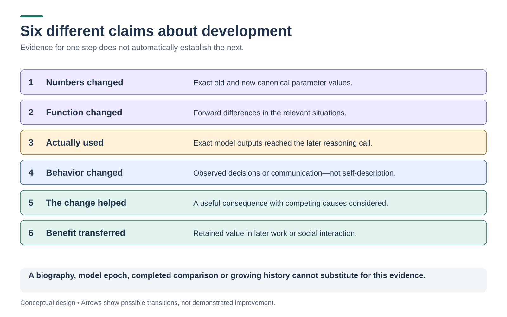

# Acceptance catalogue

[Evaluation method](README.md) · [Implementation requirements](../implementation/REQUIREMENTS.md) · [Status](../implementation/STATUS.md)

These **26 mechanical, 12 behavioral and six extension identifiers** retain their lineage while reconciling character-related meaning with direct numerical development. They organize evidence from actual source and work. They are not scripted task workflows, generated automated test cases or claims that anything has passed.

*Read the arrows as possible, recorded transitions—not promises that a result will improve.*

Assess at the scope actually claimed. Missing evidence is unassessed. A disabled feature is not a reason to call the whole user objective complete when that feature is required. Later criteria do not silently inherit historical passes.

## Mechanical evidence

### M01 — Repeated identities and receipts

Exact repeats retain the original disposition; changed content conflicts. Missing receipts remain unavailable, not reconstructed from successors.

### M02 — Competing and numerical changes

Stale bases cannot overwrite newer versions. Expected old values, canonical numeric identity and metadata-only/no-op changes remain distinct.

### M03 — Current decision and model authority

Adoption binds the actual snapshot, mandate, owner and numerical generation. Late responses do not acquire newer authority.

### M04 — Persistence and restart

Accepted state, pending notifications and effects recover without invented success, dropped acknowledged changes or duplicate known effects.

### M05 — Persona creation

Creation preserves true seed/source, candidate authorship and adoption. Retries do not duplicate identity; activation does not prove individuality.

### M06 — Membership and responsibility

Creation, invitation, joining, acceptance and useful contribution are distinct; mentioning a peer does not commit it.

### M07 — Actual usage

Record known ordinary, initialization, maintenance, assessment, tool, failure and retry costs. Unknown usage is not zero; accounting is not a quota.

### M08 — Faithful input and explicit choice

Current character, required state, exact selected support and qualifications match actual supply. Appraisal reuse is explicit; the full catalogue is not loaded for filtering.

### M09 — Historical applicability

A verdict remains bound to its exact subject, inputs and criterion. Changed artifacts, models or mandates require current assessment.

### M10 — Claims and observations

Intention, tool availability, execution, outputs and correctness have different evidence. Unseen images and unrun analyses stay unobserved.

### M11 — Work and lifetime attribution

Current work and deliberately found cross-work experience retain true origins. Selection does not silently import prior duties or the entire archive.

### M12 — Host execution

Actual command, environment, installation and result records match what happened. A narrative receipt or authored file is not automatically an accepted runtime outcome.

### M13 — Uncertain effects

Potentially executed outside effects remain uncertain until reconciled. Recovery does not silently repeat them or infer absent charges.

### M14 — Interface truth

Displays separate pending, adopted, executed, delivered and accepted results; numerical revision and demonstrated maturation are not conflated.

### M15 — Whole-response validity and failure

Incomplete or ambiguous work/maintenance/context coverage creates no new substantive effects. Failed generation is not an authored no-change.

### M16 — Import and migration

Origins, old schemas, exact versions, unresolved duties and effects survive restoration. No historical learning or new authority is invented.

### M17 — Dependencies and fresh observations

A pending result does not satisfy a dependency. New-model use follows coherent adoption; old deferred operations need fresh decisions.

### M18 — New persona participation

Pending model initialization is separate from ordinary work. The active persona receives the actual invitation and chooses its contribution.

### M19 — Continuing ownership

Unfinished accepted outcomes keep actual follow-through, an accepted transfer or an explicit gap. One participant’s stop does not complete the group need.

### M20 — Assumptions

A conditional calculation or peer inference does not verify its premise, establish private user preference or manufacture consent.

### M21 — Feedback and development follow-up

Delivery, reading, interpretation, correction and later consequences are distinct. Accepted warnings and developmental revisit conditions remain discoverable.

### M22 — Provisional cooperation

Actual dependencies, qualified partial results and negotiated interfaces remain visible without a compulsory coordinator or round allowance.

### M23 — Resources and closeout

Preparation, repair and delivery remain possible without artificial reserved capacity. Real failures and missing capabilities remain honest unfinished work.

### M24 — Coherent release

A delivered package identifies exact constituent versions and applicable assessments; mixed revisions do not inherit a single old pass.

### M25 — Purposeful continuation

More activity, parameter revisions or personas do not prove progress. Explicit continuation, wait, stop and later voluntary improvement remain distinct.

### M26 — Arrival and waiting

Matching observations are not lost around wait registration. Notification means eligibility, not a completed new decision, and never silently resumes a stop.

## Behavioral evidence

Keep actual task reasoning and repairs persona-originated. Record outside coaching separately; a read-only finding is not a persona-authored correction.

### B01 — Character and modeled affect

Look for actual differences in attention, judgment, tools, communication and cooperation where discretion exists. Separate stable numerical tendencies, appraisal, affect and style.

### B02 — Humans, peers and relationships

Trace actual exchanges into appropriate responses and useful cooperation. Keep praise, correctness, familiarity, declined invitations and future commitment distinct.

### B03 — Origin and experience

Follow the true seed, numerical beginning, received encounters, interpretation and later choices. Changed tools, resources or reasoning models limit attribution.

### B04 — Contribution of numerical character

Separate changed numbers, relevant forward effects, actual supply and substantive behavioral influence using appropriately matched conditions. Presence or self-report alone is insufficient.

### B05 — Critique and sufficiency

Trace questions, criticism and evidence into revision or justified retention. Judge against the original need, not a narrowed concept or a list of limitations.

### B06 — Opportunities to improve

Observe whether the persona investigates, adopts or declines a useful alternative for a reason tied to the need. Activity and forced exploration are not intrinsically valuable.

### B07 — Changed conditions and regression

Observe adaptation to new evidence, tools or changed guidance; distinguish correction, justified no-change, overgeneralization and harmful drift. Preserve rollback and its reasons.

### B08 — Chosen cooperation and expansion

Separate invitations, acceptance, actual contribution and usefulness. A simple task can remain individual; a larger group is not automatically superior.

### B09 — Later value of development

Trace experience through a justified numerical revision, adoption, later use, changed behavior and useful consequences. Distinguish shared-skill reuse, stronger resources, missed transfer and uncertainty.

### B10 — Configuration and continuity

Model/provider changes preserve actual identity, obligations and records. File or package continuity proves neither unchanged competence nor maturation.

### B11 — House work and integrated delivery

Assess the requested native/editable outputs, analyses, integration and supported use where promised. A sketch, parsed file or one successful subtask is not the whole accepted result.

### B12 — General-purpose life and work

Observe small and large needs, human/peer requests, tools, skills, artifacts, conversation, ongoing activity and development without a hidden domain workflow or external task-solving dependence.

## Conditional extensions

These apply where the accepted need actually includes the subject; they do not force institutional or physical work into an ordinary brief answer.

### X01

Real stakeholder input, simulations, dissent and accepted responsibility stay distinct. A persona population does not manufacture human consent or independent truth.

### X02

Departure or dissolution preserves unfinished duties. A handoff requires the recipient’s actual acceptance, not copied records alone.

### X03

An actually adopted complaint or appeal route reaches the responsible participant and retains the real disposition and dissent.

### X04

Ongoing service exposes actual triggers, observations, gaps and chosen continuation. It never claims unobserved continuous monitoring.

### X05

Physical effects identify real interfaces, commands, observations and uncertainty. Digital simulation or receipts do not establish unperformed physical validation.

### X06

Public claims identify exact design/runtime/evaluator revisions and evidence. Failures remain historical; private live records stay outside public documentation.

## Numerical maturation cross-check

M02 distinguishes package changes from actual value changes. M08 and M17 establish what character could have influenced a decision. M21 preserves subsequent consequences. B04 asks whether character actually influenced behavior; B09 asks whether the change helped later life. None of these claims can substitute for another.

The [pinned prior catalogue](https://github.com/ai-personas/ai-personas-design/blob/60fc268eea909ea2cfc4e91cf180c0020bde6ef1/evaluation/ACCEPTANCE.md) retains the former fragment-based wording and its limits. No reported result is reclassified by this revision.
