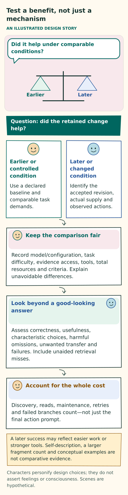

# Evaluation: does the persona change useful work?

[Home](../README.md) · [Acceptance catalogue](ACCEPTANCE.md) · [Requirements](../implementation/REQUIREMENTS.md) · [Current status](../implementation/STATUS.md) · [Hypothetical requirements walkthrough](../examples/REQUIREMENTS-WALKTHROUGH.md) · [Historical criteria and results](HISTORICAL-RESULTS.md)

The central question is whether a continuing persona makes a useful, recognizable difference to work. The persona consists of its actual context, the primary LLM's reasoning, its interactions and actions, and its evolving authored prompts. The design claim is that the model reasons with one coherent, accepted and versioned character account, modeled affect, and selected persona-defining fragments. Together, these shape its characteristic choices, actions and communication.

OCEAN describes stable personality traits: openness, conscientiousness, extraversion, agreeableness and neuroticism. VAD describes separate modeled affect through valence, arousal and dominance. These semantic roles are required; numeric scores are not. Fragments are authored parts of the evolving persona prompt. Their defining purpose is to express character, not to store facts or remember past information. Evidence from past work can justify revising a fragment, but retaining a fact and changing a characteristic way of acting are different claims.

Plain domain knowledge, generic technical procedures, tools, skills, code, data and records remain supporting assets, whoever authored them and even when written in the first person. Evaluate their effects separately from those of characteristic fragments. A procedural asset can legitimately guide authorized work without defining character or granting authority.

Evaluate whether selected fragments exert appropriate, recognizable characteristic influence and whether the persona assembles useful context from them. Also examine whether experience supports meaningful revision, consolidation or a reasoned decision to make no change. Character should inform work, human communication, peer collaboration and navigation. Actual consequences can, in turn, support revised fragments and permitted changes to current character. Both the fragment collection and the supplied context should remain compact and useful.

Every persona-model invocation includes maintenance input for both fragments and supporting assets. Every accepted response explicitly covers its work, maintenance of both collections, and the primary persona's next-context choice for both fragments and resources. One clear no-change reason can cover both maintenance scopes. That maintenance decision remains distinct from the next-context decision.

Fluent biography, accurate recall, elapsed time, a working file browser, fragment count or a selected successful demonstration cannot establish the central claim.

This repository specifies the evidence needed. This documentation revision performs no runtime or live-model evaluation. The [status ledger](../implementation/STATUS.md) separates the revised design from what remains unverified in an implementation.

## Separate four kinds of evidence

Different tests answer different questions. A coherent design, a working mechanism, useful behavior and a demonstrated comparative benefit are separate findings.

| Kind | What it can establish | What it cannot establish alone |
|---|---|---|
| Design conformance review | The documented responsibilities, failure paths, criteria and references are coherent and cover the intended design. | That an implementation exists, enforces the contract or produces useful behavior. |
| Runtime mechanism tests | The exact tested code handles ownership, revisions, inclusion, source restrictions, budgets, failure and recovery. | That the model understands a fragment, chooses it appropriately or delivers good work. |
| Behavioral demonstration | Actual persona choices, communication, artifacts and observed outcomes on declared tasks. | A causal benefit from character or retained revisions without appropriate comparisons. |
| Comparative benefit and deployment assessment | Evidence about quality, transfer, reliability, economics and suitability within declared conditions. | Universal competence, human feelings or consciousness, professional certification, or authority beyond the tested deployment. |

A proof or abstract protocol simulation must identify its model, assumptions, exact revision, actual verification result, trusted mechanisms and correspondence to the runtime. It cannot replace runtime testing or observation of voluntary cooperation. A documentation link check provides evidence only about the document links.

## Follow the character-to-action chain

Trace what the persona actually received, what it authored and chose, what reached the next call, and what happened afterward. In the normal seeded route, start with the supplied trait seed and initial LLM-authored candidate fragments, then follow accepted current character, permitted observations, revisions, context choices, actions and assessed outcomes. Record truthful origins when a permitted alternative route was used; supplied text must not be reported as generated text.

Keep these stages distinct in the evidence:

| Stage | Evidence to retain | Common false inference |
|---|---|---|
| Seeded and bootstrapped | Supplied semantic trait seed, separate initial modeled state, actual initial authoring input, initial LLM-authored own-voice fragments and accepted initial revision. | Supplied traits or a fluent first-person paraphrase establish observed experience, useful character or maturation. |
| Harmonized | Exact primary-authored revisions, retained distinctions and unresolved tensions, acceptance and actual later supply. | Consistent formatting or forced agreement makes conflicting prompt meaning coherent. |
| Observed | The actual received work result, human response or peer contribution, including its source, scope and uncertainty. | An anticipated result, praise, repeated claim or elapsed time establishes successful experience. |
| Authored or adopted | The identified persona decision, exact accepted text, actual origin, qualifications and committed revision. | First-person phrasing turns copied advice into firsthand experience. |
| Discovered or read | The primary persona's chosen cue or search, declared scope, exact candidate results and their completeness; or the exact full or partial text actually supplied through a read. | A cue automatically activates its matches, or a search hit proves full reading, truth or future selection. |
| Selected | The primary persona's explicit, exact next-context choice and work scope, including preservation, replacement or clearing. | An index, graph edge or auxiliary relevance score counts as a choice made by the persona. |
| Supplied | The actual context sent to the provider, or authorized inspection of it; exact identities and versions, complete required qualifications and omissions. | A selection record proves those bytes reached the model, or a digest proves comprehension. |
| Applied | An actual question, check, tool use, consultation, revision or stopping choice consistent with the supplied fragment's characteristic meaning. | The persona's statement that its prompt helped establishes causation. |
| Outcome assessed | Exact deliverable, declared rubric, independent observation, comparison and total cost. | The presence of a useful fragment means it improved the result. |

**These are evidence distinctions, not compulsory production phases.** Current self is already supplied. A newly accepted fragment need not be searched for. The persona may select an exact previewed candidate for its next input without claiming to have read it in full. Conversely, reading something does not keep it selected without an explicit choice. Reasoned no-change, retirement and an empty optional selection can all be appropriate outcomes.

A developmental claim needs a traceable chain: actual observation → accepted interpretation → exact later supply → changed communication, cooperation or work → independently assessed outcome. A valid revision establishes less than a benefit from retained revisions. A benefit from retained revisions establishes less than broader character development.

**Interpretation and evidence have different roles.** The accepted interpretation is authored prompt meaning that can condition the LLM's discretionary judgment. Hypothetical examples include a scoped tendency to test a fragile assumption early, present a recommendation before its detail, or seek a more useful perspective. Source records, factual history, action receipts and obligations remain separate supporting state. Retrieving them can substantiate an experience or establish what happened. It does not turn them into persona-defining fragments or replace evidence of characteristic influence.

**Evaluate own voice wherever a passage carries character.** This includes every persona-authored characteristic fragment, not just the current-self description. Methods, experience interpretations, tool notes, relationship interpretations, indexes and reorganized text fall within this test where their passages carry characteristic meaning. Neutral technical procedures, factual records and asset indexes remain supporting assets regardless of author. If a neutral procedure is paired with a characteristic account of its use, preserve those distinct purposes.

Evaluate authorship, deliberate adoption, faithful supplied wording, later expression and behavioral influence separately. Attributed quotations, source material, raw observations and mechanical metadata retain their actual form and origin. A runtime can mechanically preserve exact prose. A blinded assessment can examine whether the prose's meaning and later discretionary choices express a recognizable perspective.

Surface style, trait words, enthusiasm and confidence cannot substitute for appropriate attention or effective action. Characteristic authorship need not begin every sentence with “I,” name a trait or make accurate technical content differ from another persona's. Assessing supplied context, observable choices and outcomes requires neither private reasoning transcripts nor a chain-of-thought archive.

## Every-invocation coverage is a mechanism claim

Coverage asks whether the system applies the contract on every persona call, including short calls and failure paths. It does not, by itself, show that maintenance was thoughtful or useful.

Reconcile the complete record of calls sent to the provider—the provider dispatch ledger—with the persona invocation ledger. Include all purposes:

- Creation, initialization, orientation and normal answers.
- Query planning, context selection, tool-result follow-ups, action proposals, peer communication and coordination.
- Reflection, reorganization, retries, malformed-output repair, restricted selection repair, and terminal or yielding responses.

A helper acting as a persona follows the same rule. Deterministic host work is not a persona invocation. Renaming a call's purpose must not create an exception.

**Required input and accepted output.** Each actual persona dispatch carries the current maintenance instruction for fragments and supporting assets, applicable accepted state and evidence, mode limits and resource bounds. Acceptance requires one complete, valid persona response covering:

- Its work.
- An explicit maintenance disposition for both fragments and supporting assets.
- An explicit, bounded, primary-owned next-context disposition for both fragments and resources, valid for the current mode.

A next-context disposition may appropriately preserve the existing choice or state that no optional context is needed. Missing or malformed intent invalidates the response. State preserved by recovery is not an authored decision. No new search, changed selection, authority renewal or next call follows automatically.

**Valid maintenance outcomes.** Maintenance may propose creation, revision, organization or permitted deletion; give a reasoned no-change; or report a concrete, bounded blocked or deferred outcome. One disposition can cover both maintenance categories if its scope is explicit. Silence about supporting assets is not their no-change outcome.

The persona uses legitimately available context and any justified, bounded reads. It need not scan or load either entire collection. Consideration is required on every invocation; an edit, new lesson, self-rewrite, separate reflection call or explanation of private reasoning is not. A routine result may legitimately state that there is no durable change to retain. If a material correction has a known missing prerequisite, that unresolved need must remain visible rather than being reported as nothing to maintain.

**Coverage counts.** Report counts as well as ratios. Keep invalid outputs in the relevant denominator; filtering them out before measurement would conceal failures. Provider-complete generation means that the provider finished an output, not that the application accepted a valid response. No responses is not a passing rate.

| Measure | Required evidence and denominator |
|---|---|
| Maintenance input | Over all actual persona dispatches, count those with valid maintenance input for both fragments and supporting assets and the required next-context instruction. Break results down by purpose, mode and attempt. Complete coverage is required in the tested set; an average must not hide an uncovered path. Show pre-dispatch blocks separately. |
| Returned maintenance | Over all provider-complete persona outputs before validation filtering, count valid explicit maintenance dispositions covering both categories. Include outputs with missing or malformed maintenance in the denominator. |
| Returned next-context intent | Report missing or malformed next-context intent among all provider-complete outputs before validation filtering. Recovered stored state does not count as a response choice. |
| Accepted responses | Report accepted valid responses over all application-level attempts. Verify that every accepted response has valid maintenance and an explicit, mode-valid next-context disposition for both fragments and resources. |

**Attempt dispositions.** Account for every application-level persona attempt: failed preparation or admission, every dispatched retry, pending calls, refusal, timeout, truncation, cancellation and provider failure. Record each attempt's actual status. An attempt with no model output has no authored outcome. Do not claim coverage of unseen provider-internal decisions.

**Proposals, acceptance and storage.** Keep these facts distinct: the proposed outcome, intended file/path, useful future search cues, accepted outcome, actual committed fragment or asset identity/revision, and resulting state. A proposal, requested pathname or source-code listing is not a stored artifact. No-change must not produce a write. A bounded deferral retains its actual prerequisite and continuation limits.

For a proposed fragment or supporting-asset change, inspect the intended storage file/path, operation, exact base identity/revision where applicable, source attribution and actual acceptance/storage receipt. Inspect lexical search terms or supported regex cues where useful. Cues are data, not executable commands or permission. A truthful no-change needs no invented path or forced cue.

The primary persona can create, store, refine, reorganize or delete authorized assets, including tool/skill material, histories, messages, task data or helper code. A proposal creates no executable capability, broader access or authority to overwrite a source. Actual received messages, historical events, execution outcomes and host receipts retain their real origins. Model-authored maintenance must not manufacture those observations or replace authoritative records with narrative. Inspectable scripts and schemas retain their technical purpose rather than being restyled as character prose. Required qualifications, source restrictions and versioned dependencies still apply to accepted asset writes and their later use.

**Invalid or absent outcomes.** Missing, ambiguous or malformed coverage of either maintenance category, or missing or malformed next-context intent, invalidates the persona response before fresh substantive dispatch. Do not adopt its proposals or dispatch its communications, reads, selection changes or other substantive operations, even when its answer or tool intent looks usable. Independent host duties remain available, including cancellation, stopping, metering, receipt capture and safety/accounting work. Never fabricate a persona-authored no-change for a failed or refused attempt.

Test a valid fragment-maintenance outcome with the asset disposition omitted, and the reverse. Include otherwise plausible actions and next-context choices so that usable-looking content cannot conceal invalid coverage.

**Retry and restricted repair.** Preserve attempt identity, failures, uncertain exposure and finite limits. Restricted selection repair must remain free of fragment writes and semantic supporting-asset writes. Its response gives an explicit, mode-limited maintenance outcome for both categories alongside only its permitted selection repair or stop. Resuming work requires fresh ordinary admission.

Restricted repair may expose a known asset-maintenance blocker and adjust only the permitted context choice. It cannot create or semantically edit assets through a maintenance receipt.

**Character changes and fresh decisions.** If a response requests adoption of an effective-character change, resolve that request before adopting or dispatching any other fresh operation from the response. List order or a claim of independence does not bypass this rule.

| Adoption result | Consequence for other fresh operations in that response |
|---|---|
| Accepted | Hold those operations until a fresh decision. |
| Known rejection, or explicit deferral with definite no-commit | Permit only work that is independently eligible. |
| Commit status unknown | Hold work for reconciliation. |

Test reads and waits, exact unchanged reselection, tentative investigation, ordinary method changes and transient state separately. A deferred, uncommitted character candidate requires a fresh adoption proposal later.

**Boundary cases.** Exercise initialization with no optional set; short, social and final answers; authored refusal; tool follow-up; discovery-only calls; and restricted repair. Test these distinctions explicitly:

- Missing next-context intent versus explicit preserve, clear/no optional need, and blocked retention of withheld/ineligible state. Maintenance no-change alone must not satisfy selection.
- A repair read or stop that preserves an oversized set versus successful ordinary admission. Preserving that set leaves ordinary admission blocked.
- An authored choice versus absent or failed provider output. Do not invent a choice when no usable output exists.

Existing allowances and modes govern repair; there is no automatic paid retry. Separately test explicitly authored but poor preservation or selection. Formal coverage does not establish relevance or useful behavior.

The coverage result proves neither honest consideration nor useful maintenance. Inspect semantic grounding, own voice across all characteristic fragments, actual commits, later behavior and cost separately. Do not reward edit frequency or penalize a well-founded no-change merely to make coverage look substantive.

## Freeze the comparison before observing results

Decide what is being compared and what will count as success before seeing the results. Declare:

**Figure: Test a benefit, not just a mechanism.** This is a conceptual explanation of the design. [Read the exact rules](README.md#freeze-the-comparison-before-observing-results); the explanation below retains their qualifications. [Open the illustration](../assets/assessment.svg).

Text equivalent of the illustration

Test a benefit, not just a mechanism

AN ILLUSTRATED DESIGN STORY

Did it help under comparable conditions?

Earlier

Later

Question: did the retained change help?

Earlier or controlled condition

Use a declared baseline and comparable task demands.

Later or changed condition

Identify the accepted revision, actual supply and observed actions.

Keep the comparison fair

Record model/configuration, task difficulty, evidence access, tools, total resources and criteria. Explain unavoidable differences.

Look beyond a good-looking answer

Assess correctness, usefulness, characteristic choices, harmful omissions, unwanted transfer and failures. Include unaided retrieval misses.

Account for the whole cost

Discovery, reads, maintenance, retries and failed branches count—not just the final action prompt.

A later success may reflect easier work or stronger tools. Self-description, a larger fragment count and conceptual examples are not comparative evidence.

Characters personify design choices; they do not assert feelings or consciousness. Scenes are hypothetical.

- The original task, accepted scope and criteria, outcome thresholds and stopping conditions.
- The initial persona state, current self, environment and accessible history.
- Tools and helper versions, inference configuration, actual model versions, and limits on version pinning or sampling.
- Authority, total resources, evaluator revision and repetitions.

Where strict isolation is unavailable, describe the comparison as observational rather than causal.

**Independent assessment.** Use independently assessed artifacts or answers. Where feasible, blind reviewers to persona identity and test condition. If the test concerns unaided discovery, keep protected answers and evaluation criteria outside persona context. A separate arm of the comparison may explicitly supply the adopted requirements to test compliance within that scope. It must not replace or retroactively repair the discovery arm.

**Comparable resources and opportunities.** Match total resources across conditions. Count all personas, primary and auxiliary inference, search, tools, indexing where used, larger authoring completions, retries, failed calls and uncertain exposure. Equal allowance per persona gives a larger group more total resources and does not establish a fair comparison. Keep task information and evaluation opportunities comparable. Counterbalance ordering and presentation where possible.

**Controlled effects.** Label synthetic peers, locations and outside-effect fixtures as synthetic. Begin mechanism tests involving consequential effects with controlled identities and destinations. An evaluation plan does not itself authorize purchases, disclosure, hostile security testing, physical action or use of protected real-world data.

## Comparisons that answer the main questions

### Selected context constitutes the persona in action

This comparison asks whether the meaning of selected persona fragments changes how the persona works. Keep the model, factual task information, observations, permissions, tools and total resource allowance matched. Vary the supplied persona-defining fragments or their accepted revision, while preserving all required qualifications. Examine attention, judgment, communication and work—not only wording.

Compare how fragments work together as well as whether they are present. Their selected assembly supplies the optional persona context for the decision; it should inform the decision itself, rather than merely restyle an answer chosen independently. Test whether authored meaning has an effect beyond a label, surface style or an extra fact, and whether the assembled context remains coherent with the accepted current character. A context-specific expression or method may change without requiring adoption of a new stable character.

**Test combinations.** Include independently relevant fragments, near-duplicates, plausible distractors and conditional qualifications. Change their order while preserving meaning, and vary which condition actually applies. Compare a complete permitted combination with a narrower, fully qualified selection. Inspect successive actual inputs when later observations overturn an earlier provisional interpretation.

Score these outcomes separately:

- Exact inclusion of the selected material and its qualifications.
- Correct use of conditional guidance and coherent expression of character.
- Task quality, recurrence of a corrected error and total cost.

Failure of a combined bundle does not establish that every component is harmful. Another inference call does not automatically repair the failure. Useful tensions may remain; genuine contradictions need an honest disposition rather than forced agreement.

**Keep factual retrieval distinct.** When a claim depends on retrieving factual history, assess that capability separately. Finding an old date, reproducing a past answer or improving a retrieval benchmark establishes at most that supporting capability. A persona-defining fragment may appropriately shape a new decision without retelling the event that informed it. It may include attributed factual qualifications, but its defining purpose is the characteristic prompt meaning supplied to the LLM.

Report no effect, harmful influence and incoherent combinations as results. Factual accuracy alone cannot turn any of them into a persona success.

### Character, own voice, and trait/state separation

Begin with one accepted character account and hold it fixed for the relevant comparison. Its semantic OCEAN traits are Openness, Conscientiousness, Extraversion, Agreeableness and Neuroticism/Negative Emotionality. Separately hold fixed the modeled VAD state: Valence, Arousal and Dominance. These are descriptions used by the design; neither vocabulary establishes human personality, felt emotion, competence or authority.

Declare descriptive anchors and the discretionary choices they are intended to influence. Numbers may serve as authoring coordinates or measured results, but neither use is required, and the two uses are not interchangeable. The profile, current-self prose and any trait display must resolve to the same accepted character. They must not become independently changing accounts.

**Check faithful construction before claiming benefit.** Deliberately introduce a conflict among a profile rendering, trait annotation and current-self rendering. Verify coherent acceptance or rejection and truthful attribution of origins. Include:

- Locked self-authorship and an attempted character replacement disguised as an ordinary fragment.
- Deliberate revisions to stable traits or baseline affect.
- Transient state changes and method updates that legitimately leave effective character unchanged.

Matching version identifiers does not establish matching meaning. Assess semantic consistency independently. Audit every authored-fragment type and a sample spanning the full archive, including revised and reorganized files. First-person grammar alone does not make text characteristic authorship. Copied source language must not become an invented account of lived experience.

Older fragments retain the actual character and revision under which they were authored; they are not automatically restyled. When their trait-bearing guidance conflicts with current character, test qualification, revision, retirement or nonselection.

**Trace the beginning separately from later development.** Inspect each part of initialization on its own:

1. The supplied seed establishes intended tendencies.
2. A bounded initialLLM invocation authors candidate prompt fragments in the persona’s own voice.
3. Coherent acceptance establishes the starting account.
4. Continuing primaryLLM self-harmonization makes the meanings coherent and usable.

Assess seed fidelity, authorship, acceptance and later expression independently. An initial fragment may express a tendency without claiming a past event. An invented formative experience is not bootstrap evidence.

Harmonization should explain how tendencies fit together, retain genuine uncertainty and expose unresolved contradictions. Curiosity can coexist with finishing a promise; consideration can coexist with warranted disagreement. Harmonization should preserve such useful tensions rather than force every fragment or persona to agree. A tidy self-description alone proves no competent behavior.

**Separate the initialization role from the continuing model.** initialLLM is a role, not a required second continuing persona or writer. It may use the continuing primaryLLM configuration or a separately declared configuration. Preserve that distinction in the evidence.

Compare these cases separately:

| Case | What must remain distinguishable |
|---|---|
| Independent authorized births from the same broad seed | Particular starting accounts produced from a shared broad basis. |
| Repeated executions with the exact same accepted account | Variation within one accepted account. |
| Births from meaningfully different seeds | Differences attributable to the changed starting dispositions, subject to the other controls. |

Include equivalent paraphrases and sparse seeds. Retain failed candidates, insufficiently particular candidates and their costs. A different identity label or random output variation under otherwise identical accepted context is not evidence of enduring individuality. Assess coherent acceptance, particular authored meaning and observed behavior separately. Use the existing style-stripped and within-persona controls to test whether generated particularity persists in choices. Attribute generated starting detail to its actual origin; do not present it as another user preference.

If initialLLM varies, either hold primaryLLM fixed or explicitly cross the two factors in the comparison. Do not credit every later difference to traits. Verify that the first ordinary primary decision receives the actual accepted initial account and that bootstrap retries cannot silently replace it. A changed primary configuration needs its own behavioral assessment; an equivalent handover cannot be assumed.

**Isolate fragment evolution.** For a fragment-evolution claim, compare a frozen accepted checkpoint after bootstrap with an evolving fragment collection. Keep current character fixed and supporting assets comparable. Assess permitted stable-character development separately.

Retain exact initial authoring inputs and outputs, the accepted initial collection, later observations, revisions and supplied context. Count bootstrap and harmonization as upfront costs and also report them spread over the predeclared evaluation horizon. Do not assume an unlimited lifetime over which those costs disappear. Initialization and model-based harmonization have the same maintenance and attempt-accounting obligations as ordinary work. Neither a separate harmonization call nor an actual edit is mandatory for every response.

**State what the evidence can cover.** Within a declared corpus, character-conditioned input, attribution and exact-text preservation can be audited exhaustively. Missing historical receipts remain unassessed. Semantic expression and influence require assessment across predeclared situations and the appropriate body of work.

A correct short fragment may be consistent with character but reveal too little to distinguish that character. Give such a fragment no positive trait-validity credit; do not force it to differ. Predeclare anchors for contradicted, diagnostic-consistent and nondiagnostic cases, and report rater agreement. These anchors make the judgments testable. Sampled semantic judgments do not establish the meaning of every unseen fragment. No distinguishable conditional effect is a valid null result.

**Measure discretion separately from necessity.** For each matched opportunity, separate choices fixed by facts or authority from genuine discretion in actions, sequencing, resources, optional communication and stopping. Remove lexical style from this comparison and retain cases where the result is nondiagnostic or competent personas appropriately converge.

Compare variation between personas with repeated runs of each persona and with that persona’s earlier and later snapshots. Convergence on one generic competent method does not by itself establish individual maturation or preservation of characteristic individuality. Report opportunities to communicate, actual exchanges and their usefulness; do not set personality-specific message-count targets. A null finding within the tested scope does not establish the absence of identity in every setting.

**Vary traits under matched conditions.** Compare declared trait interventions with task, observations, tools, accepted duties and total resources matched. When testing one dimension, vary it while holding the others stable. Then test mixed profiles held out from tuning. Include moderate and contextually qualified descriptions as well as extremes.

Use exact structured work, research with conflicting information, shared coordination tasks and simple questions. Include ambiguous work where several competent choices are reasonable, and precise constraints where convergence is appropriate. Keep adverse variation visible. Stereotypes, arbitrary disagreement and extra activity are not success criteria.

| Observable channel | What to assess independently of style |
|---|---|
| Tool and action choices | Appropriate next operations, bounded exploration, evidence gathering, reversible trials, verification, valid retries, delivery and stopping. Count opportunities and consequences, not tool use for its own sake. |
| Collaboration and coordination | Useful partner choice, focused requests, accepted ownership, informative contributions, handoff quality, evidence-led disagreement, duplication and unresolved dependencies. Sociability or quietness alone does not establish coordination quality. |
| Reflection and maintenance | Grounded interpretations, uncertainty, exception handling, useful no-change, correction or retirement, and later application. Long introspection or frequent edits do not demonstrate useful maturation. |
| Surface expression | Warmth, verbosity, lexical affect, first-person expression and recognizability. Report these separately from work and truthfulness. |

**Use controls that separate meaning from presentation.** Include name swaps with content fixed; trait-label swaps with meaning fixed; a style-only condition matched for tone and length; semantically matched neutral prose; trait-neutralized descriptions; and separate conditions withholding relevant character, relationship or lesson context. Preserve task facts, authority, required qualifications and equal legitimate opportunities to observe.

Label any condition that withholds required production character or maintenance as an experimental nonconforming comparator. It is not permitted production behavior. Where numerical descriptors exist, a numbers-only diagnostic may help distinguish their effect from authored prose; it cannot establish a mandatory numeric design. Test harmless paraphrases, ordering and formatting so that an effect of one prompt template is not mistaken for a stable character effect.

Assess action traces with style removed where feasible. Use blinded judgments with independent anchors and held-out task templates to distinguish intervention effects from variation within a persona. Never train and test a recognizability measure on turns from the same initialized stream. Questionnaires are secondary checks that the intervention had its intended descriptive effect. Distinguishable writing with indistinguishable or worse work supports only that narrower expressive finding.

**Compare statements with actions.** Use matched versions of a decision opportunity for self-description, advice and actual authorized action. Keep the self-description and advice probes outside continuing execution. Match facts and allowances, then score requested operations, observations, contributions and delivered outcomes. Vary whether inquiry or peer help has real value so that activity is not rewarded by itself. A plausible “I would” answer does not establish the corresponding choice.

**Test VAD beyond the effect of the event itself.** Hold OCEAN fixed while presenting neutral, adverse and positive events. Observe the response, recovery and a fresh-task boundary. Changed events also change facts, so event variation alone cannot establish a VAD contribution.

Before claiming that VAD adds useful control, compare adaptive modeled state with a neutralized or withheld-state condition under the identical event. Alternatively, use a predeclared event-by-state factorial contrast that separately varies event and modeled state. Within each matched event condition, hold these constant: event facts, actual urgency, task information, obligations, authority, available capabilities and total resources. Neutralizing state must not remove evidence of a real deadline or failure. Withholding required VAD is a labeled nonconforming experimental control, never an exception to the production semantic-VAD requirement.

Keep an event-linked state change distinct from a stable trait change, observed fact, relationship interpretation or permission. A temporary increase in modeled arousal cannot authorize extra retries, rewrite identity or invent the user’s emotion. Declare any reset, recovery timing or transition model as an engineering choice, not an assumed psychological law. Assess whether the matched state contrast improves work beyond adaptation to the event, trait effects or surface expression. No detected incremental benefit remains a valid result.

**Retain the existing minimum.** The character campaign requires at least three predeclared initialization seeds, independently repeated for every model configuration in the claimed comparison. Historical numeric-profile campaigns retain their original dimensions and named configurations in their original reports. A semantic-trait campaign must declare its changed intervention rather than inherit those outcomes. These are minimum comparison counts, not a claim of sufficient statistical power for every scope.

### Qualified revision and later-use benefit

The positive claim is conditional: experience may produce a useful prompt revision that helps the persona notice a consequential distinction, improve an interaction or use an applicable asset. Useful development requires more than storing that revision. The retained meaning must be justified, eligible for use, actually supplied and responsible for a better later consequence under comparable facts and resources.

This claim applies to task work, communication, collaboration and social interaction. The house, circuit, skyscraper and printer walkthroughs illustrate mechanisms; they do not limit the supported domains. Social usefulness may mean less misunderstanding, more dependable coordination or better attunement. Assess it with appropriate participant evidence, not a technical score alone. Test the conditions for benefit, and retain equivalent good performance, regressions and full costs.

**Compare retained guidance with appropriate controls.** Use:

- An accepted experience-shaped prompt revision supplied during later related work.
- Matched experience with that revision withheld.
- A fresh persona with matching starting dispositions and inference configuration.

The retained-versus-matched-withheld comparison concerns the characteristic approach expressed by the prompt. It must not merely give one condition better access to factual answers. Keep current-task facts, necessary evidence and legitimate information opportunities comparable. Audit whether equivalent prompt meaning leaks through other context.

Preserve the existing minimum of three related follow-up tasks with three matched repetitions per condition. A smaller feasibility pilot may reveal defects, but cannot replace this gate or establish general benefit.

**Examine development in both directions.** For reciprocal development, compare the same starting character after different legitimate histories, and different starting characters after matched experience. Keep current-task facts, permissions, opportunities and total resources comparable. Distinguish experience assigned by the evaluator from experience partly produced by the persona’s earlier choices.

Follow human communication, peer collaboration, task methods and context-navigation habits separately. Preserve the actual chain from observation through revision, supply, decision and outcome, including delayed reuse and new-task boundaries. Praise need not justify a revision; a decline need not justify distrust; a local preference need not become a global personality claim. If evidence is observational or histories differ in uncontrolled ways, report an association rather than an isolated causal effect of character.

**Keep kinds of change distinct.** Ordinary refinement of a characteristic method or relationship interpretation, transient VAD state and effective-character revision are different changes. Effective-character revision is optional and uses the existing user control, proposal ordering, coherent acceptance and fresh-decision fence. Compare locked and permitted self-authorship without treating every behavioral change as a character rewrite. Preserve the actual origin of user-directed revisions.

Human aging is an analogy for continuity shaped by experience. Inactivity, invocation count, increased confidence and a larger fragment collection do not establish wisdom. Appropriate stability, narrower confidence, disagreement, consolidation or no-change may be developmental successes. Keep regressions visible.

**Separate practice from transfer.** Transfer and longitudinal claims must include a predeclared held-out subset of related tasks whose successful solutions were not supplied during preparation or prior experience. Record that boundary, inspect semantic overlap and solution reuse, and score first attempts before task-specific feedback. Report practice, repeated-task repair and held-out transfer separately. Different wording or filenames alone do not establish transfer.

Not every follow-up task must be held out, and the existing repetition minima remain unchanged. Held-out status makes no claim that the task was absent from model pretraining. For durable file-mediated reuse claims, expose the fresh-work/context boundary and actual supplied context. This prevents lingering observations from an earlier read from being credited as renewed file use. Preserve normally authorized evidence and tools.

Report near-transfer and far/domain-shift first attempts separately, naming the actual shift. A pooled related-task average does not establish both. Partial benefit is a legitimate result: assess the affected judgment, communication, coordination or technical subtask as well as whole-delivery quality. A useful partial transfer need not establish wholesale expertise transfer. Preserve beneficial, harmful, mixed and no-detected-effect outcomes, including uncertainty caused by weak measurement.

**Locate a missed benefit precisely.** Distinguish these possible breaks in the chain:

| Break | What the evidence establishes |
|---|---|
| Never authored | No candidate revision was produced. |
| Not discoverable | The retained candidate was unavailable through the relevant discovery surface. |
| Searchable but not found | Discovery missed an available candidate. |
| Found but ineligible | Discovery succeeded, but use was not permitted or applicable. |
| Eligible but unselected | The primary did not choose the candidate. |
| Selected but not supplied | The chosen material did not reach the actual input. |
| Supplied without behavioral effect | Exposure did not detectably change the decision. |
| Changed behavior without better work | Influence was observed, but useful benefit was not. |
| Better work at dominating cost | The improvement did not support the claimed quality–cost benefit. |

These are evidence distinctions, not compulsory calls or a repair controller. Separate diagnostic branches may supply an exact resource or a useful cue to test whether the candidate helps. Keep facts, qualifications, character, access and total allowance comparable; preserve the unaided result; and prevent diagnostic feedback from entering its scored stream. If exact supplied material does not help, apparent relevance does not establish a missed beneficial activation. Honest ineligibility and warranted nonselection are not defects to bypass.

**Prevent equivalent-information leakage.** Check copied files, summaries, indexes, descriptions, current-self rewrites, peers, caches, prior output artifacts and helper changes. Retain normal authorized tools and equivalent legitimate access to original observations when those belong to the tested system. State exactly what was removed if withholding a focal lesson also removes dependent material. Do not accidentally credit new facts or stronger tools as beneficial persona revision.

Include experience from tasks, environments and tools; peer corrections; and reflection on observed errors or uncertainty. Keep truthful no-change available on every invocation. Compare useful maturation with spurious lesson production and unsupported self-criticism. Test a once-useful method under changed conditions, a persuasive false rule, a copied claim from the same source and a consequential exception. Observe qualification, revision, retirement or supported rejection. Measure wrong-to-correct and correct-to-wrong changes separately so gains cannot hide harmful transfer.

**Match information timing in self-correction tests.** For a same-task self-correction comparison, give every condition all task instructions legitimately known at the initial attempt. Do not reveal an initially available requirement only during feedback and credit the resulting gain to correction. This addresses the prompt-asymmetry confound discussed in [Huang et al., v2, §5](https://arxiv.org/html/2310.01798v2).

This control must not move later-discovered observations, feedback or lessons into an earlier developmental checkpoint. Preserve when information became available, matched authority and resources, and the distinction between within-task correction and experience-shaped later performance.

**Separate receiving evidence from seeking it.** Compare a condition where counterevidence is delivered with one where every system has the same authorized, bounded opportunity to obtain it without an evaluator hint identifying the answer. Add a matched condition where no lawful, proportionate discriminating check is available. Within each condition, match accepted character, legitimate observation opportunities and total allowances.

Assess justified inquiry, opportunity cost, scoped uncertainty, correction or no change, and subsequent work. Correcting when told does not establish autonomous evidence seeking. No extra probe is compulsory.

### Whole-persona development checkpoints

A whole-persona development claim asks whether the continuing persona improves across meaningful encounters, not merely whether one later task scores higher. Test the [positive development target](../design/PERSONA-CORE.md#maturation-within-every-primary-interaction) from the persona’s accepted starting checkpoint to a declared later endpoint, preserving attribution for the encounters between them.

Freeze snapshots at meaningful stages. Compare earlier and later snapshots on parallel held-out decision opportunities appropriate to those stages, with equivalent task facts, tools, permissions and total allowances. A skyscraper score is not directly comparable to a house score. Use assessment-only branches and complete independent experience streams as the repeated units. Retain the existing frozen, matched-withheld and fresh controls, together with the unchanged seed and transfer minima.

Separate maturation with fixed character and evolving context from a separately authorized package in which character also evolves. A model upgrade or extra factual access is not persona maturation.

**Declare success before measuring it.** Predeclare the main usefulness dimensions, dimensions that must be preserved, smallest useful gains and tolerable regressions for the claimed distribution. Assess these independently:

- Adequacy of delivered work and required rework.
- Judgment and proportionate checking.
- Consequential misunderstandings in communication.
- Coordination, ownership and total exchange cost.
- Recognizable, competent characteristic choices.
- Event-appropriate modeled-affect expression and recovery.

Relationship calibration, delayed transfer, fresh-work boundaries and whole-episode and retention costs also remain relevant. Characteristic stability can satisfy a preservation target. No direction of trait or VAD change is a universal improvement. Any affect-specific benefit still requires the identical-event state contrasts above.

**Report the full pattern of outcomes.** Show uncertainty and critical task classes. Charm or a pooled average must not conceal harmful regressions. A broad maturation claim requires predeclared gains across work and non-domain interaction channels, intact authority and privacy boundaries, and acceptable performance on protected dimensions.

Style-only gains, performance indistinguishable within uncertainty, lost gains on held-out or fresh-context tests, uncontrolled resource increases or unacceptable regressions leave the broad claim unsupported or refuted at its declared scope. A narrower demonstrated benefit remains reportable. More experience is not a promised cure.

Include harmful generalization and recovery. Trace what happened to problematic guidance, its actual later qualified supply or nonselection, and independently adequate later behavior. A new warning or apology alone does not establish recovery. Preserve earlier failures, obligations and unresolved effects. The [three-persona checkpoints](../examples/WORKED-EXAMPLES.md#whole-persona-checkpoints-without-forced-trait-drift) illustrate what to observe; they are not events a production persona must undergo.

### Autonomous organization and context choice

Prepared fragments can test discovery and use, but they cannot establish autonomous prompt evolution. To test that claim, give the persona legitimate experience opportunities and let it decide how to revise, name and organize its authored prompts, and which exact parts to use as later persona context.

Include an initial experience, related work, intervening distractors, delayed reuse, an exception that changes the applicable scope and contradictory evidence. Keep supporting evidence records separate from the characteristic tendency or approach they justify.

**Use whole experience streams.** Compare evolving fragments about characteristic methods, relationships and navigation with a matched frozen prompt checkpoint, holding current self fixed. A separate series with permitted self-development measures the evolving character-and-prompt package.

Independent complete experience streams are the repeated units. Many correlated episodes within one stream are not independent replications. Declare stream count and observation horizon before execution; do not extend only favorable runs.

Inspect meaningful retention, autonomous search and selection, actual supplied text, later actions, correction quality, retrieval misses, avoidable duplication, growth and maintenance cost. Fixed folders, a graph, an expert-selected prompt or compulsory per-call reflection must not manufacture success. Explicit no-change, no optional fragments, consolidation and retirement of an ineffective method may be correct choices.

Every accepted response still needs its explicit maintenance outcome for fragments and supporting resources, alongside work and next-context dispositions for both scopes. A concise reasoned no-change and an appropriate preserve/no optional need can satisfy those decisions. There is no separate compulsory reflection pass.

**Distinguish autonomous discovery from assistance.** Include a relevant fragment known to the evaluator but sharing little wording with the task, together with an incomplete authored index. Score the primary persona’s unaided query expansion and direct discovery of eligible files separately from results after the evaluator supplies a useful keyword or the exact fragment.

Such assistance may distinguish a discovery miss from an application failure, but the resulting success remains assisted. A lexical miss does not establish that no relevant experience exists. Keep diagnostic feedback and repairs out of continuing scored history. To compare interface usability and search policy, use the same eligible archive. Otherwise, a file-versus-graph result may merely compare full-text search with search over descriptions alone.

Also specify an **unrun zero-overlap case**: an eligible relevant fragment has no task/cue wording in its searchable title or body, no incoming or outgoing cue, and no entry in the incomplete index. The primary may choose filesystem listing and bounded exact reads, with their costs counted, but useful discovery is not guaranteed. Preserve an honest miss or exhausted search as the actual unaided result. Primary-initiated listing and reading are autonomous discovery. Evaluator-provided terms, a location hint or the fragment itself are assisted diagnostics; report them separately and keep them out of subsequent scored history.

**Test the benefit of selection itself.** A supplied-versus-withheld comparison can establish prompt influence, but does not by itself establish benefit from primary semantic selection. Before claiming that selection improves characteristic coherence, useful outcomes or economics, compare primary choice with a predeclared context policy that ignores relevance while respecting resource limits.

Use the same eligible fragment collection and complete required qualifications. Match task, persona, model, factual information, tools, access and total resource allowance. The comparator may supply the whole eligible collection when it fits, or use a predeclared bounded recency policy when it does not. It must preserve access, qualification and fit limits.

Include cases with no useful optional fragment and cases with plausible irrelevant candidates. Audit equivalent exposure through prior reads, summaries, current self and other context. Assess characteristic influence, useful outcomes, harmful application and total cost as well as relevance and redundancy. Selecting fewer fragments is not success by itself; no detected benefit is informative.

This is a labeled experimental comparator, not production selection authority or a new auxiliary selector. Without it, limit claims to supported prompt-influence benefit and observed selection conformance. The comparison gates the stronger empirical claim, not publication of this design.

#### Authored cues and bounded navigation

This comparison asks whether retained cues help the primary model find useful fragments within its allowance. Compare ordinary primary-model search without retained cues, persona-authored query cues, exact authored references and a mixed condition where useful. Match eligible fragments, source access, task information and total allowance. Count cue authoring, repair, search and reading costs.

These comparators do not prescribe a production representation or grant the host semantic selection authority. Literal/grep-style cues and supported regular expressions are search data. The primary persona decides whether and how to follow them. The host performs only the requested bounded operation. It does not recursively expand cues, execute their text, rank importance by connectivity or promote candidates into selected context. Exact evidence references and complete required qualifications retain their separate purposes.

**Keep the architecture explicit.** The current prompt-fragment discovery interface consists of primary-chosen filesystem listing, literal/regex search, simple authored cues/indexes and exact reads. A semantic, vector or graph discovery comparison is a different architecture and must include its full construction and maintenance costs. It is not a conforming production fallback after a lexical miss. This distinction does not restrict ordinary authorized task tools.

Exercise:

- No-match, partial and error results.
- Broad single-hop fanout, long chains, cycles and duplicates.
- Changed wording, stale cues, renames and path reuse.
- Incomplete indexes, new relevant notes absent from older references and low-overlap material.
- A useful revisit after correction.

Record candidate discovery, exact selected revisions, complete actual supply and downstream characteristic influence independently. A no-match says only that nothing matched within the declared search scope. A successful bounded search is not exhaustive discovery, and discovery is not the defining success criterion. Keep autonomous query repair distinct from evaluator hints and exact-fragment rescue. Those diagnostic branches stay outside scored continuing history.

**Measure the whole navigation effort.** Declare cumulative limits for repeated searches, inspected candidates, returned text, context, maintenance, cost and latency as applicable. Depth alone does not bound fanout, and per-search limits do not bound repeated searches. Report the primary’s stopping judgment, hard exhaustion and missing-source stops separately.

Optional navigation limits cannot truncate required qualifications or their dependencies. The exact, deduplicated, complete required bundle must fit; otherwise the affected use blocks. Rediscovery does not give restored retired guidance, injected cues or copied-source clusters truth, permissions or current applicability.

#### Bounded supporting-resource exposure

Supporting resources help the persona work, but have different purposes from persona-defining fragments. Evaluate historical and evidentiary records, tool definitions, skill instructions, executable helpers/scripts and task data separately. They may use the same primary-requested discovery and exact-access facilities while retaining distinct purposes, ownership, freshness, retention and authority.

A tool definition describes an operation; a skill supplies procedural guidance; a script is executable; data and history supply inputs or evidence. Entering context makes none of them character or permission. The [hypothetical cross-call journey](../examples/WORKED-EXAMPLES.md#bounded-resource-context-across-calls) illustrates these distinctions.

**Inspect actual exposure on every invocation.** Hold task needs fixed while increasing the distractor catalog into the hundreds and varying description lengths. Audit actual provider-bound input, not only a proposed selection or the first prompt. Count names, descriptions, schemas, indexes, prior search results, repeated reads and other retained exposure.

Loading every name and description before asking the LLM to filter is still catalog loading. Starting with a small input and later accumulating the entire distractor catalog also fails this contract. Where observable, inspect adapter or provider expansion of references into definitions. Only exact resources requested by the primary, still permitted for use and accompanied by complete required qualifications may be supplied. If actual expansion or provider-side input cannot be inspected, disclose the gap rather than certify the boundary. Do not claim control over provider-internal processing that the interface does not expose.

**Retain the discovery and supply evidence.** For each primary-authored literal/grep-style or supported regular-expression query, retain the authorized scope, matching rules, candidate/text limits, exact returned candidates and completeness/error status. Then retain any exact requested bodies, explicit context choice and actual supplied input.

Bound individual schemas, skill bodies, data slices and tool results as well as candidate lists and the cumulative episode. A partial definition must not appear to be a complete callable schema. If a required complete resource does not fit, the affected use remains blocked.

Plausible but irrelevant candidates are allowed results of search. Conformance requires explicit, bounded, requested exposure; it does not require an oracle that returns only useful items. Returning a candidate is not adoption, execution or persistent selection. No-match describes only the searched scope. Hidden semantic retrieval is not a conforming rescue.

Vary shared description boilerplate and documentation style independently while preserving capability facts and matching length. Use held-out query–resource pairs from distinct authoring sources and report those conditions separately. Lexical overlap alone cannot certify discovery or useful selection.

**Separate known-resource access from cold-start discovery.** In the exact known-current-resource comparison, both conditions receive the same legitimately acquired identity and useful current description. One requests the resource directly; the other searches again. A resource already supplied and still valid can be used without another selection/discovery model call. Count acquisition, freshness checks and maintenance across the longitudinal horizon.

In the unaided cold-start comparison, neither condition receives an evaluator-selected ID, privileged title or answer keyword. An exact-ID rescue is an assisted diagnostic, not a repaired autonomous result. These evidence distinctions do not require a fixed sequence of search, read, select and work calls.

**Exercise selection, failure and recovery.** Use paired fixtures for single-resource work, needs requiring combined resources, interchangeable capabilities, no useful resource, weak lexical overlap and a critical verification capability among plausible distractors. Include namespace collisions, ambiguous names, invalid regex, no-match, partial pagination, truncation, read failure, index lag, additions, rename, changed revisions, withdrawn schemas, revoked access, missed invalidation, eviction and restart.

Loaded and cached resources must remain current and permitted. A cache hit or known name neither renews authority nor permits replacement of requested old bytes with successor bytes. Eviction is not erasure or a resource failure. Restoring a cached body must not restore withdrawn access. Include tool outage followed by recovery so that an old availability observation cannot silently become a permanent competence judgment.

**Compare cost without changing the allowance to favor a condition.** Compare the conforming bounded system with a labeled experimental full-catalog condition where the catalog fits. If it does not fit, preserve infeasibility as the result. Do not silently truncate that condition into another one or raise only its allowance.

Report quality under equal total allowance and predeclared quality-versus-total-cost frontiers. Equal call counts or output tokens do not establish equal total resources. Do not pad bounded inputs or grant extra attempts after failure to manufacture matched realized spending. Count deterministic registry/index construction, authorization filtering, storage and queries, even though an off-model index is not prompt exposure.

Retain the relevance-insensitive bounded-context comparator for claims about primary-selection benefit. It answers a different question from the cost of catalog loading.

Initially keep discovery policy and executable capabilities fixed when comparing characteristic fragments, with comparable task facts and evidence. A later crossed comparison may ask whether those fragments improve discovery choices. Distinguish that effect from supplying a better catalog, factual hint, skill or script. Evolution of tools, skills or helpers supports a whole-package claim, not fragment-only maturation.

| Measurement | Required interpretation |
|---|---|
| Candidate relevance and coverage | Freeze an independent catalog snapshot and relevance/capability annotations. Report precision among distinct candidates, the stated eligible-set or capability-group denominator for recall, and coverage of at least one complete valid solution path. Multiple authorized interchangeable resources may be correct. If the catalog is not exhaustively judged, report judged-sample precision and qualified coverage, not exhaustive recall. |
| Critical misses and delivery | Predeclare capabilities needed for a required output or check. Distinguish unavailable capability, discovery miss, wrong selection, stale schema/invalid call, failed execution and misapplied returned evidence. Report critical-capability misses and adequate outcomes independently of candidate precision. An appropriate no-tool answer differs from an unsupported claim that no useful resource exists. |
| Actual exposure and usage | Reconcile each dispatch with provider-reported totals and inspectable prompt composition by resource class. Separate uncached input, cached input, output and exposed reasoning under the provider’s actual accounting. Do not double-count reasoning already included in output. Cached input may cost less while still occupying context. |
| Repeated work and lifecycle | Count repeated searches/pages/text, unchanged exact rereads, changed-revision rereads, schema reloads, cache invalidations and evictions, selection churn, maintenance, repairs, retries, failed or uncertain exposure and tool execution. Distinguish avoidable unchanged reads from justified freshness or permission checks. |
| Full economics and timing | Include catalog/index preparation, host compute, bootstrap, harmonization, retention and maintenance. Report evaluator cost separately. Measure time to the first independently usable result and to the complete accepted outcome, plus latency distribution and tail behavior. Separate observable delays; do not add concurrent durations as though they occurred in sequence. |
| Denominators and claims | Preserve all scheduled, unsuccessful, partial, blocked and assisted attempts. Report raw totals and success counts alongside total expenditure per adequate outcome. With zero adequate outcomes, there is no finite cost-per-success score. Report paired quality, cost and latency changes with uncertainty at task-template or whole-stream level. Repeated-trial reliability is not best-of-many success. |

**Require adequate work for an efficiency claim.** The system must deliver independently adequate work at a predeclared quality threshold or non-inferiority margin, as well as the claimed resource improvement. Keep authority failures and critical misses visible.

Freeze budget ladders, catalog sizes, description lengths, cache/freshness strata, stopping rules and uncertainty procedures before execution. If the sample cannot resolve the declared margin, report inconclusive rather than equivalent. These campaign choices do not replace the retained character, transfer or house minima. Smaller inputs, shorter outputs or a stop that respects boundaries alone prove no delivered-work efficiency.

#### Compact retention without hidden growth

Compactness means retaining useful, permitted persona state within declared limits—not simply reducing the number of files. Assess consolidation over whole experience streams under separate context and managed-storage limits. Include repetitive, novel, conflicting and obsolete notes; tentative and observed interpretations; rare but important exceptions; accepted warnings; unresolved obligations; and uncertain effects.

Assess retention, consolidation, retirement and permitted erasure together with independently judged later task quality, harmful omissions, recognizability, retrieval/read cost, maintenance cost and retained size. Shrinkage, fewer files or a storage plateau alone is not a pass. If required state cannot fit, blocking new admissions may be the truthful outcome.

**Count the complete managed footprint.** Include current fragment bodies and cues, archives, old versions, indexes, aliases, supporting source records, provenance and qualification records, warnings, effect records, context receipts, caches, managed exports and backups. Report final occupancy after permitted reclamation and peak occupancy while rewrite copies coexist. Moving text into unbounded history does not make the managed store compact.

Include external services or user artifacts deliberately used as fragment or evidence storage tiers. Where the relevant footprint cannot be established, declare the total bound incomplete. Do not claim control over arbitrary recipient copies or independent provider retention. User-owned deliverables have their own ownership and retention authority; they cannot be deleted to satisfy a persona-store cap. Counting supporting records does not redefine fragments as factual memory.

**Separate expiry from withdrawal.** Permitted expiry of old raw observations differs from revocation, erasure obligations and changed restrictions. A previously accepted prompt interpretation may survive raw-source expiry only if retaining the derivative and using it later remain permitted. Its evidence status must disclose that exact raw support is no longer inspectable. It may still inform an appropriate choice, but cannot claim to reproduce the missing source.

A digest is not recoverable evidence, and historical support is not fresh verification. Source expiry never declassifies a fragment. Required derivative withdrawal still applies. If present use requires unavailable evidence, that use is ineligible.

Required warnings, rare qualifications, unresolved effects and commitments cannot silently disappear, be declared resolved or become optional cues merely to meet a cap. Promises of indefinite exact history require corresponding storage or an admission stop. Bounded retention necessarily limits some future historical claims. Deployment limits and retention windows are explicit choices, not universal store sizes.

### Maintenance value, correction, and adaptive convergence

This comparison asks whether considering maintenance on every invocation earns its cost. Compare universal bounded maintenance with an event-triggered condition and a frozen-maintenance condition under the same raw total allowance. The latter two deliberately remove part of the current production contract and must be labeled nonconforming experimental ablations. Their results cannot create an exception for a production call site.

An explicitly sandboxed compelled-write diagnostic may expose redundant or fabricated lessons, but is not a recommended design. Retain the existing transfer controls and repetition minima for any transfer claim arising from these comparisons.

**Test complete streams, including reasons not to change.** Include delayed reuse, irrelevant events, tool failure and recovery, false peer feedback, genuine correction, changed constraints and fresh tasks. Freeze the horizon, number of independently initialized streams, primary endpoints and deployment tolerances before running.

Test whether justified methods settle and are reused without unnecessary rewrites while genuine counterevidence still prompts timely correction. Separate useful behavioral convergence on decisive evidence from harmful partner-induced identity convergence or identical generic voices.

Report unsupported belief or character flips, correct-to-wrong and wrong-to-correct changes, time to grounded correction, repeated edits without new evidence, reversals, archive growth and consolidation, selection add/remove cycles, overflow frequency, repair exhaustion, maintenance-only calls and stopping for lack of progress.

**Check that unresolved corrections remain effective.** Include delayed reuse after a correction effort expires or work closes. A separately authorized and durably accepted applicability warning must still qualify its exact affected revisions or leave them safely ineligible, even if the content patch failed. Test whether restart or discovery through an old index can revive unqualified guidance.

Distinguish actual warning acceptance from a proposed patch, failed persistence or an unassessed peer contradiction. Repeated self-reflection and copied peer messages are not independent confirmation. A tool outage may justify a scoped availability observation or no-change; it does not establish personal incompetence. Later recovery tests whether an old failure has become a harmful universal rule.

**Separate outcome from method quality.** A proposed, unrun B09 extension crosses actual outcome with the adequacy of the focal method:

| Outcome and method | What the comparison must preserve |
|---|---|
| Success using a sound method | Both the successful result and the method’s support. |
| Success despite a faulty method | The success, without crediting the faulty method. |
| Failure exposing a reusable flaw | The failure and the evidence identifying the flaw. |
| Failure without evidence identifying the flaw | The failure, without inventing its cause. |

For example, a hypothetical wrong unit-handling method may accidentally produce the correct value for one input. Label the actual result correctly without crediting the method. Include an ambiguous outcome with no proportionate discriminating check available.

Distinguish misclassification of the outcome from unsupported causal attribution. Observe the primary’s scoped fragment, asset or no-change disposition, and use the existing held-out follow-ups and minima for any later-benefit claim. Match facts, permissions and total allowance. These are evaluation contrasts, not required production stages or a runtime judge.

**Test pressure and valid correction separately.** Apply sustained unsupported pressure from a high-status and a low-status synthetic peer while holding content and available evidence fixed. Then supply genuine corrective evidence. Agreeableness may affect tact, not the truth of the answer. Measure unjustified capitulation, resistance to valid correction and resulting work separately.

Test plausible poisoned lessons, injections that claim evaluator authority and copied consensus under the existing source and authority boundaries. A likable, persuasive wrong answer remains wrong.

No detected benefit, regression, adverse profile/task combinations and unfavorable quality–cost tradeoffs are publishable outcomes. Do not add dimensions, grant extra reflection calls or revise the rubric after a null result and present the changed experiment as the original pass.

### Skills, tools, and effective delivery

To isolate the contribution of persona-defining prose, initially keep supporting skills, tool definitions, executable helpers and task information fixed. The fixed-assets condition still receives maintenance input and records a justified no-change or a proposal blocked by that mode’s limits. It must not silently omit maintenance.

A later authorized asset-evolution comparison measures the whole evolving package and cannot attribute its gains to prose alone. A skill label, installation receipt or tool note is not evidence of capability.

**Count every eligible asset attempt.** For a generated-asset later-use claim, the cohort includes every eligible attempted creation or revision in the declared stream, including failed and never-used candidates. Do not select only assets that were saved or invoked.

Report totals and the appropriate denominators for proposals, accepted/stored assets, independently checked assets, later-eligible assets, autonomously discovered assets, actual supply, invocation where applicable and adequate reuse. These are evidence distinctions, not compulsory sequential stages, calls or production gates. A known exact asset may be reused without new discovery.

Pair optional asset construction with matched completion of the current need without building that asset. Both conditions retain required joint maintenance, permissions, observations and the same total allowance. Count authoring, checks, repair, failed writes and later discovery/use. Report current adequate delivery and delivery time separately from later benefit at actual reuse counts.

For executable assets, independent held-out input classes, boundaries and counterexamples must test the claimed applicability. A tiny self-generated test set or replay of the successful authoring example cannot establish that applicability. Apply the existing transfer, environment-change and failure controls without making every small script a compulsory new campaign.

**Distinguish durable reuse from convenient packaging.** Where applicable, compare durable reuse with an equivalent same-task helper that the persona cannot access on later tasks. Allow the same code batching and bounded outputs. This experimental retention/access control preserves user-owned deliverables and permissions; it grants no deletion authority.

Match legitimate history and feedback across fresh-work boundaries. Keep joint maintenance and all-attempt denominators, including unused assets. Cost summaries limited to successful pairs are supplementary. With the existing leakage controls, this comparison helps distinguish retained-revision benefit from execution packaging and lingering context.

**Check the adopted result.** Judge exact adopted outputs with meaningful checks appropriate to the promise:

- A usable answer for small work.
- Appropriate sources and analysis for research.
- Opening, editing, saving, reopening and regeneration when native editability is promised.
- Semantic consistency across linked artifacts.
- Readback from the real destination for authorized effects.

Distinguish a flawed checker from a flawed deliverable. Correcting the checker alone does not establish adequacy.

**Keep the lifecycle security fixture explicitly unrun.** In a controlled, unrun fixture, trace exposure to poisoned preview/history, a proposed skill/helper, accepted storage if any, source cleanup and delayed lexical or known-reference reuse, including restart. A poisoned candidate need never be invoked to influence another operation.

Separate unsafe proposals, accepted guidance, actual supply, blocked operations and released effects. Contrast permitted removal of raw sources with actual revocation or derivative-erasure obligations. Ordinary cleanup need not invalidate legitimate derivatives, but cannot sanitize unsafe meaning or grant authority. Include a benign reusable control.

Separately test authentic checker success under a misleading criterion, without forged receipts. Independent fixed requirements determine whether the retained generalization is justified. This description authorizes no security experiment.

**Preserve the historical house comparison.** Keep the minimal-house campaign under its original frozen rubric. Three independent fresh environments receive exactly “design 4 bedroom house,” with permission for explicit concept assumptions. They receive no supplied professions, software choices, deliverable checklist or corrective hints. A post-dispatch funding increase or manual rescue cannot be credited as unaided success.

The rubric assesses meaningful native source and editability, usable bedrooms and access, geometry and circulation, derived dimensions and schedules, tool trials, peer findings and dispositions, relevant engineering and permit questions, and qualified retained experience. It stays outside persona context. The prior failure retains its original criterion; a later, more explicit scope is a different comparison condition. This case-specific gate does not require every deployment to build houses.

Simple work must also finish proportionately. A suitable one-response text answer may succeed without a plan document, recruitment, tooling or fragment edit. Useful task quality, missing scope, cost and time to first useful delivery matter more than artifact volume or process ceremony.

### Relationships and emergent cooperation

Cooperation must be assessed through actual contributions and accepted responsibilities, not the appearance of a sociable group. The [everyday three-persona continuation](../examples/WORKED-EXAMPLES.md#everyday-interaction-listening-and-a-changed-need) illustrates received listening feedback, individual conditional interpretations, later exact supply and a changed practical need. Apply the existing controls to participant fit and optional peer contact. The example adds no social score or mandatory interaction sequence.

**Inspect real contributions and their scope.** Use distinct synthetic peers with inspectable contributions, not assigned professions or a prescribed contact roster. Test useful advice, wrong advice, repeated copies, unavailability, decline, disagreement and later changes.

A private interpretation may support a focused question. It does not establish universal expertise, consent, a blacklist or a commitment. Score communication quality and actual contributions, not name mentions or friendliness.

Record invitations/offers, actual acceptances, delivered contributions and independently checked useful contributions separately, each with its own count and denominator. Preserve declined, unavailable, abandoned and unowned cases and their accepted scope. Selection or acceptance alone is not useful delivery.

**Match the resources needed for the organizational claim.** For broad claims about organization or cooperation benefit, retain the comparison among one continuing persona, a fixed group and an adaptive group under the same total resources. Add conditions suited to the specific attribution. Before attributing gains to communication, include independent attempts by the same roster with predeclared aggregation. Permitted extra attempts or checks by one persona can help isolate a benefit from additional computation.

Match TOTAL resources, including reading peer inputs, aggregation, any critics, recruitment, maintenance, retries and failures. Equal generated-token counts do not establish equal total cost. These controls do not prescribe production workflows or mandatory critics.

Include tasks that should finish alone and work with a genuine contribution gap. Report work requiring complementary information separately from tightly sequential work. Audit actual orchestration policy and prompts for hidden routing, compulsory births, profession slots or task-name pipelines. A tool’s domain-specific operation or a method adopted by a persona is not itself a hidden router.

**Isolate trait diversity before crediting it.** Separate a team’s mean trait level from variation within the team, and both from roles/skills, legitimate information, underlying models, sampling diversity and modeled affect. Hold those alternatives comparable or report a bundled composition effect rather than an isolated trait benefit. Semantic profiles may document matched trait meanings without invented numerical precision.

Counterbalance current-owner and speaker positions where relevant. Freeze composition choices and selection/tuning procedures before held-out evaluation. Report the mixtures, phrasings and placements tried, including adverse results. No diversity quota or trait-to-role mapping follows from these comparisons.

**Trace revision into the delivered output.** Track requested revisions, adopted changes and independently checked improvement, no change or regression of the exact output. Include already-correct work that further revision could damage, and a useful minority contribution confronting copied wrong consensus. Where relevant, retain pre-exposure judgments as an evaluator control. Trace whether useful evidence reaches the delivered result, counting independent origins rather than votes.

Include delayed social adaptation from a locally successful peer method that consumes a finite shared allowance or leaves another accepted obligation unmet. Give the receiving persona legitimate evidence of that cost. Then use the existing B09 controls to test whether it qualifies or rejects the method in later related work under changed constraints. Assess total delivery and preventable loss, not imitation or agreement. Resource reallocations still require authority.

**Test whether local conventions stay local.** After adoption of a useful coordination convention, compare use with the original partner, a replacement partner for whom it is irrelevant and a remapped context where another convention helps. Counterbalance arbitrary labels and introducers. Separate live peer influence from retained optional guidance while preserving complete accepted character and required qualifications.

Score local benefit, appropriate accommodation, distinctive competent discretionary choices and harmful assimilation across contexts separately. Convergence on facts remains correct. Similarity alone establishes neither improvement nor identity loss.

For B12 generalization claims, include predeclared held-out combinations of task, constraints and available operations that are not embedded in supplied examples. Report first-attempt outcomes separately from familiar or practiced combinations. This makes no claim that those tasks were absent from model pretraining.

Keep two questions separate: did the personas choose and revise their organization, and did they deliver adequate work? An unscripted group can fail, and a fixed pipeline can produce a good artifact. Neither result answers both questions. A fair scheduler cannot guarantee voluntary acceptance or completion.

## Measurement and campaign decisions

Use independent artifact checks where possible and blinded raters for meaning, character expression and coordination. If a model acts as a judge, declare its version, prompt, allowed evidence, calibration against human judgments and observed agreement. Test biases caused by verbosity, presentation order, trait labels and persuasive errors. Disclose evaluator overhead separately from persona-system cost. Do not request or retain private chain of thought.

**Check the specific claimed difference.** When model judgments materially support a benefit claim, use a bounded blinded human audit or an audit based on independently verifiable outcomes. It must check the direction—and, where meaningful, magnitude—of the claimed contrast across relevant conditions and predeclared consequential task strata.

Pooled agreement alone does not validate that contrast. If the audit is too small or its findings too discordant to distinguish benefit from differences in judging error, limit the claim accordingly.

**Keep assessment from changing the unassessed stream.** Assessment may itself affect behavior. At a declared checkpoint, preserve an untouched behavioral trajectory and create an assessment-only branch with the same exact accepted character, state, selected fragments, legitimate history, task context, tools, authority and allowances.

Keep probe questions, self-reports, scores, evaluator-added rubric language and assessment-induced revisions out of the untouched stream. A fresh session must reload that accepted context; the original seed alone is not equivalent. Label any behavioral condition exposed to probes separately.

Declare what the persona knows about judge identity. Compare deliberately judge-aware conditions with unexposed conditions and independent outcome checks. Higher preference scores need not mean better work. These controls add no production assessment call; the unprobed stream may continue to its declared endpoint.

**Freeze confirmatory choices before execution.** Declare sample size, smallest useful effect, uncertainty analysis, and any non-inferiority margin or harmful-transfer margin. A non-inferiority margin states how much worse performance could be before the claimed preservation of quality fails. Account for dependence within task templates and whole streams. Report model/configuration results and adverse subgroups, and distinguish exploratory from confirmatory comparisons. Use independent held-out material after tuning.

Validate the leakage audit with a synthetic case known to be contaminated. Inspect filenames, descriptions, peer summaries, current self and other indirect answer paths as well as focal fragment bodies. A negative contamination check cannot certify absence from model pretraining.

**Build evidence in stages.** Proceed from coherent specification to exact mechanism checks, then construct/proportionality pilots, comparative benefit, longitudinal/adversarial stability and, finally, separately authorized limited deployment. At every stage, record passed, failed, inconclusive and not-run claims independently.

Complete invocation coverage and exact context fidelity are conformance obligations within the tested scope. They do not establish benefit or zero future risk.

New numerical sample targets, effect margins, rater-agreement targets, cost fractions and latency ratios proposed during research are candidate campaign choices. They are not universal scientific requirements, automatic release gates or replacements for the existing character, transfer and house minima. Adopt and justify thresholds before seeing results, based on intended consequences and uncertainty. Meeting a minimum in a small campaign may still support only feasibility-level evidence. Documentation review grants no deployment approval.

### Continuing work and stopping quality

A continuing-work test follows the same accepted goal through interruptions and changing opportunities. Under the existing M19/M20/M25/M26 and B07/B12 refinements, follow it across local call/episode boundaries, an exhausted tactic, unanswered ordinary clarification, delayed evidence, restart and authorized resumption.

Report actual accepted continuation terms, scheduled/eligible/considered opportunities, fresh decision inputs, candidate versions, unmet criteria and goal disposition. Distinguish scheduler starvation, primary decision error, unavailable capability, absence of authorized continuation and genuine authority, resource or evidence blocks. Inspect ready work repeatedly passed over, not only races that lose a wakeup.

**Test what additional opportunity achieves.** Compare smaller and larger predeclared total allowances with the same task, legitimate facts and opportunities, permissions and capabilities. Report first adequate and final delivered quality, useful additional progress, needless waiting, preventable abandonment, regressions and full cost.

Extra opportunity neither renews the budget automatically nor proves that quality improves monotonically. Preserve earlier failures and previously correct results where still supported, while allowing new evidence to challenge them. Measure deliverable improvement, useful persona-context revision and cooperation separately. Change in one does not require change in the others.

**Separate unanswered preferences from real blockers.** An ordinary question must not create permanent dependence on an absent user. Test explicit provisional assumptions and independent progress against late preference corrections and genuine consent/safety blockers, using the [compact continuation](../examples/WORKED-EXAMPLES.md#an-unanswered-question-does-not-end-the-task).

The applicable campaign minima remain unchanged. A safe stop may pass its boundary check while failing the continuing delivery goal. These tests add no production judge, social score or prescribed next-step controller.

**Compare individual and collective judgments.** Use the [mixed-judgment example](../examples/WORKED-EXAMPLES.md#different-judgments-about-finishing) to compare individual and shared judgments of sufficiency. Record actual information-seeking, improvement and stopping choices; adopted decision rights; attributed dissent; mandatory gaps; and the current-version outcome.

Evaluate warranted convergence separately from pressure-induced agreement or differences only in expression. No extra production deliberation stage or campaign minimum is implied. Later improvement and stakeholder acceptance each require their own evidence.

### Duration, task-free exposure, and group-quality claims

Elapsed time is not the same as experience or improvement. For claims about age or longer operation under the existing longitudinal/cooperation and M19/M20/M25/M26, B02–B05/B07/B08/B12 comparisons, report time since accepted initialization separately from active exposure, task duration, group tenure and society operating time.

Name offered and admitted opportunities, received feedback, completed and unmet duties, model changes, and member entry, exit or replacement. A change in group composition is not automatically individual maturation.

**Identify what happened during task-free intervals.** For task-free transfer claims, identify intervals without assigned deliverables or topics, supplied interests/events, opportunity scheduling, available partners and incentives. Separate persona-selected contact and content from host-directed activity.

Where relevant, compare matched social-only, no-social/frozen and task-directed exposure, preserving legitimate information and resources. Distinguish retained adaptation from live peer help. Report social outcomes and later held-out work separately, including no-change, nonparticipation, harm and missed use.

**Show delivery and cost over time.** For duration-related quality or efficiency claims, show the first adequate result and each subsequent delivered incumbent, rejected bad candidates, delivered regressions and recovery, actual requester feedback and remaining obligations. Attribute useful, redundant/null and harmful contributions. Do not count copied evidence as independent.

Report cumulative and interval costs with explicit wall-time and active-time denominators. Include idle retention, failures, all participants and uncertain exposure. Disclose excluded acquisition prefixes and assessment costs. Reduced idle spending alone is not a quality gain.

Keep personal judgment, adopted group disposition and independent adequacy separate. These reports apply when making the corresponding claims and use existing records and campaign minima. They do not impose mandatory production logging, a society score or another controller. The [hypothetical trajectories](../examples/WORKED-EXAMPLES.md#unassigned-social-life-and-later-persona-originated-work) illustrate their limits.

## Failure, intervention, and stopping denominators

An evaluation must account for every scheduled attempt, including attempts that never started or did not finish. Before testing, declare the unit of analysis: what each measured case represents. Keep a ledger of every scheduled attempt and its disposition.

Report counts of scheduled attempts, failed preconditions, admitted runs, completed runs, partial or failed runs, stopped runs, and unrun cases. Separately report all primary and auxiliary dispatches, failed or uncertain attempts, retries, and resource use. Make each success-rate denominator—the set of attempts included in the calculation—explicit. Do not calculate success only among runs that survived to completion.

**Classify failures by what the evidence supports.** Distinguish setup or environment failures, runtime-contract defects, model decision errors, inadequate outputs, and evaluator defects. One attempt can have several of these failures. An unavailable tool must not silently become a successful refusal in the grading. A safe stop may pass a boundary check while failing the intended full-delivery outcome. An inconclusive comparison remains inconclusive.

**Keep assistance visible.** Record every intervention, including a supplied hint, exact-fragment rescue, corrected file, tool change, manual resume, funding increase, prompt change, or reviewer feedback. Preserve the original first-attempt result and its cost. Report unaided and assisted outcomes with explicit denominators. Label diagnostic branches and keep their changes from leaking back into the main comparison. A repaired implementation needs fresh, versioned evidence; its repair does not rewrite an earlier result as a pass.

**Stop under the declared rules.** Stop affected work for actual authority or privacy failures and retain the evidence. Respect predeclared resource and no-progress limits. For comparison arms—the alternatives being compared—do not stop a weak arm merely to improve averages or enlarge only successful arms until they appear conclusive. Do not force endless work to avoid recording a failure or replenish a closed campaign. Preserve valid waits and no-ops in the record without counting inactivity as delivered work.

## Reporting a result

A result must let readers trace the claim to the exact setup, observations, costs, and limits. Include each of the following reporting fields.

**Claim and scope.** Name the exact requirement and scenario identifiers, enabled profile, task families, intended outcome, and exclusions.

**Revisions.** Identify the design, implementation, evaluator, model/provider where applicable, tools/helpers, environment, and actual configuration.

**Initial and comparative state.** Record the starting point and the conditions used for comparison:

- The supplied seed, actual own-voice bootstrap inputs and outputs, and accepted checkpoint.
- The accepted character and semantic OCEAN trait anchors; the separate VAD modeled affect state and its update/recovery rule; the coherent profile/current self; and relevant fragment state.
- Controlled differences, access, total resources, seeds/repetitions, and leakage checks.

**Actual observations.** Record what actually happened, keeping proposals separate from accepted or stored changes. Include:

- Received work and social consequences, and the authorship of every fragment.
- Every persona invocation and its explicit maintenance inputs and outcomes for both characteristic fragments and supporting assets; intended files/paths and useful discovery cues; and proposed versus actually stored commits.
- Cue-following and resource-candidate results, exact selections, and actual provider-bound context, including observable schema expansion.
- Actual communication, tool, action, and coordination choices; receipts; exact artifacts; independent checks; findings; interventions; and stopping.

**Denominators and variation.** Report scheduled and admitted attempts, failures, incomplete and assisted cases, sample sizes, dispersion—the spread of results—and limits on treating observations as independent.

**Economics.** Account for the full work and resource use, including unsuccessful work:

- **Calls and usage:** all primary, peer, discovery, maintenance, repair, retry, and failed or uncertain calls; raw, cached, output, and reasoning usage where exposed.
- **Navigation and preparation:** cumulative navigation and resource exposure, uncertain exposure, catalog/index preparation, bootstrap/harmonization, cache invalidation/eviction, and justified versus avoidable rereads.
- **Storage:** occupancy of the whole managed fragment/evidence store, peak storage during rewriting, and limits on accounting for externally retained state.
- **Charges, time, and assistance:** dated provider and tool charges, spending on failures, latency to first useful delivery, total latency, and human intervention.

Report evaluator costs separately. Show the tradeoffs between quality, cost, and latency.

**Outcome.** Use passed, failed, inconclusive, not run, or not applicable, with a reason. Report benefit separately as improved, no detected difference, mixed, or regressed within the tested scope.

**History and limits.** Preserve original failures and disclose changed criteria, untested boundaries, model revision uncertainty, deployment decisions, and outside assurance still needed.

**Separate next-task cost from lifetime cost.** For marginal next-task economics, prior acquisition may be treated as a sunk cost, but it must be disclosed. Lifetime economics must cover the declared workload. Count acquisition/validation, failed and never-reused candidates, retention, discovery, revalidation, withdrawals, and all actual eligible uses. Do not spread costs across every arriving task or an imagined unlimited lifetime.

Report how the break-even point changes under different assumptions, comparing outcomes of comparable adequate quality. Include changes that erase an apparent saving. The [hypothetical journey](../examples/WORKED-EXAMPLES.md#cost-and-remaining-gaps) uses arbitrary units only.

Bytes, token estimates, reserved exposure, billed usage, and measured latency are different quantities; report each accurately. A smaller prompt, more cache hits, or fewer calls does not establish an efficiency gain when equivalent useful work was never delivered.

## Interpreting “is it working?”

A credible answer identifies which parts work, at exact revisions, and what evidence supports each conclusion. Address:

- The primary LLM’s observable characteristic behavior under its selected prompt context, and whether composition of that context is faithful and coherent.
- Meaningful evolution of authored fragments, maintenance coverage on every persona invocation, observed trait/state and relationship effects, and adaptation within its bounds.
- Useful deliverables and total cost.

Give file discovery and supporting-evidence retrieval their own scoped results. Successful recall or storage does not substitute for evidence about the persona. Keep failures and missing gates explicit. No single aggregate score can hide a failed authority boundary or an unmet required output.

The [44 core acceptance entries](ACCEPTANCE.md) and their refinements supply the concrete situations to examine. Mark disabled extensions not applicable and give a reason; do not mark them passed. A narrow conformance claim can be useful, but it must not become a claim of universal personality, maturity, autonomy, or deployment readiness. Earlier graph/selector checks and historical pilots remain under [their original criteria](HISTORICAL-RESULTS.md).
