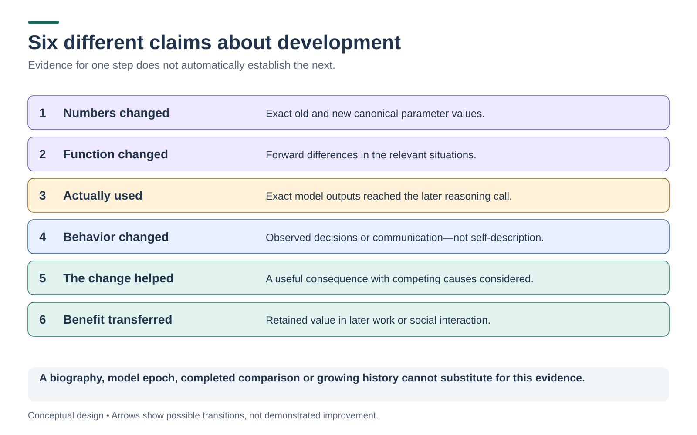

# Evaluation: what would show that the design helps?

[Home](../README.md) · [Acceptance catalogue](ACCEPTANCE.md) · [Status](../implementation/STATUS.md)

**In plain language:** show that actual experience changed the persona’s parameters, those parameters changed later choices, and the changed choices helped. Keep other explanations visible.

*Read the arrows as possible, recorded transitions—not promises that a result will improve.*

A saved reflection does not establish numerical change. A changed numerical fingerprint does not establish a changed function in a useful context. A different response does not establish a better result. The evaluation must not skip those distinctions.

## 1. Evidence levels

| Claim | Relevant observation | Insufficient substitute |
|---|---|---|
| A model revision happened | Exact old/new numeric values, owner, coherent adoption and actual lineage. | A new name, package hash or changed prose. |
| The revision changed the function | Recorded before/after outputs for an applicable appraisal. | Counting edited coordinates. |
| The character reached the decision | Exact character-use and provider-input records. | A UI chart or intended selection. |
| Character influenced behavior | Different substantive choices under appropriately matched conditions. | The persona saying “my weights helped.” |
| The behavior was useful | Better task fulfillment, appropriate communication or cooperation with contrary evidence considered. | Longer answers, more messages or unanimous praise. |
| The benefit persisted or transferred | Later relevant situations, retained strengths and qualified comparison with earlier behavior. | Elapsed time, one success or assumed domain transfer. |

A source-code review supports the inspected mechanism, not all possible executions. A published report retains its own scope and availability. A hypothetical walkthrough exposes design gaps but is not a live run.

## 2. Two questions, two comparisons

**Does the numerical character make a difference?** Compare the active and candidate numerical states under the same appraisal, task information, supporting resources and reasoning configuration. Keep intended-benefit prose, model-version labels and evaluator hints from giving one alternative a hidden advantage. Actual randomness and provider limitations remain recorded.

**Does the whole evolving persona improve over time?** Follow ordinary work and social activity across development. Preserve changing contexts, tools, resources, collaborators and outside help. This is broader and more realistic, but less causally isolated. Report it separately from the matched numerical comparison.

A simple before/after success story can be useful descriptive evidence without proving which component caused the gain. Do not strengthen the claim beyond the comparison.

## 3. Useful comparison conditions

When actual work supports a comparison, distinguish frozen character with evolving resources, evolving character with matched resources, both evolving, and ordinary general reasoning under comparable support and resource conditions. These conditions separate numerical maturation from better memory, practice, stronger tools and additional reasoning.

Character-only comparisons may hold appraisals fixed to isolate the response function. Whole-persona comparisons may allow appraisal to evolve, but then interpretation and parameters are both possible causes. State which question is being answered.

Use real retained situations, meaningful counterexamples and later contexts where possible. An assessment can make hypothetical choices without re-executing external effects. Do not claim that a hypothetical message was received or that a simulated tool result was physically observed.

The repository does not prescribe automated test cases, a fixed number of scenarios or a permanent evaluation agent. Evidence questions apply to actual work and claimed scope. If an implementation or external study supplies statistics, report its sampling, uncertainty and conditions rather than treating a few repeated outputs as broad generalization.

## 4. Quality has several dimensions

Task evidence may concern correctness, completeness against the original need, appropriate artifacts, integration, useful verification and reduced unnecessary rework. Communication evidence may concern recipient understanding, calibrated uncertainty, useful clarification, accurate disagreement and kept commitments.

Development should preserve important strengths and individuality. It need not make every persona equally talkative, agreeable or assertive. Necessary convergence on facts is appropriate. Distinctive choices should be examined where competent alternatives actually exist.

Counterexamples matter: a more cautious model may avoid a mistake yet delay simple work; a warmer model may improve an exchange yet agree with a false claim. Record such tradeoffs and regressions. There is no universal maturity number that resolves them automatically.

## 5. Social and cross-task transfer

Trace a specific earlier experience, interpretation and adopted numerical change into later decisions. Distinguish its contribution from reused skills and facts. A house-to-skyscraper or circuit-to-printer comparison must solve the new domain’s actual problem, not assume that earlier work supplied its solution.

Assess helpful transfer, no benefit, harmful transfer, missed use and missing evidence. A persona can make a justified no-change decision and still learn a useful fact or skill. That benefit is reported as resource development rather than numerical maturation.

## 6. Assisted work versus persona-originated work

Record external diagnosis, prescribed repairs, participant assignments and artifact edits separately. A result reached with such help can establish the assisted path. It cannot establish that personas independently recognized and solved the problem.

Read-only evaluation can discover defects, but repeatedly supplying their diagnosis and solution changes the run. Preserve that intervention history. The target is not a runtime that succeeds only when an external assistant continuously coaches it.

## 7. Cost and evidence integrity

Include all initialization, ordinary, maintenance, comparison, failure, retry, discovery and tool activity. Report unknown costs and externally retained context as unknown. Compare quality under meaningful cost or latency conditions; equal tokens, equal spending and equal elapsed time are different comparisons.

Freeze the exact model packages, reasoning configuration, resources, appraisals, evaluator criteria and artifacts relevant to a claim. Changed inputs do not inherit older review. Later clarification of a criterion does not turn an old failed or unrun case into success.

## 8. Report outcomes honestly

Useful benefit, no effect, regression, insufficient opportunity, missing evidence and unrun work are all meaningful outcomes. An observed edit is not automatically supported development. The [acceptance catalogue](ACCEPTANCE.md) organizes these observations; the [historical ledger](HISTORICAL-RESULTS.md) keeps older interpretations separate.
