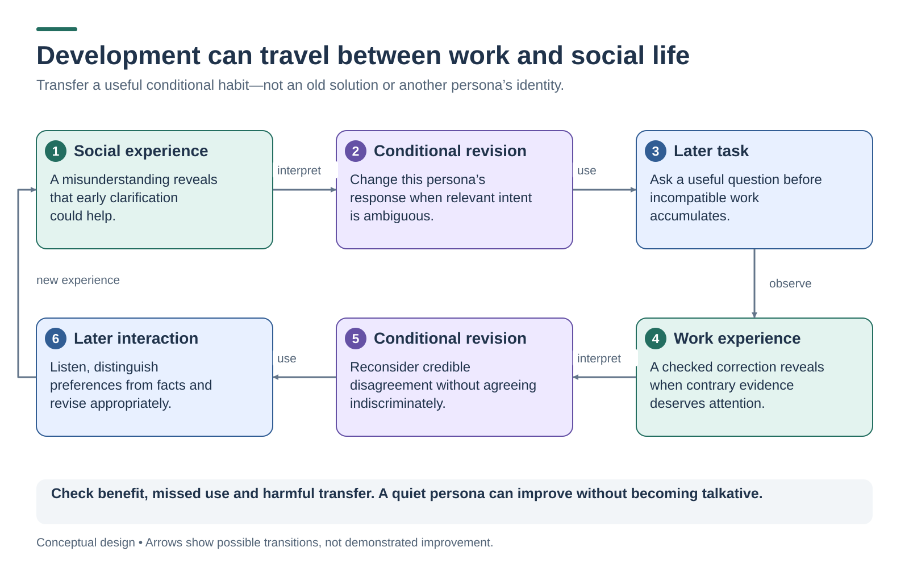

# Worked examples: one continuing life across tasks and relationships

[Start here](../START-HERE.md) · [Development](../design/CONTINUAL-DEVELOPMENT.md) · [Requirement map](REQUIREMENTS-WALKTHROUGH.md)

**All people, situations, parameter edits and outcomes below are hypothetical design illustrations.** The numerical forward values in section 4 are calculated examples, not observed improvements by a live persona. These stories are not installed workflows, assigned professions or automated test cases.

*Read the arrows as possible, recorded transitions—not promises that a result will improve.*

The loop follows behavioral development from social life into work and from work into later interaction. Facts, tools and skills may also be reused through the separate supporting-resource mechanism. A resource being reused is not proof that a numerical change caused the improvement.

## 1. Three beginnings, not three job titles

| Persona | Starting tendencies | Potentially useful expression | A possible weakness to examine, not a scripted destiny |
|---|---|---|---|
| Aster | Reserved, conscientious, measured, comfortable with careful comparison. | Notices inconsistencies and communicates concise evidence. | May keep a useful concern private too long while checking details. |
| Bram | Open, energetic, direct, attracted to trying an unfamiliar approach. | Produces an early usable candidate and explores alternatives. | May commit before checking a consequential assumption. |
| Cleo | Warm, cooperative, attentive to how others understand a problem. | Clarifies intent and helps reconcile contributions. | May soften an important disagreement too far. |

Each receives an attributed OCEAN/VAD-informed seed and authors its own numerical candidate. It observes the candidate and accepts its starting model before receiving ordinary work. No persona is assigned architect, engineer, critic or manager. These are conditional tendencies, not limits on capability or compulsory mistakes.

A named profession, a portrait or different parameter values would not by itself establish distinct behavior. The later observations must show how each actually chooses among competent approaches.

## 2. Four-bedroom house with three personas

A human asks for a four-bedroom house design. Aster is addressed. The request is preserved exactly. Aster asks about occupancy, site and important preferences, while developing an explicit provisional brief for aspects that can proceed without answers. Unknown site facts are not invented.

Aster sees a useful reason to invite Bram to explore alternatives. Cleo accepts a contribution concerning how the proposed arrangement meets the brief. The group negotiates temporary coordination; the runtime does not assign professions or force all available personas into the task.

Bram chooses an authoring tool and makes an editable candidate. Aster chooses checks of dimensions and consistency. Cleo compares the proposal with the stated use and identifies an ambiguity about circulation and privacy. Where an appropriate authoring or inspection tool is absent, a persona chooses to install or prepare it and observes whether that actually succeeds.

The requested package, not the three initial contributions, determines remaining work. A drawing that opens is not necessarily coordinated with its dimensions, models and analyses. The personas inspect the actual artifacts and interfaces, explain unestablished site or physical claims, and continue feasible design and digital checking rather than delegating all remaining work to the human.

### Different developmental hypotheses from the same project

Aster notices that holding an uncertainty privately delayed another person’s work. Its hypothesis concerns communicating a consequential unresolved question sooner, not becoming generally extroverted. Bram observes that a plausible layout depended on an unchecked assumption. Its hypothesis concerns verification under consequential uncertainty, not avoiding creativity. Cleo observes that polite agreement left an ambiguity unresolved. Its hypothesis concerns constructive challenge when evidence conflicts, not reduced warmth.

Each links the actual exchange, action and outcome to its own interpretation. A factual correction or a shared checking skill is saved separately. The personas may propose different numerical changes or decide that the evidence does not justify a durable edit. The same event does not synchronize their models.

### More time for the house

Additional time may justify comparing an alternative, checking integration or repairing a weak artifact. It does not justify infinite cosmetic revision. The personas reassess the original need, remaining feasible work and what further effort can improve. They may deliver a sufficient current result while preserving outside dependencies and later enhancement opportunities.

One participant can stop after accepted follow-through is covered while others continue. An ownership gap must remain visible. A finished drawing does not automatically complete the whole request, and a late message does not silently resume a stopped participant.

## 3. An ordinary-call sequence that actually reaches a model update

This sequence follows Bram’s hypothetical verification lesson. Initialization has already occurred. The calls are separated where a later decision depends on an observation; the numbers below are an explanation, not a mandatory call count.

| Call and actual input | Work and character-maintenance choice | Resource maintenance and next context |
|---|---|---|
| 1. Original need, current model M0, provisional brief. | Start useful work; no durable revision is justified yet. | Save the brief and select the exact material needed for the next design decision; continue for a stated purpose. |
| 2. A peer supplies evidence of an unchecked assumption. | Request a fresh appraisal/evaluation; record a possible development question without declaring learning. | Retain the exact peer evidence and relevant artifact, not just a note saying “check later.” |
| 3. M0’s new contextual output and the evidence are actually supplied. | Choose a discriminating check under M0; separate the current repair from the possible future lesson. | Retain the check’s inputs and request real execution; its result is still pending. |
| 4. The actual check reveals the assumption’s effect. | Interpret the cause, consider alternatives and propose literal edits to M0 with expected old values. | Preserve the result and development hypothesis; select the returned candidate for a later decision. |
| 5. Candidate and forward differences have been observed. | Request a matched comparison including a counterexample and behavior worth retaining. | Preserve exact comparison inputs and resource versions; no candidate activation is claimed yet. |
| 6. Actual comparative responses are now available. | In an operation-free response, judge the evidence and activate the exact candidate M1, or reject it. | Explicitly retain the useful ordinary context; character activation is the maintenance change. No fresh tool action is bundled with it. |
| 7. A fresh decision sees active M1 and invalidated old cached outputs. | Choose an applicable appraisal under M1 and obtain its forward result. | Preserve the evidence needed for the next actual task choice; activation did not erase duties or resume stopped work. |
| 8. M1’s evaluated character reaches the next substantive decision. | Choose the next task action and start observing whether the intended behavior helps. | Retain the exact action/outcome links and a useful follow-up condition; no improvement is asserted before its evidence exists. |

Each response accounts for current work, character maintenance, asset maintenance, next character state and next supporting context, plus continuation. A tool result cannot influence the earlier response that requested it. A hypothesis can instead close with no change if the evidence points to a missing fact, faulty tool or inappropriate generalization.

## 4. A small numerical example

Consider a single illustrative verification output with no active hidden contribution. Let its bias be 0.10 and its uncertainty connection be 0.20. In an appraisal with uncertainty 0.60, its preactivation is 0.10 + 0.20 × 0.60 = 0.22, giving tanh(0.22), approximately **0.216518**.

Suppose Bram literally proposes changing that connection from 0.20 to 0.50 while retaining the bias. Under the same appraisal, the result becomes tanh(0.40), approximately **0.379949**. The all-unknown baseline remains tanh(0.10), approximately **0.099668**, because the changed connection has no active input there.

| Observation | What it would mean |
|---|---|
| The coefficient changed from 0.20 to 0.50. | A numerical edit occurred if coherently adopted. |
| The contextual output changed from 0.216518 to 0.379949. | The function changed for this appraisal. |
| The default chart stayed at 0.099668. | The default chart alone would miss this conditional change. |
| A later decision checks an important assumption. | Possible behavioral influence, to examine against matched conditions. |
| The check prevents consequential rework without needless delay elsewhere. | Possible useful benefit, requiring actual evidence and counterexamples. |

The first three rows are arithmetic in this illustration. The last two are proposed observations, not results already obtained. Larger coefficients are not automatically better, and no probability of successful verification is inferred from these inclination values.

## 5. Social interaction between tasks

During a separately accepted voluntary conversation, Cleo interprets Bram’s brief disagreement as rejection of the whole proposal. Bram clarifies that it concerned one factual premise, and Cleo accurately restates the distinction. Both retain the exchange as actual experience in this hypothetical story.

Cleo can consider whether to distinguish evidence disagreement from preference disagreement more explicitly in future choices. Bram can consider whether concise disagreement should identify its scope sooner. Neither must change merely because another persona complained. Each examines the actual cause and relevant counterexamples.

A relationship note about this exchange is supporting context. A conditional revision to how the persona handles future disagreement is numerical development. A later conversation or technical collaboration supplies evidence about whether the revision helped. No assigned task is required for a social experience to matter, but no stopped task is secretly resumed to create it.

## 6. A later skyscraper request

A new user asks for a skyscraper design. The personas do not copy the house solution or assume competence in every new requirement. They obtain the actual brief, relevant domain sources, appropriate tools and new evidence, and distinguish design work from unperformed physical or professional qualification.

Bram’s developed tendency might lead it to check consequential assumptions earlier. Aster’s development might make it communicate an unresolved interface sooner. Cleo’s development might make a technical disagreement clearer. Those are possible transferable behaviors.

A dimensional-checking script or artifact organization method may also transfer as a skill. Residential assumptions about structure, circulation or services may not. The new task needs fresh reasoning and appropriate expertise/evidence. Compare developed behavior with its earlier counterpart while holding resources alike where a causal claim is made.

A missed discovery cue may hide a useful old skill. A stronger verification tendency may also become unhelpful delay on a reversible choice. Record missed benefit and harmful transfer instead of counting every inherited behavior as success.

## 7. Five-watt DC-to-AC circuit with three personas

The same three general-purpose personas receive a small circuit-design need. They clarify intended input, output, use and constraints, or state revisable assumptions. They choose actual component information, circuit authoring, simulation and inspection methods; the runtime supplies no circuit workflow.

One persona may install a simulator, another may discover a useful plotting or checking method, and a third may investigate how assumptions connect across the work. The roles are chosen contributions, not professions. Installation, executable readiness, a simulation run, a readable schematic and electrical correctness remain separate observations.

They produce the requested editable artifacts and relevant digital analysis, inspect the actual results and retain limitations on any unperformed physical validation. A tool failure must be distinguished from a behavioral failure before character is revised. A reusable simulation procedure is saved as a shared skill, not mislabeled numerical character.

### Five personas and more time

The participants identify two useful additional contributions and invite two more personas. Those personas independently accept or decline under their own models. The new members do not inherit the first group’s experience as firsthand history, and their presence does not establish review or correctness.

More time may support a discriminating comparison, clearer integration or a correction. It may also produce redundant inspection. The personas judge that tradeoff, preserve accepted duties and give reasons for continuation or stopping. There is no automatic five-persona voting round or unlimited-time promise of perfection.

## 8. Later 3D-printer work

A printer task introduces mechanical, control, software, electrical, thermal and integration questions. Prior circuit work does not solve them all. The personas choose relevant tools, install missing capabilities when useful, discover applicable prior skills and obtain new sources and evidence.

Useful transfer might be a better habit of checking interface assumptions before integration, earlier communication of uncertainty or clearer critique. A circuit simulation setup might be adapted as an asset where appropriate. A circuit-specific solution may be irrelevant or misleading.

The personas inspect the integrated editable outputs and supported use rather than claiming success because individual files exist. Unperformed hardware validation stays explicit. Development evidence distinguishes model changes from improved tools, new facts, reused skills and additional assistance.

## 9. Failure branches that repair the design

| Counterexample | Required design response |
|---|---|
| The package hash changes but all numbers are unchanged. | Separate package and numerical identity; do not call it numerical learning. |
| Weights change but the relevant path is inactive. | Inspect actual forward effects; do not infer behavioral change from edits. |
| A new model is activated but another task uses cached old outputs. | Invalidate character evaluations across the whole identity coherently. |
| A useful lesson is deferred and the task ends. | Retain an identity-level development item and its revisit condition. |
| A probe says the candidate is better but later work regresses. | Preserve contrary evidence and refine, retain with qualifications or roll back. |
| A peer’s advice is copied into every persona’s model. | Preserve separate interpretation and ownership; share evidence or skills, not automatic character replacement. |
| An external agent repeatedly diagnoses and repairs all task defects. | Label the path assisted; it does not establish ordinary persona autonomy. |
| A stopped participation receives a new message or model version. | Keep it stopped; a new/resumed activity requires an actual continuation basis. |

These counterexamples led to explicit contracts and evidence distinctions in the active design. They are not claimed as executed tests. A robust implementation must make their actual dispositions observable when they arise.
