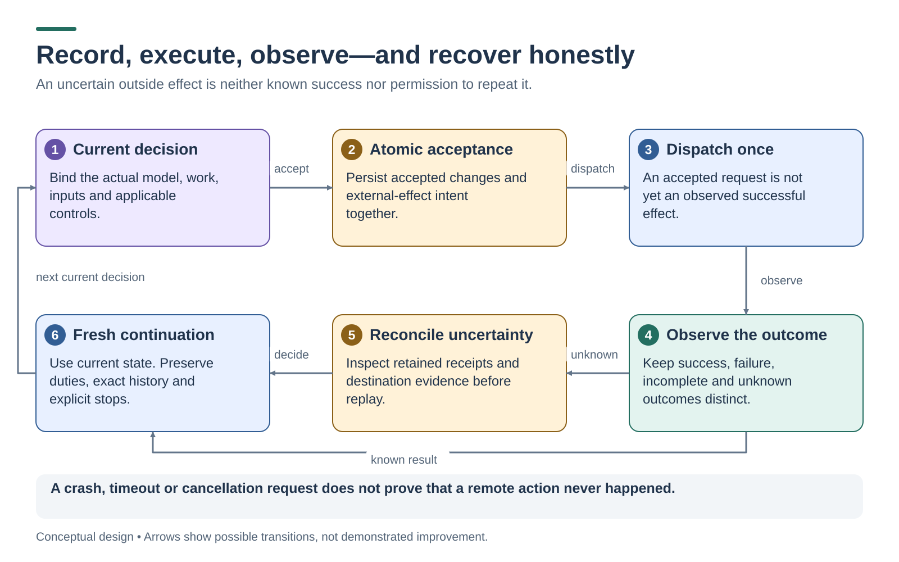

# System contracts: what must remain true at each handoff

[Design guide](../design/README.md) · [Requirements](REQUIREMENTS.md) · [Acceptance](../evaluation/ACCEPTANCE.md)

**In plain language:** record what was really chosen, supplied, executed and observed, and never let an old or incomplete decision masquerade as a current one. These are correctness contracts, not a hardcoded task workflow or approval policy.

*Read the arrows as possible, recorded transitions—not promises that a result will improve.*

The two result paths must stay different. No receipt means the result may be unknown; it does not imply success or prove that repeating an action is safe. Local recovery cannot invent a persona’s missing judgment.

## 1. Exact identity and versions

Every accepted transition identifies its actor, causal work, mandate revision, decision generation, active model package and relevant input versions. A path, label or mutable model alias is insufficient to identify exact content. Preserve the original request and all attributed changes.

One persona has one current decision authority. Independent personas and already admitted isolated jobs may run concurrently. A new user amendment, changed applicable control or changed model invalidates an older decision where the dependency matters. Ordinary newly arriving peer messages remain later inbox observations unless they change an actual admitted dependency; their arrival must not needlessly discard independent work.

No stale holder can overwrite a newer accepted version. Failed whole-response adoption commits none of its proposed mutations or new outbox effects. Already accepted independent units and already dispatched effects retain their actual outcomes; a rejected response does not retroactively erase them.

## 2. The required records

| Record | Minimum meaning to preserve |
|---|---|
| Persona | Stable owner identity, real origin, current lifecycle, active model and reasoning configuration. |
| Model package | Owner, versioned feature meanings, tensor shapes, exact canonical values, predecessor, authoring intent and evidence. |
| Numerical identity | Fingerprint of feature contract, structure and values, separate from prose and lineage metadata. |
| Work and participation | Original need, amendments, invitation/acceptance, actual commitments, outcomes, pending dependencies and continuation. |
| Appraisal | Interpreted contextual values, unknowns, evidence, scope, author and any reconsideration conditions. |
| Character use | Exact model, appraisal, evaluated outputs, projection, provider input and invocation. |
| Resource | Exact retained version or bytes, real source, discovery cues, operative qualifications and actual availability. |
| Experience | What was done, received or observed, its source context and later consequences, including uncertainty. |
| Development item | Persona-owned hypothesis, originating evidence, contrary evidence, disposition, candidates and follow-up. |
| Assessment | Exact alternatives, supplied situations/resources, configuration, actual responses, scope and observed failures. |
| Adoption | Exact old and new binding, current authority, reason, observed basis and later-observation intent. |
| Effect | Accepted intent, exact execution identity, dispatch state, actual observations and unresolved outside uncertainty. |
| Delivery | One coherent assembly of exact artifacts, supported use, assumptions, evidence, remaining work and separate user acceptance. |

This table specifies semantics, not a compulsory JSON layout, database or number of services. A short activity can use concise records while preserving these meanings where applicable.

## 3. Every ordinary persona invocation

The request includes the actual work, relevant current obligations and controls, current numerical character, needed observations, explicit maintenance responsibilities and the requirement to choose next state/context. The response explicitly covers the five responsibilities in the [persona core](../design/PERSONA-CORE.md#6-five-responsibilities-in-every-ordinary-call) and its continuation.

Validate the complete response before adopting substantive operations. Missing, malformed, ambiguous or contradictory coverage does not become a valid prefix. A concise reasoned no-change is allowed; the runtime must not fabricate it when the model failed or omitted it.

A proposal, accepted save, actual provider supply, observed action and useful consequence remain separate. An interface view must not collapse them into a single success badge. Operator cancellation, factual accounting and receipt retention remain available when persona response validation fails.

## 4. Numerical revision and activation

A patch requires the exact current numerical package, owner, expected old values, valid coordinates, finite new values, reason and attributable evidence. A nonempty list whose values are unchanged is a no-op numerically. Changed intent or lineage alone may change a package fingerprint but must not be labeled parameter learning.

Forward evaluation records the exact input meanings, unknown masks, numerical function and resulting outputs. Invalid dimensions or nonfinite arithmetic fail explicitly. Functional comparison is scoped to its actual situations; it cannot establish global equivalence from a few unchanged outputs.

A candidate is inactive until separately adopted. Before a revision is activated, the owning persona must have actually observed the relevant candidate and comparative evidence—not just a reference appearing in metadata. Preserve a typed distinction between named, read, selected and fully supplied evidence.

Activation or rollback occurs in an operation-free decision under the exact expected current binding. The transition updates identity-level model authority and invalidates cached outputs for every participation of that identity in the same coherent change. Further fresh operations require a new decision. An unknown activation outcome blocks assumptions about which model is current until reconciled.

A rollback targets a retained valid ancestor with actual ownership and lineage. It does not erase development history, accepted responsibilities or uncertain effects. Competing candidates require fresh consideration against current state; no implicit merge or rebase authors new weights.

## 5. Appraisal and temporal consistency

A reused appraisal carries its actual originating decision, evidence versions, scope and applicability judgment. A new observation does not automatically turn old contextual values into fresh measurements. Exact model changes always invalidate old outputs; semantic reconsideration is the persona’s job.

A refreshed appraisal is evaluated before the later reasoning that claims to use it. The host records the actual ordering. Requesting evaluation inside a response cannot count as using its returned values to produce that same response. Independent work under the still-valid current character is permitted where it does not depend on the new result.

A baseline with unknown inputs is labeled as such. A current UI chart, requested model and actual provider input must refer to the same accepted state or explicitly show their different historical status.

## 6. Experience, development and delayed outcomes

Index actual attributable events once with stable source identities. Repeated notification is not a new independent experience. Distinguish observed facts, received assertions, persona interpretations, hypothetical comparisons and imported examples.

Cross-work discovery is explicitly chosen by the persona and returns exact pointers with scope. The host does not silently transfer every old task’s optional context or responsibilities. Development records persist at identity level; a local task ending cannot erase an accepted developmental commitment.

A deferred development item retains a concrete revisit basis or an honest closure. Actual matching events become available without inventing the interpretation or forcing a weight edit. Track offered records, actually reviewed evidence, proposed changes, adopted changes and later supported benefit separately.

Late feedback links to the original experience and current follow-up. It changes what can now be concluded, not what was known earlier. An adopted model is initially under observation. Supported, unassessed, regressed and rolled-back states remain distinct and scoped.

## 7. Resources, discovery and context supply

Preserve exact selected bodies or ranges, source versions, qualifications, warnings and dependencies needed to interpret them. A search cue is neither executable authority nor an exact evidence reference. A pointer inside a working note does not supply its body.

The bulk tool/skill/history catalogue stays outside the provider request and the model context. Known relevant interfaces can be used directly. Discovery, exact reading, selection, exposure, invocation and observed results are different facts but need not require six separate calls.

Renaming, splitting, merging and retiring resources preserve stable lineage where represented. No silent current-path replacement can rewrite a historical receipt. Source loss is reported as unavailability. A hash or newer copy cannot reconstruct missing historical evidence.

A shared skill identifies its source and adapted versions, useful discovery cues, dependencies and observed use. Another persona decides whether it helps. Saving it does not establish that it ran or improved work.

Actual provider capacity refusal can lead to a fresh, labeled recovery view containing metadata and exact pointers. The persona chooses excerpts or preparation. Metadata is not observed content, and no model adoption may rely on merely named assessment bodies. Completed external actions are not replayed to rebuild context.

## 8. Coherent execution and dependencies

Persist complete accepted state and new external-effect intentions together. Dispatch only after acceptance. Preserve declared ordering and explicit dependencies. An operation cannot consume an unobserved external result in the same decision.

A coherently saved exact internal artifact may support an explicitly dependent operation where its bytes and accepted identity are already established. This does not justify guessing the result of a pending import, host command or remote action. Same-response aliases must bind actual accepted results, not future imagined receipts.

Installed capability, actual execution and result correctness require different evidence. Record working directory, tool/service identity, account/environment and output where observable. An unavailable directory or tool produces a failure, not a silent substitute or default success.

Background jobs retain owner, source decision, original inputs, submission/launch/terminal status and exact partial or completed observations. A cancellation request is not proof of termination. An uncertain old process identifier must not be treated as a current owned process after restart.

## 9. Retry, interruption and recovery

An exact repeated request identity resolves to its retained outcome; changed content under that identity is a conflict. An unavailable receipt remains unavailable. Local retries must not duplicate accepted state transitions.

Distinguish preparation, unattempted dispatch, observed failure, completed effect and uncertain outside effect. Reconcile uncertainty before repeating effects that may already have happened. A process crash does not prove remote nonexecution, termination or zero cost.

A retained complete response is adoptable only against its original still-current authority. Old responses, deferred actions and expired invocation identities never become fresh work merely because the runner restarted. Current controls, obligations, warnings and pending events survive restoration.

Known transport failures may support a separately recorded fresh inference attempt when no complete decision or adopted effect exists and current continuation permits it. That is not automatic replay of tools or adoption of an incomplete prefix. Report unknown provider activity and charges honestly.

## 10. Messages, waits and continuation races

Retain exact sender, recipient, work, content and versioned references. Acknowledgment and interpretation are distinct from delivery. New messages normally arrive as subsequent observations rather than retroactively changing an independent admitted decision.

Register a wait and reconcile matching arrivals after its admission boundary coherently. Do not strand a relevant message because it arrived just before the wait committed; do not use an older unrelated message to satisfy a new wait. Ordinary child replies retain their real origin and do not create parent membership or responsibility.

Stop, pause and wait are distinct. A message, model revision, late result or restart can make an appropriate wait eligible, but never silently resume a stop or override a pause. A later improvement needs an actual new or resumed continuation basis.

## 11. Review, warnings and delivery

A review names exact subject, inputs, criteria, actual reviewer and independence where adopted. Changed inputs change its applicability. A historical pass cannot migrate to newer artifacts by timestamp or similar filenames.

Feedback delivery, read status, acknowledgment, chosen disposition and actual correction are separate. A primary-authored warning has its accepted scope; copied criticism does not become a host veto. Stopping repair does not falsely resolve the warning, and a failed patch must not silently restore unqualified guidance.

A delivery binds one coherent exact assembly and current mandate. Do not publish a mixture of constituent versions under an old review. Preserve unresolved applicable findings, conditions and remaining outcomes. Activity, delivery, user acceptance, outside validation and full completion remain distinguishable.

## 12. Migration, retention and external boundaries

Migration preserves original bytes, schema/evaluator versions, active model, controls, duties, unresolved effects and real provenance. New derived indexes cannot manufacture past learning. Historical fragment-based state is not silently reclassified as numerical maturation.

User-requested erasure, retirement and actual loss receive their real dispositions. Do not promise deletion of arbitrary provider or recipient copies. Retained old evidence may remain historically valid even when its criterion is superseded; neither condition grants a pass for the new design.

Application quotas and safety approval gates remain removed under UR-052. Structural validity and evidence integrity do not disappear. External provider, host, legal or physical conditions remain facts rather than claims the runtime can override. Public documentation contains no credentials or private live traces.
