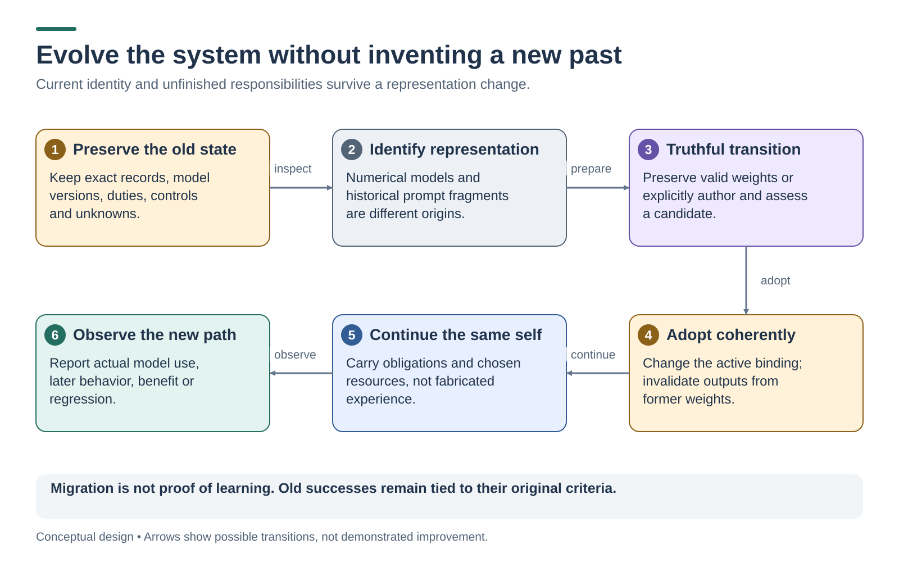

# Deployment decisions and explicit tradeoffs

[Implementation guide](README.md) · [Contracts](CONTRACTS.md) · [Status](STATUS.md)

The design fixes product intent and observable contracts. Deployment still requires real choices. Recording those choices does not create permission gates or guarantee that a chosen configuration will work.

*Read the arrows as possible, recorded transitions—not promises that a result will improve.*

A change of representation is not proof of learning. A new provider is not the same as a new numerical character. Keep these transitions distinct so later improvements can be interpreted honestly.

## Decisions that must be explicit

| Decision | Required account |
|---|---|
| Character function and interface | Exact feature meanings, unknown-input convention, parameter representation, topology and output projection. |
| Reasoning configuration | Provider, model, exposed sampling/reasoning settings, account binding and limitations of reported identity. |
| Persistence | Exact versioning, atomic state changes, durable outbox, integrity checks and recovery behavior. A particular database is not prescribed. |
| Execution environment | Host/service facilities, tool installation, image support, background jobs and actual controls. |
| Context | Selective lexical discovery, exact supply, required qualifications and observed provider-capacity recovery. |
| Development continuity | Identity-level experience discovery, agenda visibility, chosen revisit conditions and later-outcome linkage. |
| Assessment | Actual matched alternatives, behavioral evidence, configuration and limits; no universal maturity scalar. |
| Observation and UI | What users can inspect about current models, numerical changes, use, outcomes, costs and unfinished work. |
| Migration | Preserved legacy/numerical state, explicit transitions, unknown historical fields and pending effects. |
| Public governance | Owner-selected rights, license, contribution and publication decisions; no invented endorsements or release assurance. |

## Reference numerical baseline

The inspected runtime uses a separately owned small network with eighteen contextual inputs represented by value/known pairs and twelve outputs. It evaluates literal values through direct and hidden contributions. This is the concrete starting interface, not a universal personality measurement. Source and limits are in the [audit](../sources/RUNTIME-AUDIT.md).

The numerical model can share hardware and a reasoning provider with other personas while preserving separate ownership, active bindings and invocations. Physical memory limits and scheduling delays are real observations, not justification for silently using another persona’s parameters.

A feature-contract change must describe changed meanings and compatibility. A topology increase alone does not prove greater useful expression. Keep existing packages interpretable under the contract that produced them and assess new claims under the new interface.

## Learning choice

This target uses persona-authored literal parameter changes and forward evaluation. There is no mandatory gradient optimizer, training pipeline or hidden parameter-search service. A future architecture change to a separately fine-tuned language model would require an explicit requirement/design decision and new evidence; it is not an invisible implementation detail.

The host may expose exact numerical diagnostics. It must not author supposedly persona-originated edits. A shared discovery or storage service is acceptable; a hidden semantic teacher that writes the behavioral lesson is not.

## Efficiency and capacity

Measure all costs and actual delays, including initialization, maintenance, comparisons, failures and retained state. No claimed efficiency gain follows merely from using a small character network: the reasoning calls can still dominate cost.

No application call, lifetime, context, storage or population quota is introduced. Selective context and persona-chosen organization reduce unnecessary material. External resource exhaustion remains a real failure to report and address, not a fabricated successful operation.

## Open empirical decisions

Useful numerical influence, reliable persona-authored revisions, cross-context transfer, preserved individuality, regression control and favorable whole-task cost remain questions for actual evidence. The design provides the observation and recovery path; it does not settle these questions by assertion.

A deployment should identify its supported scope honestly. It must not disable a required behavior and then claim the complete user objective has been met. Historic runs keep their own configuration and criteria.
