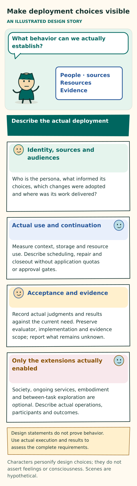

# Decisions required for a deployment

**Current requirement:** [Unrestricted execution](../design/WORK-AND-BOUNDARIES.md#unrestricted-execution-requirement) supersedes earlier application quota, safety, permission-gate and approval clauses. Historical results retain their original criteria; this change alone establishes no runtime conformance.

[Implementation guide](README.md) · [Contracts](CONTRACTS.md) · [Work and boundaries](../design/WORK-AND-BOUNDARIES.md) · [Status](STATUS.md)

A deployment must implement the adopted persona design and report actual behavior, under the unrestricted-execution requirement. This register identifies the decisions needed to do that. It does not claim production readiness or report that the separate runtime already implements these choices.

The target is a continuing persona with one accepted, versioned character account. That account includes semantic OCEAN traits—openness, conscientiousness, extraversion, agreeableness, and neuroticism—and a VAD modeled affect profile covering valence, arousal, and dominance. These meanings are required; numeric representations are optional.

The primary LLM authors persona-defining prompt fragments that carry the persona's character. It uses bounded lexical and supported regex searches, chooses the next context, and explicitly addresses maintenance in every persona invocation. Current character and selected fragments inform all discretionary task and social choices. Actual experience may lead to revisions of compact retained context, scoped relationships, and permitted character. Tools, skills, domain knowledge, generic procedures, code, data, and histories remain supporting assets, regardless of who authored them.

A deployment retains semantic traits, modeled affect, every-invocation maintenance, exact records and useful context selection. It must remove application quotas and safety gates under UR-052. For every decision below, record:

- The accountable owner and chosen policy or value.
- The rationale and exact effective version.
- Supporting evidence and remaining limitations.
- The conditions that would require reconsideration.

Keep unresolved behavior explicit in implementation status. The default full-host profile below does not add application restrictions or per-tool approval while implementation work continues.

## First release and implementation alignment

The implementation targets its first release. Backward compatibility with earlier development formats and interfaces is not required; obsolete adapters and migration paths need not constrain the current design. Historical run records retain the meaning of the build that produced them, without obligating the current runtime to read every earlier format.

Working functionality must follow the [user requirements](../USER-REQUIREMENTS.md), with later user clarifications taking precedence. Implementation work uses builds and inspection of actual persona runs, including their supplied context, tool and skill choices, installations, execution results and resulting work. The user has requested no automated test cases. Design walkthroughs and requirement criteria describe intended behavior; they are not evidence that runtime functionality works.

## Core deployment choices

The design fixes the responsibilities below. Each deployment must specify how it meets them, what limits apply, and what evidence supports those limits.

**Figure: Make deployment choices visible.** This is a conceptual explanation of the design. [Read the exact rules](DEPLOYMENT-DECISIONS.md#core-deployment-choices); the explanation below retains their qualifications. [Open the illustration](../assets/deployment-envelope.svg).

Text equivalent of the illustration

Make deployment choices visible

AN ILLUSTRATED DESIGN STORY

Which setting can we actually support?

People · limits Permissions Evidence

Decide the supported setting explicitly

Identity, permissions and audiences

Who owns the persona, who can authorize a change, which sources may be used and which recipients may receive them?

A viable operating envelope

Declare context, storage, resources, scheduling, repair and closeout capacity. Protected mandatory state must be supportable.

Acceptance and evidence

Choose criteria, review rights, assurance and relevant behavioral comparisons. Preserve exact evaluator and implementation scope.

Only the extensions actually enabled

Society, ongoing services, embodiment or between-task exploration are optional. When enabled, their applicable safeguards still apply.

An architectural design does not authorize a deployment. This is a map of decisions, not a universal product setup or research checklist.

Characters personify design choices; they do not assert feelings or consciousness. Scenes are hypothetical.

**Use, identity, and character.** Establish who the persona serves, how its accepted identity begins, and which later changes are permitted.

- **Intended use.** A domain-neutral design does not make every task feasible. Specify the users, supported tasks and results, exclusions, and any outside review needed for a particular claim.
- **Continuing identity.** Normally, attributed trait seeds become bounded initial LLM-authored candidate fragments and then one coherently accepted semantic OCEAN/VAD account shared by profile and prompt. Specify creation authority; provenance for the seed, candidates, and acceptance; initial and continuing model configurations; handling of sparse or conflicting seeds; identity across retries; truthful alternate origins; self-authorship and locked-character controls; the distinction between baseline and current state; handover; and lifecycle recovery.
- **Character representation.** Natural language is sufficient. Every persona-authored fragment must carry the owner's character and use its own voice. If the deployment adds facets or contextual operational tendencies, state their purpose. For any numeric anchors, declare provenance, display behavior, and validation. A profile must not become an independent character author, and traits must not become a deterministic action policy.
- **Experience-shaped development.** Actual consequences of tasks and human or peer interactions may inform later fragments, methods, navigation, relationships, and permitted current character. Specify user controls over self-authorship, and distinguish local methods and transient state from effective-character changes. Provide proposal-first handling, enforcement of fresh decisions, honest attribution of experience, and evidence about outcomes over time. Elapsed time or activity counts must not drive automatic aging, and the design excludes automatic weight training.
- **Modeled affect.** Keep baseline affect, transient state, outward expression, and authority distinct. Specify event and source attribution, update and recovery rules, state lifetime, uncertainty, expression limits, and consistent views tied to the same version. Any numeric dynamics are engineering choices that need testing; they are not established psychological laws.

**Primary work and maintenance.** The ordinary primary LLM owns judgment about work, maintenance, and the next context. A deployment must make those responsibilities reliable across short calls, continuing work, and repair.

- **Primary inference.** The primary LLM chooses work, fragment and asset maintenance, and relevant next context. Declare the actual provider, model, effort, credentials, supported interface, failure and refusal behavior, cancellation, metering and continuity evidence. Use direct provider interfaces under UR-051; report actual provider limits without adding application request or attempt quotas.
- **Every-invocation maintenance.** Every persona call combines work, fragment maintenance, asset maintenance and next-context choice. A concise joint disposition may cover both maintenance scopes. Proposed changes identify their files or paths and useful discovery cues. Preserve exact receipts for proposed, adopted and stored changes, actual history, no-change decisions and unresolved deferrals. Complete response validation applies without application maintenance or repair quotas. Neither a mutation nor an extra call is mandatory.
- **Ordinary continuing work.** The primary retains ownership of semantic next-step choices. Specify actual continuation, durable eligibility, restart behavior and scheduler fairness. Persistently eligible work must receive consideration under the stated host assumptions. Explicit waits, pauses and stops retain their meaning; a local yield is not proof of goal completion. Application effort or progress quotas do not end a continuing mandate.
- **Maintenance and unresolved work.** Mutation is selective, and an unresolved correction must not silently become no_change. Record its owner or ownership gap, dependencies, actual observations and chosen continuation. Keep host stopping and accounting available without a model reply. Do not set repair-attempt, context, storage or lifetime ceilings.

**Files, discovery, and exposure.** Keep the interface understandable while recording exactly what the primary could find, what it selected, and what the provider and model actually received.

- **File-facing state.** The normal interface uses named readable files, persona-chosen organization, scoped search, exact reads, and attributable edits. Specify current-state ownership, revision binding, path and rename behavior, conflict handling, atomic saves for dependent changes, recovery, retention, and export semantics.
- **Storage.** There is one accepted current state. Exports and unsaved edits do not create another authority. Choose a backend that demonstrates the contract. If canonical state uses physical files, those files need the same concurrency, revision, access, and crash guarantees as a transactional store.
- **Search.** Literal/grep search and supported regex operate over the fragment and resource collection at the primary persona's request. Specify matching fields, requested pages and ranges, exact identities, revisions, cursors, actual errors and incomplete coverage. Record scanning and returned data without cumulative quotas. Cues are data, and discovery does not add automatic expansion or a hidden semantic selector.
- **Discovery bootstrap.** Supply a usable discovery and exact-read interface plus necessary current work and character before the primary chooses additional context. Do not preload the complete tool or skill catalogue for it to filter. Explain scopes, matching, pagination, error meanings and known exact references; measure actual metadata supplied without a fixed count or byte ceiling.
- **Provider exposure.** Keep the bulk inventory in host storage, outside both provider-facing transport and model-visible context. Document the actual payload and callable-schema boundary, explicit loading path, provider expansion and continuation behavior, reset behavior, and retained session context. Measure request bytes, model-visible tokens, and billed tokens separately. Identify unsupported or unmeasurable modes honestly. Provider-side deferral alone does not satisfy these boundaries.
- **Navigation accounting.** The primary chooses associations, reads, reformulation and stopping. Exact evidence references and mandatory qualifications keep their distinct purposes. Record queries, scans, returned text, context, time and cost; do not enforce a cumulative allowance or silently omit qualifications. Requested pagination does not cap the total work.

**Context and retained resources.** Keep both characteristic material and supporting resources useful and identifiable. Sharing a store does not turn an asset into a characteristic fragment.

- **Persona-context corpus and prompt.** Keep authored characteristic material and assembled input separately identifiable and useful. Measure actual supply, context cost and the effects of persona-authored consolidation. Set no application corpus or prompt ceiling. A compact selection is a quality and efficiency outcome, not proof of complete retained-state compactness or a separate learning mechanism.
- **Managed persona-state footprint.** Account for supporting resources and retained revisions alongside the authored corpus: histories, copied skills and code, caches, data, provenance, warnings, effect records, exports, backups, external backing and temporary rewrite copies. Disclose unmeasured portions. Neither a measurement nor an old allocation becomes a retention cap; record actual cleanup and storage failures.
- **Next context.** Each persona call explicitly chooses next context for both fragments and assets. Preserve, replace, clear/no optional need, discovery and exact reads retain their actual meanings. Missing intent is not an inferred choice. Record exact supplied revisions, ranges and schemas, current character, qualifications and stale material. No fixed workflow, catalogue preload or application fitting quota replaces the choice.
- **Supporting-resource lifecycle.** Storage and organization must preserve actual origin, restrictions, freshness, and disposition. They do not establish persona authorship or execution. Specify acquisition, revision, retirement, and erasure rules for histories, definitions, skills, code, and data. Distinguish exact snapshots from live identifiers. Define cache scope and invalidation, stale or unknown outcomes, and—where watches are used—their actual requested, acknowledged, live, and ended coverage.
- **Qualification and provenance.** Preserve exact source relationships, versions, relevant corrections and the distinction between historical evidence and current applicability. Report unavailable material honestly. These records do not impose source-sharing approval or application access gates.

**Attribution, execution, and resources.** Finding or loading a capability does not establish that it is available, has run or produced a correct result. Record the actual actor, current decision and execution path without an added application permission gate.

- **Processing destinations.** Record the selected provider or service, actual account and credentials, transmitted inputs and observed results. Source and audience metadata remain attributable. Do not require an application destination allowlist or source-sharing approval. The selected destination does not become another persona author or context selector.
- **Autonomous effects.** Attribute each proposed and executed effect to its actor, work, exact inputs and current decision. Preserve durable intent, dispatch, cancellation and unresolved outcomes. Removing approval gates does not make a missing receipt proof of success or permit duplication of an accepted effect.
- **Execution.** Default host commands use the host account, filesystem, network, environment and subprocess facilities without application sandboxing, command allowlists, per-tool approval or installation grants. Bind commands to what actually ran; report only observed versions and results. Stored guidance or a past success does not establish current availability, credentials, execution or correctness.
- **Resources.** Measure calls, failures, navigation, exposure, maintenance, tools, review, retention and closeout without application ceilings. Descendants retain their own attribution within the continuing history. Known consumption and unknown remote usage remain distinct; accounting does not create a quota, reserve requirement or approval step.

**Acceptance, delivery, and continued operation.** Record what has actually been achieved, who has accepted it, and which obligations survive interruption or retirement.

- **Acceptance.** Authored judgment, independent assessment, human acceptance, and external assurance are distinct. Specify adopted criteria, qualification and separation policy, the exact subject and citation evidence, review gaps, and current release checks.
- **Delivery.** Local creation, retained publication, submission, delivery, and acceptance are separate events. Specify actual recipient surfaces, supported artifacts, explicit audiences, current readability, durable receipts, and useful failure diagnostics.
- **Retention and recovery.** Restart, renaming, retirement, consolidation, and deletion must not invent authority, resolution, or success. Declare exact-history promises and periods; derivative-use and erasure policy; conditions for lessons to survive and for reporting source unavailability honestly; backup and export boundaries; durable notifications; effect reconciliation; dispositions of protected warnings; capacity conflicts; and limits on recalling outside copies.
- **Outside stores and delivered artifacts.** Disclose external backing and include its footprint when measurable. State the limits of control over provider and recipient copies. User-owned delivered artifacts are not deleted, altered or revoked to satisfy a persona-state quota; no such quota is imposed.
- **Optional exploration.** Record an actual continuing opportunity and let the persona choose its question, methods, collaborators and continuation. No finite allowance, recurrence count, application expiry or approval workflow is required. Explicit pause and cancellation remain effective. State actual foreground scheduling behavior and any unestablished latency claim, including the effects of already running work.
- **Evaluation.** Inspect real work against the current user requirements and record exact inputs, outputs, source revisions, costs, failures and unresolved claims. Do not add or require automated test cases for this first release. Historical evaluations retain their original criteria and do not establish current conformance.
- **Distribution and contributions.** Editing the design does not select licensing or contribution terms. Obtain owner-approved terms and specify rights to material, attribution requirements, and evidence-governance responsibilities.

**Backend and interface boundaries.** Backend choice stays within the file-facing contract. A simple interface must not hide a requirement for graph bookkeeping, a separate automatic author, or another model that owns selection. Familiar files still need trusted records for permissions, exact observations, commitments, accounting, and recovery.

**From discovery to results.** Discovery, reading, selection, actual exposure, invocation, and observed results have distinct contract meanings. They need not take separate calls. An exact resource already known to the primary can retain its direct-use path, as can already supplied operative guidance that remains current.

Execution dependencies, provenance dependencies, data derivations, and required prompt qualifications require different checks. The model does not need every dependency's documentation or every data row. It does need complete required operative conditions. A missing restriction or execution prerequisite can block use. If a provider interface cannot expose a needed capability within the declared boundaries, record that deployment limitation. Do not report the tool as loaded or silently send the full catalogue.

### Effective character authorship

The persona may propose revisions to its characteristic fragments and accepted character through ordinary reasoning. The application does not require a self-authorship grant, per-revision approval or an enabled policy flag. Preserve the actual author, previous revision, supporting experience and coherent adoption of the new account.

A stable-character change remains different from a transient modeled-affect update or an asset edit. A fresh decision receives an adopted effective character before further actions from the old decision. That preserves which character informed the action; it does not supply a quota or safety approval workflow. No revision is mandatory, and an accepted revision alone does not establish beneficial maturation.

Historical locked or enabled settings and their outcomes remain attributable to the earlier design. They are not current application permission gates.

## Context, storage and supporting evidence

[UR-052](../USER-REQUIREMENTS.md#no-application-limits-or-safety-gates) removes application ceilings. Choose how to measure and organize context, navigation and retained state without setting quotas for their size, duration or cumulative use. Do not require a finite admission or repair envelope before work can proceed.

**Select context for the decision.** Follow the persona's fragment and supporting-resource choices, preserve mandatory current work and actual observations, and supply exact selected content with its relevant qualifications. Keep the bulk catalogue outside the model input unless its contents are actually selected for the task. Compactness follows useful selection and maintenance; it is not enforced by silent truncation or a larger fixed input cap. Record actual provider rejections and unavailable source material.

**Measure distinct costs.** Record the authored corpus, actual prompt, navigation and total managed footprint separately. Include retained history, metadata, temporary rewrite copies and external storage deliberately used by the application when measurable. Disclose unmeasured portions. No measurement or historical allocation becomes an application admission, retention or approval gate.

**State what retained evidence establishes.** Preserve exact origins, accepted revisions and actual source relationships. An interpretation remains distinguishable from its supporting observation; generated text is not invented firsthand experience. If evidence becomes unavailable through a real deletion, retention decision or host failure, report the resulting limit. A hash cannot replace missing source bytes, and a historical judgment does not establish current applicability.

Application access and source-sharing gates are removed. Source and audience metadata remain useful provenance; they are not an additional approval workflow. The actual host account, credentials and external service determine what an operation can access. The application must report those outcomes accurately without claiming control over arbitrary outside copies.

**Keep work and closeout usable.** Preserve unresolved effects, warnings, accepted responsibilities, explicit stops and honest status. Review and repair need no reserved application allowance or separate permission. Actual storage and provider failures remain possible; no design text establishes that they cannot occur. Record a failed save or unfinished operation as such, and do not manufacture completion or replay an uncertain effect.

The persona chooses useful consolidation, further investigation and stopping. No mandatory cleanup phase, automatic semantic writer, fixed recurrence allowance or progress quota replaces that judgment. User-owned delivered artifacts are not deleted, changed or revoked to satisfy a notebook limit.

## Default full host access

The user's current requirement is full access by default: personas can install and use any tools they choose, without application restrictions or per-tool safety approval. This default applies to both new and existing personas. A separate installation grant, command allowlist, sandbox, selected skill guide, or operator confirmation is not a prerequisite for host execution.

The host command interface runs with the host account's filesystem, network, environment, credentials, and subprocess access. Personas choose their tools, installation commands, working directories, and procedures. Actual operating-system permissions and package availability determine what a command can do; the application adds no per-tool restriction. Skill guides can be read as ordinary host files and remain attributable procedural resources.

The runtime supplies the current host command definition in ordinary persona inputs, without loading a catalogue of every installed program. Personas can discover installed programs and install additional ones through that command interface. The separate bounded WebAssembly and HTTPS profiles may remain available with their own historical contracts; their grants do not gate full host command access.

**Actual execution and continuity.** Adopt the command as part of the complete persona decision, record its identity before dispatch, and retain the observed exit status and output. Tool installation is an actual host change. Saved guidance, a proposed command, or a claimed installation is not an execution result. An interrupted command must not be automatically repeated merely because its terminal observation is missing.

Commands have no default timeout. A persona may request a timeout for a particular command. Bounded excerpts keep model context usable while full output remains available as host files. A command's live files and background processes remain distinct from an immutable recorded observation of its parent process.

**Host state and records.** This profile provides the host account's access, including access to files shared by personas using that account. Native record projections are not a filesystem isolation boundary. Native API operations continue to retain their actual adoption and execution records; direct host writes are ordinary host effects and must be described truthfully. Installation or execution does not itself establish skill application, a correct result, or completed work.

Model-call allocations and actual resource accounting remain distinct from tool permission. A host command needs no additional model attempt or per-tool attempt grant. Changing the tool-access default does not rewrite historical results, refund spending, or imply a command was executed in an older run.

This current full-access requirement supersedes the earlier requirement in this section to condition host-tool use on additional application approval or isolation controls. It does not turn earlier bounded-profile runs into full-host executions. Implementation status must be established by actual installation, filesystem and process operations through the persona's native path.

## Optional features and their evidence

Describe an optional feature's actual scope, participants, operations and evidence. These declarations do not add application permission, quota or safety approval gates under UR-052.

| Feature | What to describe and distinguish |
|---|---|
| E1: functional embodiment or enriched profiles | State which relationships the display explains. Profile richness must not imply human consciousness, feelings, competence, or physical embodiment. |
| E2: community or institution | Name the accountable sponsor and charter. Define real representation, membership, delegated powers, resource allocation, information policy, conflict and appeal routes, renewal, and the disposition of obligations at exit or dissolution. |
| E3: sensitive human-facing use | Provide transparent AI identity and meaningful choices about context, retention, and exit. Declare domain-specific policy and evidence. Do not invent credentials, diagnoses, relationships, or human endorsements. |
| E4: ongoing service | Identify the accepted owner and actual triggers. Describe freshness, missed events, disconnection, retention, actual recurring opportunities and explicit stopping without episode or lifetime quotas. Identify escalation recipients who actually accept that responsibility, and the fallback when they are unavailable. |
| E4: physical interface | Identify the actual device, interface, environment, observations, operations and outcomes. Distinguish requested stop, observed stopping and delayed effects. Record any claimed commissioning or outside qualification only when supported by actual evidence; the application adds no safety approval workflow. |
| E5: conformance aids | State which claims and optional features the profile covers, the exact requirement and evaluator versions, and explicit omissions. Keep worksheet use proportional; worksheets must not become mandatory task ceremony. |
| E6: public contribution and evidence | State adoption authority, exact historical results and criteria, source rights, transparent limits, and owner-approved distribution terms. |
| Cross-host activation | Identify what was transferred, which host actually owns the current decision and how duplicates, stale state and failures are represented. Reading or exporting state does not establish that another host activated it. |
| Separate memory-architecture research comparator | Semantic/vector retrieval and graph-driven memory are outside the current lexical/regex target. Any authorized comparison must declare that distinction, source and destination permissions, exact references, total cost, and failures. Adoption requires an explicit design change; it cannot be introduced as an optional runtime helper. |
| Numeric trait or affect representation | Declare optional engineering anchors, their actual provenance, and a consistent view of the same accepted character account. Semantic OCEAN/VAD meaning remains required without numbers. Do not fabricate or silently erase existing values. Scores confer no task router, effort quota, authority, or validated psychology claim. |

**Keep actual meanings distinct.** A selected opportunity, active service, physical operation and accepted responsibility are different records. Simulated stakeholders do not supply real human consent. Creating personas does not establish expertise, acceptance or outside resources. Report absent participants and unresolved dependencies without inventing their contribution or adding a separate application approval requirement.

**Apply maintenance by the decision being made.** Optional features do not exempt persona LLM calls from maintenance. A narrowly scoped OCR, image, or mechanical transformation service need not author fragments when it is genuinely a non-persona utility. Its output remains attributable input for the next governed persona decision. Classify a call by what it decides, not by its name. Provider-internal routing or token computation does not provide an observable inventory of persona calls.

## What the design deliberately does not select

This edition selects the persona-facing mechanism and its behavioral responsibilities. Deployments still choose vendors, prices, cloud services, storage engines, actual resource measurement, task criteria, explicit retention choices and evidence comparisons. The repository license also remains unselected.

An optional helper or extension must justify its actual burden and supporting evidence within the same authority and resource boundaries. Publishing these decisions does not make the separate runtime compliant.

Use the [decision worksheet](../templates/README.md#design-decision-and-evaluation-record) to record the chosen scope, accountable owner, evidence, and restriction on any unresolved feature. Keep unresolved implementation questions here or in a scoped implementation gap, rather than creating a competing active persona architecture.
