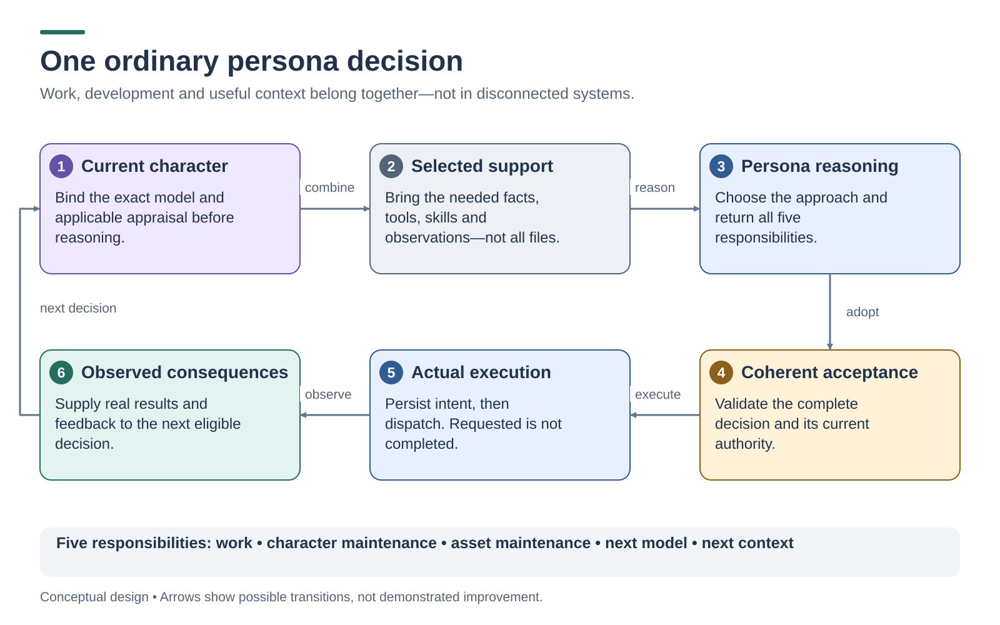

# Implementation responsibilities

[Home](../README.md) · [Design guide](../design/README.md) · [Contracts](CONTRACTS.md) · [Status](STATUS.md)

This is a design reference, not an installation tutorial or a code patch. It states what an implementation must make possible and observable. Application code, commands and branch-specific changes belong in the runtime repository.

*Read the arrows as possible, recorded transitions—not promises that a result will improve.*

A recorded intention is not an executed action. A successful transition is not proof of useful judgment. The host must make these distinctions inspectable while leaving substantive choices with the persona.

## Components and ownership

| Component | Required responsibility | Must not do |
|---|---|---|
| Identity and model store | Bind each persona to its exact active numerical package and history. | Substitute a peer’s character or reset identity on a new task. |
| Character evaluator | Apply the declared forward function, preserve unknown inputs and report actual numerical results. | Fit, optimize or silently adjust parameters. |
| Reasoning interface | Supply current character, required state and persona-selected support through a direct provider interface. | Make generic choices first and merely restyle them afterward. |
| Work and interaction store | Preserve needs, actual messages, acceptance, commitments, dependencies and outcomes. | Infer consent or assign professions. |
| Experience and development records | Make attributed experience, hypotheses, candidates and later consequences discoverable across the identity’s lifetime. | Write the lesson or label every event as improvement. |
| Resource and skill collection | Support exact retention, selective discovery, sharing, adaptation and qualified reuse. | Load the entire catalogue for model filtering. |
| Execution and recovery | Validate coherent decisions, persist effects, dispatch, observe and reconcile uncertainty. | Execute incomplete responses or automatically repeat uncertain outside effects. |
| Continuation scheduler | Offer fair opportunity under current accepted work, waits and controls. | Impose a task solution, forced edit cadence or hidden quality score. |
| User interface | Explain the real state and expose evidence and controls. | Equate activity, model versions or nice prose with maturity. |

These can share a process or database. Logical separation means responsibilities and records remain distinct; it does not require a distributed service for each row.

## Complete the chain, not isolated features

A model editor by itself does not fulfill continual development. The implementation must connect actual experience to a persona’s hypothesis, exact numerical changes, observed comparison, coherent activation, later supplied character and observed consequences. Missing any link limits the claim that can be made.

The required baseline retains simple lexical discovery, direct numerical edits and no compulsory training service. It supports task work and social activity through the same continuing identity. The [contracts](CONTRACTS.md) specify evidence-bearing handoffs; the [catalogue](REQUIREMENTS.md) preserves all implementation identifiers.

## Small work stays small

The implementation must admit a valid brief answer, no-change judgment, direct use of a known tool, or independent work without team creation. It must also support substantial tasks, ongoing services and useful development when the need warrants them. An example or optional worksheet is not a mandatory pipeline.

## Migration without invented development

An existing numerical persona keeps its active package, exact history and obligations. New development-index and numerical-fingerprint records can be derived only from retained facts and actual values; unknown historical influence remains unknown. Migration must not increment maturity counters or fabricate prior assessments.

A legacy fragment-based persona needs an explicitly attributed transition to a numerical character. Historical prompt material can be preserved as origin evidence or supporting history, not silently supplied as another operative character. Converting the representation establishes a new numerical starting state, not demonstrated lifetime benefit.

Old pending decisions retain their old schema, snapshot and authority. They are not reinterpreted under a new protocol to manufacture acceptance. In-flight effects retain their actual status. Stops, pauses, ownership gaps and warnings survive migration.

## Publication and deployment are different

This repository can be coherent before the implementation demonstrates every mechanism. It must therefore report design conformance, mechanism observations, useful behavior and deployment configuration separately. Read [status](STATUS.md) and [deployment decisions](DEPLOYMENT-DECISIONS.md); do not interpret a documentation commit as a successful live run.
