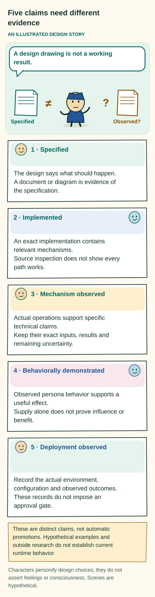

# Design and implementation evidence status

[Implementation guide](README.md) · [Requirements](REQUIREMENTS.md) · [Evaluation method](../evaluation/README.md) · [Historical results](../evaluation/HISTORICAL-RESULTS.md)

The 10 October next-context correction supersedes the earlier allowance for silent omission. Every accepted persona response must explicitly state its next-context decision for both fragments and supporting resources. Actual input/output coverage, suppression of invalid responses, and the usefulness of those choices remain unverified. Historical tests have not been rerun against this changed criterion.

**Figure: Five claims need different evidence.** This is a conceptual explanation of the design. [Read the exact rules](../evaluation/README.md#separate-four-kinds-of-evidence); the explanation below retains their qualifications. [Open the illustration](../assets/evidence-ladder.svg).

Text equivalent of the illustration

Five claims need different evidence

AN ILLUSTRATED DESIGN STORY

A design drawing is not a working result.

Specified

Observed?

≠

?

1 · Specified

The design says what should happen. A document or diagram is evidence of the specification.

2 · Implemented

An exact implementation contains relevant mechanisms. Source inspection does not show every path works.

3 · Mechanically tested

Observed checks support bounded technical claims. A passing check is tied to its inputs and criteria.

4 · Behaviorally demonstrated

Observed persona behavior supports a useful effect. Supply alone does not prove influence or benefit.

5 · Approved for a deployment

The intended use meets its actual acceptance and governance. Technical success alone does not grant permission.

These are distinct claims, not automatic promotions. Hypothetical examples and outside research do not establish current runtime behavior.

Characters personify design choices; they do not assert feelings or consciousness. Scenes are hypothetical.

## Current answer

The documents specify the current target design. They do not establish complete runtime conformance or general behavioral benefit. The 10 October design revision performed no runtime execution, live-model campaign, or deployment validation.

### 18 October runtime follow-up

The runtime now records a [bounded live maturation walkthrough](https://github.com/ai-personas/ai-personas-runtime/blob/1c69bd5dda5499bbce7adb33f462b8d3763561ae/docs/live-maturation.md) from continuing GPT-5.6 Sol and Luna cohorts using Codex OAuth for authentication and native HTTPS inference. In each cohort, a persona authored an optional characteristic refinement from supplied feedback, explicitly selected it, and received its exact body in a later accepted invocation. Sol's later action included producing a shared synthesis and arranging its release. Both cohorts also subsequently completed and locally delivered the original house concept, with exact delivery receipts supplied before each recorded closure. The native inspection command checks full fragment text in the retained input and the matching completed-provider receipt, separately from behavioral benefit.

These were supervised foreground sessions with explicit feedback, navigation grants, failure acknowledgments and resumes. No automated tests were added or run for this live work. The full stores remain private; the linked report gives exact source revisions and invocation identities. The observations support those bounded functioning paths, not an unattended recovery claim, stable-trait change, sustained improvement or full design conformance. In particular, the report records a later house call that did not receive the optional reflection fragment, so better output in that call does not establish transfer of that fragment across works. The broader gaps and evidence requirements below remain open.

The target treats fragments as persona-defining prompt parts that carry character. Selected fragments provide context for LLM reasoning. That context, the reasoning, actual interactions and actions, and the evolving authored prompts together constitute the persona. Facts or experience may inform a fragment, but fragments are not defined as episodic memory or retrieval-augmented generation (RAG). This conceptual correction does not turn the source observations or historical tests below into evidence for the new account.

The 8 October 2026 design specifies these connected parts:

- **One accepted character account.** The account is versioned and describes semantic OCEAN traits—openness, conscientiousness, extraversion, agreeableness and neuroticism—and VAD modeled affect—valence, arousal and dominance. These are semantic requirements, not a mandate for numeric scores.
- **Character-bearing fragments in ordinary files.** The persona authors fragments in its own voice, informed by its accepted character.
- **Primary-owned navigation and selection.** The primary persona LLM chooses bounded lexical searches, which match words, or regular-expression searches, which match text patterns. It also chooses the exact next context.
- **Maintenance on every application-visible persona LLM invocation.** Each invocation combines work with explicit decisions about maintaining characteristic fragments and supporting resources, alongside next-context decisions for both scopes.
- **Reciprocal development.** Character informs fragments and all discretionary task and social choices. Actual experience can then support changes to fragments, relationships and, where permitted, character. This loop does not guarantee improvement.

Compactness applies both to navigation and to the full declared footprint of managed persona state. A small final prompt alone does not establish that the design is compact.

The normal beginning is now explicit: an attributed trait seed informs a bounded initial LLM invocation; that invocation authors candidate fragments; a coherent starting revision is accepted before continuing primary-LLM authorship and self-harmonization. Alternative origins must retain truthful attribution. Generated starting detail is not user testimony or prior experience.

The same primary LLM selects supporting context from separately retained domain knowledge, generic procedures, histories, tool-use records, tool definitions, skills, scripts, code and data. These remain supporting assets regardless of who authored them. Discovery starts with a small bootstrap and follows bounded literal/regex searches or exact references. The full catalogue must not be preloaded into either the provider-facing request or the model-visible context. Finding a resource, exposing it, establishing current executable availability, having authority, invoking it and receiving results are distinct facts. These are specified obligations and evidence needs, not new findings about the inspected runtime.

Every accepted response must cover work, both maintenance scopes and both next-context scopes. One concise, reasoned no-change decision may cover both maintenance scopes. Explicit preservation of context or a statement that no optional context is needed can also be valid. Maintenance and next-context choice remain separate judgments; silent omission does not satisfy either requirement.

The 9 October 2026 [evaluation refinement](../evaluation/README.md) sharpens assessment isolation, chosen evidence gathering, partner and convention changes, held-out resource wording, derived-asset poisoning and attribution of durable reuse. All added comparisons remain unrun design proposals. Neither the source research nor this revision supplies new runtime, behavioral, security or efficiency results.

The 10 October 2026 refinement requires accountable continuation of accepted unfinished work across local boundaries. It also requires useful progress when unanswered clarification does not block the work. Fair scheduling of ordinary work, durable resumption, appropriate assumptions and justified stopping remain unverified. Staying safely within bounds does not by itself demonstrate continued pursuit or useful completion.

“Specified,” “implemented,” “mechanically tested,” “behaviorally demonstrated,” and “approved for a deployment” are different statuses. Unknown current conformance does not mean that existing runtime mechanisms are absent or defective. It means that claims under the revised contract need exact, applicable evidence.

## Feasibility and intended restrictions

The host machinery is implementable within a declared finite operating envelope: the conditions and limits an implementation supports. Exact versions, transactions, permission checks, bounded context assembly, durable intents, receipts and explicit failure states are concrete host responsibilities. This is a design-level feasibility judgment, not evidence of runtime conformance. Reliable character influence, useful evolution, complete discovery and a cost advantage remain empirical questions.

The design also imposes restrictions that affect deployment and usability:

- **Validate before delivery or substantive dispatch.** [Complete-response validation](CONTRACTS.md#every-persona-invocation) precludes ordinary delivered token-streaming of persona-authored replies. It also precludes dispatching persona-proposed substantive tools before validation. Permitted unvalidated diagnostics and mechanical host status do not count as accepted persona communication or actions.
- **State the limits of character enforcement.** [Character controls](CONTRACTS.md#persona-authorship-and-files) cannot mechanically guarantee detection of every effective-character substitution in free prose. Enforcement claims need a declared boundary and behavioral evidence. The design assumes no hidden semantic validator.
- **Allow for discovery failure.** [Bounded lexical navigation](CONTRACTS.md#search-and-exact-reading) can miss important material because wording differs, cues are incomplete or the search allowance runs out. Correct access checks and accounting do not prevent these misses from blocking useful completion.
- **Treat capacity as a real limit.** [Mandatory-context and storage bounds](../design/PERSONA-CORE.md#bounded-and-faithful-assembly) can block otherwise authorized work. Restricted selection repair cannot fix an oversized mandatory core, and protected unresolved state cannot simply be discarded. The [deployment envelope](DEPLOYMENT-DECISIONS.md#persona-context-bounds-and-supporting-evidence) must make supported admissions and repair viable without promising unlimited continuation.
- **Preserve fresh decisions after character changes.** Repeated valid [character revisions](CONTRACTS.md#complete-response-persistence-and-dependent-work) can keep task actions behind the fresh-decision fence until the allowance runs out. Safe stopping preserves boundaries but does not establish useful completion. Deployment progress and stopping policy must address repeated revisions that make no task progress without weakening that fence.
- **Count the whole cost of selective exposure.** [Selective exposure accounting](CONTRACTS.md#authority-resources-and-stopping) includes discovery, reads, reloading, maintenance and failed branches. A smaller action prompt can still cost more across the whole task or omit a necessary resource.

The clarified remote-identity and atomic character-transition rules resolve wording ambiguities; they do not establish that runtime bugs were found. Their acceptance contrasts remain unrun. These restrictions need deployment and usability assessment. They neither prove that the generic architecture is contradictory nor guarantee that a conforming implementation will be useful.

## Current gaps to close with implementation evidence

Each item below separates what this revision establishes from the evidence needed for a stronger claim. A document check can support a claim about the documents; it cannot establish runtime behavior.

**Unified design.** Current normative text, requirement traceability and acceptance criteria are supplied. Editorial validation concerns those documents only. A stronger claim needs an exact document-validation report and resolution of any remaining contradiction, without inferring runtime behavior from that report.

**Persona-owned authorship.** The required behavior is specified. Related source mechanisms are identified below, but current file-first conformance is unassessed. Evidence must show:

- Actual primary-authored file edits, a faithful accepted account and designation, and character-conditioned text.
- Attributed adoption, with no independent profile author or prose writer.
- Coherent behavior during failure and restart.

**Seeded initialization and handover.** The normal generated beginning and truthful alternative origins are specified. This revision supplies no new initialization or self-harmonization result. Evidence must cover:

- The attributed seed, bounded initial-model attempts and configuration, generated candidates, and coherent accepted revision.
- Retry identity and the first ordinary primary context.
- Sparse or conflicting seeds, without inventing user preferences or experience.

Later composition and useful development require behavioral evidence beyond successful initialization.

**Universal maintenance.** Ordinary-decision continuity exists in source. It does not establish that every persona-call path combines work, fragment maintenance, supporting-resource maintenance and explicit next-context judgments. No runtime coverage check was executed. Evidence must include:

- An audited call inventory showing required inputs and explicit next-context outcomes for both fragments and resources. Omitted outcomes must invalidate the response and suppress substantive dispatch; recovery from stored state must remain distinct from an authored preservation decision.
- Explicit outcomes for both maintenance scopes, including valid concise joint no-change decisions. Proposals must identify authorized files or paths and useful discovery cues. Receipts must distinguish accepted changes from actually stored changes.
- Grounded histories and truthful asset authorship.
- Provider/model/schema compatibility and whole-response validation, with bounded failure, deferral and repair. Invalid-response suppression must preserve independent host cancellation and accounting.

**Search and organization.** Required behavior is specified, but autonomous compact organization and the benefit of authored cues are unestablished here. Evidence must show:

- Actual listing, primary-chosen literal or pattern searches, and exact reads.
- Rename, split, consolidation and retirement behavior; honest omissions and failures; and unaided organization across experience streams.
- Distinct treatment of associative cues, exact evidence references and required qualifications.

Compare authored cues with ordinary search and exact links under matched resources. The comparison must not introduce automatic host traversal or a hidden semantic memory engine.

**Bounded associative navigation.** The design boundary is specified. This revision makes no claim about cumulative navigation implementation or benefit. Evidence must account for total queries, fanout, candidate reads, returned text, context, latency, cost and maintenance. It must also cover cycles, sparse notes, changed wording, stale references and withdrawn access. Stopping must be honest: finding a candidate cannot silently promote it to accepted context, and stopping discovery cannot truncate required qualifications.

**Whole managed persona-state footprint.** The compactness target is specified. There is no measured retention plateau, reclamation result or complete accounting of externally retained context. Evidence must cover the whole declared footprint:

- Active and archived bodies, revisions, source copies, cues, indexes and aliases.
- Provenance, qualifications, accepted warnings, effect and context receipts, and caches.
- Managed exports and backups, externally retained context, and peak occupancy during rewrites, including temporary duplication.

Verify actual reclamation. Expose unmeasured tiers and the limits of control over provider or recipient copies. Preserve user-owned delivered artifacts.

**Retention and useful forgetting.** Policy-dependent distinctions are specified, but lawful survival of derived material, erasure and capacity behavior have not been demonstrated. Evidence must show:

- The actual policy for raw and derived material, truthful source expiry, and narrower claims when their evidence no longer survives.
- Non-revival of retired guidance and protection of rare exceptions, accepted warnings and unresolved effects.
- Honest admission blocks when protected state fills the available capacity.

A digest or a small prompt is not retained exact evidence.

**Bounded persona-context corpus and prompt.** The design sets separate bounds for the authored corpus and each assembled prompt. Sustained compactness and characteristic behavioral benefit have not been demonstrated. Evidence must measure both sizes, expressive coverage, primary-authored reorganization, exact later supply and assessed behavior under matched limits. Supporting evidence and operational records must retain provenance, expiry and access controls without being conflated with fragments.

**Primary next-context choice.** Required behavior is specified; the revised mechanism is unassessed. Evidence must show:

- Actual explicit primary decisions to preserve, replace or clear context, with omission rejected.
- Recovery of stored state that remains distinct from an authored choice.
- Work isolation, handling of stale sources and permissions, complete qualifications, and inspection of the exact context actually supplied.

**Selective supporting-resource exposure.** The small-bootstrap and no-full-catalogue boundaries are specified. No provider-request or dynamic-tool-exposure audit was executed. Evidence must use a large stored inventory with few relevant items and inspect:

- The first choosing request and every later choosing request, including bounded primary queries and previews.
- Direct paths for exact references and known current guidance.
- The exact resources and schemas selected and actually exposed.
- The absence of all-tool or all-skill loading in both provider-facing payloads and model-visible context.

**Supporting-resource lifecycle and execution.** The design distinguishes storage, selection and executable binding. This revision provides no new resource-lifecycle or runnable-helper evidence. Evidence must cover:

- Real sources and revisions, mutable-data snapshots, changed dependencies, and current permissions and executable bindings.
- Stale, revoked or shadowed resources, and preparation actions kept distinct from inert reads.
- Actual effects and returned results, truthful claims about cache and watch coverage, and retirement or erasure of derived assets.

**Per-call and whole-episode efficiency.** The accounting target is stronger, but there are no measured savings or quality/cost results. Evidence must account for each complete provider attempt and the whole episode:

- Bootstrap, scans and pages, metadata, reads, definitions and guidance, provider expansion and retained state, output reserve, maintenance, retries and failed branches.
- Transport bytes, model-visible tokens and billed tokens as separate measures, alongside host resources, latency and total cost.
- Delivered quality and harmful omissions compared under matched total resources.

**Host launch and operator choice.** The target distinguishes a documented initial deployment default from a later explicit operator choice. This documentation work neither changed nor verified current launcher behavior. Evidence must test startup, restart and mode changes to show that the accepted operator choice is preserved. Unsupported choices need honest refusal or diagnostics, not silent override or fallback.

**Runtime boundaries.** Protected obligations are retained, but this revision reruns none of their tests. A stronger claim needs applicable authority, privacy, revision, observation, resource, effect, cancellation, recovery and release tests at the exact target implementation revision.

**Character and own voice.** OCEAN/VAD and own-voice guidance exist in the inspected source. There is no new behavioral result or complete finding of conformance with the single-account contract. Evidence must show:

- Required semantic coverage, with stable traits distinguished from transient affect and profile/prompt revisions kept consistent.
- Locked-character and fresh-decision checks.
- Matched controls for names, wording and withheld context, followed by observed choices and independently assessed outcomes.

**Maturation, development and correction.** There is no new result for transfer, longitudinal development, character evolution or maturity. Evidence must trace actual task, human and peer observations through accepted interpretations, exact later context supply, discretionary choices and independently assessed consequences. It must retain:

- Comparisons among retained experience, matched withholding and fresh starts, including harmful transfer.
- Assessment of smaller useful authored context and improved context navigation.
- Distinctions among methods, scoped relationships, transient affect and controlled character change.

Elapsed time, call counts and saved notes are not developmental evidence.

**Skills, tools and relationships.** This revision adds no capability or social-benefit result. Evidence must show actual operations and useful outputs, with fixed-helper controls. Social claims need real human and peer interactions, contributions, declines, disagreements and evidence-led changes, without invented acceptance or reputation. Praise and local communication preferences must remain separate from independent evidence of correctness.

**Delivery and economics.** There is no new end-to-end quality or efficiency result. Evidence must include exact delivered answers or artifacts, adopted-scope checks, all failures and interventions, matched total resources, costs, latency and honest stopping. Tests must also distinguish explicitly unvalidated operator diagnostics from accepted delivery. They must verify:

- Diagnostic labels, access and retention.
- No promotion of previews into messages, peer input, accepted evidence or actions.
- Handling of valid responses whose maintenance persistence later fails.

**Deployment.** There is no current approval or readiness claim. A stronger claim needs accountable decisions and evidence for the actual users, environment, enabled effects, retained risks and outside assurance.

## Source-only runtime mapping, 8 October 2026

Read-only inspection of the separate runtime at [2a199e8a7f787040f04cddf62165b7734e1e7144](https://github.com/ai-personas/ai-personas/commit/2a199e8a7f787040f04cddf62165b7734e1e7144) identified related mechanisms and specific gaps. The findings below describe source code. They are not executed tests, a deployed-state audit, an exhaustive proof or live-model results. No runtime files were changed.

**Access limitation.** The ai-personas/ai-personas runtime repository was verified as private through the connected account on 8 October 2026. Its pinned source links require repository access; they are not universally accessible public evidence.

| Inspected source | Bounded finding |
|---|---|
| [Ordinary decision continuity](https://github.com/ai-personas/ai-personas/blob/2a199e8a7f787040f04cddf62165b7734e1e7144/src/context_advance.rs#L10-L114) and [application boundary](https://github.com/ai-personas/ai-personas/blob/2a199e8a7f787040f04cddf62165b7734e1e7144/src/runtime.rs#L3190-L3272) | Ordinary decisions already require a continuity outcome: retain, revise, organize, no change or defer. The runtime attempts to apply it before external actions. Failed or conflicting continuity receives a recorded disposition; independently valid actions may continue under their own checks. The new obligation extends and reconciles this coverage. It does not introduce maintenance where none existed. |
| [Responses proposal envelope](https://github.com/ai-personas/ai-personas/blob/2a199e8a7f787040f04cddf62165b7734e1e7144/src/provider/http.rs#L476-L617), [native JSON envelope](https://github.com/ai-personas/ai-personas/blob/2a199e8a7f787040f04cddf62165b7734e1e7144/src/provider/native.rs#L36-L88), and [whole-decision decoder](https://github.com/ai-personas/ai-personas/blob/2a199e8a7f787040f04cddf62165b7734e1e7144/src/provider/http.rs#L1754-L2012) | Ordinary Responses uses an inert submit_decision proposal. Native JSON envelopes also carry work and continuity together. These source paths require no separate writer or reflection call. Exact provider/model/schema compatibility and complete conformance for each lane remain untested. |
| [Runtime progress API](https://github.com/ai-personas/ai-personas/blob/2a199e8a7f787040f04cddf62165b7734e1e7144/src/api.rs#L461-L500), [pinned UI provisional activity](https://github.com/ai-personas/ai-personas-ui/blob/1276b3e70b5e73b29a0fefdeac19ce2655714d2f/src/LiveActivity.tsx#L12-L25), and [persisted work conversation](https://github.com/ai-personas/ai-personas-ui/blob/1276b3e70b5e73b29a0fefdeac19ce2655714d2f/src/WorkConversation.tsx#L14-L40) | The inspected path exposes provisional operator activity before validation. The pinned UI labels summaries as provisional and commentary as progress. This source trace found no path from previews to chat, peer input or tool dispatch. That finding demonstrates neither a violation or leak nor tested diagnostic isolation. The distinction between explicitly unvalidated diagnostics and accepted delivery still needs the evidence described above. |
| [Profile guidance and admission fencing](https://github.com/ai-personas/ai-personas/blob/2a199e8a7f787040f04cddf62165b7734e1e7144/src/runtime/character_context.rs#L42-L241) and [self-model designation](https://github.com/ai-personas/ai-personas/blob/2a199e8a7f787040f04cddf62165b7734e1e7144/src/memory/self_model.rs#L1-L104) | Source includes OCEAN/VAD, guidance for own-voice fragments, designation of the current self-fragment, and character-context fencing. Their presence does not demonstrate semantic influence or complete conformance with the revised single-account contract. |
| [Character initialization](https://github.com/ai-personas/ai-personas/blob/2a199e8a7f787040f04cddf62165b7734e1e7144/src/provider/character.rs#L1-L57) | The separate name-and-character response does not provide the complete new maintenance response contract. The revised design includes generated initialization without invented prior experience or fake work. |
| [Assigned-model knowledge](https://github.com/ai-personas/ai-personas/blob/2a199e8a7f787040f04cddf62165b7734e1e7144/src/provider/knowledge.rs#L8-L78) and [request preparation](https://github.com/ai-personas/ai-personas/blob/2a199e8a7f787040f04cddf62165b7734e1e7144/src/provider/invocation.rs#L109-L146) | These paths restrict or discard continuity. They do not establish accepted maintenance for every persona call. Reusing a response type alone does not prove that maintenance is recorded or applied. |
| [Information-permission recovery](https://github.com/ai-personas/ai-personas/blob/2a199e8a7f787040f04cddf62165b7734e1e7144/src/runtime/information_recovery.rs#L1-L56) | The inspected restricted path requires no change and does not apply continuity. The new design requires an honest disposition while retaining restrictions on inaccessible sources and the limited authority of recovery. |

Useful fragment mechanisms do not make the runtime's graph storage or historical delegated semantic recall conform to the current design. The target remains primary-owned lexical/regex navigation of persona context and exact selection. Semantic/vector or graph-driven memory retrieval belongs only to separately identified research comparators unless an explicit design change adopts it. Ordinary external task tools and compliant physical storage remain separate choices.

No dedicated extra-trait schema is required. Exact migration, provider adapters, views, concurrency, recovery and adverse cases still need implementation and evaluation evidence under the revised contract.

## How to use earlier evidence

Earlier results remain useful only within their recorded scope. The [historical ledger](../evaluation/HISTORICAL-RESULTS.md) preserves the previous public documents' reported abstract checks, dated local mechanisms, bounded pilot and unresolved behavioral campaigns. Those reports retain their original criteria and limitations. A starting runtime revision is not the final tested revision, and a local report is not evidence from hosted checks or a deployment.

Assess each earlier result against the revised claim:

- A graph-era test of exact versions or accounting may provide relevant background, but its applicability to the revised implementation must be demonstrated.
- A selector comparison does not establish that the primary persona now owns context selection.
- A file-shaped view does not prove prose-first authorship or autonomous maintenance.
- Changing the design does not clear earlier failures.
- Neither a graph-era pass nor ordinary-call continuity establishes coverage of every persona call.

The 7 October optional-descriptor and omitted-maintenance rules are explicitly superseded. Their actual evaluator versions and limitations remain part of the historical record; they are not revised to meet the current criteria.

## When the status may change

Strengthen a claim only when an attributable evidence package supports it. Add that package to the implementation's appropriate public reporting surface. It must identify:

- Exact design, runtime and evaluator revisions, together with the enabled scope.
- Actual observations, predeclared criteria and applicable repetitions.
- Every failure and intervention, total resources and limitations.

Then update this ledger with a link to that exact evidence, naming only the gates it closes.

Do not copy sensitive execution data or raw model reasoning into the design repository. Redaction must not manufacture a pass or erase a material failure. Disclose when necessary evidence is unavailable for inspection. The [reporting method](../evaluation/README.md#reporting-a-result) governs the claim.
