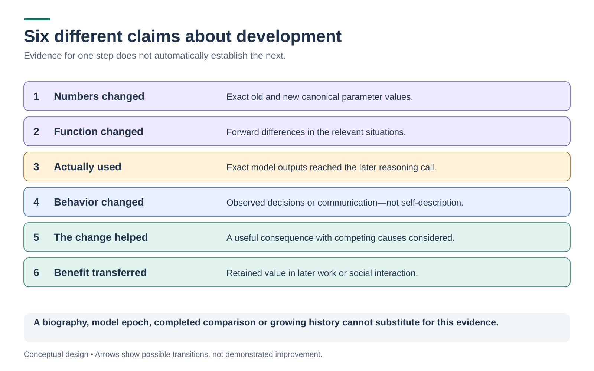

# Status: design, mechanisms and demonstrated behavior

[Home](../README.md) · [Runtime audit](../sources/RUNTIME-AUDIT.md) · [Historical results](../evaluation/HISTORICAL-RESULTS.md)

**Documentation revision: 17 November 2026.** This publication revises the design and illustrations. It does not change runtime code, provider weights or live persona state and does not report a new live maturation result.

*Read the arrows as possible, recorded transitions—not promises that a result will improve.*

Reading code can establish that an operation is implemented in the inspected path. A reported run can establish what its retained evidence supports. Neither automatically establishes self-directed, useful, lifelong development.

## Exact inspected sources

| Source | Pinned revision | Meaning |
|---|---|---|
| Previous design | `60fc268eea909ea2cfc4e91cf180c0020bde6ef1` | The pre-reconciliation fragment-based requirements and documents. |
| Runtime main | `5871c654495f07698984ed45f9c0f121ffc9b083` | The main-branch revision returned at inspection; not the editable-network feature implementation. |
| Editable runtime feature | `1aabb15c56b8a1f3c0403bdb28feeedb57c5bd7e` | The inspected `feat/editable-persona-models` source and report snapshot. |

Branch names can move. These identifiers define the observations below, not every installation bearing the project name. The current user’s binary and private database were not inspected for this documentation publication.

## What the feature source contains

The inspected model and operation paths contain owner-bound packages, literal parameter patches with expected values, forward evaluation, inactive candidates, comparative provider assessments, separate activation and ancestor rollback. Activation invalidates old character evaluations across the persona’s participations. These source findings are documented with exact file references in the [audit](../sources/RUNTIME-AUDIT.md).

The characteristic network conditions a general reasoning model. Its parameter edits do not modify the provider language model’s weights. The runtime’s direct-edit architecture explicitly supersedes the earlier fine-tuning recipe.

## What the repository reports

The [initial validation report](https://github.com/ai-personas/ai-personas-runtime/blob/1aabb15c56b8a1f3c0403bdb28feeedb57c5bd7e/docs/live-validation-2026-11-09.md) reports 143 accepted main-task decisions with no post-initialization parameter edits or comparative assessments. A separate explicitly instructed exercise demonstrated one bias edit, comparative calls, activation and rollback. That establishes reported editing mechanics, not organic maturation.

The [manufacturing report](https://github.com/ai-personas/ai-personas-runtime/blob/1aabb15c56b8a1f3c0403bdb28feeedb57c5bd7e/docs/manufacturing-validation-2026-11-09.md), at its frozen 10 November 2026 11:39:35 UTC observation, reports all five main-run models still at epoch 1 without organic parameter updates. It also retains incomplete task outcomes and limitations. These are repository-authored reports; the underlying private databases and build/run evidence were not independently reproduced here.

## What this revision specifies but does not demonstrate

| Target | Current evidence status |
|---|---|
| Lifetime experience discovery linked to character decisions | Required design; not newly executed here. |
| Durable persona-owned development hypotheses and revisits | Required design; not newly executed here. |
| Numerical-change identity separate from package metadata | Required integrity distinction; no new runtime implementation claimed. |
| Fresh, attributable character use in later decisions | Required contract; supply and causal influence still need distinct evidence. |
| Self-directed edits that help later work and communication | Not established by the cited main-run reports. |
| Retained benefit, transfer and regression handling | Required evidence; not claimed proven by this publication. |
| Lower whole-task cost or universal superiority | Not established. |

## How to investigate an apparently static persona

First establish the actual build, runtime mode, state store, persona identity, active model and activation history. Then distinguish no proposal; a candidate not assessed; assessed but not adopted; metadata-only change; numerical change without relevant forward effect; forward effect without behavior change; and behavior change without useful consequence.

An unchanged all-unknown chart does not rule out a conditional numerical revision. Conversely, a new package hash does not prove that any number changed. The interface should expose these distinctions instead of a single “learning” counter.

## Publication review scope

The current revision is intended to reconcile all 46 active human requirements, the eight retired IDs, 21 invariants and 45 implementation responsibilities across the active reading paths. Documentation checks concern links, identifiers, diagram consistency and rendered artwork. They are not runtime tests or evidence of autonomous behavior. The exact publication review and preserved predecessors are recorded in [the changelog](../CHANGELOG.md) and [source manifest](../sources/SOURCE-MANIFEST.md).
