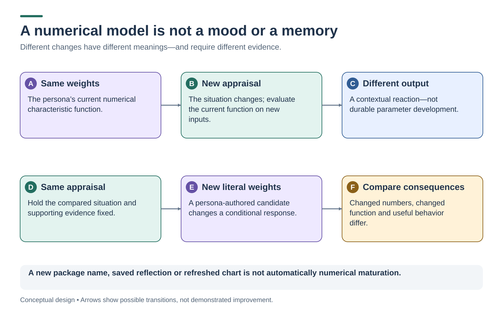

# Runtime audit: editing exists; useful maturation remains unproved

[Sources](README.md) · [Status](../implementation/STATUS.md) · [Continual development](../design/CONTINUAL-DEVELOPMENT.md)

**Inspected source baseline:** `ai-personas/ai-personas-runtime`, `feat/editable-persona-models`, commit `1aabb15c56b8a1f3c0403bdb28feeedb57c5bd7e`. The returned main revision was `5871c654495f07698984ed45f9c0f121ffc9b083`.

*Read the arrows as possible, recorded transitions—not promises that a result will improve.*

Changing the appraisal recomputes the same model. Patching and adopting a candidate changes numerical character. Neither mechanism alone establishes improvement in actual behavior.

## Inspected mechanisms and limits

| Source | What the inspected mechanism establishes | What still needs evidence or design completion |
|---|---|---|
| [Editable-model description](https://github.com/ai-personas/ai-personas-runtime/blob/1aabb15c56b8a1f3c0403bdb28feeedb57c5bd7e/docs/editable-persona-models.md) | The chosen architecture is a separate small character network conditioning a general reasoning model; direct edits replace the older training recipe. | The combined architecture’s useful developmental behavior. |
| [Numerical model](https://github.com/ai-personas/ai-personas-runtime/blob/1aabb15c56b8a1f3c0403bdb28feeedb57c5bd7e/src/persona_model.rs) | Literal sparse parameters, eighteen value/known input pairs, twelve outputs, forward arithmetic, exact-base patches and package fingerprints. | A package fingerprint includes metadata; numerical identity and meaningful functional change need separate accounting. |
| [Decision protocol](https://github.com/ai-personas/ai-personas-runtime/blob/1aabb15c56b8a1f3c0403bdb28feeedb57c5bd7e/src/neural/protocol.rs) | Work, maintenance, model choice, context and continuation are explicit in the ordinary decision. | Maintenance disposition alone does not establish numerical change or later benefit. |
| [Operations and activation](https://github.com/ai-personas/ai-personas-runtime/blob/1aabb15c56b8a1f3c0403bdb28feeedb57c5bd7e/src/neural/operations.rs) | Candidate creation, comparison prerequisites, operation-free activation, ancestor rollback and cross-task cached-evaluation invalidation. | A completed assessment is not automatically a favorable judgment, and a valid edit is not proof of improvement. |
| [Context assembly](https://github.com/ai-personas/ai-personas-runtime/blob/1aabb15c56b8a1f3c0403bdb28feeedb57c5bd7e/src/neural/context.rs) | Baseline and retained contextual inclinations enter provider context with provenance. | Reused appraisals need current applicability, and supply does not establish behavioral influence. |
| [Assessment runner](https://github.com/ai-personas/ai-personas-runtime/blob/1aabb15c56b8a1f3c0403bdb28feeedb57c5bd7e/src/neural/runner.rs) | Paired tool-free provider responses compare current and candidate inclinations under matching hypothetical inputs. | Concrete later work, persistence, regression and transfer remain separate evidence. |
| [Discovery and tool contracts](https://github.com/ai-personas/ai-personas-runtime/blob/1aabb15c56b8a1f3c0403bdb28feeedb57c5bd7e/src/neural/tools.rs) | Discoverable typed interfaces support model and supporting-resource activity. | Identity-level experience and durable development continuity need an explicit connected design. |

The current history-search path is scoped to the current work, while shared supporting assets have a separate search path. The new design adds deliberately chosen lifetime scope without automatic archive replay. The documentation also describes old contextual appraisals persisting across many decisions; adding provenance helps inspection but does not itself refresh them.

## Repository-reported runs

The [initial validation report](https://github.com/ai-personas/ai-personas-runtime/blob/1aabb15c56b8a1f3c0403bdb28feeedb57c5bd7e/docs/live-validation-2026-11-09.md) reports 143 accepted decisions in its main task without post-initialization weight edits or comparative assessments. A separate exercise explicitly instructed a persona to make a detail-bias edit, compare, activate and roll back. The report correctly separates these mechanics from organic learning and useful long-term personality.

The [later manufacturing report](https://github.com/ai-personas/ai-personas-runtime/blob/1aabb15c56b8a1f3c0403bdb28feeedb57c5bd7e/docs/manufacturing-validation-2026-11-09.md), at the frozen 10 November 11:39:35 UTC observation, reports all five main-run models at epoch 1 with no organic parameter updates. It retains incomplete engineering outcomes and limits on autonomy and efficiency.

These reports support the narrower finding that editing is implemented and exercised in reported paths while useful self-directed maturation is not established in the cited main runs. They do not prove that numerical character can never help, or that every currently running installation has the same state.

## Design consequences, not claims of completed fixes

The revision specifies identity-level experience discovery, persona-owned hypotheses and revisit conditions, numerical fingerprints distinct from package metadata, actual character-use receipts, explicit appraisal applicability, and later consequence tracking. It preserves direct persona-authored edits and the existing ownership/activation foundations.

These additions address the missing connections. They do not guarantee that a reasoning model will propose a useful edit, use numerical outputs reliably or generalize correctly. The design must expose null effects and regressions rather than convert more records into a claim of maturity.

## Inspection boundary

The relevant model, protocol, operation, context and assessment paths and the reports’ stated checkpoints were reviewed. The large manufacturing report was not independently reproduced in full. The user’s live database, binary and provider sessions were not accessed. No source change, compilation, model trial, migration or new maturation result is claimed by this audit.
