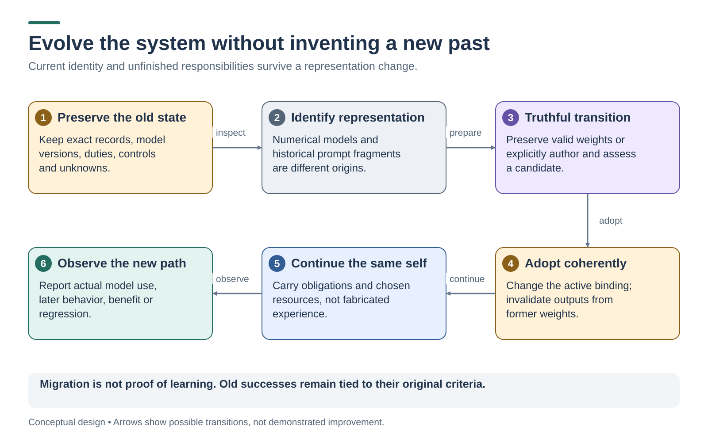

# Source lineage and consolidation map

[Sources](README.md) · [Decisions](../DESIGN-DECISIONS.md) · [Historical results](../evaluation/HISTORICAL-RESULTS.md)

**Consolidation date: 17 November 2026.** Later human clarification governs the current design. This manifest preserves exact predecessors and distinguishes source material from a rewritten explanation.

*Read the arrows as possible, recorded transitions—not promises that a result will improve.*

The transition is explicit: prompt-defined character and the earlier assistant fine-tuning proposal are historical. Owned numerical character with direct persona-authored revision is the current target. Supporting resources, identity, responsibility and truthful evidence remain continuous.

## Immediate predecessor

The complete previous design is pinned at **`60fc268eea909ea2cfc4e91cf180c0020bde6ef1`**. Its [tree](https://github.com/ai-personas/ai-personas-design/tree/60fc268eea909ea2cfc4e91cf180c0020bde6ef1), [user requirements](https://github.com/ai-personas/ai-personas-design/blob/60fc268eea909ea2cfc4e91cf180c0020bde6ef1/USER-REQUIREMENTS.md), [decision history](https://github.com/ai-personas/ai-personas-design/blob/60fc268eea909ea2cfc4e91cf180c0020bde6ef1/DESIGN-DECISIONS.md), [changelog](https://github.com/ai-personas/ai-personas-design/blob/60fc268eea909ea2cfc4e91cf180c0020bde6ef1/CHANGELOG.md), [source manifest](https://github.com/ai-personas/ai-personas-design/blob/60fc268eea909ea2cfc4e91cf180c0020bde6ef1/sources/SOURCE-MANIFEST.md), [research note](https://github.com/ai-personas/ai-personas-design/blob/60fc268eea909ea2cfc4e91cf180c0020bde6ef1/sources/PERSONA-FILES-RESEARCH.md), [historical results](https://github.com/ai-personas/ai-personas-design/blob/60fc268eea909ea2cfc4e91cf180c0020bde6ef1/evaluation/HISTORICAL-RESULTS.md) and [artwork](https://github.com/ai-personas/ai-personas-design/tree/60fc268eea909ea2cfc4e91cf180c0020bde6ef1/assets) preserve that stage exactly.

The earlier 7 October consolidation remains at **`202dd753dd1816dc9a6121f267a0d4fe7d060fad`**. The full pre-consolidation archive remains at **`f4549bd594e6a0cf5205ac031ed422ab269def8d`**. Their documents and criteria are historical, not alternate active specifications. The predecessor manifest retains the detailed retired-path and original integrity mappings.

## Original supplied-source lineage

The original repository copies are pinned at **`0c96694303e344ef976150a4d544f3ca57f77d33`**. Their recorded attachment origins are preserved below. This revision did not verify the original upload bytes against these copies.

| Recorded attachment | Exact repository copy |
|---|---|
| deep-research-report(2).md | [S1 research](https://github.com/ai-personas/ai-personas-design/blob/0c96694303e344ef976150a4d544f3ca57f77d33/sources/S1-prior-research-report.md) |
| AI-PERSONAS-EMERGENT-DESIGN(1)(2).md | [S2 emergence](https://github.com/ai-personas/ai-personas-design/blob/0c96694303e344ef976150a4d544f3ca57f77d33/sources/S2-emergent-design.md) |
| AI-PERSONAS-RUST-FINAL-SPEC(1)(2).md | [S3 v1.1](https://github.com/ai-personas/ai-personas-design/blob/0c96694303e344ef976150a4d544f3ca57f77d33/sources/S3-specification-v1.1.md) |
| AI-PERSONAS-RUST-SPEC-v1.2(1)(2).md | [S4 v1.2](https://github.com/ai-personas/ai-personas-design/blob/0c96694303e344ef976150a4d544f3ca57f77d33/sources/S4-specification-v1.2.md) |
| STRESS-TEST-REPORT(1)(2).md | [S5 stress report](https://github.com/ai-personas/ai-personas-design/blob/0c96694303e344ef976150a4d544f3ca57f77d33/sources/S5-stress-test-report.md) |

The [original manifest](https://github.com/ai-personas/ai-personas-design/blob/0c96694303e344ef976150a4d544f3ca57f77d33/sources/SOURCE-MANIFEST.md) owns its byte-integrity claims. They do not apply to current chapters or new diagrams.

## Conversation clarifications integrated here

The human clarified that each persona owns its own characteristic model, chooses a changing subset of collaborators, and must develop through work and social experience. Directly edited numerical parameters must influence later work and interaction; one-time initialization is insufficient. The current request asks for the requirements and design to be reconciled, made understandable, illustrated throughout and published in this repository.

The assistant’s earlier training-service proposal is not an independent human requirement. The current runtime documentation explicitly records its replacement by literal numerical edits. The prior conversation design attachment **AI_Personas_Continual_Maturation_Design.md**, revision 1.0, was available as synthesis material. Its proposed mechanisms are incorporated as design decisions and refined for this code-free repository; they are not mislabeled human instructions or runtime results.

The private linked conversation was not retrieved as an independent source. Relevant visible human statements are paraphrased here; raw private transcripts and session-only links are not published.

## Runtime source and reported observations

The current inspection is pinned to editable-runtime commit **`1aabb15c56b8a1f3c0403bdb28feeedb57c5bd7e`**, with main at **`5871c654495f07698984ed45f9c0f121ffc9b083`** in the returned branch listing. The [audit](RUNTIME-AUDIT.md) links the exact relevant files and reports. A branch name alone is not an immutable source.

Source review and report reading did not reproduce private runtime databases, compile a new runtime, modify provider weights or inspect the user’s running binary. Reported observations retain those limits.

## Current document homes and historical preservation

Identity and character now live in persona core; numerical development in continual development; supporting files and skills in context and skills; voluntary cooperation in collaboration; useful work and effects in work and boundaries; exact handoffs in contracts. The requirement and acceptance catalogues retain their identifiers with changed meanings recorded in the reconciliation and historical ledger.

The earlier bulky explanations, evaluation history and diagrams remain accessible through exact Git revisions instead of a second contradictory active tree. Current illustrations are explanatory vector artwork, not screenshots, psychological validation or observed traces. Their presentation review establishes readability only.

This publication does not choose licensing terms, add application code, publish private execution data or claim any new model trial. New source summaries never inherit old integrity or behavioral claims merely by retaining a filename.
