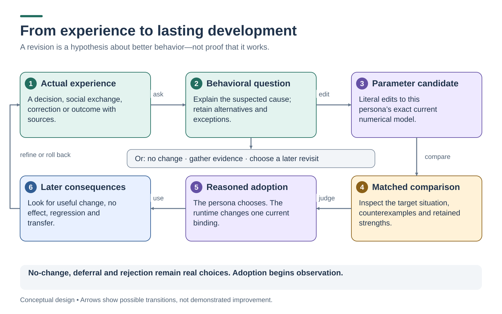

# Optional worksheets for clear decisions

[Design guide](../design/README.md) · [Examples](../examples/WORKED-EXAMPLES.md) · [Contracts](../implementation/CONTRACTS.md)

These are reading and review aids, not mandatory forms, code schemas or an installed workflow. A concise ordinary decision can cover the relevant meaning without filling every table.

*Read the arrows as possible, recorded transitions—not promises that a result will improve.*

The worksheet supports reasoning; it does not write the lesson for the persona. A populated table is not evidence that its proposed actions were executed or that the persona improved.

## Understand the need

| Question | What to preserve |
|---|---|
| What was actually requested? | Exact need, real requester and accepted amendments. |
| What would make the result usable? | Outcomes, artifacts, integration and actual completion criteria. |
| What is still unknown? | Assumptions, indispensable facts and work that can proceed independently. |
| Who accepted follow-through? | Actual commitments or visible ownership gaps. |
| What is the next useful action? | A persona-chosen purpose, dependency or honest stopping disposition. |

## Examine a developmental opportunity

| Question | What to preserve |
|---|---|
| What actually happened? | Exact experience and subsequent outcome references. |
| What behavior might matter? | A conditional hypothesis, not a generic personality adjective. |
| What else could explain it? | Missing knowledge, tools, runtime faults, appraisal, assistance and uncertainty. |
| What should stay valuable? | Strengths, contexts and relationships that should not be damaged. |
| What is proposed? | Literal coordinate changes against exact current values, or reasoned no-change. |
| What was compared? | Actual current/candidate forward and behavioral observations under stated conditions. |
| What was adopted? | Exact package and current authority; no invented activation. |
| What happened later? | Actual use, behavior, consequences, counterevidence and retained or missed benefit. |
| When is it revisited? | A concrete chosen condition or an explicit closure. |

## Share a skill

Record purpose, intended location, source, exact version, dependencies, discovery cues, observations of use and limitations. A recipient records its chosen reuse or adaptation and the actual effect. Keep the resource separate from both personas’ numerical character.

## Deliver or stop honestly

Identify the coherent artifact versions, supported use, checks actually performed, assumptions, outstanding findings and remaining outcomes. Distinguish partial delivery, sufficient current work, user acceptance and outside validation. Record accepted continuation or an ownership gap; do not invent a handoff.

## Inspect a maturity claim

Ask whether the evidence distinguishes changed parameters, changed function, actual supply, changed behavior, useful consequence and later transfer. Ask whether better memory, stronger tools, changed provider or external coaching could explain the result. “Not yet known” is a valid evidence status.
